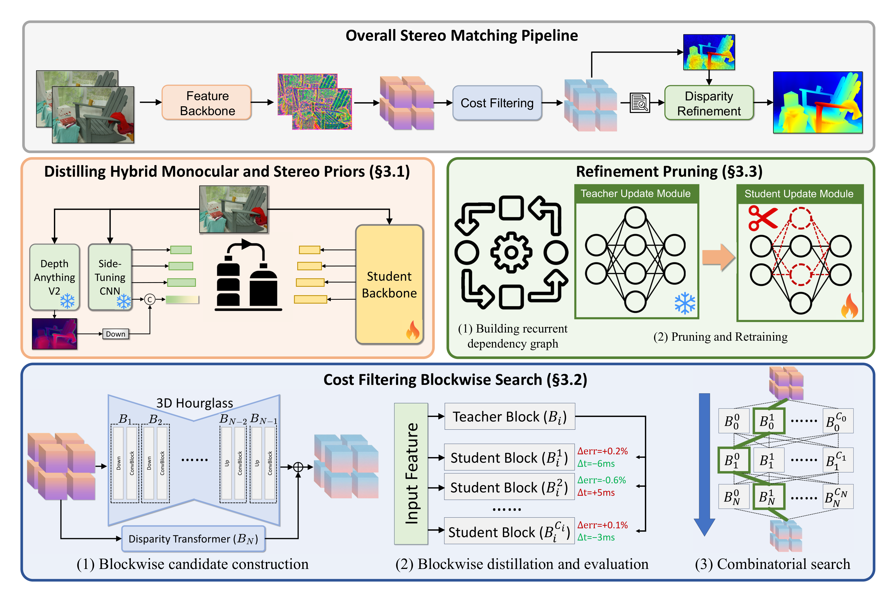

# 双目匹配与 Cost Volume：把深度先变成对应点问题

很多人第一次读 stereo matching，容易把它和 monocular depth 混在一起：都是输入图像，输出一张深度图。真正决定两者差异的不是网络名字，而是问题假设。单目深度主要在一张图里利用纹理、透视和语义线索推断距离；双目深度先有一对同步、标定、校正过的左右图，再利用同一个 3D 点在两张图里的横向位移来三角测量。

所以这篇文章不把双目匹配写成一串术语，而是沿着一条工程链走一遍：

```text
rectified left/right images
  -> disparity candidates
  -> cost volume
  -> cost filtering / regularization
  -> disparity refinement
  -> depth / robot perception
```

这条链读清楚后，再看 GC-Net、PSMNet、RAFT-Stereo、FoundationStereo 或 Fast-FoundationStereo，就不容易被结构图里的模块名绕晕。

## 先把深度改写成“左右图谁对应谁”

双目相机里，两台相机从略微不同的位置看同一个 3D 点。这个点投影到左图一个像素，也投影到右图一个像素。只要相机已经标定并完成 rectification，对应点会落在同一条水平扫描线上。原本“右图哪里像这个点”的二维搜索，就变成同一行上的一维搜索：

```text
left pixel:        (u, v)
right candidates:  (u - d, v), d = 0 ... D
```

这里 \((u,v)\) 是左图像素坐标，\(d\) 是候选 disparity，\(D\) 是最大搜索范围。OpenCV 的 depth map 教程也是这个口径：先找左右图的对应点，再用 disparity 推回深度。LearnOpenCV 的 epipolar geometry 文章则更适合补直觉：rectification 的价值，就是把对应点约束到更容易搜索的位置。

{ width="640" }

<small>图源：[Wikimedia Commons: Stereo-camera-model.jpg](https://commons.wikimedia.org/wiki/File:Stereo-camera-model.jpg)。本站用这张图解释 baseline、focal length、左右投影点和深度之间的几何关系；没有用 image2 或其他生成式工具重画。</small>

在最常见的平行双目近似下，深度公式可以写成：

\[
z=\frac{fB}{d}
\]

这里 \(z\) 表示深度，\(f\) 表示焦距，\(B\) 表示左右相机 baseline，\(d=x_L-x_R\) 表示 disparity。这个式子有两个工程后果。

第一，近处物体的 disparity 大，远处物体的 disparity 小。第二，远处的 \(d\) 本来就小，1 个像素的误差会被放大成很大的深度误差。机器人、AR 和自动驾驶系统里，双目不是“多一张图就自动更准”，它还要求标定、同步、曝光、畸变校正和亚像素估计都比较稳。

## Cost Volume：先保留候选证据，不要急着选答案

如果只给一个左图像素和一行右图候选，模型不能只凭一个局部 patch 就立刻拍板。弱纹理墙面、重复地砖、玻璃反光、遮挡边界都会制造多个看起来都合理的候选。Cost volume 的作用，就是把“每个像素在每个候选 disparity 下的匹配证据”先存成一张表。

先对左右图提取特征：

\[
F_L,F_R\in\mathbb{R}^{C\times H\times W}
\]

这里 \(F_L\) 和 \(F_R\) 分别表示左图、右图特征，\(C\) 是通道数，\(H,W\) 是特征图分辨率。对左图位置 \((u,v)\) 和候选位移 \(d\)，模型会比较 \(F_L(u,v)\) 与 \(F_R(u-d,v)\)。如果采用 correlation，可以简化写成：

\[
V(d,u,v)=\langle F_L(u,v),F_R(u-d,v)\rangle
\]

这里 \(V(d,u,v)\) 表示候选 disparity \(d\) 的匹配分数，\(\langle\cdot,\cdot\rangle\) 表示向量点积。分数越高，只能说明局部特征越像；它还不是最终深度。

很多 stereo 网络不会只保存一个相关分数。它们可能拼接左右特征、计算分组相关，或者同时保留差分特征，因此 volume 可能带一个额外的通道维：

\[
V\in\mathbb{R}^{C_v\times D\times H\times W}
\]

这里 \(C_v\) 是 cost volume 的通道数，\(D\) 是候选 disparity 数。普通图像特征是 \(H\times W\)，cost volume 多出一个 \(D\) 维，这就是 stereo 网络显存压力很大的根源之一。

| 构造方式 | 它保留什么 | 适合怎么理解 |
| --- | --- | --- |
| Concatenation | 左右特征都保留下来 | 后续网络自己学“像不像”，表达力强但体积重 |
| Correlation | 直接保存相似度分数 | 更轻，但把左右特征压缩成一个匹配分数 |
| Group-wise correlation | 分组算相似度 | 在表达力和成本之间折中 |
| Difference / absolute difference | 显式保存左右差异 | 简单直接，常和其他方式组合 |

GC-Net 的关键历史意义，是把 rectified stereo 的几何结构放进端到端网络：先构造 cost volume，再用 3D convolution 做正则化，最后通过 differentiable disparity regression 输出视差。PSMNet 继续加强多尺度上下文和 stacked hourglass 正则化。RAFT-Stereo 则换了读法：不要一次性把最终视差回归完，而是反复查询 cost / correlation 证据，并用 recurrent update 一步步修正。

## 为什么 Cost Volume 会成为系统瓶颈

Cost volume 很有用，但它也很贵。假设特征图大小是 \(H\times W\)，候选 disparity 数是 \(D\)，通道数是 \(C_v\)，那它的主体开销大致跟 \(C_vDHW\) 成正比。分辨率翻倍，空间位置增加；最大视差范围变大，候选数增加；如果再在 volume 上跑 3D convolution，计算和显存都会继续放大。

这也是为什么 stereo 论文经常围绕三件事做设计：

| 问题 | 常见做法 | 代价和取舍 |
| --- | --- | --- |
| 高分辨率 volume 太大 | 在低分辨率特征上构造 volume | 省显存，但细边界需要后续修回来 |
| disparity 搜索范围太宽 | coarse-to-fine / cascade volume | 先粗定位再细搜索，依赖上一层估计可靠 |
| 3D regularization 太重 | group-wise correlation、轻量 3D block、稀疏查询 | 速度更好，但可能牺牲一部分上下文 |
| refinement 迭代太多 | 减少 update 次数或压缩 hidden state | latency 下降，边界和遮挡修正能力可能下降 |

Cascade Cost Volume 这类方法的出发点很清楚：不要在所有尺度都构造完整、密集、高分辨率的 cost volume。先在粗尺度缩小范围，再在细尺度只围绕少数候选做精修。这个思路对部署很重要，因为真实系统往往先被显存和延迟卡住，而不是先被论文指标卡住。

## Cost Filtering：把局部匹配放回场景上下文

Cost volume 只是“候选证据表”。真正难的是：一个候选 disparity 是否应该被相信。弱纹理区域里，许多候选都差不多；重复纹理里，多个候选都很像；遮挡边界附近，左图看到的点在右图里可能不存在。Cost filtering / cost regularization 要做的事，是让局部匹配参考周围像素、相邻 disparity 和更大范围的场景结构。

| 模块 | 直觉 | 代表读法 |
| --- | --- | --- |
| 3D convolution | 同时沿 \(D,H,W\) 传播候选证据 | GC-Net 的 cost volume regularization |
| 3D hourglass | 先看大范围，再回到细粒度候选 | PSMNet 的 stacked hourglass |
| Spatial pyramid pooling | 把局部匹配放进多尺度场景上下文 | PSMNet 的 SPP 模块 |
| Cascade / coarse-to-fine | 先粗略定位，再缩小候选范围 | Cascade Cost Volume |
| Long-range context reasoning | 用更远结构约束重复纹理和平面 | FoundationStereo 的 cost filtering 思路 |

这一步很像把一堆局部证词拿到现场重新对齐。单个像素说“这个候选像”，邻域可能会说“这片墙应该是连续平面”；边界可能会说“这里不能把前景和背景平均掉”；遮挡区域可能会说“右图没有对应点，别硬匹配”。好的 cost filtering 不是凭空生成深度，而是在约束不可靠证据。

## Refinement：把初始视差修成可用结果

经过 cost filtering 后，模型通常会得到一个 initial disparity。但它还可能有四类问题：边界发糊，遮挡处乱跳，细小结构丢失，低分辨率输出上采样错位。Refinement module 会结合图像特征、当前 disparity 和隐藏状态，做一次或多次小步修正。

Recurrent refinement 可以简化成：

\[
d_{t+1}=d_t+\Delta d_t
\]

这里 \(d_t\) 表示第 \(t\) 轮 disparity，\(\Delta d_t\) 表示 update block 预测的修正量。RAFT-Stereo、FoundationStereo 和 Fast-FoundationStereo 都可以从这个角度读：它们不是把 stereo 当作一次性分类，而是在 cost / correlation 证据上反复对齐。

Refinement 最有价值的地方，通常不是整张图平均误差下降一点，而是边缘、遮挡、小物体和远距离细节少坏一些。它的系统代价也很直接：迭代次数越多，latency 越高；hidden state 越大，显存和带宽压力越高。Fast-FoundationStereo 把 refinement ConvGRU 当成单独热路径来剪枝，就是因为这部分在实时化里不能只靠“换一个更小 backbone”解决。

## 失败区域比平均指标更重要

双目最怕的失败区域很具体，读论文或做部署时要分开看：

| 区域 | 为什么难 | 实战里怎么盯 |
| --- | --- | --- |
| 弱纹理墙面、天空、桌面 | 候选 patch 都差不多 | 看大平面是否连续、是否出现随机洞 |
| 重复纹理 | 多个 disparity 周期性相似 | 看地砖、栏杆、窗格是否错到另一个周期 |
| 反光、透明、玻璃 | 左右视角看到的反射内容不一致 | 看镜面和玻璃边缘是否产生假深度 |
| 遮挡边界 | 一个视角可见，另一个视角不可见 | 看前景边缘是否被背景拖拽 |
| 细线和薄结构 | 下采样后证据弱 | 看线缆、桌沿、夹爪边缘 |
| 远距离 | disparity 很小，像素误差被放大 | 看深度噪声是否影响规划 |
| 标定或同步问题 | 几何假设被破坏 | 先排查输入，再怀疑网络 |

传统 StereoBM / StereoSGBM 里那些看似繁琐的参数，比如 block size、texture threshold、uniqueness ratio、speckle filtering，本质上也在处理这些问题。深度学习模型把很多规则变成可学习模块，但没有取消这些失败面。

## FoundationStereo 到 Fast-FoundationStereo：把强泛化和实时拆成两张账

FoundationStereo 关心的是泛化账：模型不能只在固定 benchmark 上强，还要在不同相机、不同场景、不同纹理分布里尽量稳。它的路线包括大规模合成数据、自筛选、monocular foundation prior，以及更强的 cost filtering / refinement。这里的重点不是“单目模型替代双目几何”，而是用单目先验帮助 stereo 在跨域场景里更少失控。

Fast-FoundationStereo 关心的是实时账：一个强 stereo foundation model 如果要进机器人或边缘设备，哪里最耗时、哪里最占显存、哪里可以压缩而不把泛化能力打坏。

{ width="920" }

<small>图源：[Fast-FoundationStereo](https://arxiv.org/abs/2512.11130)，Figure 3。本站用这张图说明 feature backbone、cost filtering、disparity refinement 三段式 stereo pipeline；没有用 image2 或其他生成式工具重画。</small>

这张图可以从上到下读。最上层是通用 stereo pipeline：左右图进入 feature backbone，构造 cost volume，经过 cost filtering 得到初始 disparity，再通过 refinement 输出最终 disparity。下面三块对应不同热路径：feature backbone 负责提特征，cost filtering 在 volume 上推理，refinement 负责迭代修正。Fast-FoundationStereo 的工程判断是：三段冗余形态不同，所以分别用蒸馏、blockwise NAS 和结构化剪枝处理。

这个例子也提醒我们，读 stereo 模型不要只看“网络更大还是更小”。更好的问题是：它省的是 backbone、volume 还是 refinement 的账？它牺牲的是分辨率、候选范围、迭代次数还是上下文能力？这些答案决定模型能否进入真实闭环。

## Benchmark 要看失败面，不只看排行榜

Stereo 论文常同时报告 Scene Flow、KITTI、Middlebury、ETH3D 等 benchmark，因为它们检验的失败面不同。

| Benchmark | 主要检验什么 | 读结果时要小心 |
| --- | --- | --- |
| Scene Flow | 大规模合成监督，适合训练和看平均 EPE | 合成分布不等于真实相机分布 |
| KITTI 2012 / 2015 | 自动驾驶道路、车辆、远距离和动态场景 | 指标口径、分辨率和硬件要一起看 |
| Middlebury | 高分辨率室内物体、边界、遮挡、小结构 | 很适合观察细节和坏点长尾 |
| ETH3D | 真实采集、多视角重建场景 | 更接近实际相机和纹理分布 |
| In-the-wild stereo | 跨设备、跨场景、反光/透明/弱纹理 | 更考验 zero-shot 和输入鲁棒性 |

指标也要分开读：

| 指标 | 含义 | 容易漏掉什么 |
| --- | --- | --- |
| EPE | 平均 disparity 误差 | 平均值可能掩盖局部灾难点 |
| Bad pixel / BP-1 / BP-2 | 误差超过阈值的像素比例 | 阈值不同，严格程度不同 |
| D1 | KITTI 常见 outlier 指标 | 更贴近自动驾驶 benchmark 口径 |
| Runtime / FPS | 推理速度 | 必须同时看硬件、分辨率、batch 和 runtime |
| Memory | volume 和 refinement 显存 | 高分辨率部署经常先卡内存 |

Middlebury v3 明确提供多种 disparity accuracy measures，包括 bad pixel、average absolute error、RMS 和误差分位数。这个设计很有价值：对机器人来说，少数坏点如果落在抓取边缘、桌沿或透明物体上，后果可能比平均 EPE 暗示的严重得多。

## 读 Stereo 论文时先画三张图

第一张图画输入几何：左右图是否同步，是否标定，是否 rectified，baseline 和焦距是否已知，输出是 disparity 还是 metric depth。没有这张图，后面的网络结构都缺输入假设。

第二张图画 cost volume：特征分辨率是多少，最大 \(D\) 多大，volume 是 concat、correlation 还是 group-wise correlation，后续用 3D conv、hourglass、cascade、Transformer 还是 recurrent query。它决定显存、速度和模型能保留多少候选证据。

第三张图画错误分桶：弱纹理、重复纹理、遮挡、反光、透明、远距离和细小结构分别怎么处理。只看 leaderboard 排名，很容易错过真实闭环里最麻烦的区域。

## 最后判断

双目匹配的核心不是“深度估计网络”，而是“几何约束下的对应点搜索”。Rectification 把搜索压到同一行，disparity 给出可三角测量的深度，cost volume 保存所有候选位移的证据，cost filtering 用上下文清理证据，refinement 把初始视差修成可用结果。

所以读 FoundationStereo、Fast-FoundationStereo、RAFT-Stereo、PSMNet 或任何 stereo 模型时，先问五件事：输入几何假设是什么，cost volume 怎么构造，哪里最耗显存和 latency，失败区域是否被 benchmark 覆盖，输出 disparity 最后如何进入机器人、AR 或自动驾驶的控制链。

## 外部精读

- [OpenCV: Depth Map from Stereo Images](https://docs.opencv.org/4.x/dd/d53/tutorial_py_depthmap.html)：用最小代码和公式理解 disparity 到 depth。
- [LearnOpenCV: Introduction to Epipolar Geometry and Stereo Vision](https://learnopencv.com/introduction-to-epipolar-geometry-and-stereo-vision/)：适合补 epipolar geometry、对应点和深度直觉。
- [GC-Net](https://arxiv.org/abs/1703.04309)：理解 cost volume 加 3D convolution 的深度 stereo 路线。
- [PSMNet](https://arxiv.org/abs/1803.08669)：理解 spatial pyramid pooling、3D hourglass 和 cost volume regularization。
- [Cascade Cost Volume](https://arxiv.org/abs/1912.06378)：理解 coarse-to-fine volume 如何降低高分辨率 cost volume 成本。
- [RAFT-Stereo](https://arxiv.org/abs/2109.07547)：理解 recurrent update 和 multilevel correlation / cost 证据。
- [FoundationStereo](https://arxiv.org/abs/2501.09898)：理解 zero-shot stereo 为什么需要大规模数据、单目先验和长程 cost filtering。
- [Fast-FoundationStereo](https://arxiv.org/abs/2512.11130)：理解一个强 stereo foundation model 如何被拆成实时系统。
- [Middlebury Stereo Evaluation v3](https://vision.middlebury.edu/stereo/eval3/MiddEval3-newFeatures.html)：理解 bad pixel、平均误差和分位数指标。
- [KITTI Stereo Evaluation](https://www.cvlibs.net/datasets/kitti/eval_scene_flow.php?benchmark=stereo)：理解自动驾驶场景里的 stereo benchmark 口径。

## 相关阅读与下一步

- 外部材料：[RT-2 官方博客](https://deepmind.google/discover/blog/rt-2-new-model-translates-vision-and-language-into-action/)。
- 外部材料：[Open X-Embodiment 论文](https://arxiv.org/abs/2310.08864)。
- 外部材料：[RoboTwin 项目](https://robotwin-platform.github.io/)。
- 站内下一步：[具身智能专题](index.md)。
- 站内下一步：[具身智能基础：观测、动作与反馈闭环](beginner-learning-path.md)。
- 站内下一步：[Sim2Real 与具身数据引擎](sim2real-and-data-engines.md)。
