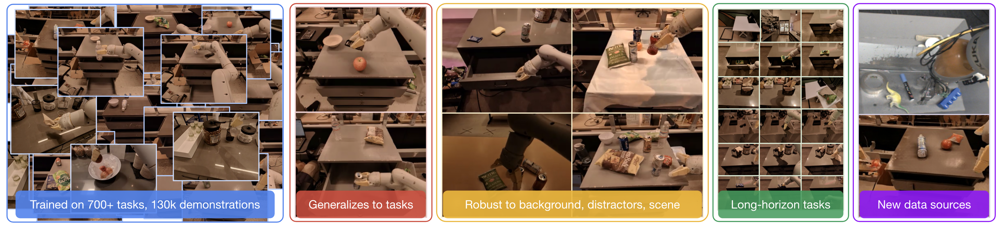

# 具身任务谱系与评测

具身智能不是单一任务，而是一整套任务族谱。把机械臂抓取、移动机器人导航、家庭服务、工业装配、人机协作都放在一起时，很容易陷入一种错觉：只要有一个统一模型，问题就算被解决了。实际上，不同任务对感知、记忆、规划、控制、安全与数据的要求差异极大。理解这些差异，是选择 Benchmark、设计训练数据和解释实验结果的前提。

<!-- [补充] -->
| 读者 | 建议读法 | 工程落点 |
| --- | --- | --- |
| 初学者 | 先抓“具身任务谱系与评测”要解决的问题、关键术语和最小例子；公式只看变量方向。 | 能说清输入、输出和常见失败信号。 |
| 工程师 | 直接对照结构、指标、成本和边界条件，必要时回到前置页补概念。 | 落到数据、算力、延迟、显存、评测和回滚检查。 |

!!! note "合并提示"
    **note · 读法定位**

    这页先回答“具身任务谱系与评测”在「具身智能」里的位置：它解决什么局部问题，依赖哪些前置，最后会影响哪类工程或研究判断。
    **前置**：先知道 VLA、世界模型、相机/深度和评测集的基本角色。 必要时先回 [具身智能入口](index.md)、[基础知识](../foundations/index.md) 或 [术语表](../glossary/index.md)。
    **主线关系**：把感知、数据、仿真、策略、控制、安全和真实闭环连起来，看机器人系统为什么不能只靠离线指标判断。

    **note · 页面边界**

    本页是“任务怎么分、评测怎么分桶”的总框架，不专门比较某个 VLA 榜单。若要看 VLA 数据集、模型族和数据引擎，转到 [VLA 数据、模型与评测路线](vla-data-model-and-evaluation-roadmap.md) 和 [VLA 评测与数据引擎](../vla/benchmarks-and-data-engines.md)。

## 任务谱系的几个主轴

具身任务可以沿四个主轴拆分：时间尺度、空间范围、交互对象和指令开放度。时间尺度区分单步反应、短序列技能和长时多阶段任务；空间范围区分桌面局部操作、房间级移动和建筑级多房间任务；交互对象包括刚体、柔体、容器、工具、动态主体和人类；指令开放度则从固定任务走向参数化任务和自然语言开放任务。

把一个任务投影到这四个轴上，往往比只说“这是一个机器人任务”更有信息量。

例如“抓起桌上的蓝色方块放进盒子”属于短时、局部、刚体、参数化指令；而“整理厨房台面，把可回收物分拣到对应区域”则是长时、多区域、多对象、开放语言理解任务。

RT-1 原论文的任务示例图很适合说明具身任务为什么不能只用一个“抓取成功率”概括。真实机器人数据里同时存在短任务、长时任务、背景变化、干扰物、新数据源和不同对象组合。

{ width="920" }

<small>图源：[RT-1: Robotics Transformer for Real-World Control at Scale](https://arxiv.org/abs/2212.06817)，任务示例图。原论文图意：展示 RT-1 训练数据覆盖 700+ tasks、130k demonstrations，并强调任务泛化、背景/干扰鲁棒性、长时任务和新数据源。</small>

!!! note "合并提示"
    **note · 图解：任务多样性决定 benchmark 应该怎么分桶**

    图里同样是机械臂场景，但任务难点不同：有的是物体识别，有的是抓取放置，有的是长时多步流程，有的是背景和干扰物变化。Benchmark 会塑造研究方向；如果评测没有覆盖恢复能力、接触质量、长时记忆和真实长尾风险，模型可能在榜单上进步，却在部署中退化。具身评测应该按任务类型、时间尺度、对象类别、失败阶段和安全风险分桶，而不是只报一个总成功率。

    **example · 有趣例子：只考直线倒车的驾照**

    如果驾考只考直线倒车，学员可能很会完成这个动作，却不会雨天变道、避让行人或处理窄路会车。具身 Benchmark 也是这样：评测桶缺什么，模型就可能在哪些真实场景里脆。

### 用论文案例定位任务层级

读 π0.5、DreamZero、LingBot-World 这类论文时，先不要急着比较分数，而要先判断它们评测的是哪类任务能力：

| 论文 / 系统 | 评测对象 | 对 Benchmark 的启发 |
| --- | --- | --- |
| [π0.5](../paper-deep-dives/embodied-ai/pi05.md) | 新家庭厨房/卧室里的多阶段移动操作任务 | 长任务要用 task progress，不只用最终成功率；还要区分语义子任务失败和低层动作失败 |
| [DreamZero](../paper-deep-dives/embodied-ai/dreamzero.md) | seen / unseen tasks、zero-shot environment、cross-embodiment transfer | WAM 评测要看动作和未来视频是否能转化为真实执行进展，而不是只看视频质量 |
| [LingBot-World](../paper-deep-dives/world-models/lingbot-world.md) | 动作条件交互模拟、长 horizon、实时 rollout | 世界模拟器评测要固定历史、改变动作，检查未来是否真的随动作分叉 |
| 资产/轨迹数据管线 | clean/random 场景、尺寸任务、堆叠/放置/排序 | 自建 Benchmark 要把资产尺度、干扰物、成功判定和失败复位都写进任务定义 |

这也是为什么具身评测不能只报一个总成功率。π0.5 更像在测开放家庭长任务，DreamZero 更像在测 WAM 是否能当 policy，LingBot-World 更像在测交互模拟器是否动作敏感。它们的指标不应该被简单横向混用。

### Benchmark 快速定位

下面这些 Benchmark 不是同一类考试，先分清“考什么”，再比较模型分数。

| Benchmark / 数据环境 | 主要考什么 | 容易误读的地方 |
| --- | --- | --- |
| CALVIN | 语言条件下连续 5 个任务的长时操作，ABC 训练、D 测试 | 强在语言任务链，不等于真实机器人接触稳定 |
| MetaWorld | Sawyer 多任务操作和 oracle 轨迹 | 适合技能广度，不代表开放语言泛化 |
| RoboChallenge | 真实桌面任务中的 3D 精定位、遮挡和多阶段操作 | 更接近真实难点，但仍要看任务覆盖和判定规则 |
| BridgeData V2 / Simpler WidowX | 真实 WidowX 数据和仿真镜像评测 | 适合看 Sim2Real 趋势，不能把仿真成功率直接当真机能力 |
| LIBERO | Spatial / Object / Goal 等任务组合泛化 | 适合早筛语言目标和组合泛化，但还需要真实闭环验证 |
| RoboTwin | 双臂任务、数字孪生资产、功能点和 success checker | 强在自动生成和自动判卷，但 checker 必须防止最终状态作弊 |

这张表也解释了为什么新增的 [VLA 数据、模型与评测路线](vla-data-model-and-evaluation-roadmap.md) 会从 Benchmark 开始讲：评测定义了“什么算智能”，模型只是朝这个定义优化。

{ width="920" }

<small>图源：[π0.5](../paper-deep-dives/embodied-ai/pi05.md)，Figure 6。原论文图意：展示用于评测 open-world generalization 的真实家庭环境，强调测试场景不在训练数据中。</small>

!!! note "图解：真正的 Benchmark 要把测试环境说清楚"
    这张图提醒我们，评测不是抽象数字。新家、新物体、新布局和新光照会同时改变视觉分布、任务语义和动作可达性。读具身论文时，先看 train/test 环境是否真的分开，再看是否报告 task progress、语言跟随、失败阶段和人工干预，而不是只盯总成功率。

## 从低层控制到高层任务的层级

### 2.1 低层控制任务

这类任务关注伺服与轨迹跟踪，例如机械臂末端到达、关节控制、速度控制、平衡控制。常见指标包括跟踪误差、稳定时间、能耗和超调量。

这些任务通常不需要复杂语义理解，但对控制精度和频率要求极高。

### 2.2 技能级任务

技能（skill）是具身智能中的中间层，如抓取、放置、开门、推拉、插拔、旋钮操作。它们通常时间跨度短到中等，对局部感知和接触建模要求高，也容易组合成更长任务。

技能级 Benchmark 通常关注成功率、接触稳定性、动作长度和重复执行一致性。

### 2.3 任务级与流程级任务

再往上是多阶段任务，例如“做一杯咖啡”“整理货架”“把散落物品放回指定位置”。这类任务需要子任务分解、记忆和状态跟踪、长时规划以及失败恢复。

它们更接近真实应用，也是当前很多 VLA 和 agentic robotics 研究的焦点。

## 任务类型的典型分类

### 3.1 操作类任务

包括抓取、堆叠、插拔、工具使用、容器操作、装配。难点通常在精细接触、遮挡、物体属性长尾和末端执行器限制。

一个很生动的例子是“把勺子放进抽屉分隔槽”。这看似简单，实则同时要求视觉定位、姿态调整、抽屉状态理解和狭窄空间插入控制。

### 3.2 导航类任务

包括点到点导航、目标驱动导航、语义导航、探索、避障与地图构建。难点在空间记忆、路径效率、动态障碍规避和长时局部最优问题。

例如“去厨房水槽旁边拿海绵”，不仅需要到达厨房，还要理解“水槽旁边”的语义位置。

### 3.3 移动操作类任务

移动操作把底盘运动与机械臂操作耦合起来，例如仓库拣选、家务清洁、餐厅送餐与收纳。比纯导航或纯操作更难，因为必须同时协调全局移动与局部接触。

### 3.4 社会交互类任务

包括跟随、协作搬运、递物、人机协作装配、语言问答与动作解释。这类任务引入人类行为不确定性和社会规范，常需要额外的安全、舒适与可解释性评测。

## Benchmark 为什么会“带偏”研究方向

Benchmark 不是中立的。它定义了可测的成功，也塑造了研究者会优化什么。

如果一个基准只考察单步抓取成功率，那么大家会优先优化 grasp proposal 与局部视觉，而不是长时记忆与恢复；如果基准环境过于整洁、对象过于标准化，模型可能学会实验室捷径，却没有现实泛化。

从这个角度看，Benchmark 设计至少要回答三个问题：是否覆盖真实应用的关键难点，是否存在可被利用的捷径，评测是否足以区分“真的理解任务”和“碰巧在该环境中成功”。

## 常见 Benchmark 维度

### 5.1 成功率

最直观，但也最粗糙。成功率适合比较同一任务配置下的整体能力，却无法告诉你失败发生在哪个阶段。

### 5.2 路径 / 动作效率

设最优路径长度为 $L^\star$，执行路径长度为 $L$，可以定义效率因子

$$
\eta = \frac{L^\star}{L}.
$$

<!-- [补充：符号说明] -->
| 符号 | 含义 | 取值范围 / 常见值 |
| --- | --- | --- |
| \(\eta\) | 公式中的变量或中间量 | 按上下文定义 |
| \(L\) | 损失或目标函数 | 实数标量，训练时按 batch 聚合 |

导航领域常使用 SPL（Success weighted by Path Length）一类指标，本质就是在成功率外加入效率惩罚。

### 5.3 接触质量与动作平滑性

在操作任务中，成功不该只看“最后是否放进盒子”，还应看是否磕碰、是否滑落、动作是否过猛。可以记录峰值力、加速度、关节 jerk 等控制指标。

### 5.4 长时恢复能力

对开放世界任务，恢复能力往往比首次完美执行更重要。一个成熟系统应在抓取偏一点、导航走错一步、语义解析有歧义时，有办法回退和重试。

## 桌面操作 Benchmark

桌面操作是具身智能最常见的研究起点，因为环境可控、传感器布置简单、收集示范相对容易。典型任务包括 pick-and-place、堆叠与排序、开关抽屉与门、插拔与拼装。

这类 Benchmark 的价值在于接触密集、细粒度动作要求高；其局限在于场景空间小、社会交互少、语义复杂度有限。

很多桌面数据集还存在“固定相机、固定桌布、固定对象集合”的问题，容易让模型记住背景和位置偏好，而不是学会真正泛化。

## 室内导航与家务 Benchmark

家庭机器人更接近真实应用，常见任务包括找物、送物、清洁、多房间语义导航和多步骤家务流程。相比桌面操作，它们更强调长时记忆、语义地图、自然语言理解，以及与人类环境共存的安全性。

但其评测往往受仿真器质量、场景建模和导航偏差影响较大。

## 工业与仓储 Benchmark

工业环境的任务往往更结构化，但对可靠性要求极高。典型任务有货箱拣选、托盘码放、装配线抓取与插入、异常件剔除。

工业 Benchmark 的优势是指标明确、落地价值强；难点是数据常涉商业机密，公开 benchmark 相对稀缺，研究与真实产线存在断层。

## 多模态开放任务 Benchmark

近年随着 VLM 和 VLA 的结合，越来越多 Benchmark 开始考察自然语言到动作的全过程：给出口语化复杂指令，要求机器人在视觉场景中定位目标，执行一串多步骤动作，并在失败后继续恢复。

这类基准更接近“通用具身智能”叙事，但也更容易因语言模板泄漏、环境脚本固定、评测自动化粗糙而产生误导。

## Benchmark 设计中的数学视角

一个任务集可以看作从分布 $p(\tau)$ 中采样的轨迹集合。若训练分布为 $p_{\text{train}}(\tau)$，测试分布为 $p_{\text{test}}(\tau)$，则泛化问题实质上是评估

$$
\mathbb{E}_{\tau \sim p_{\text{test}}}[R(\pi; \tau)]
-
\mathbb{E}_{\tau \sim p_{\text{train}}}[R(\pi; \tau)].
$$

<!-- [补充：符号说明] -->
| 符号 | 含义 | 取值范围 / 常见值 |
| --- | --- | --- |
| \(\tau\) | 轨迹或采样路径 | 由策略与环境/数据生成过程决定 |
| \(\pi\) | 策略或概率分布 | 非负概率分布，总和为 1 |
| \(p_{}\) | 概率、转移分布或预测量 | 概率分布或任务定义的张量 |
| \(R\) | 奖励、回报或时间索引相关量 | 实数标量或上下文定义的索引范围 |

若二者差距很大，说明 Benchmark 的训练-测试转移过弱，模型只是在重复环境统计。

更进一步，可以把任务拆成若干因素：

$$
\tau = (\text{scene}, \text{object}, \text{instruction}, \text{goal}, \text{dynamics}).
$$

<!-- [补充：符号说明] -->
| 符号 | 含义 | 取值范围 / 常见值 |
| --- | --- | --- |
| \(\tau\) | 轨迹或采样路径 | 由策略与环境/数据生成过程决定 |

一个高质量 Benchmark 不只是随机打乱样本，而会系统地控制这些因素的组合，评估模型是否具备组合泛化能力。

## 组合泛化为什么关键

具身智能常见的真实需求不是“见过这个任务再做一次”，而是“见过类似组件，但第一次见到这种组合”。例如模型可能见过“红杯”“蓝盒”“放进去”，但没见过“把红杯放进蓝盒后再盖上盖子”；也可能见过“抽屉”“勺子”“餐具篮”，但没见过厨房布局变化后的同类任务。因此 Benchmark 最好包含新对象组合、新语言组合、新场景布局和新工具或末端执行器。

## 评测中的隐藏捷径

很多基准失败并不是模型弱，而是任务被设计成可被“投机”。

典型捷径包括目标总出现在图像中央、指令模板过于固定、成功检测太粗、训练测试对象集合重叠太多。

举例来说，如果“把苹果放进篮子”的篮子永远在画面左下角，模型可以依赖固定位置偏好，而无需真正理解“篮子”。

## 如何选用 Benchmark

### 13.1 若目标是低层控制

优先选高频、接触精细、可重复的技能级基准，不必追求语言开放性。

### 13.2 若目标是 VLA 或通用操作

需要包含语言指令、多步骤任务与失败恢复，同时最好有真实世界验证，而不只停留在仿真。

### 13.3 若目标是生产部署

公开基准只能作为前测，最终仍需自建业务 Benchmark，包括长尾物体、真实灯光、真实噪声和真实安全约束。

## 直觉例子

可以把具身任务谱系理解成体育项目谱系。低层控制像练基本功和体能，技能级任务像定点投篮、发球、跨栏，任务级流程像一整场比赛，而开放世界多模态任务则像真实联赛中的复杂战术协同。只看某一种训练项目的成绩，并不能代表运动员在真实比赛里一定强。同样，只在单一 Benchmark 上高分，也不代表机器人在真实世界中可靠。

## 本页结论

具身智能的 Benchmark 选择，本质上是对“你认为什么能力最重要”的公开表态。理解任务谱系，才能看懂不同论文为何使用不同数据集和指标，也才能避免用一个不匹配的 Benchmark 去评价另一类系统。对研究者而言，Benchmark 是测量尺；对工程团队而言，它更应该是上线前的风险筛子。

## 工程收束

具身 benchmark 的选择，等于公开声明“当前系统最该被测量的能力是什么”。低层控制、技能任务、长流程任务和开放世界任务不能互相替代；上线前要让评测任务覆盖真实失败成本最高的边界，而不是只选择最容易刷分的公开集合。

!!! tip "下一站"
    - 回到本专题入口：[具身智能](index.md)，确认这页在整条路线中的位置。
    - 按导航顺序继续：[相机、深度与机器人视觉](cameras-depth-and-robot-vision.md)。
    - 概念或符号卡住时，先查 [术语表](../glossary/index.md)，再回到当前页。
