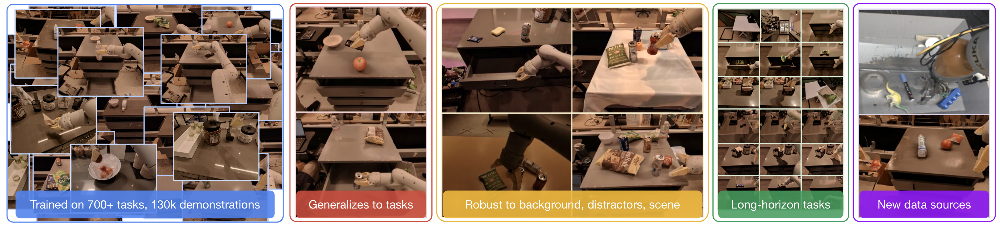
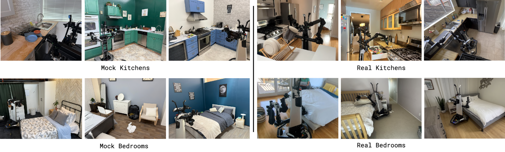

# 具身任务与评测分布

抓杯子、开抽屉与整理厨房都可以用成功率衡量，但它们要求的状态、时间范围和接触证据不同。选择 benchmark 首先要确定自己希望测量的变化轴，再判断任务与判定规则是否覆盖它。

{ width="920" }

<small>图源：[RT-1: Robotics Transformer for Real-World Control at Scale](https://arxiv.org/abs/2212.06817)，任务示例图。原论文图意：展示 RT-1 训练数据覆盖 700+ tasks、130k demonstrations，并强调任务泛化、背景/干扰鲁棒性、长时任务和新数据源。</small>

## 用同一个对象构造不同任务

“把夹爪移到杯子上方”主要考几何定位与跟踪；“拿起杯子”增加接触与夹持；“把杯子带到另一房间”增加导航、遮挡记忆和移动操作；“按用户要求收好杯子并关闭柜门”又增加语言约束与阶段验证。后一个任务不能仅用前一个的成功率代替。

任务规格可以写成 \(c=(s_0,g,\mathcal C,T,\mathcal H)\)，分别是初始条件、目标、约束、时间预算与允许的人类帮助。给定 c 和策略 \(\pi\)，环境才产生轨迹 \(\tau\sim P(\tau\mid c,\pi)\)。轨迹不是预先固定而与策略无关的试题，模型自己的动作会改变后续观测。

因此评测量应写为

\[
J(\pi)=\mathbb E_{c\sim P_{\mathrm{test}}}\mathbb E_{\tau\sim P(\cdot\mid c,\pi)}[R(\tau,c)].
\]

这里明确分开了任务分布和策略诱导的轨迹分布，避免把训练轨迹和测试轨迹的简单差异直接解释成泛化。

## 任务组合怎样防止位置捷径

假设训练里红杯总在左侧，蓝杯总在右侧。模型按位置行动也能取得高分。要检验颜色指令，应在测试中交换位置，保持其他条件可比；要检验新对象泛化，应使用未参与训练的杯子实例，而不是只换一句措辞。

空间、对象、语言、目标和动力学是不同变化轴。每次只改变一个轴能帮助定位；组合改变更接近实际部署，但失败原因也更难分辨。随机划分帧通常不能检验这些能力，因为相邻帧共享同一对象和场景。

{ width="920" }

<small>图源：[π0.5](../paper-deep-dives/embodied-ai/pi05.md)，Figure 6。原论文图意：展示用于评测 open-world generalization 的真实家庭环境，强调测试场景不在训练数据中。</small>

这类环境图帮助核对测试场景的范围，但图示几个房间不等于对所有家庭环境有覆盖。应回到任务抽样、训练隔离与人工干预规则。

## 长任务为什么要报告条件阶段成功

一个任务先开门，再抓取，最后放置。若三阶段条件成功率分别为 0.9、0.8、0.95，整段为 \(0.9\times0.8\times0.95=0.684\)。第二阶段的 0.8 应在第一阶段实际成功的状态上测量；如果把机器人重置到理想开门状态再测，得到的是另一种实验。

部分进度可以说明失败发生在哪，但也可能被“先做最容易的阶段”利用。最终成功、阶段进度、时间与过程违规应一起报告。人工打开门后策略完成抓取，需要计入辅助完成，不应写成全流程自主成功。

## 路径效率的完整定义

导航中的 SPL 用成功对路径效率加权。

\[
\mathrm{SPL}=\frac1N\sum_{i=1}^NS_i\frac{L_i^*}{\max(L_i,L_i^*)}.
\]

\(S_i\) 是成功标记，\(L_i^*\) 是同一任务定义下的最短可行路径，\(L_i\) 是实际路径。构造两个任务，第一个成功且最短 5 米、实际 10 米，第二个失败，则 SPL 为 \((0.5+0)/2=0.25\)，成功率为 0.5。指标因此同时惩罚失败与绕路。

对操作任务，末端路径短未必好。绕开障碍可能需要更长轨迹，平滑性还受时间参数影响。用采样动作差分估计加速度或 jerk 时必须包含实际时间步长，否则改变记录频率就会改变数值口径。

SPL把成功与路径长度合在一起，也会改变策略排序。假设两条路径都成功，一条最短但贴近人员，另一条绕行增加20%距离。仅按SPL，后者得到 \(1/1.2\approx.833\)，前者为1。这个指标正确表达了它定义的路径效率，却没有包含人员距离的风险代价。

所以任务规格必须先说明允许的碰撞、人员距离和干预规则，再把路径效率与安全结果分别报告。给导航模型增加一个“抓杯后再返回”的要求，成功事件、动作空间和观测依赖也改变了；不能因为都叫具身任务，就使用同一分数解释全部能力。

## 公开数据与 benchmark 应怎样选择

| 研究问题 | 可查阅的任务或数据 | 需核对的边界 |
| --- | --- | --- |
| 语言条件多步操作 | [CALVIN](https://github.com/mees/calvin)、[LIBERO](https://github.com/Lifelong-Robot-Learning/LIBERO) | 环境划分、任务链和成功判定 |
| 多任务基础操作 | [MetaWorld](https://github.com/Farama-Foundation/Metaworld) | 任务集合、观测设置与训练协议 |
| 多机器人经验 | [Open X-Embodiment](https://robotics-transformer-x.github.io/) | 原始动作接口与来源比例 |
| 实际环境采集 | [DROID](https://droid-dataset.github.io/) | 采集分布、数据质量与测试隔离 |
| 仿真双臂任务 | [RoboTwin](https://robotwin-platform.github.io/) | 资产、控制、重置和 checker |
| 仿真与实机关联 | [SimplerEnv](https://simpler-env.github.io/) | 哪些机器人与任务验证过关联 |

同一 benchmark 的不同版本、控制模式和训练预算也不能直接比较。报告应让读者重建初始条件、试验次数、随机种子、人工干预与指标计算。具体统计方法见[VLA 评测](../vla/benchmarks-and-data-engines.md)，物理执行边界见[部署安全案例](deployment-patterns-and-safety-cases.md)。

## benchmark 选择的检查点

先写任务成功谓词，再写观测、动作、重置、控制周期、人工干预和训练预算；之后才选择 benchmark。不同 benchmark 的任务难度、仿真器、checker 和数据来源不同，不能只按一个成功率排序。

**来源与改编说明**：[CALVIN](https://github.com/mees/calvin)、[LIBERO](https://github.com/Lifelong-Robot-Learning/LIBERO)、[MetaWorld](https://github.com/Farama-Foundation/Metaworld)、[Open X-Embodiment](https://robotics-transformer-x.github.io/)、[DROID](https://droid-dataset.github.io/)、[RoboTwin](https://robotwin-platform.github.io/)和[SimplerEnv](https://simpler-env.github.io/)承担不同的任务和数据问题。自测时挑两个 benchmark，列出至少三项不能直接比较的条件，并写出统一报告所需的额外字段。
