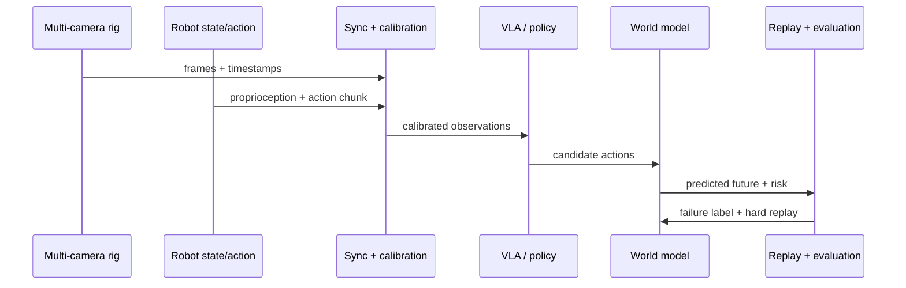

# VLA 数据、模型与评测：机器人数据到底该怎么读

VLA 不是“给机器人接一个大 VLM”这么简单。真正难的是把视觉、语言、机器人状态、动作、接触、任务进度和失败原因记录到同一条时间轴上。否则模型看起来在学动作，实际只是在拟合不同数据源之间的噪声。

机器人 VLA 数据需要支撑动作学习、世界模型训练和闭环评测。

{ width="880" }

<small>图源：[Wikimedia Commons: Franka Emika2.jpg](https://commons.wikimedia.org/wiki/File:Franka_Emika2.jpg)。原图展示 Franka 机械臂。读图重点：具身智能的关键不是机器人“像不像智能”，而是视觉、语言、动作、控制器、接触和任务判定能否形成稳定闭环。</small>

## 一条 episode 要记录什么

具身数据最容易“看起来很丰富，训练时却很脏”。多相机视频、机器人状态、动作、语言、任务进度和失败原因如果没有对齐到同一条时间轴，后面再大的 VLA 或 world model 都只是在拟合噪声。

一条能支撑 VLA 和世界模型训练的 episode，至少要回答六件事。多相机观测记录每路图像、时间戳、内参、外参和延迟；本体状态记录关节、夹爪、底盘和末端位姿；动作 chunk 记录起止时间、控制频率、动作空间和归一化参数；语言和任务状态记录指令、进度、是否完成和是否无效；失败标签记录 slip、collision、wrong target、lost object、timeout 等原因；评测结果记录 success、人工接管、恢复、耗时和 cost per success。

这些字段的意义不是让 schema 变复杂，而是让失败能回放。后续排查时应该能重建：某个动作执行前，模型看到了哪些视角，机器人手臂在哪，语言目标是什么，世界模型预测了什么风险，最终为什么失败。

## 数据集不是越大越好，而是异质性是否可控

今天的 VLA 数据来自很多来源：单机器人成功演示、多机器人数据集、真实家庭/办公室采集、仿真轨迹、人类视频、失败纠正和在线回流。规模当然重要，但更关键的是不同数据源的动作空间、相机视角、任务标签和成功判定能不能对齐。

{ width="920" }

<small>图源：[Open X-Embodiment](https://arxiv.org/abs/2310.08864)，数据集可视化图。原图展示多机器人、多任务、多场景数据聚合。读图重点：跨 embodiment 数据能扩大覆盖，但不自动解决动作空间、标注噪声、相机视角和安全迁移。</small>

Open X-Embodiment 的价值在于把多机器人、多任务数据放进统一格式，帮助模型学习跨 embodiment 迁移。DROID 的价值在于大规模真实场景采集，覆盖大量真实房间、任务和操作者。RoboTwin 的价值在于双臂任务、数字孪生资产、success checker 和可控仿真生成。LIBERO 的价值在于把 lifelong learning、目标组合和知识迁移拆成可比较任务。

这些数据集各自回答不同问题。Open X 更适合问“不同机器人经验能否正迁移”；DROID 更适合问“真实环境多样性是否足够”；RoboTwin 更适合问“仿真任务和自动判卷能否规模化”；LIBERO 更适合问“语言目标和任务组合是否泛化”。读数据集时不要只看轨迹数量，要看 train-test split、动作接口、success checker、失败记录和是否能回放。

## Benchmark 先看成功判定

VLA benchmark 最容易让人误判，因为很多任务短、场景干净、成功条件单一。读 benchmark 时先问四个问题：任务是否长时程，是否跨环境，是否真实机器人，success checker 是否可靠。

| Benchmark | 主要考点 | 最适合看什么 |
| --- | --- | --- |
| CALVIN | 语言条件下连续任务链 | 长时程、语言跟随、环境泛化 |
| MetaWorld | 多任务 Sawyer 操作 | 操作技能广度和 baseline 对比 |
| LIBERO | lifelong robot learning 和任务组合 | 目标、空间、对象和知识迁移 |
| BridgeData / Simpler | 真实数据与仿真评测连接 | Sim2Real 与 zero-shot 策略评估 |
| RoboTwin | 双臂操作、资产和 success checker | 自动判卷、功能点、仿真生成 |
| DROID | in-the-wild 真实操作数据 | 真实场景多样性和数据收集协议 |

一个 benchmark 如果只检查最终物体位置，可能漏掉碰撞、穿模、夹爪强挤、路径不安全和任务过程错误。具身评测应同时记录中间接触、遮挡、速度、动作平滑、人工接管和恢复。

## VLA 模型正在补三个短板

第一是数据短板。RT-2 证明 web-scale VLM 知识可以接到机器人动作 token 上，但它不能凭空获得未训练的 motor skill；Open X 和 DROID 这类数据集继续补真实机器人覆盖。

第二是动态短板。GR-2、Video Prediction Policy、DreamZero 这些路线都在尝试“先想象未来，再让动作和未来对齐”。它们说明视频预测不只是展示品，未来表征可以成为动作生成的条件。

第三是空间短板。SpatialVLA、DepthVLA、VGGT、Depth Anything 一类方法强调 3D、深度、相机和空间坐标。机器人抓取、插入、避障和放置不是纯语义问题，模型必须知道物体在哪里、离手多远、是否被遮挡、是否可达。

{ width="960" }

<small>图源：GR-3 Technical Report，Figure 4。原图展示 GR-3 的数据 recipe。读图重点：具身数据不应只有成功演示，还要组织机器人轨迹、人类轨迹、任务状态、无效指令和长任务数据，让 VLA 在 rollout 中知道何时继续、终止或拒绝。</small>

## 任务状态比很多人想得重要

真实 VLA 不只要输出动作，还要知道任务是否仍在进行、是否已经完成、当前指令是否无效。比如桌上没有蓝色杯子时，机器人不应该乱抓一个相似物体；抽屉已经关上时，机器人不应该继续推；目标被遮挡时，机器人应该重新观察或请求澄清。

可以把任务状态分成三类：`in progress` 表示继续执行，`terminate` 表示完成并安全收尾，`invalid` 表示当前条件下指令不可完成。这个头看起来简单，却能显著减少“模型一直动下去”和“无效任务硬执行”的失败。

这也是为什么失败数据重要。成功演示教模型怎么做，失败和纠正教模型什么时候停、什么时候拒绝、什么时候恢复。

## 动作表示决定能不能落到真实控制

动作表示是 VLA 和机器人控制之间的接口。单步 action 简单但容易抖动；action chunk 更平滑但错了会连续错；末端执行器位姿更跨机器人，但需要 IK 和 controller；关节动作更直接，却很难跨 embodiment；动作 token 适合 Transformer，但离散化会丢精度。

跨数据集训练时，动作尺度和控制模式尤其危险。一个数据集的 action 可能是末端位姿增量，另一个是关节角，第三个是夹爪命令；如果没有 `<control mode>`、单位、频率和归一化规则，模型会把硬件差异误学成任务差异。

{ width="760" }

<small>图源：[Wikimedia Commons: Hydraulic toy robot arm gripper.jpg](https://commons.wikimedia.org/wiki/File:Hydraulic_toy_robot_arm_gripper.jpg)。原图展示夹爪结构。读图重点：同样是“抓住”，不同夹爪的开合范围、力控能力、摩擦和接触反馈都不同；动作接口不能只停在文本描述。</small>

## 评测要看闭环收益

VLA 报告至少要同时写四张账。数据账说明 episode、camera、action、reward、done 和 failure_type；状态账说明 raw tokens、compressed tokens、接触和小目标是否保留；决策账说明候选动作、预测 success/risk 和最终选择；失败账说明 slip、wrong target、occlusion、collision 和 recovery。

离线 loss 下降不等于闭环成功。更硬的指标包括 action sensitivity、candidate ranking agreement、closed-loop success、risk ECE、near-miss recall、人工接管率和 cost per success。模型必须证明自己让动作选择更好，而不是只让视频或语言输出更顺。

## 外部材料

- [RT-2 paper](https://arxiv.org/abs/2307.15818) 与 [DeepMind RT-2 blog](https://deepmind.google/discover/blog/rt-2-new-model-translates-vision-and-language-into-action/)：理解 VLM 如何接到机器人动作 token。
- [Open X-Embodiment](https://robotics-transformer-x.github.io/)：理解跨机器人数据和 RT-X 的统一格式。
- [DROID](https://arxiv.org/abs/2403.12945)：理解 in-the-wild 真实机器人数据的采集规模和多样性。
- [RoboTwin 2.0 docs](https://robotwin-platform.github.io/doc/)：理解双臂任务、数字孪生资产和 success checker。
- [LIBERO](https://arxiv.org/abs/2306.03310)：理解 lifelong robot learning 和任务组合评测。

- [RT-2 官方博客](https://deepmind.google/discover/blog/rt-2-new-model-translates-vision-and-language-into-action/)。
- [Open X-Embodiment 论文](https://arxiv.org/abs/2310.08864)。
- [RoboTwin 项目](https://robotwin-platform.github.io/)。
