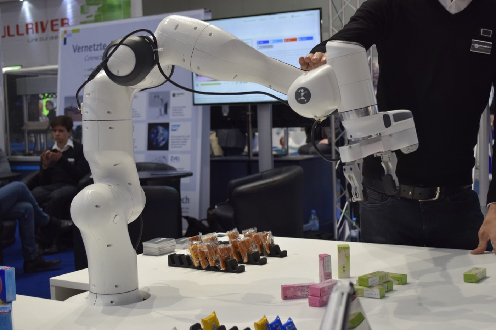
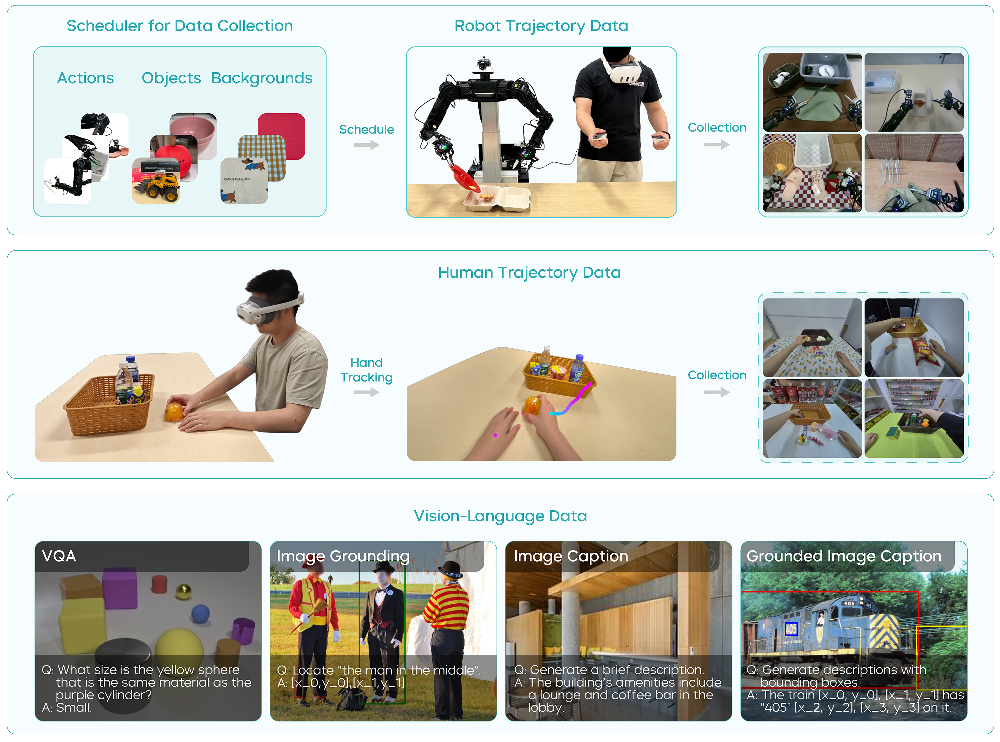
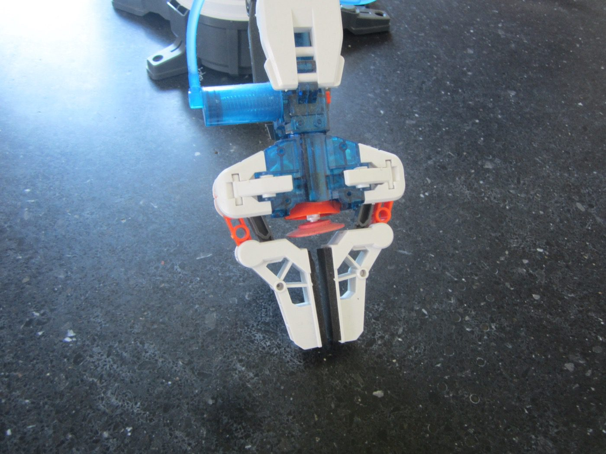
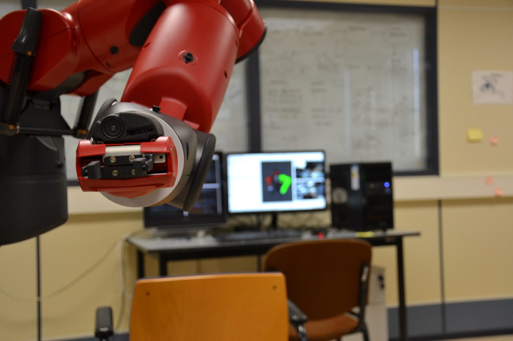

# VLA 数据、模型与评测路线

这页是一份具身智能和 VLA 的扩展教程，重点放在三件事：常用 benchmark 和数据集到底在测什么，VLA / 视频预测策略 / 空间与深度 VLA 各自解决什么，以及怎样把“数据更多”升级成“数据 recipe 更好、评测更真实、闭环更稳”。

{ width="880" }

<small>图源：[Wikimedia Commons: Franka Emika2.jpg](https://commons.wikimedia.org/wiki/File:Franka_Emika2.jpg)。具身智能的关键不是机器人“像不像智能”，而是视觉、语言、动作、控制器、接触和任务判定能否形成稳定闭环。</small>

{ width="960" }

<small>图源：GR-3 Technical Report，Figure 4。具身智能的数据 recipe 不只是成功演示，还要组织机器人轨迹、人类轨迹、任务状态、无效指令和长任务数据，让 VLA 在 rollout 中知道何时继续、终止或拒绝。</small>

!!! note "图解：这张图要按数据功能读"
    不同数据块不是简单相加：机器人轨迹提供低层动作，人类/任务数据提供高层语义，invalid / terminate 状态训练模型何时拒绝或停止，长任务数据训练 task progress。读 VLA 数据 recipe 时，先问每类数据解决哪个失败模式，再决定是否值得采。

!!! note "主线判断"
    具身智能不是 VLA 的同义词。VLA 是把视觉和语言接到动作的策略接口；具身智能还包括传感器、标定、动作表示、控制器、仿真、数据采集、任务判定、失败恢复和安全边界。一个 VLA 论文能否落地，常常取决于这些“模型之外”的系统层。

!!! note "页面边界"
    本页是 VLA 论文、数据集和评测路线的总索引。它回答“看哪些 VLA 系统、数据 recipe 和 benchmark”，而不是展开相机标定、仿真资产、低层控制或安全案例；这些分别放在相机、仿真、闭环和部署相关页面。

## 本页怎么读

先读 benchmark 和数据集，建立“任务到底在考什么、数据到底来自哪里”的判断；再看 GR-2、GR-3、VPP、SpatialVLA、DepthVLA、X-VLA 等模型路线，分清它们是在补视频动态、任务状态、空间尺度，还是跨 embodiment 适配；最后再回到失败轨迹、纠正数据和数据引擎，因为 VLA 真正走向部署时，坏经验和信用分配往往比一次成功 demo 更重要。

## 1. 先看任务和 Benchmark：它到底在考什么

先看 Benchmark 时，不要只记名字，要问四个问题：任务是否长时程、是否跨环境、是否真实机器人、成功判定是否可靠。

| Benchmark | 主要考点 | 关键信息 | 适合用来判断 |
| --- | --- | --- | --- |
| CALVIN | 语言条件下的长期操作任务序列 | ABC 环境训练，D 环境评估；每个指令链连续 5 个任务 | 长时程、语言跟随、环境泛化 |
| MetaWorld | Sawyer 机器人多任务操作 | 50 个任务，每个任务可用 Oracle 策略采轨迹 | 操作技能广度、RL / imitation baseline |
| RoboChallenge | 多载体桌面任务 | 30 个任务，覆盖精确 3D 定位、遮挡、多阶段长任务 | 通用策略和真实操作难点 |
| BridgeData V2 / Simpler WidowX | 真实数据与仿真评测连接 | WidowX 多环境真实轨迹，Simpler 近似镜像真实域 | Sim2Real、zero-shot 策略评估 |
| LIBERO | 任务组合和目标泛化 | Spatial / Object / Goal 等任务套件 | 语言目标和任务组合泛化 |
| RoboTwin | 双臂操作和数字孪生 | 任务、功能点、专家轨迹和 success checker | 资产标注、仿真生成、自动判卷 |

!!! tip "读 Benchmark 的小口诀"
    先看 train-test split，再看 success checker，最后看 episode 长度。很多模型在短桌面任务上表现不错，但一到新环境、长任务、无效指令和失败恢复，能力边界会很快暴露。

## 2. 数据集：真正重要的是异质性

具身数据集不是“越大越好”这么简单。不同数据集的机器人、相机、动作空间、场景和任务标签都不一样。RT-1、DROID、RH20T、Mobile ALOHA、Open X-Embodiment、BridgeData V2、Galaxea Open-World 等数据集，正好说明了今天 VLA 的核心难题：**跨机器人、跨场景、跨动作接口学习同一类物理技能。**

| 数据集 | 典型规模 / 特点 | 关键价值 |
| --- | --- | --- |
| RT-1 | 大规模真实机器人轨迹，覆盖多任务、多对象和多环境 | 说明 Transformer policy 能在真实机器人控制中吃规模化数据 |
| Open X-Embodiment | 公开页面说明汇集 22 种机器人、60 个数据集、100 万以上真实轨迹 | 跨 embodiment 预训练的代表数据底座 |
| DROID | 官方页面给出 76k demonstrations、350h interaction、564 scenes、86 tasks | in-the-wild 场景多样性和统一硬件采集 |
| RH20T | 多机器人、多视角、长短任务混合 | 适合研究跨硬件和多视角泛化 |
| Mobile ALOHA | 双臂移动操作，第一人称多相机 | 长时家务和双臂协调 |
| BridgeData V2 | WidowX 真实世界操作数据 | 与 Simpler WidowX 连接，常用于 Sim2Real |
| Galaxea Open-World | 150 任务类别、50 真实场景、100k 轨迹 | 开放场景下通才策略训练 |

[Open X-Embodiment](https://robotics-transformer-x.github.io/) 的公开页面强调统一数据格式和跨机器人策略；[DROID](https://droid-dataset.github.io/) 则强调真实场景、便携采集平台和丰富视角。把这两类数据放在一起看，可以得到一个重要结论：具身模型的泛化不是单一数据集堆出来的，而是靠数据来源之间的互补。

## 3. VLA 模型族：从“看图出动作”走向任务状态和世界后果

VLA / 机器人基础模型可以按能力层次分成几类。

| 模型 / 路线 | 核心思想 | 对系统设计的启发 |
| --- | --- | --- |
| [GR-2](../paper-deep-dives/embodied-ai/gr2.md) | web-scale 视频预训练，再用机器人轨迹微调，联合未来视频和动作预测 | 视频里学到的动态知识可以迁移到小样本机器人操作 |
| [GR-3](../paper-deep-dives/embodied-ai/gr3.md) | Qwen2.5-VL 主干 + flow matching Action DiT，输出 action chunk，并加入任务状态监督 | VLA 需要知道任务进行中、已完成还是无效 |
| [Video Prediction Policy](../paper-deep-dives/embodied-ai/video-prediction-policy.md) | 先训练文本引导视频预测模型，再用预测表征训练逆动力学动作模型 | 未来视频的中间表征可作为动作生成条件 |
| GEN-0 | 大规模真实物理交互数据、10B+ 模型、Harmonic Reasoning | 具身 scaling 可能需要更大模型和高数据量环境 |
| Spirit-v1.5 | 开放式、目标驱动、非脚本化数据收集 | “脏而多样”的数据可能比过度干净的脚本数据更利于泛化 |
| [SpatialVLA](../paper-deep-dives/embodied-ai/spatialvla.md) | Ego3D 位置编码 + 自适应动作网格 | 用空间结构统一跨机器人观察和动作 |
| DepthVLA | 深度感知空间推理，基于 π0 风格 MoT 结构 | 深度和绝对尺度能增强操作中的空间推理 |
| X-VLA | 用软提示吸收不同 embodiment / 数据源差异 | 跨硬件异质性不只在动作头，也在相机、任务和数据协议 |
| RECAP / π0.6 路线 | 离线 RL、专家纠正和自主经验回流 | VLA 不能只模仿成功轨迹，还要从坏经验中提取好信号 |

这些路线共同说明一个趋势：VLA 正从“视觉语言到动作”的单向映射，转向更系统的闭环学习：

```text
异构预训练数据
  -> VLA / action expert
  -> 真实或仿真部署
  -> 失败、纠正、奖励、任务状态
  -> 再训练或 RL 改进
```

如果要精读单篇论文，建议顺着 [GR-2](../paper-deep-dives/embodied-ai/gr2.md) -> [Video Prediction Policy](../paper-deep-dives/embodied-ai/video-prediction-policy.md) -> [SpatialVLA](../paper-deep-dives/embodied-ai/spatialvla.md) -> [GR-3](../paper-deep-dives/embodied-ai/gr3.md) -> [π0.5](../paper-deep-dives/embodied-ai/pi05.md) -> [DreamZero](../paper-deep-dives/embodied-ai/dreamzero.md) 读：前两篇讲“预测未来怎样帮助动作”，SpatialVLA 补空间坐标，GR-3 和 π0.5 补长任务与任务状态，DreamZero 则把 world-action modeling 推到可直接输出策略的位置。

## 4. GR-2：视频知识怎样迁移到机器人操作

GR-2 的关键观点是：大规模视频中包含大量人类活动和物理动态先验，即使这些视频没有机器人动作，也能帮助机器人理解“事情接下来会怎样”。它先在大规模视频片段和文本 token 上预训练，再在机器人微调阶段同时学习未来视频生成和动作预测；真实部署时，用 WBC 将笛卡尔轨迹转成低层关节动作。这里最重要的系统启发是：预测轨迹通常比单步动作更利于平滑执行，在机器人数据稀缺时，物体 / 背景增强也能补一部分覆盖。

GR-2 的关键细节可以整理成这样：

| 维度 | 关键细节 | 系统启发 |
| --- | --- | --- |
| 模型结构 | 约 230M 参数、95M 可训练；冻结文本 encoder 和 VQGAN；机器人状态用 linear 编码 | 小模型也能验证“视频动态先验 -> 机器人动作”的路线 |
| 预训练 | 约 3800 万视频片段、500 亿 token；HowTo100M、Ego4D、Something-Something V2、EPIC-KITCHENS、Kinetics-700 等 | 先从人类活动视频里学动态，再迁移到机器人 |
| 机器人数据 | RT-1、Bridge 等机器人视频经过手部过滤和重 caption；105 个桌面任务、约 40k 轨迹、8 类技能 | 机器人数据不是孤立采集，要接到视频预训练语义上 |
| 稀缺数据设置 | 完整数据约 1/8，即每任务约 50 条轨迹，总量约 5k | 评估 few-shot 不是口号，要明确每任务轨迹数 |
| bin picking | 55 个对象、约 94k pick-and-place 轨迹；测试包含更多对象组合 | 把单任务做深能检验接触和泛化，而不只是语言跟随 |
| 机器人平台 | 7-DoF Kinova Gen3 + Robotiq 2F-85，静态头部相机 + 腕部相机 | 双视角把全局语义和局部接触连接起来 |
| 控制落地 | 预测 Cartesian 轨迹，优化平滑度，再由 WBC 以约 200Hz 转成低层关节动作 | VLA 输出不是直接等于电机命令，中间需要控制器投影 |

这条路线适合记成：

```text
互联网视频先验
  -> 操作视频预测
  -> 机器人动作轨迹
  -> 控制器投影到真实硬件
```

它和世界模型天然相连：如果模型能预测动作后的未来视频，再把未来视频与动作轨迹对齐，就开始具备“动作后果”的内部模拟能力。

## 5. GR-3：任务状态和拒绝能力很关键

GR-3 的总结很重要：模型不只要输出动作，还要估计任务状态。任务状态可以是：

| 状态 | 含义 | 为什么重要 |
| --- | --- | --- |
| `in progress` | 任务正在执行 | 避免模型过早停止 |
| `terminate` | 任务已经成功完成 | 避免继续乱动 |
| `invalid` | 当前观察下指令不可完成 | 让模型学会拒绝无效任务 |

无效任务是具身系统最容易被忽视的能力。例如桌上没有蓝色碗时，“把蓝色碗放进箱子”不应该触发机器人乱抓。一种常见做法是训练时随机替换为无效指令，并让模型预测 `invalid`，而不监督动作块其他维度。

这给系统设计一个直接建议：**不要只训练 success policy，要训练 task-state-aware policy。**

真实部署可以把任务状态接到安全逻辑：

```text
invalid -> 拒绝执行或请求澄清
terminate -> 松爪、退回安全位姿、结束 episode
in progress -> 继续执行动作块并观察反馈
```

!!! example "有趣例子：机器人也要会说“这题没法做”"
    如果房间里没有杯子，聪明的机器人不应该努力“找到一个看起来像杯子的东西”。它应该先判断任务不可完成，再请求用户换目标或补充信息。很多 VLA 失败不是手不灵，而是它根本没有“当前任务是否有效”的概念。

GR-3 还补了很多工程细节：

| 维度 | 关键细节 | 为什么重要 |
| --- | --- | --- |
| 主干 | Qwen2.5-VL-3B-Instruct + flow matching Action DiT，总参数约 4B | 说明 VLA 正在用强 VLM 维持视觉语言能力，再接动作生成专家 |
| 输入 | 只接受当前时刻状态；动作块长度为 K，并和机器人状态 token 拼接 | 更像实时 policy，而不是长历史视频生成器 |
| Action DiT | 使用 VLM 后半层 KV cache、因果 attention mask、AdaLN 注入 flow matching 时间步 | 保持推理速度，同时让动作块内部有时间依赖 |
| 稳定训练 | 在 DiT attention 和 FFN linear 后加入 RMSNorm；一次 VLM forward 采多个 flow matching 时间步 | RMSNorm 对指令跟随和训练稳定性很关键 |
| 任务状态 | `in progress / terminate / invalid` 作为附加动作维度 | 让模型显式判断任务进度和是否应该拒绝 |

GR-3 的部署和 few-shot 也值得单独记：

| 场景 | 关键细节 | 启发 |
| --- | --- | --- |
| 人类轨迹微调 | 用 PICO 4 Ultra Enterprise 收集少量人类轨迹；约 450 条/小时，高于机器人遥操作约 250 条/小时 | 人类轨迹能降低新环境适配成本，但要处理缺少腕部视图、关节和夹爪状态的问题 |
| 机器人平台 | ByteMini 双手移动机器人；全身顺应性控制；策略 rollout 控制 19 DoF，并加入 pure pursuit 和轨迹优化 | VLA 的动作块必须经过全身控制和轨迹平滑，才能在长任务里稳定 |
| 泛化抓取 | 约 35k 机器人轨迹、101 个对象、69 小时；unseen objects 中每个对象最多 10 条人类轨迹，约 450 条总计、30 分钟 | few-shot 适配的价值在于快速接入新物体，而不是重收大规模机器人轨迹 |
| 长线桌面清理 | Flat / Instruction-Following 两种设置；invalid 任务要求 10 秒内不操纵任何对象才算成功；约 101 小时轨迹 | 同一任务要同时考高层目标、精确指令和拒绝能力 |
| 灵巧衣物操作 | 约 116 小时机器人轨迹 | 柔体和长时程会暴露单纯桌面 pick-place 看不到的问题 |

## 6. Video Prediction Policy：把未来视频变成动作条件

VPP 的核心观点是：只看单张图像的 policy 容易停在静态特征，视频预测模型则能捕捉“接下来会怎么动”的动态表征。它不是直接拿未来视频当结果，而是让下游策略跟踪预测表征中的机器人运动，隐式学一个逆动力学模型。

| 阶段 | 做什么 | 关键细节 |
| --- | --- | --- |
| 阶段一：文本引导视频预测 | 把通用 video diffusion model 微调成 manipulation TVP | 使用互联网人/机器人操作数据 + CALVIN + MetaWorld |
| 阶段二：逆动力学 | 用 TVP 中间预测表征作为条件，再用 diffusion 生成动作 | 使用中间表征可以更快，不必完整生成清晰视频 |
| 模型配置 | 1.5B Stable Video Diffusion + CLIP 文本特征 | 视频可以不够清晰，但要保留大致动态 |
| 真实机器人 | Franka Panda 约 30 任务 / 2000 轨迹；xArm + 12-DoF XHand 100+ 任务 / 4000 轨迹 | 少量机器人演示用于把视觉空间和动作空间对齐 |

这条路线和世界模型的连接非常直接：未来视频不是展示品，而是动作生成的中间条件。更有趣的是，它把“先想象未来，再反推动作”做成了一个可训练策略。

## 7. 动作表示：单步 action 通常不够

这条路线里反复出现“轨迹”“action chunk”“30 个锚点”“50-step chunk”“EEF pose”“控制模式”等词。这说明动作表示是 VLA 成败的底层接口。

| 动作表示 | 优点 | 风险 |
| --- | --- | --- |
| 单步动作 | 简单，低延迟 | 容易抖动，缺少短时技能结构 |
| Action chunk | 平滑，能表达短时技能 | 错了会连续错，需要滚动重规划 |
| 末端执行器位姿 | 跨机器人相对统一 | 需要 IK / controller 转换 |
| 关节动作 | 直接控制硬件 | 跨 embodiment 很难统一 |
| 轨迹锚点 | 抽象意图，过滤低层噪声 | 需要下游控制器补细节 |
| 动作 token / 网格 | 适合 Transformer 序列建模 | 离散化可能丢精度 |

π0.5 的做法是给动作数据添加 `<control mode>` 来区分关节和末端执行器，并按每个数据集动作维度的 1% 和 99% 分位数归一化到 `[-1, 1]`，不足的动作维度用零填充。这种工程细节很重要，因为跨数据集训练时，动作尺度不统一会让模型把“机器人硬件差异”误学成“任务差异”。

{ width="760" }

<small>图源：[Wikimedia Commons: Hydraulic toy robot arm gripper.jpg](https://commons.wikimedia.org/wiki/File:Hydraulic_toy_robot_arm_gripper.jpg)。动作表示最后要落到真实末端执行器：同样是“抓住”，不同夹爪的开合范围、力控能力、摩擦和接触反馈都不同。</small>

## 8. 空间、深度和跨 embodiment：VLA 的下一层骨架

### SpatialVLA

SpatialVLA 关注一个现实问题：不同机器人相机安装不同、动作空间不同、工作空间也不同。它用 Ego3D 位置编码把 3D 空间上下文注入视觉语言动作模型，并用自适应动作网格把连续动作离散成空间动作 token。

SpatialVLA 有几个关键设计：先用深度估计模型预测 depth，再用内参把 depth 变成点云；把点云 token 和 2D 图像 token 融合；动作侧把极坐标和旋转坐标网格化。SpatialVLA 每步只需要生成 3 个动作 token，而不是 RT-1 / RT-2 / OpenVLA 常见的 7 个 token。它先在约 110 万 / 1.1M 真实机器人数据上预训练，数据混合来自 OXE 和 RH20T 子集，再做零样本任务和新机器人适配评测。

这给 VLA 一个方向：**跨机器人泛化不能只靠更大的语言模型，还要把空间和动作坐标系设计好。**

### DepthVLA

DepthVLA 强调深度和绝对尺度。它采用 MoT 结构，基于 π0 风格路线，使用 DA2 预训练权重，并通过尺度不变损失学习绝对尺度深度。数据上，它在 Galaxea Open-World 和 BridgeData 上预训练，在 Galaxea R1 Lite 以及 LIBERO / Simpler 等仿真环境里评估。

对抓取、放置、插入、避障来说，纯 RGB 很容易误判距离和遮挡。深度分支可以提供更稳定的空间推理，尤其适合陌生物体和复杂摆放。

### X-VLA

X-VLA 用软提示处理不同数据源和 embodiment 的差异。异质性不只来自动作空间，还来自相机设置、视觉域、任务分布和数据收集协议。

X-VLA-0.9B 路线可以压成三句话：第一阶段在 DROID、RoboMind、Agibot 等异构数据上预训练，覆盖五种机械臂类型、七个平台；第二阶段为目标域新建一组 soft prompt，主干冻结后做领域适配；输入侧把固定视角/语言流和腕部视角流分开编码，低维本体感觉和 noisy action sample 通过 MLP 投影融合，动作标准化为 EEF pose，并用接下来 4 秒的 30 个锚点表示意图。

这意味着跨 embodiment 训练最好不要只换动作头，而要显式告诉模型：

1. 这是哪种机器人；
2. 相机在哪里；
3. 控制模式是什么；
4. 数据来自什么任务域；
5. 动作统计和采集策略有什么差异。

{ width="820" }

<small>图源：[Wikimedia Commons: Baxter robot's gripper.JPG](https://commons.wikimedia.org/wiki/File:Baxter_robot%27s_gripper.JPG)。同样是“夹爪”，不同机器人的几何、自由度、相机位置和控制接口都可能不同；跨 embodiment VLA 的难点就在这里。</small>

## 9. 数据 recipe：不要只收“干净演示”

这些资料里反复出现的“发现”非常值得展开：

1. 一些 VLA 指令跟随能力存在问题，可能过拟合图像；
2. 缺乏当前任务执行状态判断能力，需要学会拒绝任务；
3. 主线是跨领域、跨数据集预训练，再在专用场景下微调并评测；
4. 现有模型规模可能偏小，很多低于 3B；
5. 数据太干净，缺乏脏数据，需要设计合理数据 recipe。

[GEN-0 官方博客](https://generalistai.com/blog/nov-04-2025-GEN-0) 给了一个激进版本：他们报告 270,000 小时级真实世界操作数据、每周继续增长，并观察到 7B 附近的模型规模阈值和更大模型的收益。无论是否采用它的全部主张，这至少说明机器人领域正在从“小模型 + 小数据 demo”走向“数据工厂 + 大模型 + 长任务”的阶段。

Spirit-v1.5 的思路则提醒另一件事：高度脚本化、摆放整齐、总是成功的数据，可能会让模型缺少恢复、转换和真实混乱环境经验。开放式、目标驱动的数据收集让操作者围绕高层目标即兴完成多种子任务，更像真实世界的一天。

把 GEN-0 和 Spirit-v1.5 放在一起看，会得到一组很清晰的数据观：

| 路线 | 关键数字 / 机制 | 对数据 recipe 的启发 |
| --- | --- | --- |
| GEN-0 | 10B+ 参数；7B 附近出现模型规模阈值；270k+ 小时真实操作数据；每周增加 10k+ 小时；覆盖 6 / 7 / 16+ DoF 平台 | 具身 scaling 需要模型、数据、计算和跨平台经验一起扩大 |
| Harmonic Reasoning | 让异步、连续时间的感知 token 和行动 token 形成交互 | 推理不能阻塞行动，行动也不能脱离感知流 |
| GEN-0 数据科学 | 低 MSE + 低 reverse KL 更适合下游微调；高 MSE + 低 reverse KL 更有多样性，可能更适合 RL | 数据混合会塑造模型性格，不能只看总量 |
| Spirit-v1.5 | 只设高层目标“做些有用的事”，让操作者在连续会话中即兴完成多种子任务 | 开放式数据能保留恢复、转换和真实混乱环境 |
| Spirit-v1.5 采集效率 | 有效收集时间增加约 200%，研究人员关注度降低约 60%；多样化预训练达到基线性能只需约 60% 迭代 | 更自然的数据采集可能同时提高多样性和边际效率 |

一个更健康的数据 recipe 应该包含：

| 数据类型 | 作用 |
| --- | --- |
| 成功演示 | 学会基本任务 |
| 失败轨迹 | 知道哪里会坏 |
| 人工纠正 | 学会从策略自己造成的状态恢复 |
| 无效指令 | 学会拒绝和请求澄清 |
| 脏场景 | 学会处理干扰物、遮挡和非理想摆放 |
| 长时连续任务 | 学会子任务转换和任务进度判断 |
| 跨机器人数据 | 学会共享物理技能而不是绑定硬件 |

## 10. RECAP：从坏经验里提取好训练信号

RECAP / π0.6 路线可以概括为一句话：如果策略只是复制过去行为，它也会复制过去错误。要从自主经验中进步，必须做信用分配。

RECAP 的思路包括：

1. 用离线 RL 预训练 VLA；
2. 在部署中收集真实结果和稀疏奖励；
3. 专家在机器人犯错时接管并给出纠正；
4. 训练价值函数判断哪些状态更接近成功；
5. 根据优势信号提取更好的策略。

这和世界模型的数据引擎高度一致：不是所有失败都一样。若机器人最后插不进咖啡粉罐，错误可能发生在早期抓取姿态，而不是最后插入动作。没有价值函数、世界模型或分阶段任务状态，系统很难把责任分配到正确动作。

## 11. 暂存但未展开的线索

还有一些值得进入后续专题的线索。它们尚未展开成完整教程，但已经可以先放到地图上：

| 线索 | 关键词 | 后续适合怎么展开 |
| --- | --- | --- |
| LingBot-VA / Motus | 自回归结构、视频预测、MoT、记忆功能、类似 OpenPi0.5 预训练 | 接到视频世界模型和 VLA 记忆机制 |
| Unitree UnifoLM-VLA-0 | 宇树开源 VLA 线索、空间推理能力 | 跟硬件生态和开源机器人平台一起整理 |
| Octo | 跨 embodiment robot policy 代表 | 放入 VLA 基础模型和动作接口章节 |
| Helix / Hi Robot | 具身通用策略和开放家庭任务方向 | 和 π0.5、GEN-0、Spirit 共同讨论数据工厂路线 |
| VO-DP | 视觉-动作/扩散策略线索 | 放到世界模型与动作扩散的交叉章节 |

保留这张表的意义，是避免把所有线索硬塞进正文。正文主线负责讲清楚，暂存表负责告诉读者哪些材料已经进入知识库、后面可以继续拆成专题。

## 12. 评测路线：从离线预测到真实闭环

具身智能评测至少要分四层：

| 层级 | 看什么 | 示例 |
| --- | --- | --- |
| 离线预测 | action MSE、next-action error、任务状态分类 | 先确认模型能拟合数据 |
| 仿真闭环 | success rate、碰撞、超时、重试次数 | CALVIN、LIBERO、RoboTwin、ManiSkill |
| 真实机器人 | 成功率、恢复成功率、人工接管率、任务耗时 | 新物体、新场景、新家庭 |
| 安全和可用性 | invalid refusal、near-miss、力/速度边界、可解释失败 | 部署前门禁 |

Flat / Instruction-Following Setting 很有用：同一个桌面清理任务，可以给高层目标“清理桌面”，也可以给具体子任务。前者考任务分解和语义选择，后者考指令跟随和低层操作。一个模型在 Flat Setting 强，不等于在精确指令跟随强。

!!! warning "离线分数只能做早筛"
    具身智能最终要看闭环。动作 MSE 很低的模型可能在真实执行中积累误差；success checker 很高的策略可能只钻了最终状态规则空子；语言跟随很好也不代表接触稳定。闭环日志和失败分析才是硬证据。

## 13. 一个推荐学习和落地顺序

如果要继续扩展具身项目，建议路线如下：

1. **先选任务族**：桌面操作、长时家务、焊缝观察、双臂传递，不要一开始泛化到所有机器人；
2. **定义动作接口**：关节、EEF、轨迹锚点、action chunk、控制模式；
3. **定数据 schema**：图像、depth、相机、关节、本体状态、动作、任务状态、语言；
4. **用 Benchmark 早筛**：CALVIN / LIBERO / RoboTwin / Simpler 先看趋势；
5. **加入任务状态**：`in progress / terminate / invalid` 必须进入训练和评测；
6. **保留失败和纠正**：不要只收成功演示；
7. **接世界模型**：让候选动作先经过风险、可见性、可达性和未来状态预测；
8. **真实小闭环**：每轮只扩大一个维度：新物体、新背景、新任务、新机器人，不要全一起变。

这条路线听起来朴素，但很抗返工。具身智能最怕的是先把模型训大，最后发现动作接口、任务状态、success checker 和数据回流都没定。

## 14. 参考资料

- [RT-1: Robotics Transformer](https://robotics-transformer1.github.io/)：真实机器人 Transformer policy 的经典入口。
- [Open X-Embodiment](https://robotics-transformer-x.github.io/)：跨机器人公开数据集和 RT-X 模型。
- [DROID Dataset](https://droid-dataset.github.io/)：in-the-wild 机器人操作数据集。
- [π0.5 论文专题讲解](../paper-deep-dives/embodied-ai/pi05.md)：异构协同训练和开放世界家庭任务。
- [GR-2 论文专题讲解](../paper-deep-dives/embodied-ai/gr2.md)：web-scale 视频知识迁移到真实机器人操作。
- [Video Prediction Policy 论文专题讲解](../paper-deep-dives/embodied-ai/video-prediction-policy.md)：预测视觉表征到逆动力学策略的路线。
- [SpatialVLA 论文专题讲解](../paper-deep-dives/embodied-ai/spatialvla.md)：Ego3D 位置编码和自适应动作网格。
- [GR-3 论文专题讲解](../paper-deep-dives/embodied-ai/gr3.md)：任务状态、少样本人类轨迹和长时程机器人部署。
- [DreamZero 论文专题讲解](../paper-deep-dives/embodied-ai/dreamzero.md)：WAM 如何把未来视频与动作联合建模为 zero-shot policy。
- [GEN-0: Embodied Foundation Models That Scale with Physical Interaction](https://generalistai.com/blog/nov-04-2025-GEN-0)：大规模真实物理交互数据和具身模型 scaling 观察。
- [Spirit-v1.5](https://github.com/Spirit-AI-Team/spirit-v1.5)：开放式、目标驱动、多样化机器人数据采集。
- [Isaac Sim](https://developer.nvidia.com/isaac/sim)、[RoboTwin](https://robotwin-platform.github.io/doc/) 和 [ManiSkill](https://maniskill.readthedocs.io/en/latest/)：仿真、数据生成和评测工具链。
