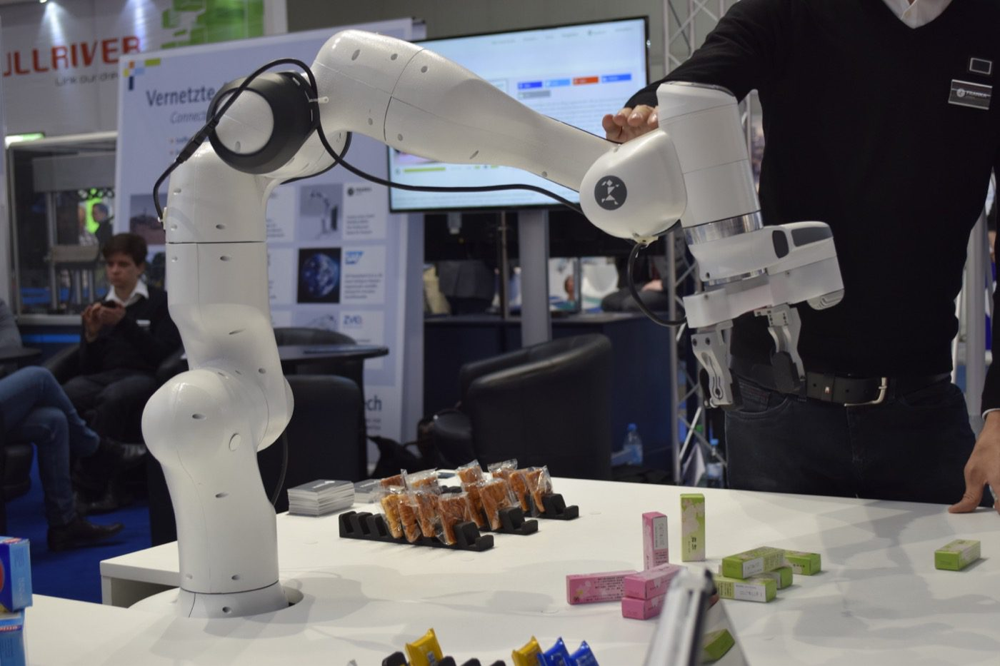
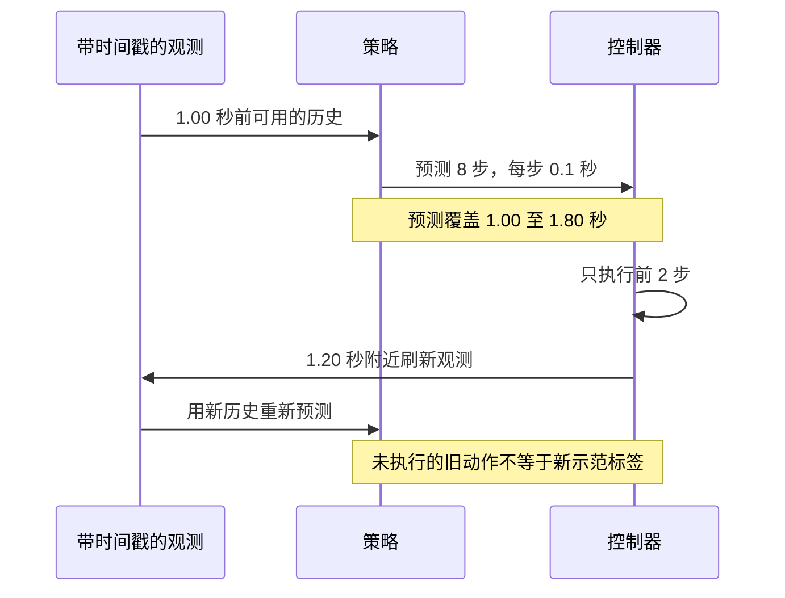
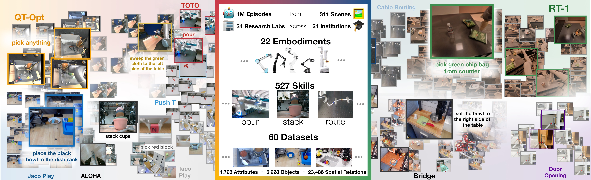
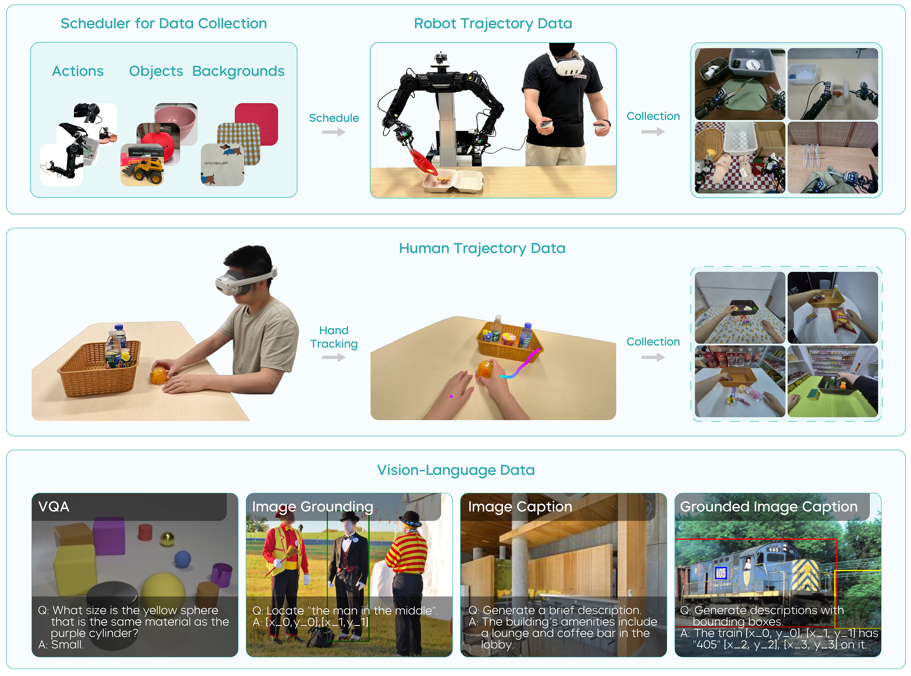
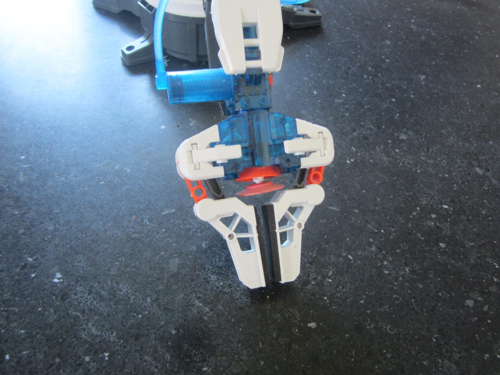

# 一条机器人轨迹怎样进入模型与评测

从下载数据到训练 VLA，中间最容易丢失的是样本的时间含义。一个 batch 里图像、state 和 action 的形状可以全部正确，却仍然把执行后的图像配给执行前的动作。本页沿一条构造轨迹解释数据、训练与评测如何保持同一语义。

{ width="880" }

<small>图源：[Wikimedia Commons: Franka Emika2.jpg](https://commons.wikimedia.org/wiki/File:Franka_Emika2.jpg)。原图展示 Franka 机械臂。读图重点：具身智能的关键不是机器人“像不像智能”，而是视觉、语言、动作、控制器、接触和任务判定能否形成稳定闭环。</small>

## 先为采样时刻建立协议

设机器人以 10 Hz 记录并发出动作，每个决策使用两路相机的最近两帧、七维本体状态和一句指令，预测未来八个七维动作。若 batch 为 32，图像张量可以组织为 `[32,2,2,3,224,224]`，依次是 batch、历史、相机、通道、高、宽；动作标签为 `[32,8,7]`。

张量顺序只是程序约定，数据语义还需说明相机时间戳、动作起止区间和各维含义。当前 state 若来自 1.05 秒，图像来自 1.00 秒，动作从 1.10 秒执行，不能只写一个共同 t 掩盖差异。训练应复现部署能够获得的历史信息。

取其中一条episode在1.00秒的决策，沿用100毫秒的控制周期。两帧历史应对应截止时刻前可获得的观测，8步动作覆盖从1.00秒到1.80秒的8个执行区间。若只执行前2步，下一次重规划发生在约1.20秒，此时新的输入应使用可用的最新观测，而不是把原来的第3个动作假装成新的专家标签。

训练batch把32个这样的窗口堆起来，张量的batch维并不保留episode之间的连续性。模型内部可以联合预测8步动作，但训练验证切分仍要在切窗前按episode或场景完成。否则同一次抓取的高度重叠窗口进入两侧，会让离线分数高估对新场景的泛化。

图中暂忽略推理和通信延迟，只检查动作区间。真实执行时应再把采集、完成推理与动作生效的时间分开记录。

## 归一化不是把所有字段混成一个均值

位置、角度、夹爪与速度单位不同，应按动作协议分别处理。构造位置维度均值 0.01 米、标准差 0.02 米，原始标签 0.03 米归一化为 1。模型输出 1 后必须用同一统计量恢复为 0.03 米。训练集外新任务不能擅自重新计算尺度，否则模型输出协议改变。

末尾不足八步的标签可以补齐，但 mask 必须排除虚构动作。若一个样本只有五步真实标签，损失除数也应按有效元素计算，而不是仍除以八步导致它的权重无意减小。mask 属于目标定义，不只是 tensor padding 技巧。

{ width="920" }

<small>图源：[Open X-Embodiment](https://arxiv.org/abs/2310.08864)，数据集可视化图。原图展示多机器人、多任务、多场景数据聚合。读图重点：跨 embodiment 数据能扩大覆盖，但不自动解决动作空间、标注噪声、相机视角和安全迁移。</small>

多机器人混合数据还需处理关节数、末端定义、控制器和夹爪差异。统一文件格式便于读取，不等于动作已在同一物理空间。可以用机器人条件与适配器保留差异，也可以对有共同语义的部分做转换，但必须说明哪些维度可比较。

## 训练目标要求哪些标签

行为克隆需要可作为示范的动作，动力学学习需要动作后的观测或状态，风险学习需要有定义的失败事件。一次滑落日志能提供真实失败转移，却未必包含正确恢复动作。将它作为风险样本与将其所有动作当成成功示范，是不同使用方式。

人类视频可以提供运动、对象与任务语义，但未必有机器人关节或控制命令；不能假设它天然提供与实机轨迹相同的动作监督。多源训练要按可获得的标签分别设计目标。

{ width="960" }

<small>图源：GR-3 Technical Report，Figure 4。原图展示 GR-3 的数据 recipe。读图重点：具身数据不应只有成功演示，还要组织机器人轨迹、人类轨迹、任务状态、无效指令和长任务数据，让 VLA 在 rollout 中知道何时继续、终止或拒绝。</small>

<small>此图保留为原技术报告的数据组织示例。数据源具体作用需通过该报告的训练配方和消融判断，不能从来源名称直接推断所有模型的能力。</small>

## 动作误差怎样与任务结果脱节

示范末端从左侧绕过杯子，另一条右侧路径也可能成功。模型生成右侧路径，与示范的逐步 MSE 可以很大，但任务正确；反过来，平均两条路径得到接近障碍的中间路线，MSE 可能不大却执行失败。

因此离线误差检查模型是否拟合标签，闭环评测检查它是否承受自己的动作后果。二者都需要，但不能相互替代。若使用 action token，除了交叉熵，还应在反量化后计算物理误差；若使用扩散头，则记录完整采样与执行延迟。

{ width="760" }

<small>图源：[Wikimedia Commons: Hydraulic toy robot arm gripper.jpg](https://commons.wikimedia.org/wiki/File:Hydraulic_toy_robot_arm_gripper.jpg)。原图展示夹爪结构。读图重点：同样是“抓住”，不同夹爪的开合范围、力控能力、摩擦和接触反馈都不同；动作接口不能只停在文本描述。</small>

夹爪图提醒我们，动作维度最后仍对应硬件。相同“闭合”命令在不同开口、指尖材质和力控条件下会产生不同接触结果，跨机器人评测不能忽略这些条件。

## 用测试划分声明要测哪种泛化

同场景新 episode 测重复执行，新物体实例测对象变化，新房间测环境变化，新机器人测接口与本体迁移。不同变化轴可以分开控制，也可以组合，但报告时应明确是哪一种。DROID、Open X-Embodiment、LIBERO 与 RoboTwin 的数据和任务设计各有目标，不能仅按总轨迹数选择。

先按独立来源切分，再切训练窗口。保留采集版本、标定、动作协议和成功判定器；对于人工提示、重置与接管单独记账。这样一个模型版本的提升才可以追溯到具体数据与行为变化。

数据字段见[state/action](state-action-robot-datasets.md)，训练目标见[VLA 策略学习](../vla/data-and-policy-learning.md)，统计与回流见[评测数据引擎](../vla/benchmarks-and-data-engines.md)。原始资料见 [Open X-Embodiment](https://robotics-transformer-x.github.io/)、[DROID](https://arxiv.org/abs/2403.12945)、[LIBERO](https://arxiv.org/abs/2306.03310)与 [RoboTwin](https://robotwin-platform.github.io/)。
