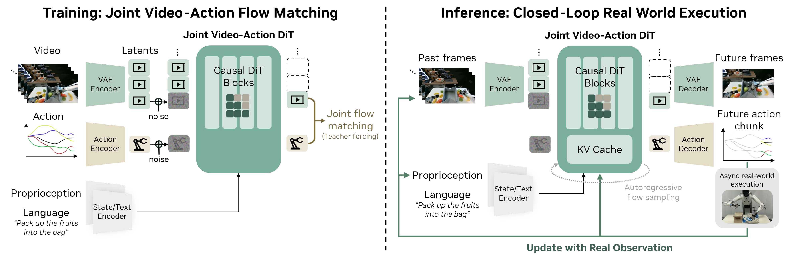
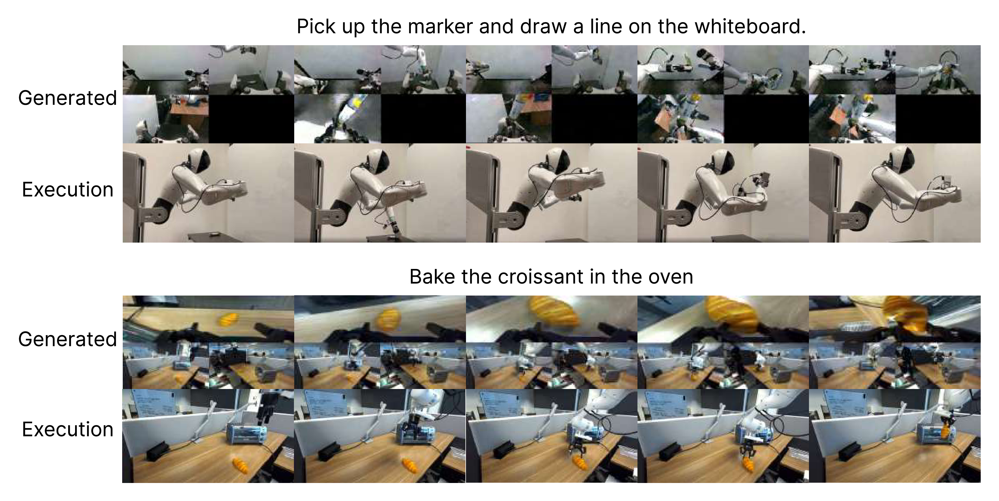
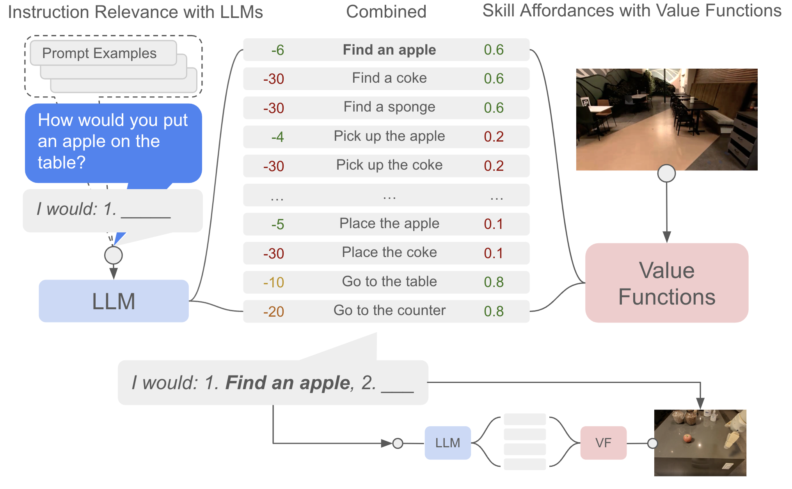

# VLA、WAM 与世界模型系统图：谁负责什么

具身智能不是某一个模型名字，而是一套闭环系统。VLA、world model、WAM、planner、controller、safety filter 和 data engine 各负责一部分；把它们混成“一个大模型”会让系统边界和失败归因都变得模糊。

这页只回答一个问题：这些模块分别负责什么，彼此怎么接。

## 一条闭环链

具身系统可以压成下面这条链：

```text
语言目标 / 任务约束
  -> 观测与状态估计
  -> 高层语义与子任务
  -> 动作表示与策略
  -> 世界模型 / 动作后果预测
  -> planner / controller / safety
  -> success checker / 数据回流
```

对应到一次决策：

$$
(o_{\le t},q_t,\ell)
\rightarrow
\text{subtask}_t
\rightarrow
A_{t:t+H-1}
\rightarrow
(\hat z_{t+1:t+H},\hat r,\hat c,\hat d)
\rightarrow
\text{safe command}
\rightarrow
o_{t+1}
$$

其中 \(o_{\le t}\) 是历史观测，\(q_t\) 是机器人状态，\(\ell\) 是语言目标，\(A_{t:t+H-1}\) 是动作块，\(\hat z\) 是预测未来 latent，\(\hat r\) 是收益或进展，\(\hat c\) 是风险或 continuation，\(\hat d\) 是终止或失败信号。公式的重点是：动作不是直接变成电机命令，中间还要经过未来预测、安全过滤和控制执行。

## VLA 负责产生动作候选

VLA 通常学习：

$$
A_{t:t+H-1}\sim \pi_\theta(o_{\le t},q_t,\ell)
$$

这里 \(\pi_\theta\) 是策略模型，输入观测历史、机器人状态和语言，输出未来 \(H\) 步动作块。VLA 的强项是把视觉语言目标转成动作，尤其适合多任务、开放语言和跨对象泛化。

{ width="920" }

<small>图源：[π0.5](../paper-deep-dives/embodied-ai/pi05.md)，Figure 3。原图展示 high-level subtask prediction 和 flow-matching action expert。本站读法：π0.5 强化的是语义子任务和动作生成层，但图里没有替代低层碰撞检查、安全过滤和真实观测刷新。</small>

VLA 不天然负责严格碰撞检查、高频控制、力控稳定，也不一定显式比较多个候选动作的未来。它给出的动作最好被看成候选或短时技能，而不是最终硬件命令。

## World model 负责预测动作后果

World model 学的是 what-if：如果执行这段动作，未来会怎样。

$$
p_\theta(z_{t+1:t+H},r_{t:t+H},c_{t:t+H},d_{t:t+H}
\mid z_t,A_{t:t+H-1},\ell)
$$

其中 \(z_t\) 是当前状态或 latent，动作 \(A\) 进入条件，输出里有未来状态、收益、风险和终止。它的核心不是视频像不像，而是输出能否被 planner、risk checker、RL actor/value 或 data engine 消费。

世界模型最小验收是：同一状态下换动作，未来是否合理分叉；它能否预测风险而不只是像素；它的 latent 是否能帮助选择动作；它是否用真实观测定期刷新，避免 rollout drift。

## WAM 同时生成未来和动作

WAM 代表另一种接口：未来状态和未来动作一起生成。

$$
(o_{t+1:t+H},A_{t:t+H-1})
\sim
p_\theta(o,A\mid o_{\le t},q_t,\ell)
$$

它的优势是动作必须解释未来视觉变化，风险是未来视觉错了，动作也可能沿着错误未来走。

{ width="920" }

<small>图源：[DreamZero](../paper-deep-dives/embodied-ai/dreamzero.md)，Figure 4。原图展示 visual context、language、robot state 和 action prediction 如何进入同一生成主干。本站读法：WAM 不是普通视频生成器；必须看视觉历史、机器人状态、动作解码和真实观测刷新这四个接口。</small>

{ width="920" }

<small>图源：[World Action Models are Zero-shot Policies](https://arxiv.org/abs/2602.15922)，Figure 16。原图展示 WAM 失败案例。本站读法：WAM 绑定动作和未来后，成功时动作更能解释未来；失败时动作也可能忠实执行错误未来，所以验收不能只看视频，而要看 predicted future、issued action、real observation 和 checker 是否一致。</small>

## Planner、controller 和 safety 负责可执行性

模型动作通常不是最终电机命令。更稳的部署链路是：

```text
VLA / WAM action
  -> action adapter
  -> planner or controller
  -> safety filter
  -> robot command
```

action adapter 负责坐标系、归一化反变换和控制模式；planner 负责 IK、碰撞检查和可达路径；controller 负责每个控制周期的跟踪和动力学稳定；safety filter 负责工作空间、速度、力、碰撞和急停。

SayCan 是一个很好的直觉例子：语言模型判断候选技能是否符合指令，affordance/value 判断当前场景里技能是否可执行。一个动作语义上正确，不代表物理上可做。

{ width="920" }

<small>图源：[Do As I Can, Not As I Say](https://research.google/pubs/do-as-i-can-not-as-i-say-grounding-language-in-robotic-affordances/)，Figure 3。原图展示 LLM score 和 affordance score 的组合。本站读法：模型的聪明必须被可执行性约束；够不到、会碰撞、不可抓的动作不能因为语言上合理就执行。</small>

## Data engine 让系统能进步

VLA、world model 和 WAM 都需要数据，但数据形态不同。VLA 需要观测、语言和动作标签；world model 需要动作条件未来、reward、risk 和 done；planner/checker 需要真实执行结果、失败原因和可回放日志。

{ width="760" }

<small>图源：[Open X-Embodiment](https://arxiv.org/abs/2310.08864)，Figure 1。原图展示不同 robot embodiment、scene、trajectory、skill 和 object category 的分布。本站读法：跨数据训练时，动作坐标系、控制频率、相机视角、夹爪形态和任务标签必须记录清楚，否则模型会把硬件差异误学成任务差异。</small>

一个好的 data engine 不只是堆轨迹，而是把成功、失败、near-miss、恢复、人工接管和 checker 分歧都组织成可训练样本。失败样本要能指出是视觉、动作、世界模型、planner、controller 还是 checker 出了问题。

## 四条路线怎么组合

| 路线 | 优先场景 | 不能单独承担什么 |
| --- | --- | --- |
| 经典 pipeline | 工业、高精度、规则清楚、安全要求高 | 开放语言和新场景泛化 |
| VLA policy | 多任务、开放语言、从演示中学技能 | 显式风险预测和硬安全证明 |
| World model + planner | 需要比较候选未来、降低真实试错 | 直接输出低层控制 |
| WAM policy | 希望动作和未来视觉一起建模 | 替代安全层和真实观测刷新 |

成熟系统往往不是四选一，而是组合：VLA 产生候选动作，world model 预测未来和风险，planner/controller 投影到可执行命令，success checker 判定结果，data engine 回流失败。

## 外部精读

- [π0.5](https://www.pi.website/blog/pi05)：理解 VLA 的 high-level subtask 和 action expert。
- [DreamZero](https://arxiv.org/abs/2602.15922)：理解 WAM 的未来视频与动作联合建模。
- [SayCan](https://research.google/pubs/do-as-i-can-not-as-i-say-grounding-language-in-robotic-affordances/)：理解语言规划和 affordance grounding。
- [Open X-Embodiment](https://robotics-transformer-x.github.io/)：理解跨 embodiment 数据引擎。
