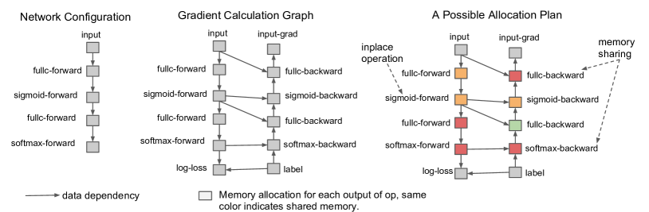

# 自动微分与激活显存：训练为什么要保存中间值

这篇文章只回答一个问题：为什么训练一个模型时，显存不只是装下权重就够了。

推理只要把输入一路算到输出。训练不同，它还要知道“每个参数应该往哪边改”。这意味着框架不仅要执行 forward，还要为 backward 留下足够的信息：哪些算子参与了计算、哪些张量在反向公式里会被再次用到、梯度要累积到哪些参数上。自动微分让这件事看起来像一句 `loss.backward()`，但显存账就藏在这些被保存的中间值里。

## Backward 不是倒放 forward

先看一个两层 MLP。这里先定义 forward 里会出现的变量槽位：\(x\) 是输入，\(W_1,W_2\) 是参数，\(z_1\) 是第一层线性输出，\(a\) 是激活后的中间表示，\(y\) 是预测，\(L\) 是 loss：

\[
z_1=xW_1,\qquad
a=\phi(z_1),\qquad
y=aW_2,\qquad
L=\ell(y,t)
\]

反向传播时，\(W_2\) 的梯度需要 \(a\)：

\[
\frac{\partial L}{\partial W_2}=a^\top\frac{\partial L}{\partial y}
\]

这行式子在说：要更新第二层权重，必须同时知道进入第二层的 activation \(a\) 和 loss 对输出的梯度 \(\partial L/\partial y\)。\(W_1\) 的梯度更早一层，所以它还需要 \(x\)、\(z_1\) 和激活函数导数：

\[
\frac{\partial L}{\partial W_1}
=
x^\top\left(
\frac{\partial L}{\partial y}W_2^\top
\odot
\phi'(z_1)
\right)
\]

这两行式子在说 activation 显存的根源：反向不是把 forward 结果倒着播一遍，而是每个算子的 backward rule 会重新读取某些 forward 中间量。矩阵乘的 backward 要输入张量，GELU/SiLU 的 backward 要 pre-activation 或输出，dropout 的 backward 要 mask，attention 的 backward 可能要 \(Q,K,V\)、softmax 统计或 kernel 保存的辅助量。框架把这些值称为 saved tensors。

自动微分系统做的事，可以粗略理解成保存一条 tape：forward 时把计算节点和必要张量记录下来；backward 时沿图反向调用每个算子的梯度规则。PyTorch、JAX、TensorFlow 的实现细节不同，但核心约束相同：如果 backward 公式需要某个中间值，你要么在 forward 后保存它，要么在 backward 前重新算出来。

## 训练显存是一张状态账

训练显存通常由五类东西组成：

| 项目 | 什么时候存在 | 为什么不能简单释放 |
| --- | --- | --- |
| Parameters | forward、backward、update | 模型权重本身，forward 和 optimizer 都需要 |
| Gradients | backward 后到 optimizer step 前 | 参数更新需要，梯度累积时还要跨 micro-batch 保留 |
| Optimizer states | 整个训练过程 | AdamW 要保存一阶动量、二阶矩，常常还有 FP32 master weights |
| Activations / saved tensors | forward 后到对应 backward 完成前 | backward rule 需要读取 |
| Temporary buffers | kernel、通信、workspace 期间 | attention、GEMM、all-reduce、fragmentation 都可能临时占用 |

对 AdamW 来说，权重只是起点。若训练使用 BF16/FP16 权重、FP32 master weights、梯度、一阶动量和二阶矩，一个参数可能对应多份状态。ZeRO 论文常用这个账解释数据并行为什么浪费：普通 data parallel 的每张卡都保存完整参数、梯度和 optimizer state，而 ZeRO/FSDP 通过分片减少这些长期状态的重复。

{ width="820" }

<small>图源：[ZeRO: Memory Optimizations Toward Training Trillion Parameter Models](https://arxiv.org/abs/1910.02054)，Figure 1。原图表达：普通数据并行会复制 optimizer states、gradients 和 parameters；ZeRO 分阶段把它们切到不同 rank。本站使用这张图说明：activation checkpointing 只管中间激活，参数状态这张账要由 ZeRO/FSDP、低精度优化器或 offload 处理。</small>

所以看到 OOM 时，不要只问“模型多少 B 参数”。更应该先拆账：是长期状态太大，还是 activation 太大，还是某个 attention kernel 或通信 workspace 峰值太高。不同账对应不同解法。

## Activation 为什么会随序列和层数爆炸

activation 是每层每个 token 的中间张量。一个粗略估算是：

\[
\text{activation bytes}
\approx
B\times T\times D\times L\times c\times b
\]

这里 \(B\) 是 batch size，\(T\) 是序列长度或视觉 token 数，\(D\) 是 hidden size，\(L\) 是层数，\(b\) 是每个值的字节数，\(c\) 是“每层到底保存多少中间量”的系数。\(c\) 不等于 1：attention 要保存或重建 QKV、attention score/softmax 相关状态，MLP 要保存投影和激活中间量，norm/dropout/residual 也可能留下辅助信息。

长上下文和视频模型最容易在这里爆。假设一个多相机视频 batch：`B=2`，4 路相机，16 帧，每帧 1024 个视觉 token，hidden size 1024，BF16。仅一份 token hidden activation 就是：

\[
2\times4\times16\times1024\times1024\times2
\approx 256\text{ MB}
\]

这行计算表示一层里仅保存一份 hidden activation 就可能达到 256 MB；这还只是一层、一类中间值。几十层叠起来，再加 attention/MLP 的 saved tensors，activation 很快会超过权重。很多“显存怎么这么离谱”的多模态训练问题，本质是 \(T\) 被图像 patch、视频帧、长文本上下文一起推高了。

## Activation checkpointing：少存一点，多算一遍

activation checkpointing 的核心很简单：forward 时不要保存所有中间激活，只保存少数边界点；backward 走到某一段时，从最近的 checkpoint 重新 forward 这段，恢复 backward 需要的中间量，然后立刻反传。

{ width="620" }

<small>图源：[Training Deep Nets with Sublinear Memory Cost](https://arxiv.org/abs/1604.06174)，Figure 1。原图把前向计算表示成计算图，并说明反向需要中间节点值。本站用这张图说明 checkpointing 的真正折中：不是“不需要 activation”，而是把部分 activation 从“长期保存”改成“反向前重算”。</small>

以 6 层网络为例：

```text
x -> L1 -> L2 -> L3 -> L4 -> L5 -> L6 -> loss
```

这里的 \(L1\) 到 \(L6\) 表示连续层或连续子模块。不做 checkpoint 时，forward 可能保存每一层的多种中间值；做 checkpoint 时，可以只保存 \(L2\)、\(L4\)、\(L6\) 的边界输出。反向传播到 \(L3/L4\) 这段时，从 \(L2\) 重新计算 \(L3\)、\(L4\)，拿到所需中间量后再求梯度。显存下降，代价是 backward 期间多做一部分 forward。

这不是免费午餐。checkpointing 省的是 activation residency，不省参数、梯度和 optimizer state；它增加 step time，也可能改变随机数处理。PyTorch 文档特别强调 RNG state：如果 checkpointed 区域里有 dropout，框架需要保存和恢复随机状态，才能让重算的 forward 与原 forward 对齐；关闭这项会更快，但可能改变梯度语义。

## 怎么决定 checkpoint 切在哪里

切分点不是越多越好。保存太少，反向重算段很长，时间开销大；保存太多，显存省不下来。一个实用判断是看哪类张量最贵：

| 训练形态 | activation 压力来自哪里 | checkpointing 的常见边界 |
| --- | --- | --- |
| 普通 decoder LLM | 层数、序列长度、MLP 中间维度 | 每个 Transformer block 或 attention/MLP 子块 |
| 长上下文训练 | attention saved tensors、KV/QKV、softmax 相关状态 | attention kernel、context/sequence parallel 边界 |
| VLM/VLA | 视觉 token、视频帧、多模态 connector | vision encoder、projector、LLM block 分段 |
| diffusion / video model | U-Net/DiT 多尺度 feature、时空 token | residual block、attention block、stage 边界 |

工程上还要看 kernel。FlashAttention 这类 IO-aware attention 会把 softmax 矩阵显存压力降下来，改变 checkpointing 的收益；fused MLP、fused norm 或 compiler remat 也会改变 saved tensors。也就是说，checkpointing 不是纯数学开关，而是和 kernel、编译器、并行策略一起决定最终显存峰值。

## 它和模型 checkpoint 不是一件事

中文里 “checkpoint” 容易混成两件事。

activation checkpointing 是训练过程中对中间激活的保存/重算策略，目标是降低一次 step 的 GPU 显存峰值。

model checkpoint 是训练资产，通常包含权重、optimizer state、scheduler、RNG、数据游标、并行拓扑和配置，目标是恢复训练、导出模型或复现实验。

二者有关但不能互相替代。你可以开 activation checkpointing 但不保存可恢复的 model checkpoint；也可以保存模型 checkpoint，但 activation 显存仍然爆掉。分布式训练里尤其要分清：ZeRO/FSDP 解决长期状态分片，activation checkpointing 解决中间激活 residency，training checkpoint 解决故障恢复和资产治理。

## OOM 排查要先定位是哪张账

遇到 OOM，不要立刻把所有开关都打开。先判断峰值来自哪里。

如果 OOM 出现在 forward 中段，通常优先看 activation、attention workspace、序列长度、视觉 token 和 micro-batch。可尝试 activation checkpointing、降低 resolution/token、FlashAttention、sequence/context parallel 或更小 micro-batch。

如果 OOM 出现在 backward 或 optimizer step，优先看 gradients、optimizer states、gradient accumulation、ZeRO/FSDP stage、offload 和 mixed precision optimizer。

如果 OOM 只在某些 batch 出现，优先看长度桶、图像分辨率、动态 padding、packing 后有效 token、临时 buffer 和碎片化。平均 batch 没问题不代表 P99 batch 没问题。

如果开了 checkpointing 后吞吐明显下降，要看重算区域是否太大、attention kernel 是否已经省掉很多中间状态、RNG preserve 是否带来额外开销，以及 pipeline/communication overlap 是否被重算打乱。

## 读完以后怎么判断

自动微分的显存成本来自 backward rule 对 forward 中间量的依赖。activation checkpointing 的本质不是魔法压缩，而是把“保存中间量”换成“反向时重算中间量”。它适合解决 activation 爆炸，尤其是长上下文、视频、多模态和极深网络；但参数、梯度、optimizer state、通信 buffer、训练恢复资产仍要靠 ZeRO/FSDP、低精度、offload、kernel 和 checkpoint 治理一起处理。

## 外部精读

- [Training Deep Nets with Sublinear Memory Cost](https://arxiv.org/abs/1604.06174)：理解 activation checkpointing / rematerialization 的经典来源。
- [PyTorch: Activation Checkpointing](https://pytorch.org/docs/stable/checkpoint.html)：看现代 PyTorch checkpoint 的 reentrant/non-reentrant、RNG state 和实现语义。
- [JAX: Gradient checkpointing with `jax.checkpoint`](https://docs.jax.dev/en/latest/gradient-checkpointing.html)：理解 remat 策略如何由自动微分系统表达。
- [ZeRO](https://arxiv.org/abs/1910.02054)：把参数、梯度、optimizer state 和 activation 分开记账。
- [FlashAttention](https://arxiv.org/abs/2205.14135)：理解 attention saved tensors 和 IO-aware kernel 为什么会改变显存压力。
- [Hugging Face Transformers performance guide](https://huggingface.co/docs/transformers/perf_train_gpu_one)：适合看 gradient checkpointing、mixed precision 和 batch 调整的实践入口。
- [OneFlow 官方博客](https://blog.csdn.net/OneFlow_Official)：中文工程文章常用“显存账 + 并行策略 + kernel 细节”来组织讲解，可学习其问题驱动写法。
