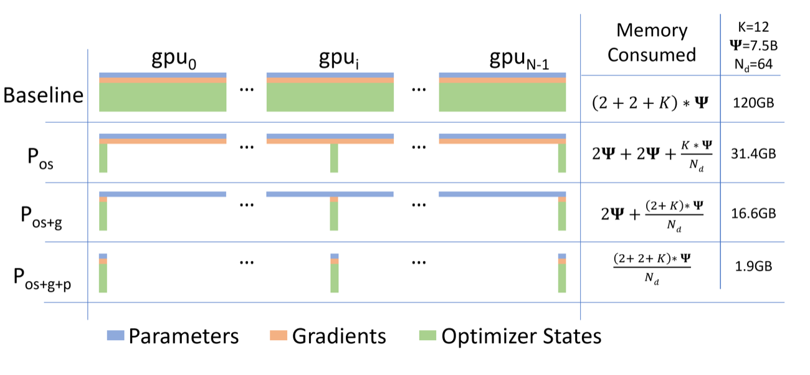
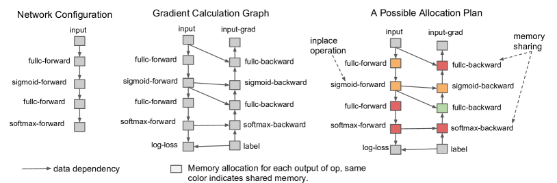

# 自动微分、激活重计算与训练显存

一个模型完成前向计算以后，训练程序还要知道每个参数怎样影响损失。自动微分利用程序已经执行的运算和这些运算的导数，按链式法则计算梯度。它通常需要保留部分中间数据，这也是训练显存常高于普通推理显存的重要原因。

可以从一个标量模型看清整个过程。输入 \(x=2\)，参数 \(w=3,b=1\)，预测为 \(z=wx+b=7\)，目标为 \(y=10\)。取损失 \(\mathcal L=(z-y)^2/2\)，结果是 4.5。接下来只需沿着这几次运算反向求导，就能得到参数梯度。

链式法则的数学背景见[微分、Jacobian 与梯度流](../prerequisite-math/differential-jacobian-and-gradient-flow.md)。参数拿到梯度后如何更新，则在[优化与训练](optimization-and-training-basics.md)中讨论。

## 从损失开始，一步步传回梯度

先把前向计算拆成几个节点。

| 节点 | 运算 | 当前数值 |
| --- | --- | --- |
| \(u\) | \(wx\) | 6 |
| \(z\) | \(u+b\) | 7 |
| \(e\) | \(z-y\) | -3 |
| \(\mathcal L\) | \(e^2/2\) | 4.5 |

反向传播从 \(\partial\mathcal L/\partial\mathcal L=1\) 开始。损失对误差的导数是 \(e=-3\)，误差对预测的导数是 1，所以

\[
\frac{\partial\mathcal L}{\partial z}
=\frac{\partial\mathcal L}{\partial e}\frac{\partial e}{\partial z}
=-3.
\]

加法 \(z=u+b\) 对两个输入的局部导数都是 1，因此损失对 \(u\) 和 \(b\) 的导数都为 \(-3\)。乘法 \(u=wx\) 对 \(w\) 的局部导数是 \(x=2\)，对 \(x\) 的局部导数是 \(w=3\)，最终得到

\[
\frac{\partial\mathcal L}{\partial w}=-3\times2=-6,\qquad
\frac{\partial\mathcal L}{\partial b}=-3,\qquad
\frac{\partial\mathcal L}{\partial x}=-3\times3=-9.
\]

每一步都把从后面传来的梯度乘以当前运算的局部导数。网络增加层数以后，只是这条依赖关系更长、分支更多，计算原则不变。

可以用中心差分近似检查权重梯度。将 \(w\) 分别增加和减小一个很小的 \(h\)，比较损失变化。

```python
def loss(w):
    x, b, target = 2.0, 1.0, 10.0
    error = w * x + b - target
    return 0.5 * error * error

w, h = 3.0, 1e-5
numeric_gradient = (loss(w + h) - loss(w - h)) / (2 * h)
analytic_gradient = (w * 2.0 + 1.0 - 10.0) * 2.0
print(loss(w))
print(round(numeric_gradient, 6), analytic_gradient)
```

输出为 `4.5` 和 `-6.0 -6.0`。数值差分适合检查小例子，但每次扰动一个参数都要重新计算损失，对大模型代价很高，而且步长过大有截断误差、过小有浮点抵消误差。自动微分直接组合局部导数，不依赖这种逐参数扰动。

## 同一个值经过多条路径时要相加

考虑 \(u=x^2\)、\(\mathcal L=u+x\)。\(x\) 一方面经过平方影响损失，另一方面直接参与最后的加法，所以

\[
\frac{d\mathcal L}{dx}
=\frac{\partial\mathcal L}{\partial u}\frac{du}{dx}
+\left.\frac{\partial\mathcal L}{\partial x}\right|_{u\text{固定}}
=2x+1.
\]

在 \(x=2\) 时，梯度是 5。漏掉任意一条路径都会得到错误结果。残差连接、参数共享、多个损失项都需要这种梯度相加，因此反向传播不能简单理解成沿一条直线往回乘。

张量运算使用相同规则。若 \(Y=XW\)，上游梯度为 \(G=\partial\mathcal L/\partial Y\)，则

\[
\frac{\partial\mathcal L}{\partial X}=GW^\top,\qquad
\frac{\partial\mathcal L}{\partial W}=X^\top G.
\]

矩阵乘法的求和已经把多条元素级路径的贡献合并起来。这些式子也揭示了反向计算为什么可能需要前向输入 \(X\) 和参数 \(W\)。

## 源码里的加等号和逆拓扑顺序

micrograd 的加法与乘法反向函数都使用 `grad += contribution`。若写成赋值，刚才 \(u+x\) 的一条路径会覆盖另一条。同一个参数被多个 token、多个损失或多个模块重复使用，也需要这种累积。

它的 `backward` 先按依赖关系建立拓扑顺序，再逆序执行各节点的局部反向函数。一个节点必须等所有下游用途的贡献到齐，才能把总梯度传给自己的输入。仅按创建变量的表面顺序倒着走，或遇到一个节点就立即向上递归，都可能在共享分支上出错。

这个教学引擎把梯度放在 Value 对象里，适合观察机制。真实框架还需要处理张量广播、视图、原地修改、并行调度和保存张量的生命周期，不能把这个小实现当成生产引擎的完整行为。

## 反向模式怎样避免构造巨大的 Jacobian

设某个函数把 \(n\) 维输入映射为 \(m\) 维输出。它的 Jacobian 有 \(m\times n\) 个元素，记录每个输出对每个输入的偏导数。如果把神经网络每一层的 Jacobian 全部显式存下来，空间和计算都会很大。

训练通常只关心一个标量损失对参数的梯度。假设某层输出已收到一个长度为 \(m\) 的梯度列向量 \(g\)，该层只需要计算 \(J^\top g\)，得到长度为 \(n\) 的输入梯度。反向自动微分直接执行这样的向量与 Jacobian 乘积，不必先构造完整的 \(J\)。

这也是反向模式适合“许多参数、少量输出目标”的原因。前向模式传播输入方向的变化率，在输入维度很小或需要特定 Jacobian 向量乘积时可能更合适。两种模式都使用链式法则，只是传播方向和计算目标不同。

自动微分还受运算定义限制。取整、离散采样或 argmax 不能直接提供通常训练所需的梯度；跨出自动微分框架做计算、显式 detach 或转换到不记录梯度的数据结构，也可能截断路径。遇到没有梯度的参数，要先确认损失是否仍通过可微运算依赖它。

## 框架何时计算，何时累积，何时更新

在 PyTorch 常见的 eager 执行中，参与求导的前向运算建立自动微分图。调用 `backward()` 计算并累积梯度，优化器的 `step()` 使用这些梯度改变参数，这两个动作分开进行。常见的单次更新顺序可以写成

```text
清除本次更新不需要的旧梯度
用当前参数计算预测与损失
沿计算图反向计算梯度
必要时处理梯度缩放或裁剪
优化器更新参数与自身状态
```

梯度默认累积到相应参数的梯度字段中，这支持多个 micro-batch 合成一次更新。若并不打算累积却忘记清除旧梯度，下一次更新就会混入之前的贡献。计算图的中间数据则通常在一次反向使用后释放；反复对同一图求导或求更高阶导数需要额外设置，也会增加内存需求。

`model.eval()` 用来改变 dropout、batch normalization 等模块的训练行为，本身不会关闭自动微分。普通推理若不需要梯度，通常还会使用 `no_grad` 或适当的 inference mode。反过来，有些分析任务会在评估模式下计算输入梯度，所以两种开关承担不同职责。

## 训练显存里究竟存着什么

训练显存通常包含参数、梯度、优化器状态、反向所需的前向数据，以及执行过程中的临时空间。它们的生命周期和增长方式不同。

| 数据 | 为什么需要 | 常见增长因素 |
| --- | --- | --- |
| 参数 | 计算模型输出 | 模型宽度、深度和词表大小 |
| 参数梯度 | 给优化器提供更新信息 | 需要训练的参数量 |
| 优化器状态 | 保存动量等历史统计 | 优化器种类与参数量 |
| 已保存张量 | 计算局部反向导数 | batch、序列长度、网络结构 |
| 临时缓冲区与工作空间 | 完成算子和通信 | 内核、布局、并行方式 |

假设参数和梯度均为 FP32，Adam 的两个状态也均为 FP32，那么这四部分合计每个参数约 16 字节，还没有算激活和临时空间。混合精度可能使用不同的参数、梯度和状态格式，有些方案额外保留高精度主权重。估算时应列明实际存储项，避免把某种实现的固定字节数当成通用规则。

前向数据也并非全部必须保存。乘法、激活和归一化所需的反向信息不同，自动微分系统按算子的导数公式保存相应输入、输出或辅助量。有的运算只需要形状，有的需要原输入，有的可以利用输出计算导数。原地修改某个已保存的值，可能破坏反向所需的信息，因此框架会对部分情况报错。

{ width="820" }

<small>图源为 [ZeRO](https://arxiv.org/abs/1910.02054)。图中区分参数、梯度和优化器状态，并逐步把它们分片到设备。激活重计算主要处理前向中间数据，两者可以组合使用，但各自节省的项目不同。</small>

一个 `[2, 1024, 768]` 的 BF16 激活具有 \(2\times1024\times768\times2\) 字节，即 3 MiB。若显式保存一个 batch 为 2、头数为 4、长度为 1024 的 BF16 注意力矩阵，单层数据量为

\[
2\times4\times1024^2\times2\ \mathrm{bytes}=16\ \mathrm{MiB}.
\]

16 层各保存这样一份矩阵时，总量为 256 MiB。这只是指定布局与保存方式下的演算，FlashAttention 等实现会改变中间数据的保存方式，实际训练也还有其他张量，不能把这个结果直接当成完整峰值显存。

## 激活重计算怎样用算力换空间

考虑四段连续计算

\[
h_1=f_1(x),\quad h_2=f_2(h_1),\quad
h_3=f_3(h_2),\quad h_4=f_4(h_3).
\]

普通反向可能需要在前向后保留这些模块内部的若干张量。激活重计算，也称 activation checkpointing 或 rematerialization，会选择一些边界保存，在反向需要内部数据时，再执行对应的一段前向。

例如把 \(f_1,f_2\) 作为一段，把 \(f_3,f_4\) 作为另一段。保存分段边界的输入后，反向经过第二段时，从 \(h_2\) 重新执行所需计算，得到该段求导要用的数据，使用后释放；再处理第一段。实际框架可能只重算必要部分，具体保存策略取决于实现。

{ width="820" }

<small>图源为 [Training Deep Nets with Sublinear Memory Cost](https://arxiv.org/abs/1604.06174) Figure 1。图示比较保存中间节点与在反向阶段重新生成节点的方式。减少常驻中间数据需要付出额外计算，保存边界和临时峰值仍然占用内存。</small>

重计算区域越大，通常越能减少长期保留的内部张量，但也可能增加重算工作和反向阶段的临时峰值。划分方式要结合激活大小与运算耗时。对已经非常昂贵、但保存数据很少的运算，重算收益可能有限；对中间数据很大且可较便宜地恢复的区域，收益可能更明显。

这个方法要求重算与原前向在求导所需的意义上保持一致。dropout 等随机操作涉及随机数状态，带可变状态的模块可能在重复执行时再次修改状态，依赖外部输入或全局变量的函数也可能产生不同结果。框架提供的随机状态处理和执行模式需要按文档确认，不能把任意一段有副作用的代码包起来就假定梯度一定相同。

## 三种容易混淆的节省方式

激活重计算减少保存的前向中间数据。把张量卸载到 CPU 则改变数据存放的位置，会引入传输成本。参数、梯度或优化器状态分片改变多设备之间的存储责任。它们可以共同使用，但处理的是不同部分，性能代价也不同。

磁盘上的模型 checkpoint 又是另一件事。它通常保存参数、优化器状态、训练步数及恢复训练所需的信息，用来在进程中断后继续运行。激活 checkpointing 发生在一次训练计算中，不负责创建这样的恢复文件。

遇到 OOM 时，应先观察峰值出现在哪个阶段。加载模型时就超出容量，优先看参数与状态；长度增加后前向峰值快速上升，要检查序列相关激活和注意力实现；第一次优化器更新才明显增加，可能与状态分配有关。内存分配器显示的保留量也可能高于当前活跃张量占用，不能只根据一个总数判断来源。

实际测量方法和数值格式见[数值、显存与运行时](numerics-memory-and-runtime-basics.md)，多设备状态管理见[分布式训练与 checkpoint](../training/distributed-training-and-checkpointing.md)。

## 参考资料

- [PyTorch Autograd Mechanics](https://docs.pytorch.org/docs/stable/notes/autograd.html) 解释图的构建、已保存张量与梯度模式。
- [PyTorch Activation Checkpointing](https://pytorch.org/docs/stable/checkpoint.html) 说明重计算实现、随机数状态和执行限制。
- [Training Deep Nets with Sublinear Memory Cost](https://arxiv.org/abs/1604.06174) 给出通过保存边界与重计算减少训练内存的方法。
- [ZeRO](https://arxiv.org/abs/1910.02054) 讨论优化器状态、梯度与参数分片。

- [micrograd engine.py](https://github.com/karpathy/micrograd/blob/7bc720e951fe422b8f8814aa5aa1b64121d26b4c/micrograd/engine.py)，用于把正文的数学对象对应到具体数据布局和执行顺序。
