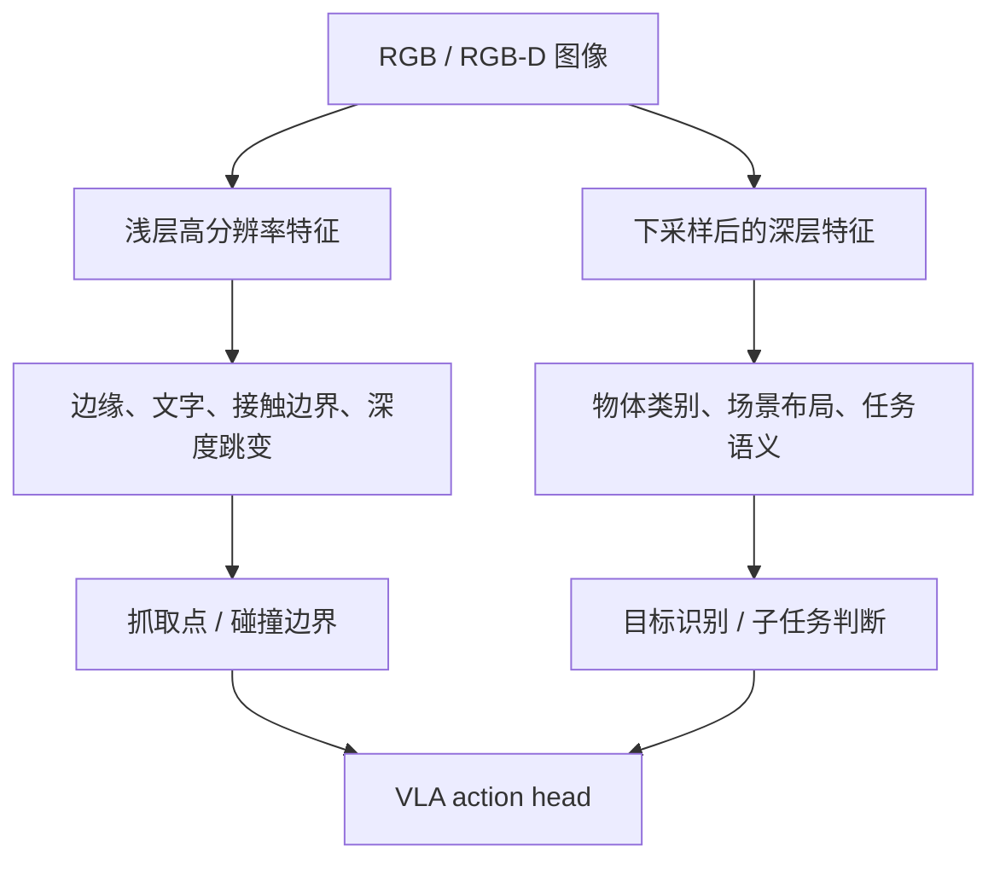

# 卷积与视觉特征：局部窗口如何变成多尺度表示

这篇文章只回答一个问题：为什么视觉模型曾经长期依赖卷积，以及卷积到今天仍然是理解 U-Net、扩散模型、视觉编码器和机器人感知的基础。

图像不是一串彼此无关的数字。相邻像素通常属于同一条边缘、同一个纹理或同一个物体部件；同一种局部模式也可能出现在画面的任何位置。卷积正是把这两个假设写进网络结构：**局部连接**让模型先看附近区域，**权重共享**让同一个检测器在全图复用，**多通道输出**让不同 filter 学不同模式。

!!! tip "数学先修"
    本文会用到[卷积、频域与多尺度](../prerequisite-math/convolution-frequency-and-multiscale.md)中的 kernel、感受野和尺度直觉，也会把 feature map 当作[向量与矩阵表示](../prerequisite-math/linear-algebra-and-geometry.md)。如果这些概念还不熟，先读对应数学页。

## 为什么不能直接把图像摊平

一张 \(224\times224\times3\) 的 RGB 图像有 150,528 个数。如果第一层直接接一个 4096 维全连接层，参数量约为：

\[
224\times224\times3\times4096\approx 6.2\times10^8
\]

这行式子在说：仅第一层就要六亿级参数，而且它没有利用“附近像素相关、同一模式可平移复用”的图像结构。卷积把问题改成只看局部窗口。例如一个 \(3\times3\) filter 作用在 RGB 图像上，只需要：

\[
3\times3\times3=27
\]

个权重，再加一个 bias。这 27 个权重会在整张图上滑动复用。它不能表达任意全局关系，但第一层本来也不需要一眼看完整张图；先检测边缘、颜色变化和局部纹理，后面层再逐步组合更大结构。

## 卷积层实际在算什么

深度学习框架里的 `Conv2d` 通常实现的是 cross-correlation，而不是数学课里会翻转 kernel 的严格 convolution。对理解网络来说，关键是局部加权求和。给输入 \(x\in\mathbb{R}^{C_{in}\times H\times W}\)，输出通道 \(o\) 的某个位置可以写成：

\[
y_{o,i,j}
=
b_o+
\sum_{c=1}^{C_{in}}
\sum_{u=0}^{K_h-1}
\sum_{v=0}^{K_w-1}
W_{o,c,u,v}\,x_{c,i+u,j+v}
\]

这里的变量槽位要分清：\(o\) 是输出通道，也就是第几个 filter；\(c\) 是输入通道；\(u,v\) 是 kernel 窗口内部坐标；\(i,j\) 是输出特征图的位置。一个输出通道不是只看一张灰度图，而是同时看所有输入通道的局部 patch。若有 64 个输出通道，就表示这一层学习了 64 组局部检测器。

卷积的三件事可以这样读：

| 结构假设 | 公式里对应什么 | 视觉含义 |
| --- | --- | --- |
| 局部连接 | 只求和 \(K_h\times K_w\) 窗口 | 先看边缘、角点、纹理和局部部件 |
| 权重共享 | 同一个 \(W_{o,c,u,v}\) 在不同 \(i,j\) 复用 | 同一种模式可在画面任意位置出现 |
| 通道混合 | 对 \(C_{in}\) 求和，并产生 \(C_{out}\) | 把颜色、边缘、纹理组合成多种特征 |

这也解释了为什么卷积具有平移等变性：输入里的某个局部模式平移，输出里的响应也大致平移。它不是严格的目标检测器，仍然会受边界、padding、stride、数据增强和后续 pooling 影响；但这个结构先验非常适合图像。

## Shape 不是细节，它决定信息还剩多少

卷积输出空间尺寸由 kernel、padding、stride 和 dilation 决定。单个方向上可以写成：

\[
H_{out}
=
\left\lfloor
\frac{H_{in}+2P-D(K-1)-1}{S}+1
\right\rfloor
\]

这里 \(H_{in}\) 是输入高度，\(K\) 是 kernel size，\(P\) 是 padding，\(S\) 是 stride，\(D\) 是 dilation。这个公式的含义不是让你背一遍 API，而是提醒：每次 stride 或 pooling 都在改变后续特征图对原图的采样密度。

几个常见选择可以按任务后果理解：

| 选择 | 它改变什么 | 典型收益 | 典型风险 |
| --- | --- | --- | --- |
| `kernel=3` | 每层看 3x3 局部区域 | 参数少，堆叠后感受野扩大 | 单层看不到大结构 |
| `padding=1` 配 3x3 | 尽量保持空间尺寸 | 边界不快速缩小 | padding 位置是人为补出来的 |
| `stride=2` | 输出尺寸约减半 | token / FLOPs / activation 显存下降 | 小物体、文字、接触边界可能消失 |
| `dilation>1` | kernel 点之间隔开 | 不降采样也扩大感受野 | 稀疏采样可能漏局部细节 |

举个控制任务里的直观例子。输入 \(640\times480\) 图像，若早期总 stride 为 16，特征图大约是 \(40\times30\)；若总 stride 为 32，特征图大约是 \(20\times15\)。后者更省，但一个 feature cell 覆盖的原图区域更大。分类任务也许没事，抓取、插孔、OCR、UI grounding 这类任务可能会因为定位粒度太粗而失败。

## Channel 是“检测器集合”，不是颜色数量

第一层输入通道通常是 RGB，所以 \(C_{in}=3\)。但卷积层输出 64、128、256 个 channel 时，不是在生成 64 种颜色，而是在生成一组 feature maps。每个输出通道是一种局部响应：可能偏向水平边缘、颜色对比、纹理片段、局部形状或更抽象的部件。

到了深层，channel 更像“语义子空间”。一层的某个 channel 不一定能被简单命名成“眼睛检测器”或“把手检测器”，但它会对某些视觉模式有稳定响应。Distill 的 feature visualization 系列很有价值，因为它提醒我们：深层特征不是手写规则，而是在训练目标和数据分布下学出的方向；有些方向可解释，有些只是组合统计。

`1x1` 卷积尤其容易被低估。它不看邻域，只在同一个像素位置混合 channel：

\[
y_{o,i,j}=b_o+\sum_c W_{o,c}x_{c,i,j}
\]

这行式子表示：`1x1` 卷积是在每个空间位置上做通道投影。它常用于降维、升维、融合多分支特征或在 depthwise convolution 后做 pointwise mixing。换句话说，卷积不只有“空间窗口”，还有“通道变换”。

## 感受野：一层看局部，多层看结构

单层 \(3\times3\) 卷积只看九个位置。两层 \(3\times3\) 叠起来，输出位置会间接依赖更大的输入区域；层数越深，理论感受野越大。这个机制让 CNN 形成层级特征：

| 层级 | 常见响应 | 对任务的意义 |
| --- | --- | --- |
| 浅层 | 边缘、颜色变化、纹理、角点 | 保留定位和边界线索 |
| 中层 | 局部部件、重复形状、材质组合 | 识别物体部件和可操作区域 |
| 深层 | 对象、布局、类别和语义组合 | 服务分类、检索、任务理解 |

但理论感受野不等于有效感受野。论文和可视化工作都观察到，深层输出虽然理论上能依赖很大区域，真正贡献最大的区域往往集中在中心附近。实际模型还要靠下采样、残差、attention、多尺度融合和数据增强来获得更稳的全局上下文。

## U-Net：为什么 dense prediction 需要“下去再上来”

分类只需要最终判断“图里是什么”。分割、深度、去噪、光流、动作接触点这类 dense prediction 任务还要知道“每个位置是什么”。这就产生一个矛盾：模型既要下采样获得大上下文，又要保留高分辨率定位。

U-Net 的设计正是为了解这个矛盾。

{ width="690" }

<small>图源：[U-Net: Convolutional Networks for Biomedical Image Segmentation](https://arxiv.org/abs/1505.04597)，Figure 1。原图表达：左侧 contracting path 下采样并扩大上下文，右侧 expanding path 上采样恢复分辨率，横向 skip connection 把高分辨率特征接回解码端。本站用这张图说明：dense prediction 不能只要深层语义，也要把早期定位细节带回来。</small>

U-Net 可以拆成三条机制。

第一，下采样路径把空间尺寸压小，换来更大的上下文和更便宜的深层计算。扩散模型里的 U-Net 或 DiT 变体也需要这种全局结构感，否则去噪只能修局部纹理，难以控制整体构图。

第二，上采样路径把低分辨率表示恢复到像素或 latent 网格上。它不是简单“放大图片”，而是把深层语义重新投回空间位置。

第三，skip connection 把早期高分辨率特征直接送到后面的解码层。没有 skip，模型很容易知道“这是细胞/杯子/手柄”，却忘了边界在哪里；有了 skip，解码端能同时使用语义和细节。

这就是为什么 U-Net、FPN、feature pyramid 和多尺度 decoder 会反复出现在分割、检测、深度估计、扩散生成和机器人视觉里。视觉任务经常不是“语义 vs 细节”二选一，而是要把二者在正确尺度上合起来。

## 卷积在 VLA 和世界模型里仍然重要

机器人任务会放大下采样的代价。语言模型可以说“把红杯放进灰盒子”，但动作头需要知道杯把、杯沿、夹爪、桌面边界和深度不连续在哪里。一个视觉编码器如果过早把图像压成很粗的 token，语义可能还在，控制线索已经没了。

设计视觉 tokenizer、world model encoder 或 VLA perception stack 时，可以把问题写成取舍表：

| 设计 | 省下什么 | 可能丢什么 | 更适合 |
| --- | --- | --- | --- |
| 大 stride / 强 pooling | token、FLOPs、activation 显存 | 小物体、文字、接触线 | 分类、粗粒度场景理解 |
| 高分辨率分支 | 定位误差和边界误差 | 显存、延迟、通信 | 抓取、插入、OCR、UI 操作 |
| 多尺度融合 | 语义和细节同时保留 | 结构复杂、融合调参 | 分割、深度、VLA、扩散去噪 |
| 局部 crop / gripper-centric crop | 任务关键区域更清楚 | 依赖 proposal 或控制先验 | 机器人闭环控制 |

所以卷积没有因为 ViT 流行而变成历史。即使主干用 Transformer，前端 patch embedding、局部窗口 attention、多尺度 feature pyramid、depthwise convolution、U-Net decoder 和 3D cost volume 里仍然在使用卷积思想：让局部结构先被稳定编码，再把它交给更全局的模块。

## 容易误读的地方

卷积不是只能识别边缘。浅层常学边缘和纹理，但深层卷积特征可以服务对象、布局、分割、深度、生成和控制。

更大的 kernel 不一定更好。大 kernel 单层看得更宽，但参数、计算和优化都变复杂；多层小 kernel、dilation、attention 或多尺度结构也能扩大上下文。

stride 不是纯加速开关。它确实省 token 和显存，但会改变定位粒度。对动作、OCR、检测小目标和接触边界，早期强下采样可能是质量问题的根源。

U-Net 的 skip connection 不只是“防止梯度消失”。在 dense prediction 里，它更关键的作用是把高分辨率定位信息带回解码端。

## 读完以后怎么判断

卷积把图像先验写进网络：局部窗口负责看邻域，权重共享负责在全图复用检测器，channel 负责组织多种视觉响应，stride/padding/dilation 决定空间信息还剩多少，多层堆叠和多尺度结构把局部特征变成对象与场景表示。读扩散、VLA、深度估计或视觉 tokenizer 时，真正要抓住的不是“卷积过时了吗”，而是这套局部到全局、语义到定位的特征账有没有被模型结构保住。

## 外部精读

- [CS231n: Convolutional Neural Networks](https://cs231n.github.io/convolutional-networks/)：系统理解 local connectivity、weight sharing、stride/padding 和 volume depth。
- [PyTorch `nn.Conv2d`](https://pytorch.org/docs/stable/generated/torch.nn.Conv2d.html)：核对工程 API、groups、dilation 和输出 shape 语义。
- [A guide to convolution arithmetic for deep learning](https://arxiv.org/abs/1603.07285)：用图和公式理解 padding、stride、transposed convolution。
- [Distill: Feature Visualization](https://distill.pub/2017/feature-visualization/)：理解卷积网络中 channel / neuron / layer 的可视化与可解释边界。
- [U-Net](https://arxiv.org/abs/1505.04597)：理解 contracting path、expanding path 和 skip connection 为什么适合 dense prediction。
- [Feature Pyramid Networks](https://arxiv.org/abs/1612.03144)：理解多尺度特征如何服务检测和定位。
- [CNN Explainer](https://poloclub.github.io/cnn-explainer/)：适合用交互方式看卷积、ReLU、pooling 和分类路径。
- [动手学深度学习：卷积神经网络](https://zh.d2l.ai/chapter_convolutional-neural-networks/index.html)：中文入门材料，适合把公式、张量 shape 和代码对上。

## 相关阅读与下一步

- 外部材料：[The Illustrated Transformer](https://jalammar.github.io/illustrated-transformer/)。
- 外部材料：[Dive into Deep Learning](https://d2l.ai/)。
- 外部材料：[Distill Circuits](https://distill.pub/2020/circuits/visualizing-weights/)。
- 站内下一步：[基础概念专题](index.md)。
- 站内下一步：[Transformer 输入与注意力](transformer-attention-and-tokenization.md)。
- 站内下一步：[数值、内存与运行时基础](numerics-memory-and-runtime-basics.md)。
