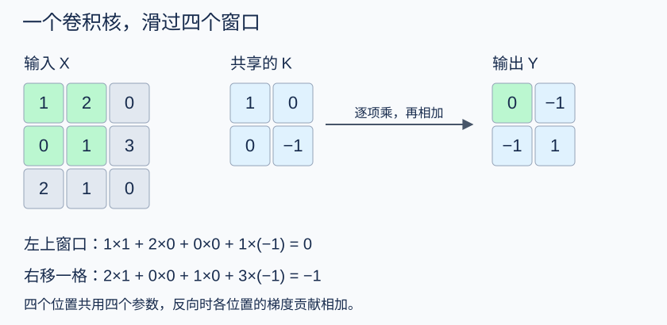
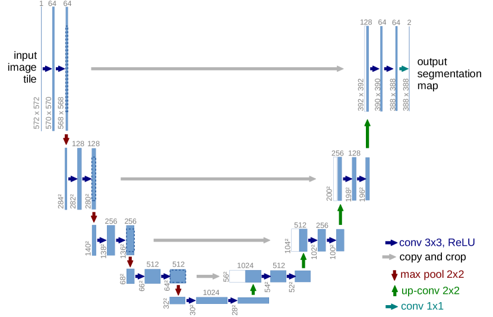

# 卷积与多尺度视觉特征

一个 `3×3` 输入经过 `2×2` kernel 后为什么会变成 `2×2` 输出？四个位置都用了同一组权重，反向传播时这组权重又怎样收到四处梯度？卷积的局部连接、权重共享和下采样都可以从这个小例子算出来。

先看一个单通道 `3×3` 输入与 `2×2` kernel。这里按深度学习框架常用的互相关约定，不翻转 kernel。

\[
X=\begin{bmatrix}1&2&0\\0&1&3\\2&1&0\end{bmatrix},\qquad
K=\begin{bmatrix}1&0\\0&-1\end{bmatrix}.
\]

## 一个窗口产生一个数

左上窗口输出 \(1\times1+2\times0+0\times0+1\times(-1)=0\)。窗口右移一步，输出 \(2-3=-1\)；下一行两个输出分别为 \(0-1=-1\) 和 \(1-0=1\)。所以结果是

\[
Y=\begin{bmatrix}0&-1\\-1&1\end{bmatrix}.
\]



<small>图源：本站根据上面的 (3\times3) 输入和 (2\times2) kernel 重绘。四个输出位置共享同一组权重，图示用于核对窗口移动和输出索引。</small>

**读这张图。**固定一个输出位置，沿窗口的四个元素相乘求和；再把窗口右移一格，就得到下一个输出。它展示的是互相关的索引关系，未涉及 padding、stride 或真实 GPU 线程映射。

四个位置共享四个 kernel 参数。梯度反传时，这四次使用对同一个参数的贡献要相加；共享权重同时是减少参数和组合训练信号的机制。

```python
x = [[1,2,0], [0,1,3], [2,1,0]]
k = [[1,0], [0,-1]]
y = [[sum(x[i+u][j+v]*k[u][v] for u in range(2) for v in range(2))
      for j in range(2)] for i in range(2)]
print(y)
```

输出 `[[0,-1],[-1,1]]`。代码故意保留窗口循环，真实库会用适合硬件的 kernel 或矩阵化方式执行，不一定逐点照此循环。

## 增加通道以后，求和在哪里发生

RGB 图像有三个输入通道。一个输出通道会为每个输入通道准备一张 kernel，把三张局部加权结果相加，再加一次 bias。多个输出通道使用不同的权重，形成不同特征响应。

对 stride 为 1、无 padding 的普通卷积，

\[
y_{o,i,j}=b_o+\sum_c\sum_u\sum_vW_{o,c,u,v}x_{c,i+u,j+v}.
\]

o 是输出通道，c 是输入通道，i/j 是输出位置，u/v 是窗口内部位置。权重尺寸为 `[C_out,C_in,K_h,K_w]`，不含 bias 的参数量为 \(C_{out}C_{in}K_hK_w\)。例如 3 输入、64 输出、3×3 kernel，共 1728 个权重，无需随图片尺寸增长。

输出的 64 个通道不是 64 种颜色，也不能保证逐个对应“边缘”“杯柄”等人类概念。它们是训练目标塑造的特征方向。1×1 卷积不混合邻近位置，只在每个位置做通道线性变换；depthwise 卷积则把各输入通道的空间处理分开，通常再用 pointwise 层混合通道。

## 输出尺寸决定保留多少位置

在一个空间方向上，输入长度 H、kernel K、padding P、stride S、dilation D 对应输出长度

\[
H_{out}=\left\lfloor\frac{H+2P-D(K-1)-1}{S}\right\rfloor+1.
\]

本例 H=3、K=2、P=0、S=D=1，得到 2。若 stride 变成 2，只留下一个窗口输出，计算减少，但也不再保留每个位置的响应。Padding 通过补值保留边界输出，却引入人为边界条件；平移等变性会受到边界、步幅和采样网格影响。

对 `640×480` 图像，累计 stride 16 后约为 `40×30`，stride 32 后约为 `20×15`。更粗的网格可能仍足够分类，却难保留小字、细孔或接触边缘。不能只用参数量判断视觉表示对定位任务是否足够。

## 多层怎样看到更大范围

令 \(r_l\) 为第 l 层理论感受野，\(j_l\) 为相邻输出中心在原图上的间隔，初始均为 1。递推为

\[
r_l=r_{l-1}+(k_l-1)d_lj_{l-1},\qquad j_l=s_lj_{l-1}.
\]

连续两个 3×3、stride1 卷积，感受野从 1 变为 3 再变为 5。若第一层 stride2，第一层仍看 3 个像素，但相邻中心间隔变为 2；第二个 3×3 层就看到 7 个像素的范围。

理论感受野只表示存在计算路径。训练后哪些输入真正强烈影响输出，要看权重、激活和梯度，通常并不均匀。更大感受野也不能恢复早期采样已经丢掉的信息。

## U-Net 为什么把高分辨率特征接回来

分割、重建和去噪需要为多个空间位置输出结果。编码器降采样获得大范围语义，解码器升采样恢复输出网格。但单靠放大低分辨率特征，无法保证重建细边界。

U-Net 因此把编码器同尺度特征接到解码器。例如解码分支升采样得到 `[B,64,32,32]`，同尺度跳连也是 `[B,64,32,32]`，沿通道拼接后成为 `[B,128,32,32]`，再用卷积融合。拼接保留两组特征，与 residual 相加要求同形状并直接求和不同。

这种路径是信息复用，不保证所有细节都正确。跳连本身也受早期卷积和降采样影响。DiT 则常把潜空间 patch 组织成 token，用 Transformer 处理；不能把所有扩散网络都画成同一种 U-Net 下采样结构。

{ width="820" }

<small>图源：[U-Net: Convolutional Networks for Biomedical Image Segmentation](https://arxiv.org/abs/1505.04597)，Figure 1。</small>

**读这张图。**先看中间的低分辨率路径如何扩大感受野，再沿横向连接追踪高分辨率特征如何回到解码端。原论文使用 copy-and-crop，现代实现可能使用 padding 对齐，因此图中的尺寸不能直接套到所有 U-Net。

先看竖向的分辨率变化，再看横向 copy-and-crop 箭头。横向连接带回较细的空间信息，原始 U-Net 还需裁剪以配合有效卷积；现代 padding 版本可能采用不同尺寸规则。拼接会增加通道数，下一层卷积需接收这个新尺寸。

## padding 会改变边界看到的内容

把前面的输入放在四周补一圈 0，再用同一个 \(2\times2\) kernel 计算，左上窗口变成

\[
\begin{bmatrix}0&0\\0&1\end{bmatrix},
\qquad 0\times1+0\times0+0\times0+1\times(-1)=-1.
\]

原来左上输出是 0，现在变成 -1。输出尺寸增加了，边界位置也获得了一个包含人工 0 的上下文。zero padding、reflect padding 和 replicate padding 产生的边界信号不同，不能只看输出 shape 判断它们等价。

stride 也会改变取样位置。输入长度 5、kernel 3、stride 2、无 padding 时，窗口起点只有 0 和 2，位置 4 不会成为窗口左端。若后续任务需要精确定位，应该记录输出网格中心映射回原图的位置，而不是只保存一个 `H_out`。

## 共享权重怎样进入反向传播

设一个 kernel 权重 \(w\) 在两个窗口中分别乘以输入 \(x_1,x_2\)，损失对两个输出的梯度为 \(g_1,g_2\)。由于这两个位置使用的是同一个参数，

\[
\frac{\partial\mathcal L}{\partial w}=g_1x_1+g_2x_2.
\]

把同一个参数误写成每个位置一份，前向结果仍可能看起来合理，反向更新却不再具有平移共享的含义。一个小测试可以把输入中只有一个像素设为 1，分别平移这个像素，再比较输出和 kernel 梯度是否按同样方式平移。它比只检查张量尺寸更容易发现权重索引错位。

## 用 reference 把实现边界钉住

卷积 kernel 的最小回归集应覆盖：

| 对照 | 想检查的内容 |
| --- | --- |
| \(1\times1\)、全零输入 | bias 与空窗口行为 |
| kernel 大于输入 | padding 和错误提示 |
| stride 2、奇数尺寸 | 尾部窗口与输出网格 |
| 非连续 view | stride 是否真的传入 kernel |
| 多通道单输出 | 通道求和与 bias 位置 |

先用手算或框架 reference 得到数值，再用 `torch.testing.assert_close` 比较自定义实现。随机测试可以发现更多组合，却不能替代这些能定位边界规则的固定样例。

## 从这个例子读实现

先对齐输入布局、kernel轴和互相关约定，再检查 stride、padding、dilation、groups。一个 shape 相同的输出也可能采用不同边界规则，因此应同时用手算值比较。图像任务越依赖精确位置，预处理坐标和输出映射越不能省略。

- [D2L 卷积神经网络](https://github.com/d2l-ai/d2l-zh/tree/e6b18ccea71451a55fcd861d7b96fddf2587b09a/chapter_convolutional-neural-networks)从互相关窗口逐步展开多通道与池化。
- [U-Net](https://arxiv.org/abs/1505.04597)给出编码器与解码器之间的高分辨率特征连接。
- [卷积、频域与多尺度](../prerequisite-math/convolution-frequency-and-multiscale.md)进一步解释滤波、相位与降采样混叠。
- [张量与 Shape](tensors-shapes-and-computation-graphs.md)补充布局、轴和 batch 维度的读法。
- [数据划分与评测指标](data-splits-metrics-and-evaluation-basics.md)讨论视觉任务中分组划分和定位误差的统计单位。
