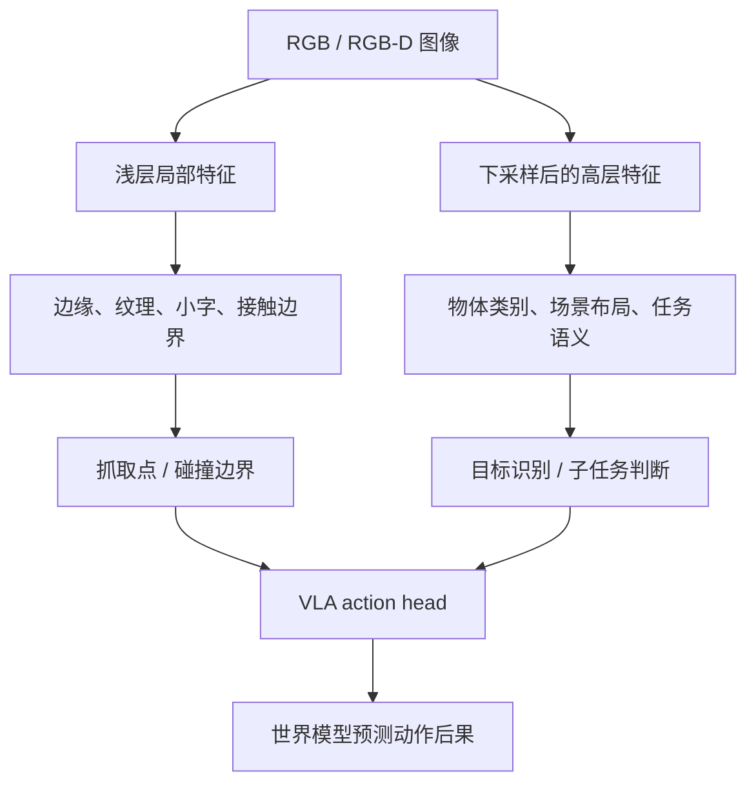

# 卷积与视觉特征

卷积是视觉模型里最经典的结构之一。即使 Transformer 很流行，卷积仍然是理解 CNN、UNet、视觉编码器和扩散模型的重要基础。

<!-- [补充] -->
| 读者 | 建议读法 | 工程落点 |
| --- | --- | --- |
| 初学者 | 先抓“卷积与视觉特征”要解决的问题、关键术语和最小例子；公式只看变量方向。 | 能说清输入、输出和常见失败信号。 |
| 工程师 | 直接对照结构、指标、成本和边界条件，必要时回到前置页补概念。 | 落到数据、算力、延迟、显存、评测和回滚检查。 |


!!! note "读法定位"
    这页先回答“卷积与视觉特征”在「基础知识」里的位置：它解决什么局部问题，依赖哪些前置，最后会影响哪类工程或研究判断。
    **前置**：先看本页要补哪一个最小概念；公式或术语卡住时回到术语表，不需要一次吃完整个数学体系。 必要时先回 [基础知识入口](index.md) 或 [术语表](../glossary/index.md)。
    **主线关系**：把符号、张量、优化、评测和运行时这些前置打稳，后面的扩散、VLM/VLA、训练与系统页才不会断层。

{ width="830" }

<small>图源：[U-Net: Convolutional Networks for Biomedical Image Segmentation](https://arxiv.org/abs/1505.04597)，Figure 1。原论文图意：U-Net 左侧 contracting path 逐步下采样并扩大上下文，右侧 expanding path 逐步上采样恢复分辨率，灰色箭头把高分辨率特征复制到对应解码层。</small>

!!! note "合并提示"
    **note · 图解：U-Net 图里的编码器、解码器和跳连**

    左侧 contracting path 通过卷积和下采样逐步降低分辨率、扩大感受野，适合理解全局结构；右侧 expanding path 通过上采样逐步恢复空间分辨率，适合输出像素级细节。灰色横向箭头是 skip connection，会把早期高分辨率特征复制到对应解码层。卷积的核心不是“旧结构”，而是局部归纳偏置和多尺度表示；这也是扩散模型里 UNet 去噪网络能同时保全局构图和局部细节的原因。

    **note · 初学者先抓住**

    卷积最重要的不是公式，而是“小窗口反复看局部”。它默认图像里的相邻像素更相关，所以特别适合找边缘、纹理、角点和局部形状。看到 CNN、UNet 或视觉编码器时，先判断它是在保局部细节、扩大感受野，还是压缩视觉 token。

    **tip · 遇到这些症状，回看本页**

    世界模型视频看起来整体合理但小物体、接触边缘、文字或把手位置丢失，VLA 换背景就退化，或者视觉 tokenizer 一压缩就失去抓取相关细节时，回看本页。本页能帮你判断是局部特征没保住、stride 下采样太狠、skip connection 不够，还是视觉 encoder 过早把决策相关细节平均掉。

## 符号卡：卷积公式怎么读

卷积公式：

\[
y_{i,j} = \sum_{u,v} k_{u,v} x_{i+u,j+v}
\]

<!-- [补充：符号说明] -->
| 符号 | 含义 | 取值范围 / 常见值 |
| --- | --- | --- |
| \(y_{i,j}\) | 公式中的变量或中间量 | 按上下文定义 |
| \(u\) | 公式中的变量或中间量 | 按上下文定义 |
| \(v\) | value、速度场或向量量 | 实数标量/向量，依上下文而定 |
| \(k_{u,v}\) | 公式中的变量或中间量 | 按上下文定义 |
| \(x_{i+u,j+v}\) | 样本、状态或 latent 变量 | 张量空间，形状由数据表示决定 |


读作：用一个小窗口 \(k\) 去看输入 \(x\) 周围的一小块区域，把窗口权重和局部像素相乘求和，得到输出位置 \(y_{i,j}\)。

## 卷积在做什么

卷积可以理解为一个小窗口在图像上滑动。窗口里的参数叫 kernel，它会和局部像素相乘求和，得到输出特征。

\[
y_{i,j} = \sum_{u,v} k_{u,v} x_{i+u,j+v}
\]

<!-- [补充：符号说明] -->
| 符号 | 含义 | 取值范围 / 常见值 |
| --- | --- | --- |
| \(y_{i,j}\) | 公式中的变量或中间量 | 按上下文定义 |
| \(u\) | 公式中的变量或中间量 | 按上下文定义 |
| \(v\) | value、速度场或向量量 | 实数标量/向量，依上下文而定 |
| \(k_{u,v}\) | 公式中的变量或中间量 | 按上下文定义 |
| \(x_{i+u,j+v}\) | 样本、状态或 latent 变量 | 张量空间，形状由数据表示决定 |


直觉上，一个 kernel 可以学会检测：

- 边缘：亮度或颜色突然变化的位置，是物体轮廓的基础线索。
- 角点：两个或多个边缘交汇的位置，常用于定位和结构判断。
- 纹理：重复的局部模式，如布料、草地、金属表面。
- 局部形状：由多个边缘和纹理组合出的局部部件，如眼睛、把手、轮廓片段。
- 重复模式：在空间上反复出现的结构，如砖墙、栅格或文字笔画。

浅层卷积看局部纹理，深层卷积通过多层叠加看到更大的结构。

## Stride、Padding 和 Channel

| 概念 | 作用 | 直观例子 |
| --- | --- | --- |
| `kernel size` | 每次看多大窗口 | 3x3、5x5 |
| `stride` | 每次移动多远 | stride=2 会下采样 |
| `padding` | 边界补多少 | 保持输出大小或减少边缘损失 |
| `channel` | 同时学习多少类特征 | 边缘、颜色、纹理、形状 |

如果 stride 变大，输出图会变小，模型计算更省，但细节也更容易丢。  
如果 channel 变多，模型能表达更多特征，但参数量和计算量也会上升。

## Receptive Field：模型到底看到了多大范围

感受野指输出某个位置能看到输入的多大区域。单层 3x3 卷积只看很小范围，但多层叠加后感受野会扩大。

这解释了 CNN 的层级特征：

1. 浅层看边缘和纹理。
2. 中层看局部部件。
3. 深层看整体对象和语义。

在扩散模型的 UNet 中，这种多尺度结构非常重要：低分辨率层负责大构图，高分辨率层负责细节和边缘。

## 为什么 UNet 常用于扩散模型

UNet 有两条关键设计：

1. **下采样路径**：逐渐压缩空间分辨率，扩大感受野，学习全局结构。
2. **上采样路径**：逐渐恢复分辨率，生成细节。
3. **skip connection**：把早期高分辨率细节直接传给后面，避免细节丢失。

因此 UNet 很适合做“输入一张带噪图，输出去噪结果”这类 dense prediction 任务。

## 多尺度视觉特征怎么服务 VLA



这张图说明卷积和多尺度结构在 VLA 中仍然有价值。高层语义告诉系统“这是红杯、目标是灰箱”，浅层局部特征告诉系统“杯把边界在哪里、夹爪会不会碰到杯沿”。如果视觉 tokenizer 或下采样路径过早丢掉浅层细节，模型仍可能会描述正确，却在动作上偏几厘米。

## 一个设计取舍：stride 省计算，也会丢控制线索

假设输入是 \(640\times480\) 图像。如果早期 stride 总倍率为 16，特征图约为 \(40\times30\)；若总倍率为 32，特征图约为 \(20\times15\)。后者 token 更少、算得更快，但每个 token 覆盖的原图区域更大。

| 选择 | 收益 | 风险 | 适合场景 |
| --- | --- | --- | --- |
| 大 stride / 强下采样 | token 少、显存低、吞吐好 | 小物体、文字、接触边界丢失 | 分类、粗粒度场景理解 |
| 小 stride / 高分辨率特征 | 定位和边界更稳 | 计算和显存上升 | OCR、抓取、UI grounding |
| UNet / FPN 式多尺度 | 兼顾语义和细节 | 结构复杂，融合要调 | 分割、控制、世界模型状态 |

对世界模型和 VLA，最稳的做法往往不是全程高分辨率，而是为任务关键区域保留高分辨率分支，例如 gripper-centric crop、目标物 crop、接触区域 token 或深度边界特征。

## 简化伪代码

```text
function ConvBlock(x):
    x = Conv2D(x, kernel=3, padding=1)
    x = Normalization(x)
    x = Activation(x)
    return x

function UNet(x):
    h1 = ConvBlock(x)
    h2 = Downsample(h1)
    h3 = ConvBlock(h2)
    y  = Upsample(h3)
    y  = Concat(y, h1)       # skip connection
    return ConvBlock(y)
```

这段伪代码展示了 UNet 的基本思想：先压缩，再恢复，同时把早期细节接回来。

## 和后续专题的关系

- [扩散训练与表示](../diffusion/training.md)：理解 UNet 为什么适合预测噪声或 velocity。
- [扩散条件控制](../diffusion/guidance-and-conditioning.md)：理解 ControlNet 如何在卷积特征图上注入结构条件。
- [VLM 架构](../vlm/architecture-and-training.md)：理解视觉编码器如何把图像变成特征。

## 本页结论

卷积适合局部结构，UNet 适合多尺度重建。读扩散模型时，如果先理解卷积、下采样、上采样和 skip connection，后面看去噪网络会更自然。

!!! tip "下一站"
    - 回到本专题入口：[基础知识](index.md)，确认这页在整条路线中的位置。
    - 按导航顺序继续：[Transformer 输入与注意力](transformer-attention-and-tokenization.md)。
    - 概念或符号卡住时，先查 [术语表](../glossary/index.md)，再回到当前页。
