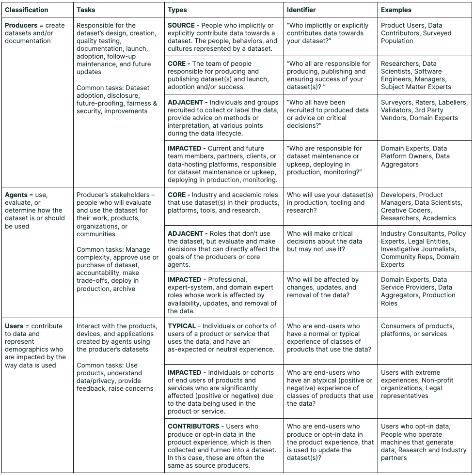
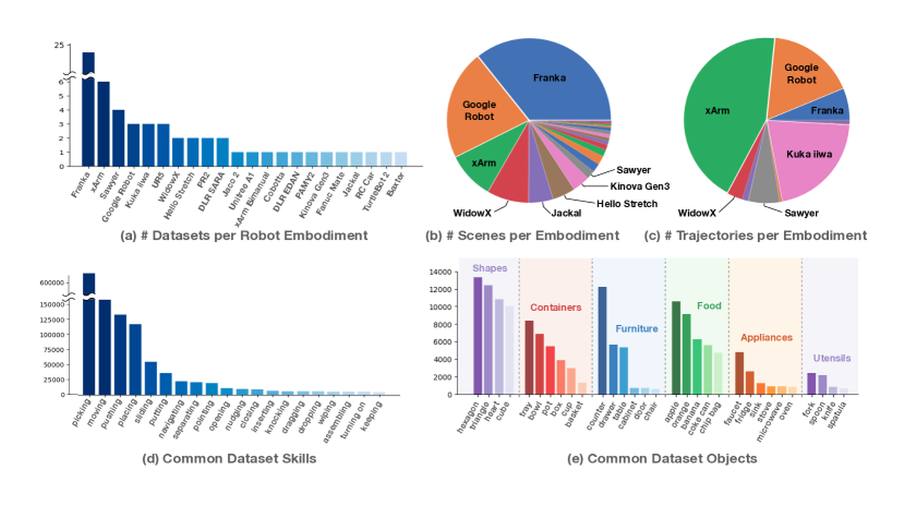

# 数据与数据集基础

模型不是从“张量”开始学的，而是从一批被采集、清洗、标注、切分和版本化的数据开始学的。张量和 token 是进入模型前的形态；数据本身决定模型见过什么、没见过什么、把什么当成标签，以及最后能不能泛化到真实场景。

!!! note "读法定位"
    这页先回答“数据与数据集基础”在「基础知识」里的位置：它解决什么局部问题，依赖哪些前置，最后会影响哪类工程或研究判断。
    **前置**：先知道模型会把文本、图像、视频和动作变成张量或 token；公式或术语卡住时回到术语表。必要时先回 [基础知识入口](index.md) 或 [术语表](../glossary/index.md)。
    **主线关系**：把数据来源、样本、标签、清洗、去重、泄漏和版本先讲清，后面的 tokenizer、训练目标、评测和数据治理才有落点。

{ width="820" }

<small>图源：[Data Cards: Purposeful and Transparent Dataset Documentation for Responsible AI](https://arxiv.org/abs/2204.01075)，Typology table。原论文图意：把 dataset 文档相关角色分为 producers、agents 和 users，并说明不同角色在数据创建、使用、评估和影响中的责任与问题。</small>

!!! note "图解：数据集不是一个文件夹"
    Data Cards 这张表提醒你：dataset 会被不同角色创建、加工、训练、评估和使用。一个数据集不只包含样本本身，还包含来源、采集目的、标注规则、过滤策略、已知偏差、适用边界和更新历史。基础区先抓轻量版：知道样本从哪里来、字段是什么意思、标签如何产生、哪些数据不能混进训练或评测。

!!! note "初学者先抓住"
    数据的最小单位不是“文件”，而是有语义边界的 sample。一个 sample 可以是一句文本、一张图、一个视频片段、一段机器人轨迹或一次多轮对话。训练代码看到的是 tensor，工程判断要先看 sample、label、schema、split 和 version。

!!! tip "遇到这些症状，回看本页"
    训练 loss 很漂亮但线上答非所问、验证集分数突然异常高、同一问题在 train/test 里重复出现、VLA 换机器人就崩、RAG 回答引用了过期文档，先回看本页。很多模型问题其实是数据来源、泄漏、去重、分布偏移或版本不清。

## 一个数据样本包含什么

不同任务的样本长得不一样，但都可以拆成几类字段：

| 字段 | 例子 | 为什么重要 |
| --- | --- | --- |
| input | 文本、图像、视频、传感器状态、用户问题 | 决定模型能看见什么 |
| target / label | 类别、下一个 token、动作、分数、偏好排序 | 决定训练信号是什么 |
| metadata | 来源、时间、语言、设备、机器人、标注者 | 用于分桶、去重、审计和回放 |
| split | train、validation、test、holdout | 防止训练和评测互相污染 |
| version | 数据快照、过滤规则、标注规范版本 | 让实验能复现和比较 |

样本可以写成：

\[
s_i = (x_i, y_i, m_i)
\]

这里 \(x_i\) 是输入，\(y_i\) 是目标或标签，\(m_i\) 是 metadata。没有 \(m_i\)，很多问题会变得不可查：你不知道失败集中在哪个来源、哪个标注规则、哪个设备或哪个时间段。

## Tokenizer 和 Processor 在哪里

数据进入模型前通常会经过 processor：

```text
raw data
  -> parse / decode
  -> clean / normalize
  -> tokenizer or processor
  -> tensor batch
  -> model
```

| 模态 | processor 做什么 | 常见风险 |
| --- | --- | --- |
| 文本 | 分词、归一化、截断、加特殊 token | 语言混杂、乱码、截断掉关键信息 |
| 图像 | resize、crop、normalize、patchify | 小字、小物体和边界被缩没 |
| 视频 | 抽帧、切 clip、时序对齐 | 动作和画面错位 |
| 机器人 | 同步相机、状态和动作；坐标归一化 | 坐标系、频率和 gripper 定义不一致 |
| RAG 文档 | 清洗、切块、embedding、索引 | 页眉页脚噪声、chunk 太碎或过期 |

Tokenizer / processor 不是中性步骤。它会改变模型看到的数据分布，也会决定后面 shape、context、KV cache 和训练吞吐。

## 清洗、去重和泄漏

清洗不是把数据“弄干净”这么简单，而是决定哪些信号被保留、哪些噪声被移除。

| 操作 | 目的 | 误区 |
| --- | --- | --- |
| 清洗 | 去乱码、坏文件、无效标签、重复页眉 | 过度清洗可能删掉真实长尾 |
| 去重 | 防止同一内容重复主导训练或污染测试 | 只按文件名去重远远不够 |
| 泄漏检查 | 防止 train 见过 validation/test 答案 | benchmark、题库、网页镜像最容易漏 |
| 版本化 | 固定数据快照和过滤规则 | 只记录代码版本不够 |

最危险的泄漏通常不是“完全一样的一行数据”，而是近重复：同一道题的改写、同一网页的镜像、同一视频的切片、同一机器人轨迹的相邻片段。如果这些同时进入 train 和 test，模型看起来像泛化，其实是在复述邻近样本。

!!! warning "常见误区：数据越多一定越好"
    更多数据只在有效覆盖增加时有用。重复数据会放大偏差，低质标签会教错目标，来源不平衡会让大桶压住小桶，高风险场景缺失会让平均分掩盖真实失败。

## 分布偏移：训练世界和真实世界不一样

分布偏移可以粗略写成：

\[
p_{\text{train}}(x,y) \neq p_{\text{deploy}}(x,y)
\]

它的意思不是“线上有几个新样本”，而是训练数据和使用场景的统计规律不同。

| 偏移类型 | 例子 | 处理线索 |
| --- | --- | --- |
| 输入偏移 | 新语言、新相机、新文档格式 | 分桶评测、补采样、processor 检查 |
| 标签偏移 | 类别比例、任务成功定义变化 | 重加权、指标重定义、版本标记 |
| 条件关系变化 | 同样观测下动作后果变化 | closed-loop 回放、环境分桶 |
| 时间偏移 | 知识、网页、产品规则更新 | 数据版本、RAG 索引版本、定期回归 |

偏移无法靠一个总分发现。它必须和 metadata、bucket、holdout、线上回放一起看。

## 具身数据为什么更难

{ width="760" }

<small>图源：[Open X-Embodiment: Robotic Learning Datasets and RT-X Models](https://arxiv.org/abs/2310.08864)，Figure 1。原论文图意：统计 Open X-Embodiment 中不同 robot embodiment、scene、trajectory、skill 和 object category 的分布，展示跨机器人数据的异质性。</small>

!!! note "图解：机器人数据的 sample 边界更长"
    Open X-Embodiment 这张图说明，具身数据不是简单的图像分类集。不同机器人、相机、夹爪、控制频率、场景、物体和任务都会改变输入和动作分布。VLA 训练时，sample 往往是一段轨迹：观测、语言、状态、动作、成功/失败和时间戳必须对齐。只把它们压成“图片 + 文本标签”，会丢掉真正决定动作成败的接口信息。

## 一个轻量数据卡

基础阶段不需要写完整治理文档，但至少要能回答：

| 问题 | 最小记录 |
| --- | --- |
| 数据从哪里来 | 来源、许可、采集时间、采集设备 |
| 样本是什么 | 输入、目标、metadata、单位、shape |
| 标签怎么来 | 人工、规则、模型伪标签、环境 reward |
| 怎么切分 | train/validation/test/holdout 的规则 |
| 怎么清洗 | 过滤、去重、截断、异常处理 |
| 有什么偏差 | 大桶、小桶、高风险缺口、已知失败 |
| 当前版本 | 数据快照、代码版本、processor 版本 |

## 和后续专题的关系

- [张量、Shape 与计算图](tensors-shapes-and-computation-graphs.md)：数据进入模型后的 tensor 接口。
- [Transformer 输入与注意力](transformer-attention-and-tokenization.md)：tokenizer 如何把样本变成序列。
- [数据划分与评测指标](data-splits-metrics-and-evaluation-basics.md)：split、bucket 和回放如何支撑结论。
- [训练数据质量与治理](../training/data-quality-dedup-and-governance.md)：更完整的数据治理、去重和质量控制。
- [VLA 评测与数据引擎](../vla/benchmarks-and-data-engines.md)：机器人数据如何进入失败回流。

## 本页结论

数据基础的核心是：先把样本、标签、schema、来源、清洗、去重、泄漏、偏移和版本说清楚，再谈张量、模型和 loss。数据边界不清，训练曲线越漂亮，越可能只是把问题藏得更深。

!!! tip "下一站"
    - 回到本专题入口：[基础知识](index.md)，确认这页在整条路线中的位置。
    - 按导航顺序继续：[符号与最小数学地图](symbols-and-minimal-math.md) 或 [张量、Shape 与计算图](tensors-shapes-and-computation-graphs.md)。
    - 概念或符号卡住时，先查 [术语表](../glossary/index.md)，再回到当前页。
