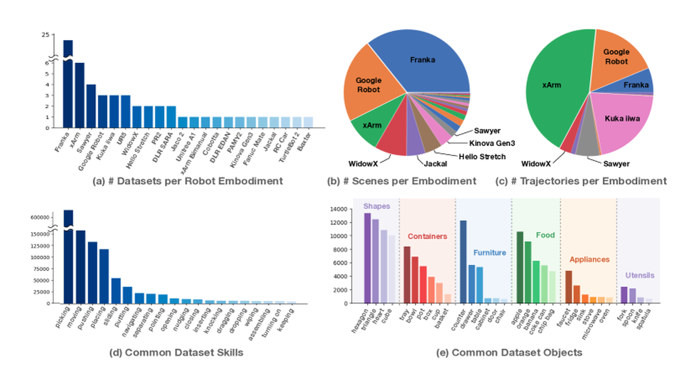
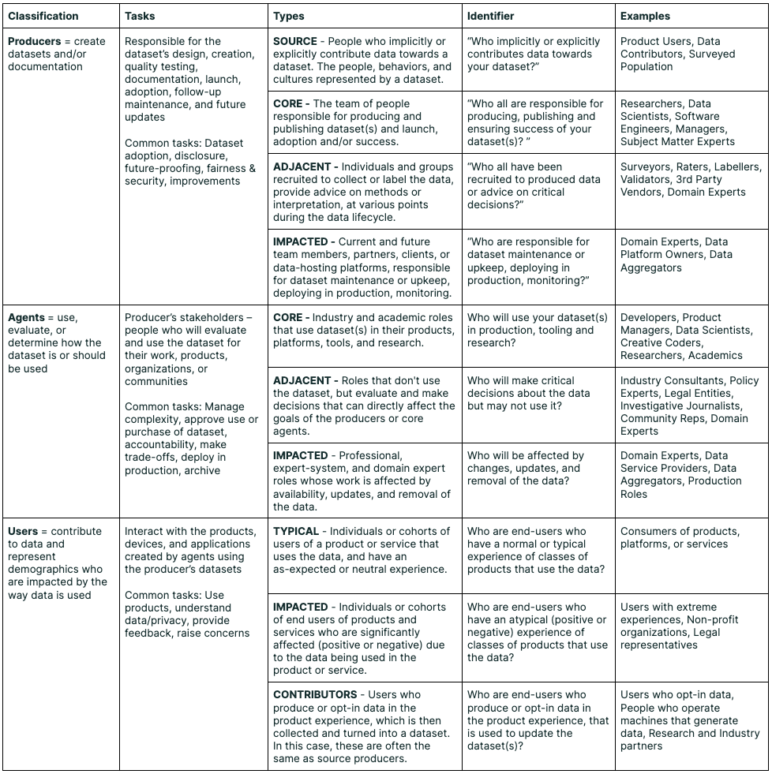

# 数据怎样成为训练样本

训练程序读取的张量与硬盘上的原始记录往往不是同一个对象。一段对话会被拼接、分词、截断，产生输入 token、目标 token 和 loss mask；图像会被缩放裁剪；机器人轨迹还要按时间对齐。数据集最容易被忽略的地方，恰好在这些转换里。理解它，需要能沿着一条记录走到模型真正收到的输入，并说清楚中途删掉了什么。

以一段客服对话为例，用户问“订单可以退吗”，回答是“签收后七天内可以申请”。这是一条原始记录。我们希望模型学习根据用户问题回答，而不要求它在这条 SFT 样本中学习生成用户提问。这个目标会决定后面的标签和 mask。

## 先明确一条样本的边界

原始记录至少包含消息角色、文本、对话编号和来源版本。如果同一用户的多轮对话被拆成很多行，这些行并不相互独立；如果一个答案引用了某版退款规则，规则版本也是理解标签的一部分。

标签表达的是训练目标。人工答案可能有误，规则生成答案会继承规则边界，教师模型答案会继承教师偏差。把它们统一命名为 `label` 并不会使它们自动成为事实。

这里把对话简化成六个 token，仅用于解释索引。真实 tokenizer 往往会把一句话拆成更多 token。

| 位置 | 符号 | 含义 |
| --- | --- | --- |
| 0 | BOS | 序列起点 |
| 1 | USER | 用户角色 |
| 2 | Q | 问题内容 |
| 3 | ASSISTANT | 回答角色 |
| 4 | A | 回答内容 |
| 5 | EOS | 回答结束 |

样本边界、结束标记、角色模板必须与模型使用方式一致。训练时有 EOS、推理时却换了一套停止规则，可能表现为答案不停续写或提前结束。

## Shift 让输入位置预测下一个 token

自回归训练的输入是 `[BOS, USER, Q, ASSISTANT, A]`，目标是 `[USER, Q, ASSISTANT, A, EOS]`。输入位置 3 的表示包含用户问题与回答角色，用它预测目标 A；输入位置 4 已经看到 A，用它预测 EOS。

如果只训练回答，目标位置的 loss mask 可设为 `[0,0,0,1,1]`。有效损失是

\[
\mathcal L=-\frac{\sum_t m_t\log p_\theta(y_t\mid x_{\le t})}{\sum_t m_t}.
\]

分母是两个有效目标，不是五个总位置。全零 mask 的样本没有可用监督，代码要明确跳过或处理它，不能直接除零。

Attention mask 与 loss mask 不同。用户问题即使不计算损失，仍必须被回答位置看见；padding 位置即使不参与 loss，也应按模型约定禁止不必要的注意力。把两个 mask 混为一个，可能让模型失去理解问题所需的信息。

```python
sequence = ['BOS', 'USER', 'Q', 'ASSISTANT', 'A', 'EOS']
inputs, targets = sequence[:-1], sequence[1:]
loss_mask = [0, 0, 0, 1, 1]
for token, target, use in zip(inputs, targets, loss_mask):
    print(token, '->', target, 'train' if use else 'context')
```

最后两行应是 `ASSISTANT -> A train` 和 `A -> EOS train`。在大型训练开始前，打印几条这样的可读样本，经常比先观察总 loss 更容易发现错位。

## 处理过程会改变模型看见的任务

假设长度上限截断了最后的 A 和 EOS，保留下来的都是上下文，样本就没有回答监督。若从中间随机截取，可能保留答案却丢掉问题。Padding、packing 和滑动窗口都必须重新检查标签边界，不能把它们看成纯粹节省空间的操作。

图像裁剪的影响更直观。原问题问包装右下角的日期，裁剪却去掉日期区域，此时正确答案在原始文件里、却不在模型输入里。视频每秒只取一帧，持续 0.1 秒的动作可能完全没被采到。机器人动作和观测错开一个时间步，则会让模型学习错误的响应关系。

因此一次数据检查应该同时查看原始记录、处理后的输入、目标和对应 metadata。只抽查原始文件，无法发现 processor 引入的问题。

## Packing 后，第二条样本能不能看到第一条

为了减少 padding，常把多条短序列拼到一个长序列里。假设两条独立样本分别是

```text
s1 = [BOS, A, EOS]
s2 = [BOS, B, EOS]
packed = [BOS, A, EOS, BOS, B, EOS]
```

如果任务要求每条样本独立预测，普通的下三角 causal mask 还不够。位置 4 的 `B` 会沿着因果方向看到位置 0 到 3，其中包括 `s1` 的内容；模型可能借到前一条样本的信息。需要再加一条按 segment 隔离的条件，query 和 key 只有在属于同一段时才允许连接。

```python
tokens = ['BOS', 'A', 'EOS', 'BOS', 'B', 'EOS']
segment = [0, 0, 0, 1, 1, 1]

allowed = []
for q in range(len(tokens)):
    row = []
    for k in range(len(tokens)):
        causal = k <= q
        same_segment = segment[k] == segment[q]
        row.append(int(causal and same_segment))
    allowed.append(row)

for row in allowed:
    print(row)
```

输出的非零位置应形成两个互不相连的下三角块。第二个块的第一行只能看到自己的 `BOS`，不能回看 `s1` 的 `EOS`。这张矩阵是教学用的布尔关系；具体框架可能把禁止位置写成 `-inf` 加到 attention score，也可能通过 `cu_seqlens` 让 kernel 直接跳过跨段计算。

targets 和 loss mask 也要按段重新对齐。若两条样本都训练回答，`EOS` 可以作为前一 token 的目标；若只训练回答字段，第二段的 mask 需要从它自己的回答开始，不能把 packed 后的全局位置直接切一段连续区间。最小检查应打印每个位置的 token、target、segment 和是否计入 loss：

```python
targets = ['A', 'EOS', '<ignored>', 'B', 'EOS', '<ignored>']
loss_mask = [1, 1, 0, 1, 1, 0]
for i, (token, target, seg, use) in enumerate(
    zip(tokens, targets, segment, loss_mask)
):
    print(i, token, '->', target, 'segment', seg, 'loss' if use else 'ignore')
```

这个例子只说明独立样本 packing 的数据依赖。某些预训练实现会故意允许跨文档上下文，或只在文档边界重置位置编号；那是另一个训练目标，不能看到 `packed` 就默认它们都应使用同一张 mask。复现数据管线时，应同时记录是否跨段 attention、position id 是否重置、EOS 是否保留和 loss 的有效分母。

## 划分要按泄漏单位进行

若一段长文切成十个重叠片段，再逐片段随机分训练和测试，相邻文字很可能出现在两边。对话、用户、视频、机器人 episode 等对象也存在这种相关性。要测新对象上的泛化，应先按对象分组，再切片；要测未来数据，则可能需要按时间划分。

分组规则要匹配问题。按用户隔离是在问能否服务新用户，按商品隔离是在问能否处理新商品，它们不是同一种测试。文本完全去重也不够，相同事实的改写、同一视频的近邻帧或同一任务的轻微变体仍可能泄漏。

## 抽样比例就是训练目标的一部分

设一个数据池 90% 是短问答、10% 是长文推理。如果均匀按记录采样，优化的是按记录平均的风险；如果按 token 平均，长样本自然得到更多总权重；如果人为把两类各采一半，又换了一个目标分布。

这不一定有问题，但必须知道改变了什么。过滤低质量数据可能同时删除罕见语言，去重可能改变常见主题比例，按模型困惑度过滤也可能偏向模型已经擅长的内容。数据“更干净”与任务覆盖“更充分”需要分别检查。

{ width="820" }

<small>图源：[Open X-Embodiment: Robotic Learning Datasets and RT-X Models](https://arxiv.org/abs/2310.08864)，Figure 1。</small>

图分别统计机器人、场景、轨迹、技能和物体。某台机器人轨迹多，不代表任务种类同样丰富。用这些不同分母理解前面的采样权重，才能判断训练是在重复常见轨迹，还是覆盖新的动作与环境。

## 保存什么才能重建同一批输入

原始快照、处理代码、tokenizer 或 processor 版本、划分清单、过滤规则和抽样配置共同决定输入。源文件路径一样，不代表训练数据一样。对于随机裁剪、抽帧和 shuffle，还需记录随机状态或能恢复数据进度的规则。

最有用的 metadata 往往服务于具体排查。例如回答变差时按规则版本分组，OCR 失败时按文字大小分组，机器人失败时按设备和相机标定分组。无需把所有字段塞进模型，字段可以只用于追踪与评价。

{ width="820" }

<small>图源：[Data Cards: Purposeful and Transparent Dataset Documentation for Responsible AI](https://arxiv.org/abs/2204.01075)，Typology table。</small>

沿表格的角色列查不同使用者需要的信息。本文的原始记录、去重、tokenizer、划分与采样版本应能串起同一条处理历史；仅保存最终训练文件，通常无法解释样本是怎样被筛选出来的。

## 对照实现

- [LLMs from scratch 的 GPTDatasetV1](https://github.com/rasbt/LLMs-from-scratch/blob/cdbd33e6d57a71e20ea31434841095fac50cecd8/ch04/01_main-chapter-code/gpt.py)，观察同一 token 序列如何切出 input_chunk 与右移一位的 target_chunk；该例是语言建模，回答专用mask需按任务另外构造。

标签错位与跨文档可见性可继续查看[位置编码与 mask](positional-encoding-masks-and-context.md)，划分后的指标计算见[评测基础](data-splits-metrics-and-evaluation-basics.md)。

## 公式和代码对照

token 窗口和目标右移对照 [LLMs from scratch 的 GPTDatasetV1](https://github.com/rasbt/LLMs-from-scratch/blob/cdbd33e6d57a71e20ea31434841095fac50cecd8/ch04/01_main-chapter-code/gpt.py)，数据 worker 和预取边界对照 [PyTorch DataLoader 文档](https://docs.pytorch.org/docs/stable/data.html)，数据记录与使用者视角参考 [Data Cards](https://arxiv.org/abs/2204.01075)。客服对话、六个 token 和采样比例是本站的教学构造，用来检查样本边界、监督位置和数据分母，不代表某个真实数据集。

回放时给两条长度不同的对话加上唯一 ID，打印原始记录、token、目标和 mask。再把它们 packing 到一行，验证第二条样本的 logits 是否按设计不受第一条样本修改的影响。这个小实验比只看最终 loss 更容易暴露跨样本泄漏。
