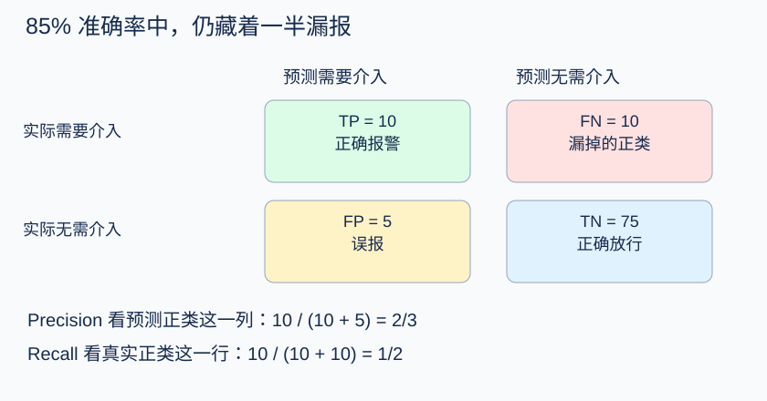
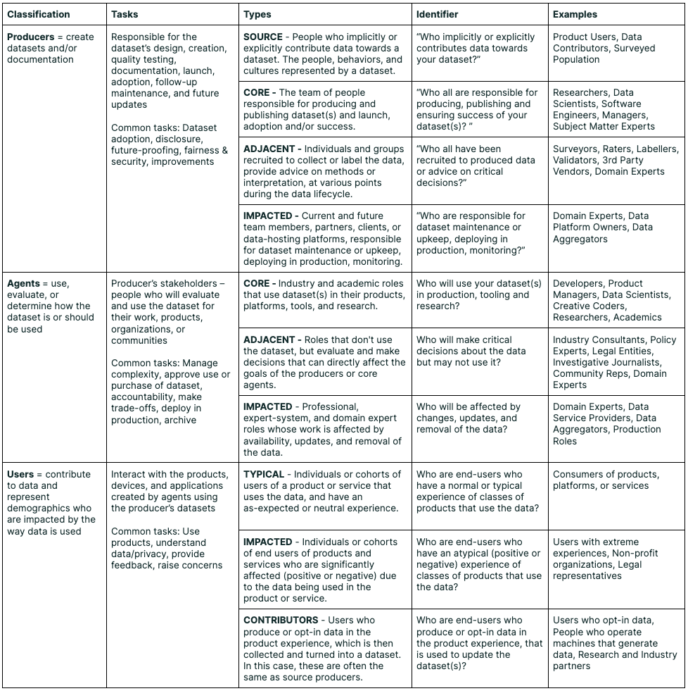

# 数据划分与评测指标

一个“准确率 90%”的系统，可能漏掉了一半真正需要处理的请求。分数没有算错，问题在于平均的对象与任务关心的错误不一致。评测需要把样本来源、决策规则、指标和比较协议连起来。

设我们在 100 条请求中判断哪些需要人工介入，真实需要介入的有 20 条。系统找出其中 10 条，也错误地把 5 条普通请求送给人工。下面一直用这组结果，看看不同指标各自说明什么。

## 从四个计数开始

混淆矩阵为 TP=10、FN=10、FP=5、TN=75。TP 是正确报警，FN 是漏报，FP 是误报，TN 是正确放行。

\[
\mathrm{Accuracy}=\frac{TP+TN}{100}=0.85,
\quad \mathrm{Precision}=\frac{TP}{TP+FP}=\frac23,
\quad \mathrm{Recall}=\frac{TP}{TP+FN}=0.5.
\]



85% 准确率看起来不错，召回率却说明一半需要人工介入的请求被漏掉。如果全部预测为“不需要”，准确率还有 80%，但召回率为零。类别不平衡时必须同时看错误类型。

F1 是 precision 与 recall 的调和平均，本例为 \(2TP/(2TP+FP+FN)=0.571429\)。它把两种错误合成一个数，但这个权衡未必符合业务代价。漏掉危险请求和多叫一次人工，成本可能相差很大。

## 阈值改变的是决策规则

模型可以先给每条请求一个分数，再用阈值决定是否介入。降低阈值通常会把更多样本判为正类，TP 和 FP 都可能增加。PR 曲线或 ROC 曲线展示这种变化，而不是挑一条最好看的点。

阈值应在验证集上按预定目标选择，再锁定到测试集。反复看测试结果换阈值，相当于让测试集参与方案选择。AUC 衡量排序跨阈值的表现，也不直接告诉你某个工作点的误报预算是否可接受。

## 训练、验证和测试需要回答不同问题

训练集用于拟合参数，验证集用于选择阈值、结构和超参数，测试集用于对已确定方案做最终估计。划分单位应来自实际泛化目标。来自同一患者、用户、文档或视频的相关样本，通常不能靠逐行随机划分消除泄漏。

如果部署面对未来月份，随机打散所有月份可能只测到同时间混合分布。时间划分更接近这个问题，但也会包含真实分布变化。此时需明确分数同时受新数据分布和模型泛化影响，不能自动归因于过拟合。

{ width="820" }

<small>图源：[Data Cards: Purposeful and Transparent Dataset Documentation for Responsible AI](https://arxiv.org/abs/2204.01075)，Typology table。</small>

这张表按生产、处理中介与使用者区分数据文档需求。对前面的评测，先定位数据来源和使用条件，再记录划分单位与样本比例。它提供文档组织方式，不直接规定本文的统计检验。

## 平均分隐含了任务比例

假设四类任务占比为 60%、25%、10%、5%，两个版本分数如下。数字为演算设定。

| 任务 | 占比 | 原版本 | 候选版本 |
| --- | ---: | ---: | ---: |
| 普通问答 | 60% | 86 | 88 |
| 复杂推理 | 25% | 79 | 79.5 |
| 工具调用 | 10% | 68 | 71 |
| 高风险拒答 | 5% | 94 | 86 |

加权结果分别为 82.85 与 84.075，增幅 1.225 个百分点。候选的高风险拒答下降 8 个百分点，却被其他组提升掩盖。总分只回答在这组权重下的平均，不能替代各关键组的要求。

部署比例改变时，即使每组能力不变，总分也会改变。报告应同时保留每组分数、样本量和权重，这样读者才能区分模型变化与样本构成变化。小样本组还需要更宽的不确定性范围。

## 同一批题上的差异要成对看

假设两个版本共同答对 75 题，只有旧版答对 5 题，只有新版答对 10 题，都错 10 题。旧版准确率 80%，新版 85%，真正发生变化的是 15 题，而非两组互不相关的 100 题。

令每题差值 \(d_i\) 为新版正确与旧版正确的差，取值 -1、0、1。平均差为 0.05。可对这些配对记录做 bootstrap，或按适当假设使用配对检验。把两个准确率各自的独立标准误直接相加，会丢掉它们共享样本的信息。

单个准确率的近似标准误为 \(\sqrt{\hat p(1-\hat p)/n}\)。在 100 个独立样本、准确率 0.8 时为 0.04，只能提示波动尺度；接近 0 或 1、样本少或样本相关时，应换用更合适的区间或按用户/episode分组重采样。公式与数值见[采样与估计](../prerequisite-math/sampling-estimation-and-calibration.md)。

## 生成模型还要固定生成与评分协议

一题采样一次是否成功，与采样多次至少一次成功，是不同问题。若每题独立采样 \(n\) 次，其中 \(c\) 次通过验证，常用 pass@k 估计为

\[
1-\frac{\binom{n-c}{k}}{\binom nk},\qquad n\ge k.
\]

例如 \(n=5,c=2,k=2\)，结果为 0.7。这个量描述在采样候选中至少一个成功的概率估计，前提还包括固定采样协议和正确的验证器；它不表示部署系统知道哪个答案正确。若要选择一个最终答案，还需投票、rerank或验证流程并另算成本。

模型比较时应固定或明确披露 prompt、温度、采样次数、输出上限、工具权限、检索资料和评分器。Judge 可能偏爱长答案或某种格式，交换答案顺序、人工复核争议样本能帮助识别这种偏差。最终回答正确也不代表引用支持结论，需要单独核查证据。

```python
old = [.86, .79, .68, .94]
new = [.88, .795, .71, .86]
weights = [.6, .25, .1, .05]
a = sum(w*s for w,s in zip(weights, old))
b = sum(w*s for w,s in zip(weights, new))
print(round(100*a, 3), round(100*b, 3), round(100*(b-a), 3))
```

输出 `82.85 84.075 1.225`。把计算写出来既能防算术错误，也能暴露分母和权重是否符合实际任务。

## 进一步阅读

- [D2L 的模型选择与过拟合](https://github.com/d2l-ai/d2l-zh/blob/e6b18ccea71451a55fcd861d7b96fddf2587b09a/chapter_multilayer-perceptrons/underfit-overfit.md)，区分用于拟合、选择和独立估计的数据角色。

- [Evaluating Large Language Models Trained on Code](https://arxiv.org/abs/2107.03374)给出 pass@k 的采样估计背景。
- [评估与消融方法](../training/evaluation-and-ablation-methodology.md)进一步讨论训练预算和变量控制。
