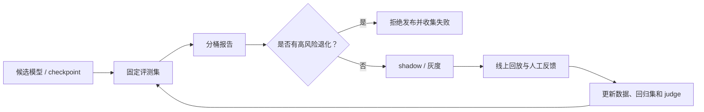

# 数据划分与评测指标

模型训练不是只看 loss，模型能力也不是只看一个 benchmark 分数。要判断一个模型是否真的更好，必须把数据划分、指标选择、分桶评测和错误分析放在一起。

{ width="820" }

<small>图源：[Data Cards: Purposeful and Transparent Dataset Documentation for Responsible AI](https://arxiv.org/abs/2204.01075)，Typology table。原论文图意：把 dataset 文档相关角色分为 producers、agents 和 users，并说明不同角色在数据创建、使用、评估和影响中的责任与问题。</small>

!!! note "图解：评测不是只有 test set"
    这张表提醒你：数据和评测结论会被不同角色使用，也会影响不同人群。Train/validation/test 只是第一层划分；真正可信的评测还要说明数据由谁产生、谁会使用、谁会被影响、哪些样本代表真实风险。benchmark 是入口，不是结论。能支撑迭代的是固定样本、分桶指标、失败案例、上线回放和清楚的数据责任边界。

!!! note "初学者先抓住"
    评测不是给模型打一个总分，而是判断模型在哪些场景可靠、在哪些场景危险。平均分只能说明整体趋势，分桶和失败样本才能指导下一步怎么改。看到 benchmark 提升时，先追问数据划分是否干净、提升集中在哪些桶、失败样本是否可回放。

!!! tip "遇到这些症状，回看本页"
    平均分提高但高风险任务失败更多、上线回流的问题离线集里从没出现、消融表里每个版本都“略有提升”但无法复现，或者模型开始过拟合同一批验证样本时，回看本页。它能帮你判断该建哪些 bucket、哪些样本要进 holdout、哪些指标能指导回流，而不是继续追一个总分。

## 0. 读法卡：评测先问四件事

| 问题 | 为什么重要 |
| --- | --- |
| 数据怎么分 | 防止把训练、调参和最终测试混在一起 |
| 指标算什么 | 防止用错误指标证明错误结论 |
| 是否分桶 | 防止平均分掩盖关键失败 |
| 失败能否回放 | 防止只知道分数变化，不知道怎么修 |

初学者可以先把评测理解成“证据链”，不是“排行榜”。一个模型是否更好，要看它在固定数据、关键分桶、失败样本和真实使用场景里是否都站得住。

## 1. Train / Validation / Test

最基本的数据划分是：

| 数据集 | 用途 | 不能做什么 |
| --- | --- | --- |
| Train | 更新模型参数 | 不能用来证明泛化 |
| Validation | 调超参和选 checkpoint | 不能反复过拟合 |
| Test | 最终报告结果 | 不应参与调参 |

如果用 test 集反复调参，test 集就会被污染，分数会越来越像“适配测试集”，而不是代表真实泛化。

!!! note "常见误区：验证集可以无限次试到满意"
    Validation set 本来用于调参，但反复围着同一批样本改 prompt、改数据、改超参，也会慢慢过拟合开发过程。更稳的做法是保留 holdout 或 shadow eval：平时少看它，只在关键节点检查改动是否真的泛化。

## 2. 指标必须匹配任务

不同任务需要不同指标：

| 任务 | 常见指标 | 注意点 |
| --- | --- | --- |
| 分类 | accuracy、F1 | 类别不均衡时 accuracy 可能误导 |
| 检索 | Recall@K、nDCG、MRR | 要看召回池和排序阶段 |
| 生成 | BLEU、ROUGE、human eval | 自动指标很容易漏掉事实性 |
| VLM | OCR 准确率、定位、问答正确率 | 图表、文档、屏幕应分桶 |
| 推理系统 | TTFT、TPOT、QPS、P99 | 平均延迟不代表线上体验 |

指标不是越多越好，而是要能回答当前问题。

## 3. 为什么要分桶

平均分会掩盖局部失败。比如一个 VLM 在普通图片问答上很强，但在发票、表格和小字体 OCR 上很弱。如果只看总分，问题可能完全被盖住。

常见分桶方式：

1. 按任务类型：问答、检索、代码、数学、OCR。
2. 按输入长度：短文本、长文本、超长上下文。
3. 按风险等级：普通样本、高价值样本、安全敏感样本。
4. 按模态：文本、图像、视频、动作。
5. 按失败类型：幻觉、格式错、召回漏、拒答错。

## 4. 错误分析比排行榜更重要

如果一个模型分数下降，只知道“下降了 2 分”没有太大价值。更重要的是知道：

1. 哪些样本错了；
2. 错误集中在哪些桶；
3. 是数据问题、模型问题、提示问题还是系统问题；
4. 能不能通过回放稳定复现；
5. 下一轮该补数据、改目标还是改系统。

## 5. 一个评测闭环伪代码

```text
for checkpoint in candidate_checkpoints:
    results = evaluate(checkpoint, eval_sets)
    report = bucketize(results)
    failures = collect_failures(report)

    if high_risk_bucket_regresses(failures):
        reject(checkpoint)
    else:
        promote_to_shadow_test(checkpoint)

analyze_failures()
update_data_or_training_recipe()
```

这段伪代码强调：评测不只是打分，而是要能决定 checkpoint 是否进入下一阶段，并驱动数据和训练策略调整。

## 6. 和 benchmark 的关系

公开 benchmark 很有用，但不能替代自己的任务评测。

公开 benchmark 适合：

- 横向比较模型大致能力；
- 找到领域常用指标；
- 复现论文和系统能力边界；
- 发现明显短板。

自建评测更适合：

- 业务真实样本；
- 高价值长尾；
- 线上失败回放；
- 特定格式和工具协议；
- 安全与合规边界。

## 7. 评测闭环图



这张图强调评测不是一次性打分，而是发布门禁和数据回流系统。一个模型如果平均分提高，但高风险桶退化，就不应该直接上线；一个模型如果线上出现新失败，也不应该只写事故复盘，而要把样本进入回归集。

## 8. 一个分桶报告长什么样

| 桶 | 样本数 | baseline | candidate | 结论 |
| --- | ---: | ---: | ---: | --- |
| 普通问答 | 5,000 | 86.2 | 87.1 | 可接受提升 |
| 长上下文 | 800 | 72.4 | 70.8 | 轻微退化，需看失败 |
| 工具调用 | 600 | 64.0 | 68.5 | 明显提升 |
| 高风险拒答 | 300 | 93.2 | 89.1 | 阻断发布 |
| 已修复事故样本 | 120 | 96.0 | 94.5 | 需复查是否回归 |

这样的报告比一个总分有用得多。它能直接告诉团队下一步：高风险拒答必须先修，长上下文需要看失败回放，工具调用可以保留收益。对于 VLM/VLA 和世界模型，同样要把 OCR、小物体、动作敏感性、risk calibration、失败恢复分桶，而不是只看总体 success rate。

## 9. 和后续专题的关系

- [训练评测与消融](../training/evaluation-and-ablation-methodology.md)：如何判断训练改动是否可信。
- [推理在线评测](../inference/observability-and-online-evaluation.md)：如何把离线评测接到线上观测。
- [强化学习总览](../reinforcement-learning/index.md)：reward、闭环评测和世界模型任务指标如何影响训练结论。
- [量化评测与部署清单](../quantization/evaluation-and-deployment-checklist.md)：量化掉点如何验收。

## 小结

评测的核心不是“拿一个分数”，而是建立可复现、可分桶、可回放、能驱动下一步行动的证据链。没有这条证据链，模型改动很难长期可信。
