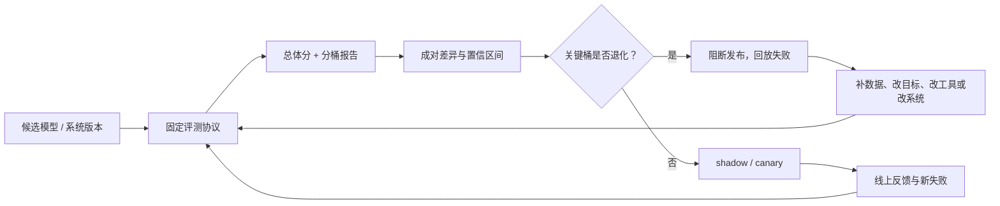

# 数据划分与评测指标：一个分数为什么不够

评测不是给模型贴一个排行榜分数，而是建立一条证据链：这个模型在什么数据上、按什么指标、相对哪个基线、在哪些分桶里变好或变差、结果有多大不确定性、失败能不能复现、能不能支撑发布决策。

这页只回答一个核心问题：**当论文或实验报告说“模型提升了 2 分”时，怎样判断这 2 分是真的、有用的、可泛化的，而不是数据污染、指标错配或平均分幻觉？**

## 评测对象先要说清楚

一个评测结论至少包含四个对象：

\[
(M, D, P, C)
\]

\(M\) 是模型或系统版本，\(D\) 是评测数据，\(P\) 是推理协议，\(C\) 是判分规则。很多争议来自其中某一项没固定：同一个模型换了 prompt、检索器、temperature、工具 schema、judge 或后处理，已经不是同一个被评测对象。

因此，评测表里不应该只写模型名和分数。至少要能追到：模型 checkpoint、数据版本、prompt / system message、采样参数、检索索引版本、工具版本、judge 版本、后处理规则和随机种子。否则分数变化很难归因。

{ width="820" }

<small>图源：[Data Cards: Purposeful and Transparent Dataset Documentation for Responsible AI](https://arxiv.org/abs/2204.01075)，Typology table。原图表达数据集文档要同时服务 producers、agents 和 users，不同角色关心的数据创建、使用、评估和影响不同。本站读法是：评测可信度不是从 metric 开始，而是从数据来源、使用边界和责任边界开始。</small>

## Train、validation、test 不是三个名字

训练集用于更新参数，验证集用于调参和选 checkpoint，测试集用于最终报告。它们的区别不是文件夹名，而是“是否允许根据结果继续改系统”。

如果反复看 test 分数，再改数据、prompt、超参或模型，test 就变成了开发集。它仍然叫 test，但已经不能证明泛化。验证集也会被开发过程过拟合：每一次围绕同一批样本改 prompt、调阈值、调采样参数，都会把系统向这批样本贴近。

更稳的结构是四层：

| 集合 | 用途 | 读法 |
| --- | --- | --- |
| train | 更新参数或构造 few-shot / prompt 规则 | 不能证明泛化 |
| validation / dev | 调超参、选 checkpoint、改 prompt | 可反复看，但要承认会过拟合 |
| test | 阶段性报告和模型选择后的确认 | 不应参与开发循环 |
| sealed holdout | 少看或不看，只在关键节点打开 | 检查长期开发是否污染评测 |

真实项目里，完全不看 holdout 很难，但可以降低使用频率：只在发布前、重大 recipe 改动后、或公共 benchmark 可能被污染时使用。它的价值不是样本多，而是开发者还没有围绕它调过系统。

## 污染往往不是完全重复

数据污染最容易被低估。LLM 预训练数据来自网页、代码、论坛、书籍和合成数据，公开 benchmark 的题目、解析、翻译、改写和讨论很可能出现在训练语料里。机器人和视频数据也有近重复风险：同一条轨迹的相邻片段、同一场景的不同摄像机、同一任务的重录样本，如果跨 split 出现，评测会被抬高。

污染检查不能只做 exact match。常见层级是：

| 检查 | 能发现什么 | 漏掉什么 |
| --- | --- | --- |
| hash / exact match | 完全相同文件或文本 | 改写、翻译、截图、局部片段 |
| n-gram overlap | 题目或答案大段重合 | 语义改写、模板变体 |
| embedding nearest neighbor | 近义样本、同题改写 | 模型 embedding 的盲区 |
| metadata / trajectory boundary | 同源网页、同一视频、同一机器人轨迹 | 没记录 metadata 时无法查 |

现实目标不是宣称“零污染”，而是写清污染假设、检查方法和剩余风险。越是核心 benchmark，越应该维护 contamination watchlist，并用私有真实集降低对单一公开榜单的依赖。

## 指标是在定义“什么叫好”

指标不是中性统计。Accuracy 把每个样本等权；F1 更关注正类召回和精确率；pass@k 奖励多次采样中至少一次成功；BLEU/ROUGE 偏向表面重合；human eval 和 LLM judge 又会引入标注口径和 judge 偏差。

分类任务里，precision、recall 和 F1 是：

\[
\text{Precision}=\frac{TP}{TP+FP},\qquad
\text{Recall}=\frac{TP}{TP+FN}
\]

\[
F_1=\frac{2\cdot \text{Precision}\cdot \text{Recall}}{\text{Precision}+\text{Recall}}
\]

如果任务是安全拒答，false negative 可能比 false positive 更贵；如果任务是客服自动化，错误拒答会伤体验；如果任务是代码生成，pass@1 和 pass@k 回答的是不同问题。指标一换，“更好”的含义就变了。

代码评测常见 pass@k 可以理解为：一次生成不一定成功，多采样 \(k\) 次，只要有一个通过测试就算成功。它适合衡量“模型能不能在搜索空间里产生正确解”，但不等于单次交互体验好，因为线上用户通常不想等 \(k\) 份答案和测试。

## 一个平均分可以掩盖关键退化

假设候选模型平均分从 82.0 涨到 83.5，看起来提升 1.5。但分桶后可能是：

| 桶 | 样本占比 | baseline | candidate | 变化 |
| --- | ---: | ---: | ---: | ---: |
| 普通问答 | 70% | 86.0 | 88.0 | +2.0 |
| 长上下文 | 15% | 74.0 | 73.5 | -0.5 |
| 工具调用 | 10% | 68.0 | 71.0 | +3.0 |
| 高风险拒答 | 5% | 94.0 | 86.0 | -8.0 |

加权平均仍然会涨，但如果高风险拒答是发布门槛，这个模型应该被拦下。平均分回答的是“总体样本上怎么样”，不是“最不能退化的地方有没有退化”。

分桶不是附表，而是评测主结构。常见桶包括长度、语言、来源、任务类型、模态、难度、风险等级、业务价值、失败类型、是否检索、是否工具调用、是否多轮、是否含图表/OCR/小物体。VLA 和世界模型还要按 embodiment、场景、物体、动作类型、接触、遮挡、恢复动作和 horizon 分桶。

## 分数有统计不确定性

评测集有限，所以分数只是总体能力的估计。对于 accuracy，如果样本数是 \(n\)，观测准确率是 \(\hat p\)，一个粗略标准误差是：

\[
\operatorname{SE}(\hat p)\approx\sqrt{\frac{\hat p(1-\hat p)}{n}}
\]

如果 \(n=100\)、\(\hat p=0.80\)，标准误差约是 0.04；1-2 分变化很可能只是噪声。如果 \(n=10,000\)，同样准确率的标准误差约是 0.004，微小变化才更有解释空间。

真实模型比较还要考虑 paired evaluation。两个模型在同一批样本上比较，比各自在不同样本上比较更可靠；看“哪些样本从错变对、哪些从对变错”，比只看两个平均分更能说明问题。人工评测和 LLM judge 还要看标注者一致性、judge 稳定性、位置偏差、长度偏差和复评样本。

## LLM 评测多了协议层

LLM 评测不是“输入题目，输出分数”这么简单。协议层会显著改变结果：

| 协议项 | 为什么会影响分数 |
| --- | --- |
| prompt / system message | 同一题目换指令，模型行为可能完全不同 |
| temperature / top-p / n samples | 决定单次答案、多样性和 pass@k |
| max tokens / stop sequence | 影响长推理、代码和 JSON 是否完整 |
| tool / RAG | 检索质量和工具 schema 可能比模型本身更关键 |
| judge | 自动评分口径、偏差和格式解析会改变结论 |

所以“模型 A 比模型 B 高 3 分”必须附带协议。若 A 用 RAG、B 不用；A 用 8 次采样取最好、B 用 greedy；A 的 judge prompt 更新过、B 用旧版本，这个对比就不再是单纯模型能力对比。

## 评测要能驱动下一步行动

一个可用评测闭环不是打分结束，而是把失败变成下一轮训练、数据、prompt 或系统改动。

这条闭环要求失败样本可回放。只知道“长上下文掉 2 分”还不够；要知道是检索召回漏、上下文被截断、引用格式错、模型没遵守工具协议，还是 judge 把等价答案判错。没有回放，评测只能制造焦虑，不能指导修复。

## 公开 benchmark 和自建评测分工不同

公开 benchmark 的价值是外部对齐：它让不同团队能在共同题集上比较模型，帮助发现明显短板，也方便复现论文。它的风险是被训练数据污染、被长期调参适配、和真实任务分布不一致。

自建评测的价值是贴近真实任务：它可以覆盖业务样本、事故样本、长尾高价值场景、工具协议、安全边界和线上失败回放。它的风险是样本少、口径漂移、团队内部自我确认。因此自建评测也要版本化、保留 holdout，并记录每次样本加入的原因。

HELM 的思路值得学习：不要只用一个分数，而是把 scenarios、metrics 和 harms 组合起来看。OpenAI Evals、EleutherAI lm-evaluation-harness、SuperCLUE、FlagEval 等框架或榜单也都体现了同一个方向：评测应该是可复现协议，不只是一次性表格。

## 读完以后怎么判断

评测的核心不是追一个总分，而是证明一个改动是否可靠、可归因、值得上线。数据划分回答“有没有被开发过程污染”；污染检查回答“模型是否已经见过近邻样本”；指标回答“什么叫好”；分桶回答“关键场景有没有退化”；置信区间和成对比较回答“差异是不是噪声”；失败回放回答“下一步该修什么”。

当这些证据都能连起来，模型提升才不只是漂亮数字，而是可以支持训练决策、系统发布和长期维护的工程事实。

## 外部精读

- [Model Cards for Model Reporting](https://arxiv.org/abs/1810.03993)
- [Data Cards](https://arxiv.org/abs/2204.01075)
- [HELM: Holistic Evaluation of Language Models](https://arxiv.org/abs/2211.09110)
- [OpenAI Evals](https://github.com/openai/evals)
- [EleutherAI lm-evaluation-harness](https://github.com/EleutherAI/lm-evaluation-harness)
- [SuperCLUE](https://www.superclueai.com/)
- [FlagEval](https://flageval.baai.ac.cn/)

## 相关阅读与下一步

- 外部材料：[The Illustrated Transformer](https://jalammar.github.io/illustrated-transformer/)。
- 外部材料：[Dive into Deep Learning](https://d2l.ai/)。
- 外部材料：[Distill Circuits](https://distill.pub/2020/circuits/visualizing-weights/)。
- 站内下一步：[基础概念专题](index.md)。
- 站内下一步：[Transformer 输入与注意力](transformer-attention-and-tokenization.md)。
- 站内下一步：[数值、内存与运行时基础](numerics-memory-and-runtime-basics.md)。
