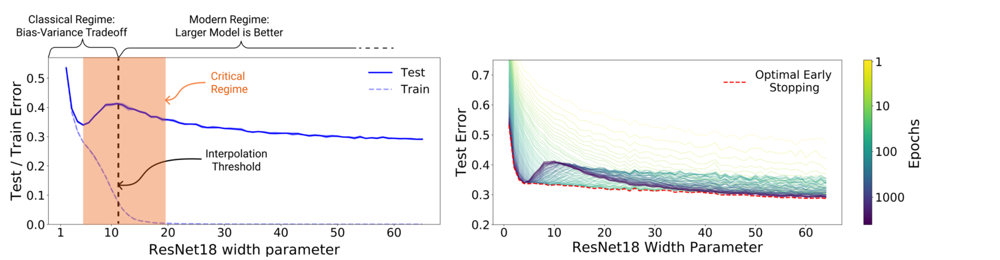

# 泛化、正则化与分布偏移：训练 loss 下降为什么不等于模型可用

训练集 loss 下降以后，模型仍未必真正学会任务。

优化回答的是“参数能不能把当前训练目标降下来”；泛化回答的是“这个规律能不能离开训练样本继续成立”；分布偏移回答的是“训练时看见的世界和真正使用时的世界是不是同一个世界”。这三件事连在一起，才决定模型是否可用。

如果你关心 causal、intervention、counterfactual 和 OOD 这些判断语言，可以先读前置数学里的 [因果、反事实与分布偏移](../prerequisite-math/causality-counterfactual-and-distribution-shift.md)。重点放在训练 loss、正则化、数据切分、分桶评测和部署风险如何连成一个可检查的工程问题。

{ width="920" }

<small>图源：[Deep Double Descent: Where Bigger Models and More Data Hurt](https://arxiv.org/abs/1912.02292)，Figure 1。原图展示模型宽度、训练 epoch 与 test error 的 double descent 现象。这张图说明：现代深度学习里的泛化不能只靠“模型越大越过拟合”这种旧直觉判断，必须看曲线、数据、正则化和分布证据。</small>

!!! tip "数学先修"
    需要用到[因果、反事实与分布偏移](../prerequisite-math/causality-counterfactual-and-distribution-shift.md)、[采样估计](../prerequisite-math/sampling-estimation-and-calibration.md)和[优化与正则化](../prerequisite-math/optimization-and-gradient-methods.md)，分别说明风险来自哪里、证据有多稳、训练约束改变了什么。

## 第一张账：训练风险不是部署风险

训练时最小化的是经验风险：

\[
\hat{R}_{\text{train}}(\theta)
=
\frac{1}{n}\sum_{i=1}^{n}\ell(f_\theta(x_i),y_i)
\]

这行式子在说：把训练集里 \(n\) 个样本的 loss 求平均，然后调整参数 \(\theta\) 让它下降。这里的样本来自训练数据，loss 来自你选定的训练目标。

真正关心的是部署风险：

\[
R_{\text{deploy}}(\theta)
=
\mathbb{E}_{(x,y)\sim p_{\text{deploy}}}
\left[\ell(f_\theta(x),y)\right]
\]

这里 \(p_{\text{deploy}}\) 是真实使用场景的数据分布。训练风险下降，只证明模型越来越适合训练集和训练目标；它不自动证明部署风险下降。二者之间的差距来自三类事情：训练样本有限，训练数据可能有偏，部署分布可能已经变了。

因此泛化误差可以先粗略理解成：

\[
R_{\text{deploy}}(\theta)-\hat{R}_{\text{train}}(\theta)
\]

这不是一个训练时能直接看见的量，因为 \(p_{\text{deploy}}\) 往往未知。验证集、测试集、holdout、线上回放和分桶评测，都是在用可观测证据逼近这个不可直接观测的问题。

## 第二张账：train、validation、test 各自回答不同问题

很多实验失败不是模型坏了，而是 split 的问题问错了。

| 数据切分 | 它应该回答什么 | 不能用来做什么 |
| --- | --- | --- |
| train | 优化目标是否能被模型拟合 | 不能证明泛化 |
| validation | 当前超参、训练轮数、checkpoint 选择是否合理 | 反复调参后不再是纯粹泛化证据 |
| test | 在冻结决策后给一次外部估计 | 不该参与模型选择 |
| holdout / canary set | 防止团队在长期迭代中把 test 调穿 | 样本太少时不能代表所有风险 |
| online replay / shadow eval | 接近真实部署流量 | 受日志偏差、策略变化和时间漂移影响 |

Train-val gap 常被用来判断过拟合，但它只是信号，不是诊断结论：

| 曲线现象 | 常见解释 | 还要查什么 |
| --- | --- | --- |
| train 差、validation 差 | 欠拟合、目标错、数据太难、训练不足 | loss 实现、学习率、模型容量、标签规则 |
| train 好、validation 差 | 过拟合、泄漏反向、验证集更难 | 去重、split 规则、长尾 bucket |
| train 好、validation 好、真实场景差 | validation 太像 train，被反复调参或已污染 | holdout、线上回放、时间切分 |
| 总分好、关键场景差 | 大桶覆盖了小桶失败 | 按来源、长度、语言、设备、任务风险分桶 |

最危险的是“假泛化”：validation 看起来很好，但其实 train 和 validation 共享了近重复样本、同一题库改写、同一网页镜像、相邻视频片段或同一机器人轨迹的前后段。模型看似学到了规则，其实学到了邻近样本。

## 第三张账：过拟合不是“大模型专属问题”

经典说法会把模型分成欠拟合和过拟合：容量太小容易欠拟合，容量太大容易过拟合。这个直觉仍然有用，但在现代深度学习里不够完整。

《Understanding Deep Learning Requires Rethinking Generalization》指出，深度网络即使可以记住随机标签，也仍可能在真实标签上泛化。这说明“能记忆”不等于“一定只会记忆”。Deep Double Descent 进一步说明，当模型容量跨过插值阈值后，test error 可能再次下降。

所以更稳的读法是：

| 问法 | 比简单结论更有用的判断 |
| --- | --- |
| 模型是不是太大 | 它是否在关键 bucket 上稳定改善，还是只记住训练样本 |
| 训练是不是太久 | 后期 checkpoint 是否开始适配噪声、泄漏或长尾错误标签 |
| 数据是不是太多 | 新数据是否增加有效覆盖，还是重复放大偏差 |
| 正则是不是不够 | 退化来自模型自由度，还是来自 split、标签、指标和部署偏移 |

大模型时代的泛化判断更像证据审计：看训练曲线、验证曲线、去重结果、时间切分、分桶错误、线上回放和对照实验，而不是只看参数量。

## 正则化到底在限制什么

正则化不是“让模型弱一点”。更准确地说，正则化是在限制模型利用脆弱捷径，让它更倾向于学对真实场景也成立的规律。

| 方法 | 它限制什么捷径 | 可能的代价 |
| --- | --- | --- |
| Weight decay | 过大的权重和过尖的解 | 过强时会压掉需要高置信度的特征 |
| Dropout | 对少数激活路径的依赖 | 大模型、归一化和数据规模变化后收益不一定稳定 |
| Data augmentation | 对固定视角、颜色、裁剪、噪声模式的依赖 | 不合理增强会破坏任务语义 |
| Mixup / CutMix | 对单个样本边界的硬记忆 | 可能不适合所有结构化输出或精细定位任务 |
| Label smoothing | 对 one-hot 标签的过度自信 | 可能伤害蒸馏、校准或需要明确类别边界的任务 |
| Early stopping | 后期适配训练噪声 | validation 被调穿时会选择错误 checkpoint |

Weight decay 的常见写法是：

\[
\min_\theta
\frac{1}{n}\sum_{i=1}^{n}\ell(f_\theta(x_i),y_i)
+
\lambda\|\theta\|_2^2
\]

这里 \(\lambda\) 控制正则项强度，\(\|\theta\|_2^2\) 惩罚权重大小。它不是神秘的泛化按钮，而是在优化目标里加入“不要用过大的参数解释训练样本”的偏好。AdamW 这类方法强调把 weight decay 和 Adam 的梯度更新解耦，原因是自适应优化器里的 L2 penalty 与真正的权重衰减并不完全等价。

Dropout 可以理解成训练时随机隐藏部分激活：

\[
h'=\frac{m\odot h}{1-p},
\quad
m_j\sim\operatorname{Bernoulli}(1-p)
\]

这里 \(h\) 是激活，\(m\) 是随机 mask，\(p\) 是 dropout probability。除以 \(1-p\) 是为了让训练时激活期望大致保持不变。这个公式的工程含义是：模型不能稳定依赖某一个神经元或路径，必须学会更分散的表示。

Label smoothing 则把硬 one-hot 标签改软：

\[
y^{LS}
=
(1-\epsilon)y+\epsilon / K
\]

这里 \(K\) 是类别数，\(\epsilon\) 是平滑强度。它限制模型把目标类概率推到极端自信，但如果任务本身需要非常清楚的边界，或者后续要做蒸馏和校准，就要实际验证收益。

## 分布偏移：训练世界和使用世界不一样

分布偏移可以先写成：

\[
p_{\text{train}}(x,y)\neq p_{\text{deploy}}(x,y)
\]

这行式子在说：训练样本和部署样本的统计规律不一样。它不只是“线上出现了几个新样本”，而是输入、标签、条件关系或时间背景发生了系统性变化。

| 偏移类型 | 例子 | 更可靠的证据 |
| --- | --- | --- |
| 输入偏移 | 新语言、新相机、新文档格式、新光照 | 按来源/设备/语言分桶，OOD holdout |
| 标签偏移 | 类别比例、成功定义、风险偏好变化 | 标签版本、任务定义变更记录 |
| 条件关系变化 | 同样观测下正确动作不同 | closed-loop 回放、环境 bucket |
| 时间偏移 | 法规、产品、网页、知识更新 | 时间切分、近期流量回归 |
| 选择偏差 | 训练日志只来自旧策略能到达的状态 | off-policy 评估、人工采样补洞 |

WILDS 这类 benchmark 的价值不在于又多了一个总分，而在于它把真实世界分布偏移显式做成评测对象。对工程项目也是一样：只要平均分掩盖了关键桶失败，模型就还没有被真正评估。

## 一个实用排查顺序

泛化问题不要一上来换模型。更稳的顺序是先确认评测证据干净，再讨论训练 recipe。

```text
1. 确认 split 规则：随机切分、时间切分、实体切分还是场景切分。
2. 查近重复和泄漏：题库改写、网页镜像、相邻视频片段、同轨迹样本。
3. 分桶看曲线：来源、长度、语言、设备、难度、风险、时间。
4. 看错误样本：模型到底在记格式、走捷径，还是缺少真实信号。
5. 再决定动作：补数据、改增强、调正则、早停、重做指标或改部署保护。
```

这个顺序看似朴素，但能避免一种常见误判：用更复杂的模型或更强的正则去修补一个本质上是数据泄漏、标签定义或部署偏移的问题。

## 读完以后怎么判断

泛化不是训练结束后的附加检查，而是从数据切分、训练目标、正则化、分桶评测到部署回放贯穿全程的问题。训练 loss 下降只证明优化在训练集上成功；模型是否可用，要看它能否在冻结决策、干净 split、关键 bucket 和真实分布变化下继续保持可靠。

## 外部材料

- [Understanding Deep Learning Requires Rethinking Generalization](https://arxiv.org/abs/1611.03530)：理解“可记忆”与“能泛化”之间的张力。
- [Deep Double Descent](https://arxiv.org/abs/1912.02292)：理解现代模型容量、训练轮数和泛化曲线为什么不是单调直觉。
- [WILDS](https://arxiv.org/abs/2012.07421)：理解真实世界分布偏移评测为什么要按环境和群组拆开看。
- [Dropout](https://jmlr.org/papers/v15/srivastava14a.html)：理解 dropout 作为正则化方法的原始动机和机制。
- [Decoupled Weight Decay Regularization](https://arxiv.org/abs/1711.05101)：理解 AdamW 为什么把 weight decay 从梯度项里拆出来。
- [When Does Label Smoothing Help?](https://arxiv.org/abs/1906.02629)：理解 label smoothing 对过度自信、表示和蒸馏的影响边界。
- [动手学深度学习：模型选择、欠拟合和过拟合](https://zh.d2l.ai/chapter_multilayer-perceptrons/underfit-overfit.html)：中文讲法清楚，适合补训练/验证曲线直觉。

- [The Illustrated Transformer](https://jalammar.github.io/illustrated-transformer/)。
- [Dive into Deep Learning](https://d2l.ai/)。
- [Distill Circuits](https://distill.pub/2020/circuits/visualizing-weights/)。
