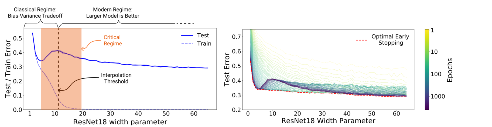

# 泛化、正则化与分布偏移

训练误差下降以后，为什么新数据上的结果仍然可能变差？一个原因是模型把有限训练集里的偶然关系也拟合进去了，另一个原因是部署数据已经不再来自训练时的分布。先用一个只有两个样本的回归例子把这两种情况分开。

用一条直线说明这两个差别。设真实关系接近 \(y=x\)，但我们收集到的两个训练样本是 `(1,1)` 和 `(2,3)`，第二个观测带有噪声。模型限制为 \(\hat y=wx\)，没有 bias。它应该怎样选择 \(w\)？

## 训练误差最小不一定最接近真实关系

采用损失 \(\frac12\sum_i(wx_i-y_i)^2\)，求导得 \(5w-7=0\)，所以训练最优 \(w=1.4\)。训练平方误差和为 0.2。

若 \(w=1\)，两个训练预测为 1、2，平方误差和为 1，明显更差；但在假设的无噪声关系上，\(w=1\) 恰好正确。模型把第二个样本中的噪声也部分学进去，正是有限样本拟合与总体表现可能不一致的原因。

形式上，经验风险为 \(\hat R(\theta)=N^{-1}\sum_i\ell(f_\theta(x_i),y_i)\)，同分布总体风险为 \(R_P(\theta)=\mathbb E_P[\ell]\)。二者差异是泛化差距。实际总体分布未知，只能通过独立样本估计，不能在真实任务中像本例一样直接知道“正确斜率”。

## 正则化加入了一个可计算的偏好

给损失加 \(\lambda w^2/2\)，解变为

\[
w_\lambda=\frac{\sum_i x_i y_i}{\sum_i x_i^2+\lambda}=\frac7{5+\lambda}.
\]

\(\lambda=0\) 时为 1.4，\(\lambda=2\) 时为 1，\(\lambda=9\) 时为 0.5。正则化偏向较小权重，在这个例子中适度收缩恰好帮助恢复真实关系，过强收缩则欠拟合。这个巧合不能推广为“权重越小越泛化”。

```python
train = [(1.,1.), (2.,3.)]
valid = [(1.,1.), (2.,2.), (3.,3.)]
for penalty in [0.,2.,9.]:
    w = sum(x*y for x,y in train) / (sum(x*x for x,y in train)+penalty)
    mse = sum((w*x-y)**2 for x,y in valid)/len(valid)
    print(penalty, round(w,6), round(mse,6))
```

三个验证 MSE 为 0.746667、0、1.166667。这是人为设置的演算数据，用于展示选择流程。在真实数据上要用验证集选 \(\lambda\)，测试集保留到方案确定以后；若尝试很多方案后只报告最好测试分，也会产生选择偏差。

## 其他正则化在改变什么

数据增强规定哪些变换不应改变标签。左右翻转对普通物体分类可能合理，对包含方向文字或左右动作命令的样本却可能改变正确答案。增强有效依赖任务的真实不变性。

Dropout 在训练时随机屏蔽部分激活，并按规则缩放，使模型不能始终依赖同一组激活组合。推理时关闭随机屏蔽，输出并不等于所有随机子网络输出的精确平均；神经网络非线性使这个等号通常不成立。

早停用验证表现选择训练长度。权重衰减、数据增强、dropout和早停通过不同方式影响拟合过程，不能只因为都叫正则化就认为可互换。AdamW 的解耦衰减与将 L2 直接加入 Adam 损失也不同，见[优化与训练](optimization-and-training-basics.md)。

{ width="820" }

<small>图源：[Deep Double Descent: Where Bigger Models and More Data Hurt](https://arxiv.org/abs/1912.02292)，Figure 1。</small>

左图横轴为模型宽度，训练与测试误差并非始终同步下降；右图也以宽度为横轴，用颜色区分训练轮次。这里展示特定实验中的双下降现象，说明简单的容量与过拟合直觉有适用边界，并不保证加宽任意网络都会改善测试结果。

## 当新数据来自不同分布

假设模型在白天道路上训练，部署到夜间。现在关心的是 \(R_Q(\theta)\)，其中 \(Q\ne P\)。即使模型在训练来源的独立测试集上很好，也未必在夜间可靠。这是分布偏移，不应只用“训练集过拟合”解释。

三种理想化情形有助于定位变化。Covariate shift 改变 \(p(x)\)，假定 \(p(y\mid x)\) 不变；label shift 改变类别先验 \(p(y)\)，假定 \(p(x\mid y)\) 不变；concept shift 则改变 \(p(y\mid x)\)。标签定义被重新制定属于任务含义变化，不能直接塞进只有先验变化的 label shift。

现实变化常同时影响多项。例如新相机改变像素分布，夜间交通改变类别频率，新的标注规则又改变目标含义。只换一种重加权公式，未必能覆盖这些变化。

## 用两组对照区分问题来源

保留一组与训练来源相同但独立的数据，再增加一组接近部署来源的数据。若训练好、同分布独立集差，先查泄漏、样本量和拟合过程；若前两者都好、部署集差，重点看新输入覆盖和目标变化。如果所有集都差，则可能是标签、表示能力或优化链条没有建立。

重要性加权可在特定假设下把训练期望改写为部署期望。例如 covariate shift 下，用 \(q(x)/p(x)\) 加权。但训练分布必须覆盖部署输入，密度比也需可靠估计。训练里从未出现的场景，不能靠给不存在的样本加大权重解决。

模型置信度在分布外也可能很高，因此“低置信度才转人工”需要实际校准和失效评估。泛化、校准、分布覆盖和异常处理分别回答不同问题，不应压成一个分数。

## 教程对照

- [D2L 模型选择、欠拟合和过拟合](https://github.com/d2l-ai/d2l-zh/blob/e6b18ccea71451a55fcd861d7b96fddf2587b09a/chapter_multilayer-perceptrons/underfit-overfit.md)，从有限样本与独立测试解释训练误差和总体误差；本文用解析回归例子补齐正则路径。

## 先用干预判断偏移来自哪里

不要看到部署集分数下降就立刻重训。可以按一次只改变一个因素的方式建立小矩阵：

| 对照 | 改变 | 如果分数下降，优先怀疑 |
| --- | --- | --- |
| 同来源新样本 | 样本 ID | 过拟合、泄漏或数据量不足 |
| 同输入换标签规则 | 目标定义 | concept shift 或标注协议变化 |
| 同任务换相机/天气/域 | 输入外观 | covariate shift、表示不稳 |
| 同模型换阈值 | 决策规则 | 校准或代价函数不匹配 |
| 同场景换历史长度 | 观测信息 | 状态/记忆不足 |

配对的原始与干预样本比随机新增样本更容易定位原因。例如把一张道路图片只改亮度、只遮挡车牌、只替换标签，然后观察模型输出和置信度。干预不应改变任务含义；若改变了，就需要把它记录为新的任务条件。

## 选择正则化时不要把测试集当调参器

一个可复用的选择流程是：

1. 预先写候选范围和评价指标。
2. 在训练/验证划分上选择权重衰减、dropout、增强或早停。
3. 锁定超参数和 checkpoint 选择规则。
4. 只在最终测试或目标域上进行一次估计。
5. 报告尝试数量、验证曲线和失败配置，而不是只报告最好的测试点。

如果目标域很小，可以用分层 bootstrap 或跨时间窗口估计不确定性，但不要把反复查看目标域结果再改规则称为一次无偏测试。

## 校准和拒答是泛化的一部分

模型在分布内准确并不代表置信度可信。可以按置信度桶计算实际正确率，观察 reliability diagram、ECE 或任务相关的风险覆盖曲线。对高风险任务，允许模型在证据不足时拒答或转人工，可能比强行输出更合理。

一个简单的选择策略是：在验证集上选择达到目标 recall 的最低置信度阈值，再在不同域分别测误报、漏报和拒答率。阈值本身也是部署协议的一部分，换数据来源后应重新核对。

## 预处理也可能把测试集信息带进训练

标准化、词表构建、去重和特征选择都要在训练划分上拟合。若先用全量数据计算均值和方差，再切分训练集与验证集，数值泄漏可能很小，却已经让验证结果看到了一部分未来数据。近重复去重也要记录它使用的范围，不能把测试样本的哈希或 embedding 参与训练期聚类。

一个安全的流水线应把“拟合”和“应用”分开：

```python
transform = fit_transform(train)
train_x = transform.apply(train)
valid_x = transform.apply(valid)
test_x = transform.apply(test)
```

如果转换器带有随机性或可学习词表，把它的版本和训练样本范围写进 manifest。仅仅把代码放在 `Dataset` 类里，不能证明它没有读到验证和测试数据。

## 小目标域要保留两种不确定性

目标域样本很少时，某个 checkpoint 在 20 个样本上高出 5 个百分点，可能只是样本波动。可以分别做两件事：在固定目标域上按用户、episode 或时间块 bootstrap，估计样本不确定性；再用多个训练 seed 估计模型不确定性。最后报告每个 seed 的结果和聚合区间，避免把一个最佳 seed 写成稳定能力。

假设目标域只有 4 个用户，不能把 400 帧当成 400 个独立样本来缩小区间。按用户重采样会得到更宽但更接近部署单位的估计。若未来部署对象是 episode，就按 episode 重采样；统计单位应跟决策单位一致。

## 校准例子比一个 ECE 数字更有用

把预测置信度分成两个桶，0.5 到 0.6 的 100 个预测中有 55 个正确，0.9 到 1.0 的 20 个预测中有 15 个正确。前者的平均置信度若为 0.55，误差为 0；后者即使平均置信度为 0.95，实际正确率也只有 0.75，说明高置信度桶过于自信。ECE 只汇总这些桶的差异，报告时还应保留每桶样本数和正确率。

拒答阈值应在验证集上按风险覆盖曲线选择，再在同分布和目标域分别测。目标域若出现高置信度错误，单纯把阈值调高可能只增加拒答，不能修复表示或标签问题。

## 来源与改编说明

- [D2L 模型选择、欠拟合和过拟合](https://zh.d2l.ai/chapter_multilayer-perceptrons/underfit-overfit.html)提供教学化的训练/验证/测试和正则化顺序。
- [Deep Double Descent](https://arxiv.org/abs/1912.02292)用于提醒模型容量与测试误差关系可能出现非单调区间，不能把“更大必然更差”或“更大必然更好”当定律。
- [Dataset Shift](https://www.cs.cmu.edu/~epxing/Class/10708-19/notes/lecture-5.pdf)用于补充 covariate、label 和 concept shift 的分类；课程讲义中的假设仍需与实际任务对照。

## 自测

1. 如何用三个配对干预区分输入外观变化和标签规则变化？
2. 为什么反复使用测试集挑正则强度会改变测试集角色？
3. 高置信度但错误率很高时，应该先查校准、数据偏移还是模型容量？请给出证据顺序。
4. 设计一个允许拒答的阈值实验，分别报告覆盖率、风险和人工转交率。

继续阅读：[数据划分与评测指标](data-splits-metrics-and-evaluation-basics.md)处理指标分母与分组划分；[训练稳定性与失败排查](../training/stability-numerics-and-failure-triage.md)处理数值异常、梯度和训练过程中的可观测证据。
