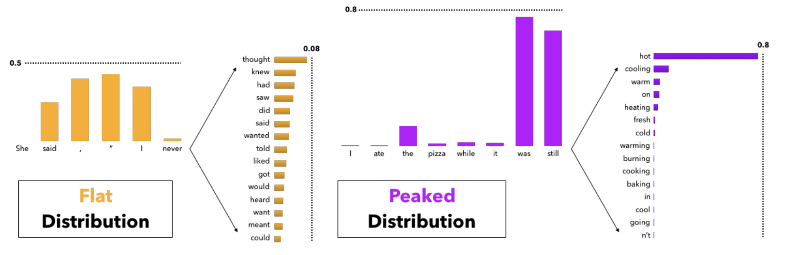

# 生成与解码

给定一段上下文，语言模型首先为词表中的每个 token 计算一个分数。解码程序再根据这些分数选择下一个 token，把它接回上下文，重复这个过程，直到遇到结束条件。

因此，同一组模型参数也可能产生不同的回答。选最高分、按概率采样、限制候选集合、约束输出语法，都会改变生成结果。理解这种差别，需要先看清单次选择，再看多次选择怎样形成整段序列。

本文从一组固定分数开始，不依赖具体产品 API。模型怎样产生这些分数，见[Transformer 与注意力](transformer-attention-and-tokenization.md)；概率与条件分布的背景见[概率分布与期望](../prerequisite-math/probability-distributions-and-expectation.md)。

## Logits 怎样变成概率

假设一个小词表只有三个候选 A、B、C，模型输出 logits 为 `[2, 1, 0]`。Logits 是未归一化分数，可以为负，不需要加起来等于 1。softmax 将其转换为

\[
p_i=\frac{e^{z_i}}{\sum_j e^{z_j}}.
\]

三个概率约为 `[0.665241, 0.244728, 0.090031]`。模型更偏向 A，但也给 B 和 C 分配了概率。给所有 logits 加上同一个常数，不会改变 softmax 的结果，因为分子与分母中的公共指数因子会抵消。

直接计算较大数值的指数可能溢出。利用上述性质，先减去最大 logit，便得到常用的稳定写法

\[
p_i=\frac{e^{z_i-m}}{\sum_j e^{z_j-m}},\qquad m=\max_j z_j.
\]

```python
import math

logits = [2.0, 1.0, 0.0]
peak = max(logits)
values = [math.exp(z - peak) for z in logits]
probabilities = [v / sum(values) for v in values]
print([round(p, 6) for p in probabilities])
```

输出为 `[0.665241, 0.244728, 0.090031]`。[本站数值示例](../assets/examples/foundations/mechanisms.py)中的 `softmax` 函数使用同样的方法。

模型给出的下一个 token 概率是条件概率 \(p(x_t\mid x_{<t})\)。上下文改变以后，三个候选的分数也会改变，所以生成一段文本不能只计算一次分布，然后反复从中抽取。

## 温度改变分布的集中程度

温度参数 \(T>0\) 用来缩放 logits

\[
p_i(T)=\frac{e^{z_i/T}}{\sum_j e^{z_j/T}}.
\]

对同一组 `[2, 1, 0]`，结果如下。

| 温度 | A | B | C |
| --- | --- | --- | --- |
| 0.5 | 0.866813 | 0.117310 | 0.015876 |
| 1 | 0.665241 | 0.244728 | 0.090031 |
| 2 | 0.506480 | 0.307196 | 0.186324 |

低温度让概率更集中，高温度让它更分散。正温度不会改变 logits 的排序，因此单纯调整温度不会改变贪心选择的最高分 token；它主要影响采样时各候选被抽中的概率。

公式没有定义 \(T=0\)。当唯一最大值存在时，\(T\) 从正数趋近于零会把概率集中到这个最大值，一些软件据此把 `temperature=0` 约定为贪心解码。实际参数语义需要查看所用实现，不能直接在公式里除以零。

温度只能改变已有候选分数的相对集中程度。若模型把错误答案排在最高位，降低温度会让程序更稳定地选择这个错误方向；提高温度也不自动带来事实准确性或更好的推理。

## Top-k 与 top-p 怎样筛选候选

采样前可以先缩小候选集合。Top-k 保留概率最高的 \(k\) 个 token，把其他候选的概率置零，再对保留项重新归一化。例如 `[0.50, 0.30, 0.15, 0.05]` 取 \(k=2\)，保留前两项，采样分布变成 `[0.625, 0.375, 0, 0]`。

Top-p 先按概率从高到低排序，再选择累计概率达到阈值 \(p\) 的最短前缀。仍用上面的分布，\(p=0.8\) 时，前两项的累计概率为 0.8，保留两项；\(p=0.9\) 时，前两项不够，需要加入第三项，总量变成 0.95，再除以 0.95 归一化。

Top-p 的候选数量随分布变化。若最大概率已经超过阈值，只保留一个候选就够；若分布很分散，则可能保留很多项。并列概率时，排序和边界处理还需要实现约定。

{ width="880" }

<small>图源为 [The Curious Case of Neural Text Degeneration](https://arxiv.org/abs/1904.09751) Figure 5。分布在不同上下文中可以很集中，也可以较分散，这为按累计概率选择候选提供了动机。论文中的实验支持特定设置下的比较，不能推出某个 top-p 值适合所有任务。</small>

过滤以后再采样，得到的是修改后的分布。温度会改变累计概率，因此先调整温度再计算 top-p，可能与相反顺序得到不同候选集合。重复惩罚、禁用 token、最短长度和语法掩码也会影响最终结果，实际处理顺序以具体解码实现为准。

## 生成分布与原始模型概率要分别记录

设原分布仍为 `(0.50,0.30,0.15,0.05)`，top-k只保留前两个候选。重归一化后，实际采样分布是 `(0.625,0.375,0,0)`。采到B时，原始模型给它0.30，采样器给它0.375；两个log概率分别约为-1.203973和-0.980829。

这一区别会影响生成日志、重要性权重和强化学习数据。如果需要计算采样行为的概率，应记录真正用来抽样的分布；如果要评价原模型对给定文本的似然，应明确采用原分布。温度、截断、约束和重复惩罚都属于这条转换链，不能只保存最初logits就假定知道最终行为概率。

## 采样怎样选出一个 token

对于分布 `[0.50, 0.30, 0.15, 0.05]`，可以把区间 `[0, 1)` 分成四段。第一段长度为 0.50，第二段长度为 0.30，以此类推。从区间内均匀抽一个数，它落在哪段，就选择哪个 token。

```python
names = ["A", "B", "C", "D"]
probabilities = [0.50, 0.30, 0.15, 0.05]
u = 0.72
cumulative = 0.0
for name, probability in zip(names, probabilities):
    cumulative += probability
    if u < cumulative:
        print(name)
        break
```

这里固定 \(u=0.72\) 便于演示，输出 B。真正采样时，\(u\) 由随机数生成器产生。固定随机种子可以帮助复现一组伪随机选择，但完整生成还受到模型数值计算、软件版本和执行环境影响。

采样给低概率候选留下机会，适合需要多样性的生成任务，也会增加偏离主要分布的可能。候选过滤和温度调节就是在控制这组取舍。它们不能替代对模型输出的任务评价。

## 贪心为什么不保证整段概率最高

贪心解码在每一步选择当前最高概率 token。给定相同 logits 与并列规则，这个算法本身不使用随机抽样。不过，不同硬件和数值实现可能产生略有差异的 logits，接近并列时就可能改变最终选择。

局部最高概率也不保证整段序列概率最高。下面构造一个只有两次选择的例子。

| 选择位置 | 条件 | 候选概率 |
| --- | --- | --- |
| 第一次 | 初始上下文 | A 为 0.6，B 为 0.4 |
| 第二次 | 已选择 A | X 为 0.5，Y 为 0.5 |
| 第二次 | 已选择 B | X 为 0.01，Y 为 0.99 |

条件概率相乘得到四条路径的概率

\[
P(AX)=0.30,\quad P(AY)=0.30,\quad
P(BX)=0.004,\quad P(BY)=0.396.
\]

贪心第一步一定选 A，最终只能得到概率 0.30 的 AX 或 AY。整段概率最高的路径却是 BY。这是数学构造的反例，说明逐步局部选择与完整序列搜索的区别。

Beam search 每一步保留若干条当前得分较高的部分序列，扩展后再次筛选。在这个例子中，宽度为 2 的 beam 可以保留 A 和 B，并发现 BY。有限宽度的 beam 仍可能在更早的步骤丢掉最终最优路径，所以没有一般的全局最优保证。

实际搜索通常累加对数概率，避免连乘得到极小数。长度变化时，还需要明确 EOS 的概率、停止规则和是否使用长度惩罚；不同惩罚形式对应不同的排序目标。高模型概率也不等同于高事实准确率、好文风或正确代码，搜索目标与任务目标需要分别评价。

## 一整段输出何时结束

一次自回归生成的基本过程是计算当前分布、选择一个 token、追加到上下文，然后继续。EOS 是词表中的特殊结束 token，模型选择它以后，程序可以结束当前序列。最大生成长度则是外部限制，达到上限时，即使语义上没有写完，也会被截断。

停止字符串是另一类机制。程序可能在解码后的文本中检测某段字符，命中后停止。一个字符串可能对应多个 token，因此字符级停止与单个 EOS token 的行为并不一样，返回文本是否包含终止内容也由实现决定。

聊天模型还依赖消息角色、分隔符与模板。输入相同的可见文字，如果包装成不同 token 序列，条件分布也会不同。复现生成结果时，要保留完整的输入格式、解码参数、模型与 tokenizer 版本，单独记录一行提示词通常不够。

## 语法约束与结果验证分别负责什么

如果需要 JSON 或固定格式，可以在每一步排除违反目标语法的候选，使生成始终沿允许的前缀继续。这个过程常称为约束解码。它需要正确处理 token 与字符的对应关系，并保证当前位置还有可用候选。schema 中哪些约束可以执行、生成是否可能被长度上限截断，取决于具体系统。

在这些条件满足时，约束解码可以保证实现所覆盖的语法规则。它不能证明字段值符合事实，也不能证明一段满足类型要求的程序具有正确行为。输出仍需要按用途检查，例如 JSON schema 校验、代码执行测试、数值范围检查或有来源的事实核验。

也可以生成多个候选，再用测试、规则或评价模型选择结果。此时增加的价值来自候选覆盖和评估器的区分能力，代价是更多计算。若评估器偏好某种表面形式，重复筛选可能强化这种偏差。模型负责提出候选，验证过程必须清楚说明自己实际检查了什么。

## 解码算法与推理加速怎样相遇

KV cache 保存标准因果 Transformer 已计算的历史 key 和 value，避免每一步重复处理整个前缀。它改变执行代价，正常情况下应保持相同模型计算的语义。批处理、缓存管理和数值格式可能进一步影响速度与数值细节，见[推理系统中的 GPU、批处理与显存](../inference/gpu-kernels-batching-and-memory-systems.md)。

投机解码让较便宜的过程先提出多个 token，再由目标模型批量验证。严格的投机采样算法配合正确的接受与补偿规则，可以保留目标模型的采样分布，同时减少昂贵模型的串行调用。简单地“让小模型写、大模型挑”并不自动具有这个性质，不同变体也可能采用不同保证。

投机验证在这里负责维持目标分布，事实核验则负责检查答案内容，两者目的不同。更详细的算法与实现见[多 token 预测与投机解码](../training/mtp-and-speculative-decoding.md)。

## 参考资料

- [Hugging Face 生成策略](https://huggingface.co/docs/transformers/generation_strategies) 介绍常见解码方法及其实现入口。
- [How to generate](https://huggingface.co/blog/how-to-generate) 对比贪心、beam search 与采样。
- [The Curious Case of Neural Text Degeneration](https://arxiv.org/abs/1904.09751) 提出 nucleus sampling 并分析生成退化现象。
- [Fast Inference from Transformers via Speculative Decoding](https://arxiv.org/abs/2211.17192) 给出保持目标分布的投机采样方法。

- [LLMs from scratch 的生成与模型代码](https://github.com/rasbt/LLMs-from-scratch/blob/cdbd33e6d57a71e20ea31434841095fac50cecd8/ch04/01_main-chapter-code/gpt.py)，用于把正文的数学对象对应到具体数据布局和执行顺序。
