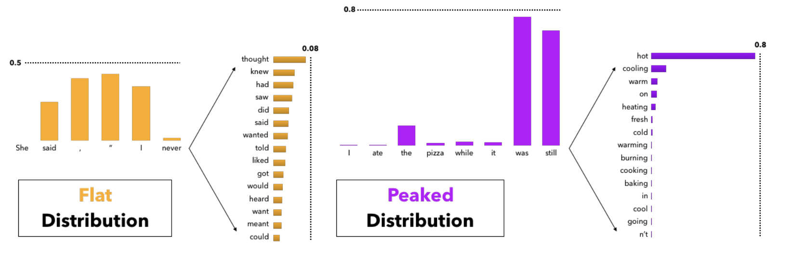
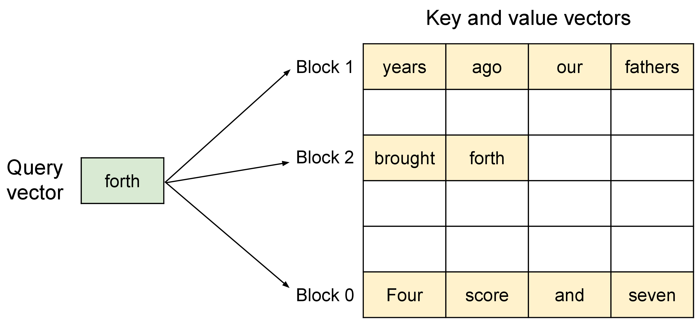

# 生成与解码：模型给出概率后，系统怎样选 token

这篇文章只回答一个问题：语言模型已经给出下一 token 的分数以后，系统怎样把概率分布变成一段可用、可控、成本可承受的输出。

解码不是“让模型回答”的按钮。它是一条状态机：每一步先拿到 logits，再做格式 mask、重复惩罚、temperature 缩放、top-k/top-p 截断、采样或搜索，然后把选中的 token 写回上下文和 KV cache。输出质量、格式稳定性、延迟和显存，都在这条链路上被决定。

!!! tip "数学先修"
    本文会把 logits 变成[条件概率分布](../prerequisite-math/probability-distributions-and-expectation.md)，再使用[Top-k、beam search 与离散选择](../prerequisite-math/discrete-selection-topk-and-routing.md)，同时依赖[序列位置和 causal mask](../prerequisite-math/sequence-position-and-masking.md)定义哪些 token 可见。

## 第一步：模型输出 logits，不是答案

在第 \(t\) 步，语言模型输出的是词表上的一组 logits：

\[
z_t \in \mathbb{R}^{|V|}
\]

这里 \(|V|\) 是词表大小，\(z_{t,i}\) 是第 \(i\) 个 token 的未归一化分数。Softmax 把 logits 变成概率：

\[
p_{t,i}
=
\frac{\exp(z_{t,i})}{\sum_j \exp(z_{t,j})}
\]

这两行式子在说：模型并不是一次性写出完整答案，而是在每一步给出“下一个 token 可能是什么”的条件分布。选出一个 token 以后，它会被拼回上下文，影响下一步分布。

整段生成可以写成：

\[
p_\theta(y\mid x)
=
\prod_{t=1}^{T}
p_\theta(y_t\mid x,y_{<t})
\]

这里 \(x\) 是 prompt，\(y_{<t}\) 是已经生成的前缀。乘积形式说明了自回归生成的脆弱点：前面一步选错，后面的条件分布都会被带偏；单步最高概率也不保证整段文本最好。

## 第二步：先改候选集合，再谈采样

实际系统很少直接从 raw softmax 采样。更常见的顺序是：

```text
raw logits
  -> grammar / schema / tool mask
  -> safety or policy mask
  -> repetition / presence / frequency penalty
  -> logit bias
  -> temperature
  -> top-k / top-p / min-p truncation
  -> sample, greedy, beam, or verifier search
  -> append token and update KV cache
```

这个顺序很重要。结构化输出的 grammar mask 必须在采样前生效，否则模型可能生成非法 JSON token；重复惩罚要在截断前影响排名，否则重复 token 可能已经留在候选集合里；temperature 只是改变分布形状，不能把非法 token 变合法，也不能把错误证据变正确。

把 temperature 写成公式：

\[
p_{t,i}^{(\tau)}
=
\frac{\exp(z_{t,i}/\tau)}
{\sum_j \exp(z_{t,j}/\tau)}
\]

这里 \(\tau\) 是温度。 \(\tau<1\) 会放大 logit 差异，让高分 token 更集中；\(\tau>1\) 会压平分布，让更多 token 有机会被采到；工程里 `temperature=0` 通常表示直接 argmax。Temperature 改的是“如何从已有候选里选”，不是模型能力、事实性或检索质量。

## 第三步：top-k 固定数量，top-p 固定概率质量

低概率 token 数量极多。全量采样会让长尾坏 token 有机会混入；完全 greedy 又容易重复、保守和模板化。Top-k 和 top-p 都是在采样前裁掉候选。

Top-k 保留概率最高的 \(k\) 个 token：

\[
S_k=\operatorname{TopK}(p_t,k)
\]

这里 \(S_k\) 是固定大小的候选集合。它简单稳定，但不看上下文分布的形状：如果当前分布很尖，固定 \(k\) 会留下太多噪声；如果当前分布很平，固定 \(k\) 又可能过早删掉合理候选。

Top-p，也叫 nucleus sampling，保留累计概率达到阈值 \(q\) 的最小集合：

\[
S_q
=
\min \left\{
S:\sum_{i\in S}p_{t,i}\ge q
\right\}
\]

这里 \(q\) 是 nucleus 阈值，例如 `0.9` 或 `0.95`。Top-p 的候选数量会随上下文变化：分布尖时集合小，分布平时集合大。

{ width="880" }

<small>图源：[The Curious Case of Neural Text Degeneration](https://arxiv.org/abs/1904.09751)，Figure 5。原图展示不同上下文下 next-token distribution 有时很平、有时很尖。本站用这张图说明：固定 top-k 不知道当前分布形状，top-p 的价值是让候选集合随概率质量自适应变化。</small>

Holtzman 等人的论文还指出，开放文本里高 likelihood 路径常常退化成重复、乏味或不自然的文本。这个结论不是说“采样永远更好”，而是提醒我们：开放生成和短结构预测不是同一种目标。

## 第四步：greedy、beam、sampling 适合不同任务

Greedy 每步选最高概率 token。它快、稳定、可复现，适合分类、抽取、确定性工具参数等任务，但开放聊天和创意写作里容易进入重复路径。

Beam search 保留 \(B\) 条候选前缀，每步扩展再保留总分最高的 \(B\) 条。常见打分是 log probability 累加，并加长度惩罚：

\[
\operatorname{score}(y)
=
\frac{\sum_t \log p_\theta(y_t\mid x,y_{<t})}{T^\alpha}
\]

这里 \(T\) 是输出长度，\(\alpha\) 是长度惩罚强度。这行式子说明 beam search 在追求整段序列的高概率路径。它适合翻译、语音识别、短结构预测这类目标较明确的任务；但开放对话里，高平均概率常常意味着安全、模板化和重复。

Sampling 适合多个续写都合理的任务。它允许模型从截断后的分布里抽样，而不是每步都追局部最大。创意写作、头脑风暴、多候选搜索和 verifier sampling 往往需要 sampling；事实问答和 RAG 则更依赖证据和引用约束，采样参数只能减少表达波动，不能制造事实。

## 第五步：结构化解码靠约束，不靠低温度

如果目标是 JSON、函数调用、SQL、正则格式或工具参数，低 temperature 不够。低温只让模型更偏向高概率 token，但它仍可能在某一步生成语法非法的 token。

结构化解码的核心是动态约束候选集合。系统根据 schema、grammar 或状态机判断当前前缀下哪些 token 合法，再把非法 token 的 logits mask 掉。OpenAI 的 Structured Outputs 文章把 JSON Schema 转成 CFG 来做 constrained decoding；许多本地推理框架也提供 grammar / regex / JSON schema 路径。

这个机制能保证格式约束，却不能保证语义正确：

| 约束能保证 | 约束不能保证 |
| --- | --- |
| JSON 语法合法 | 字段值真实 |
| 必填字段出现 | 引用确实支撑结论 |
| 工具参数可解析 | 该不该调用这个工具 |
| SQL/DSL 形状符合 grammar | 执行结果符合业务目标 |

因此结构化输出后还要做业务校验、证据校验、执行结果校验和安全校验。Grammar 是解码层的边界，不是事实层的证明。

## 第六步：verifier sampling 把生成变成搜索

数学、代码、规划和工具任务里，单次 greedy 未必可靠。更常见的策略是采样多个候选，再用 verifier 选择：

\[
y^{(1)},\ldots,y^{(n)}
\sim p_\theta(y\mid x)
\]

\[
y^\*
=
\arg\max_y V(x,y)
\]

这里 \(V(x,y)\) 是验证器，可以是单元测试、数学校验、规则检查、检索证据匹配、reward model 或人工评审。公式说明：多候选生成不是让 base model 突然更懂任务，而是给它更多搜索空间，再用更贴近任务的信号筛掉坏答案。

代价也直接：如果采样 \(n\) 个候选，decode token 成本通常接近 \(n\) 倍。它适合高价值、可验证任务；不适合每个普通在线请求默认开启。

## 第七步：投机解码服务速度，不服务质量筛选

Speculative decoding 用 draft model、draft head 或 n-gram 猜一段候选 token，再让 target model 一次性验证。标准算法的目标是保持 target model 原本的输出分布，同时减少昂贵 target forward 的次数。

它和 verifier sampling 的区别很重要：

| 方法 | 主要目标 | 是否应该改变选择标准 |
| --- | --- | --- |
| verifier sampling | 提高候选质量 | 可以，由 verifier 决定最终答案 |
| speculative decoding | 降低 decode 延迟 | 不应改变 target model 分布 |

能否加速取决于 acceptance rate、draft 开销、请求长度、QPS、batching 和 workload。vLLM 的 speculative decoding 博客也强调，收益要按 workload 分桶看；acceptance 低或高峰期 draft overhead 大时，P99 反而可能受伤。

## 第八步：prefill、decode 和 KV cache 决定系统成本

生成请求通常分成两段：

| 阶段 | 做什么 | 主要瓶颈 |
| --- | --- | --- |
| Prefill | 处理 prompt，把历史 token 的 K/V 写入 cache | 大矩阵并行，受 prompt 长度和 batch 影响 |
| Decode | 每步生成一个或少量 token | 反复读取历史 KV，容易受内存带宽和调度影响 |

自回归 decode 不需要每步重新计算所有历史 token 的 K/V，因为历史 K/V 已经缓存。但它需要读取这些 K/V 来和当前 query 做 attention。KV cache 粗略显存可以写成：

\[
\text{KV bytes}
\approx
Layers\times 2\times B\times L\times D_{\text{kv}}\times bytes
\]

这里 \(2\) 表示 K 和 V，\(B\) 是并发 batch，\(L\) 是上下文长度，\(D_{\text{kv}}\) 是 KV 宽度，`bytes` 是每个值的字节数。长 prompt、多并发、长生成、多候选采样都会推高这笔账。

{ width="620" }

<small>图源：[Efficient Memory Management for Large Language Model Serving with PagedAttention](https://arxiv.org/abs/2309.06180)，Figure 4。原图展示 PagedAttention 允许 K/V 存放在非连续物理块中，通过 block table 找到逻辑 token 的 KV block。本站用这张图说明：采样策略决定选哪个 token，serving runtime 还要决定这些 token 的 KV cache 如何分配、共享和释放。</small>

PagedAttention、prefix cache、KV 量化、KV eviction、disaggregated prefill 和 speculative decoding 都是在救不同的系统账。调 sampling 参数只能改变输出选择；不能解决 KV 碎片、batch 调度、TTFT、TPOT 和 P99。

## 怎么选解码策略

| 任务 | 更合理的起点 | 要额外验证什么 |
| --- | --- | --- |
| 分类、抽取 | 低 temperature、schema、短输出 | 字段合法、边界样例、拒答 |
| JSON / 函数调用 | grammar/schema constrained decoding | 参数业务合法、权限、安全 |
| RAG 问答 | 低温、引用约束、证据校验 | retrieval recall、citation faithfulness |
| 创意写作 | sampling、top-p、适度 temperature | 重复、安全、风格边界 |
| 数学/代码 | 多候选采样 + verifier | 测试、计算、最终答案一致性 |
| 长输出服务 | decode 优化、speculative、输出限长 | acceptance rate、P95/P99、KV 生命周期 |

最常见的误区有四个。第一，把 temperature 当成事实性开关；事实性主要来自模型能力、上下文证据和验证。第二，用 beam search 做开放聊天，以为高 logprob 就等于好回答。第三，结构化输出只靠 prompt，而不是 grammar/schema 和外部校验。第四，只调采样参数，不看 prefill、decode、KV cache 和用户侧延迟。

## 读完以后怎么判断

解码是把概率分布变成输出的执行层。Logits 定义候选分数；mask 和 penalty 改候选集合；temperature 和 top-k/top-p 改采样分布；greedy、beam 和 sampling 对应不同任务；结构化解码用 grammar/schema 保证格式；verifier sampling 把生成变成搜索；speculative decoding 主要服务速度；prefill、decode 和 KV cache 决定这套策略能否在线上跑得动。

理解这条链路以后，prompt、RAG、工具调用、结构化输出、投机解码和推理服务不再是分散技巧，而是同一条生成状态机上的不同控制点。

## 外部精读

- [The Curious Case of Neural Text Degeneration](https://arxiv.org/abs/1904.09751)：理解 beam / greedy 为什么会让开放文本退化，以及 nucleus sampling 的动机。
- [Hugging Face Generation Strategies](https://huggingface.co/docs/transformers/generation_strategies)：核对 greedy、beam、sampling、constraints 和 cache 等生成入口。
- [Hugging Face: How to generate text](https://huggingface.co/blog/how-to-generate)：用代码例子理解 top-k、top-p、temperature 和 repetition penalty。
- [OpenAI Structured Outputs](https://openai.com/index/introducing-structured-outputs-in-the-api/)：理解 schema/CFG constrained decoding 为什么不同于“提示模型输出 JSON”。
- [Fast Inference from Transformers via Speculative Decoding](https://arxiv.org/abs/2211.17192)：理解 draft/verify 如何保持 target distribution 并降低延迟。
- [vLLM speculative decoding blog](https://vllm.ai/blog/spec-decode)：学习 acceptance rate、QPS 和 workload 如何决定投机解码收益。
- [PagedAttention paper](https://arxiv.org/abs/2309.06180)：理解 KV cache 分页管理为什么是 serving 成本核心。

## 相关阅读与下一步

- 外部材料：[The Illustrated Transformer](https://jalammar.github.io/illustrated-transformer/)。
- 外部材料：[Dive into Deep Learning](https://d2l.ai/)。
- 外部材料：[Distill Circuits](https://distill.pub/2020/circuits/visualizing-weights/)。
- 站内下一步：[基础概念专题](index.md)。
- 站内下一步：[Transformer 输入与注意力](transformer-attention-and-tokenization.md)。
- 站内下一步：[数值、内存与运行时基础](numerics-memory-and-runtime-basics.md)。
