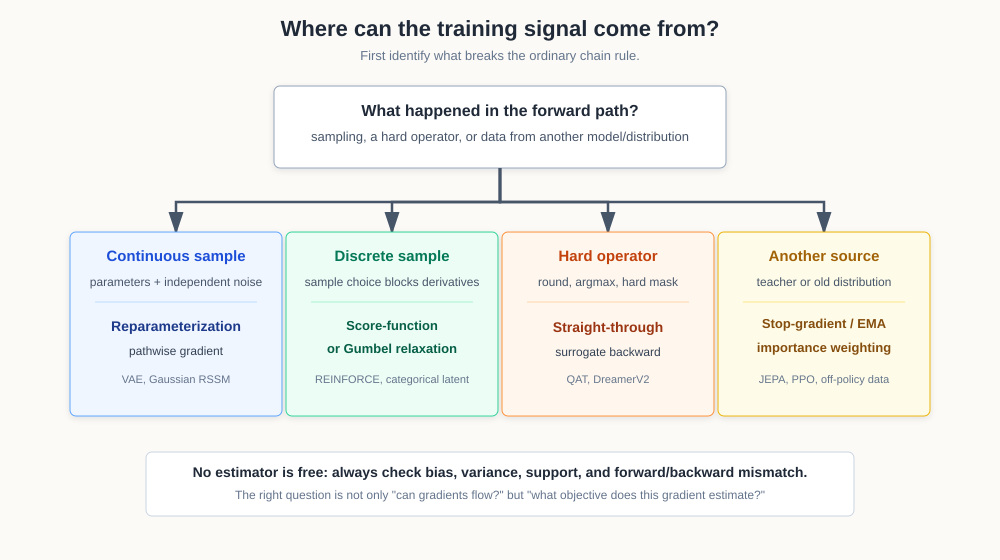

# 梯度估计、离散变量与训练信号

采样得到一个整数以后，为什么反向传播常常只返回零？普通反向传播沿着已经执行的计算求导，而参数改变时，变的不只是一条样本路径，连抽到不同样本的概率也在变。把采出来的整数直接交给自动微分，通常看不到后一种变化。

用一次最小决策把问题算清楚。模型用一个参数 \(a\) 决定选 1 的概率 \(p=\sigma(a)\)，然后采样 \(z\sim\operatorname{Bernoulli}(p)\)。选 1 得一分，选 0 得零分，希望最大化 \(J(a)=\mathbb E[z]=p\)。在 \(p=0.25\) 处，精确梯度是

\[
\frac{dJ}{da}=p(1-p)=0.1875.
\]

这个小例子有精确答案，可以用来判断各种梯度估计到底估计了什么。后文涉及的训练信号都围绕一个问题展开：采样以后，怎样让参数知道哪种选择值得增加？

## 固定一次采样，会漏掉什么

设我们抽到 \(z=1\)。如果程序把这个 1 当成常数，奖励对 \(a\) 没有可微的依赖，反向传播不能得到 0.1875。把采样写成 \(z=\mathbf1[u<p]\)、\(u\sim U(0,1)\) 也不解决问题。固定 \(u\) 后，这个阶跃函数几乎处处导数为零，只有在边界跳变。

然而期望确实随 \(p\) 改变，因为变大的是区间 \([0,p)\) 的长度。需要求导的是整个分布下的平均，而非只看一次已固定的输出。两者交换顺序，需要满足相应的可微性和积分条件。

## 对样本概率求导

对于离散分布，可以直接从求和出发。假定奖励函数 \(f(z)\) 本身不依赖参数，有

\[
\begin{aligned}
\nabla_a\mathbb E_{z\sim p_a}[f(z)]
&=\sum_z f(z)\nabla_a p_a(z)\\
&=\sum_z p_a(z)f(z)\nabla_a\log p_a(z).
\end{aligned}
\]

于是采样后计算 \(f(z)\nabla_a\log p_a(z)\)，平均起来就是原目标的梯度。这是 score-function estimator，也是 REINFORCE 的基础。这里的 score 指对参数的 log 概率导数，与扩散里对输入求导的 score 要区分。

伯努利分布满足 \(\partial_a\log p_a(z)=z-p\)。我们的小例子中，抽到 1 时估计梯度为 \(1(1-0.25)=0.75\)；抽到 0 时为零。按发生概率求平均，得到 \(0.25\times0.75=0.1875\)。单次值与精确梯度差很多，无偏只保证平均对应正确目标，不保证一次更新稳定。

在策略优化里通常把这个上升目标写成便于最小化的损失 \(-\log\pi_a(z)f(z)\)。奖励作为权重固定下来，负号让优化器的梯度下降实现奖励上升。如果所有奖励都为正，低奖励动作也可能获得增加概率的方向；只有比较基准以后，“差于平均”才对应负权重。

## Baseline 怎样减少波动

从奖励减去一个不依赖本次动作的常数 \(b\)，不会改变期望梯度，因为

\[
\mathbb E[b\nabla_a\log p_a(z)]
=b\nabla_a\sum_zp_a(z)=0.
\]

取 \(b=0.25\)，抽到 1 的梯度变成 \(0.75\times0.75=0.5625\)，抽到 0 则变成 \((-0.25)(-0.25)=0.0625\)。期望仍然是 0.1875，方差从 0.105469 降为 0.046875。这个 baseline 有帮助，但不一定最优；最小方差还与 score 的平方有关，不能简单断言奖励均值总是最佳。

强化学习常用状态价值 \(V(s)\) 作为动作无关基准，形成优势 \(A(s,a)\)。价值网络的参数可以训练，但在 actor 的这一项中要把优势当作固定权重；否则会多出并非策略梯度定理要求的导数。共用网络时，价值损失仍可从自己的分支回传。

## 连续变量可以保留一条可微路径

若 \(z\sim\mathcal N(\mu,\sigma^2)\)，可以写成

\[
z=\mu+\sigma\epsilon,\qquad \epsilon\sim\mathcal N(0,1).
\]

随机来源 \(\epsilon\) 不依赖待优化参数，样本 \(z\) 对 \(\mu,\sigma\) 则是可微函数。对 \(f(z)=(z-c)^2/2\)，单次路径导数为

\[
\frac{\partial f}{\partial\mu}=z-c,\qquad
\frac{\partial f}{\partial\sigma}=(z-c)\epsilon.
\]

例如 \(\mu=1,\sigma=0.5,\epsilon=-0.4,c=2\)，得到 \(z=0.8\)，两个导数为 \(-1.2,0.48\)。它们仍是随机估计，但利用了奖励函数的局部变化信息。VAE 的完整例子见[概率与潜变量模型](probability-latent-variables-and-generative-models.md)。

重参数化要求这种可微路径存在且下游可求导。外部机器人执行、离散搜索返回值、人工打分等过程往往不满足条件，不能只把随机数提前生成就声称问题已解决。

## STE 明确替换了反向规则

考虑量化 \(z=\operatorname{round}(a)\)，损失 \((z-1)^2/2\)。在 \(a=0.3\) 时，前向得到 \(z=0\)，损失为 0.5；真实损失在当前量化区间内不变，所以真实导数是零。

Straight-Through Estimator 在反向中假设 \(\partial z/\partial a\approx1\)，于是给出梯度 \(z-1=-1\)。更新能把 \(a\) 推向下一个量化区间，但这个 -1 不是原阶梯函数的真实导数。QAT 依靠这种有偏替代，让高精度可训练参数适应低精度前向；是否有效要看最终量化模型表现。

Gumbel-Softmax 则构造连续松弛。对类别 logits \(l_i\)，先采独立 Gumbel 噪声 \(g_i\)，再用 \(\operatorname{softmax}((l+g)/\tau)\) 得到软选择。有限温度时优化的是松弛问题，温度很低又可能让梯度尖锐或消失。若前向取硬 one-hot、反向沿软值传播，就进一步引入了 straight-through 近似。连续松弛、有偏替代与无偏 score 估计不是同一种保证。

## 冻结目标和换分布各自解决什么

`stop_gradient` 或 `detach` 保留前向数值，切断指定路径的导数。例如学生拟合教师表示时，目标不应跟着学生损失一起追逐学生。EMA 教师按 \(\phi\leftarrow\tau\phi+(1-\tau)\theta\) 更新；\(\tau=0.9,\phi=1,\theta=3\) 时新教师是 1.2。这是参数平滑规则，不是把教师也交给同一个反向损失。停止梯度本身也不排除所有表示坍缩，仍要看完整目标和数据结构。

如果数据由旧分布 \(q\) 产生，而目标在 \(p\) 下，且 \(q\) 覆盖 \(p\) 的支持集，可以用 \(p(z)/q(z)\) 重新加权。概率比很大时方差会增加，截断权重又会改变目标。PPO 的逐动作 ratio、固定优势和 clipping 是特定代理目标，不等于用一项比值完成全部轨迹分布修正，也不强制策略更新落在一个硬距离范围内。

## 先问计算图缺了哪条导数

遇到随机或离散模块时，可以先按接口选择估计器，再决定要不要换算法。下面的表只描述常见入口，不替代对目标函数的推导。

| 计算图里的对象 | 常用方法 | 保留的保证 | 最容易误判的地方 |
| --- | --- | --- | --- |
| 离散采样，奖励只能在采样后得到 | score-function / REINFORCE | 估计的期望梯度可无偏 | 单次梯度方差很大，baseline 不能改变目标但会改变方差 |
| 连续随机变量，样本可写成参数与噪声的函数 | 重参数化 | 沿样本路径使用局部导数 | 下游若含离散决策或外部执行，路径仍会断 |
| round、sign 或硬门控，但希望前向保留真实值 | STE | 只是人为指定反向规则 | 反向梯度不是原函数导数，训练有效要靠任务验证 |
| 教师、目标网络或缓存标签 | `detach`、EMA | 阻止指定目标追着学生移动 | 切断一条边不等于解决表示坍缩或目标偏移 |
| 训练分布与目标分布不同 | 重要性权重 | 在支持集条件下修正期望 | 极端权重带来高方差，截断会改变目标 |

做选择时先画出采样点、不可导算子和目标分支。若把一个本该由 score-function 处理的离散动作硬塞进重参数化，代码仍可能跑通，梯度却没有对应的数学含义。

{ width="820" }

<small>图为本站整理。阅读时先在自己的计算图中标出采样、不可导操作和需要冻结的目标，再对应可用的估计方式。</small>

## 直接核对无偏性和方差

```python
p = 0.25
for baseline in [0.0, 0.25]:
    values = [(z - baseline) * (z - p) for z in [0, 1]]
    mean = (1 - p) * values[0] + p * values[1]
    var = (1 - p) * (values[0] - mean)**2 + p * (values[1] - mean)**2
    print(baseline, round(mean, 6), round(var, 6))
```

两行均值都是 0.1875，方差分别为 0.105469、0.046875。代码枚举全部两个结果，不依赖随机种子。大问题不能枚举时，才需要用采样近似这些期望。

## 可以对照的实现

- [micrograd 的反向传播](https://github.com/karpathy/micrograd/blob/7bc720e951fe422b8f8814aa5aa1b64121d26b4c/micrograd/engine.py)，适合对照局部导数和分支累积；它本身不实现随机梯度估计。

- [Spinning Up 的策略梯度推导](https://github.com/openai/spinningup/blob/038665d62d569055401d91856abb287263096178/docs/spinningup/rl_intro3.rst)，从轨迹概率展开 log-probability、reward-to-go 和 baseline。

如果要继续把这些估计器放进训练代码，可以先看[策略梯度、Actor-Critic、PPO 与 GRPO](../reinforcement-learning/policy-gradient-actor-critic-ppo-grpo.md)，再对照[模型蒸馏](model-distillation-basics.md)里的 `detach` 和教师目标。前者关注随机动作的梯度，后者关注目标分支的梯度边界，两个问题都应先画计算图再写 loss。

**来源与改编说明**：score-function 恒等式与 baseline 的解释对照 [Spinning Up](https://spinningup.openai.com/en/latest/algorithms/vpg.html)，连续重参数化、STE 和 Gumbel-Softmax 的定义按各自方法的标准形式整理。伯努利、正态和量化的数值都是本站手算例子，没有声称某个 RL 或量化模型的训练结果。
