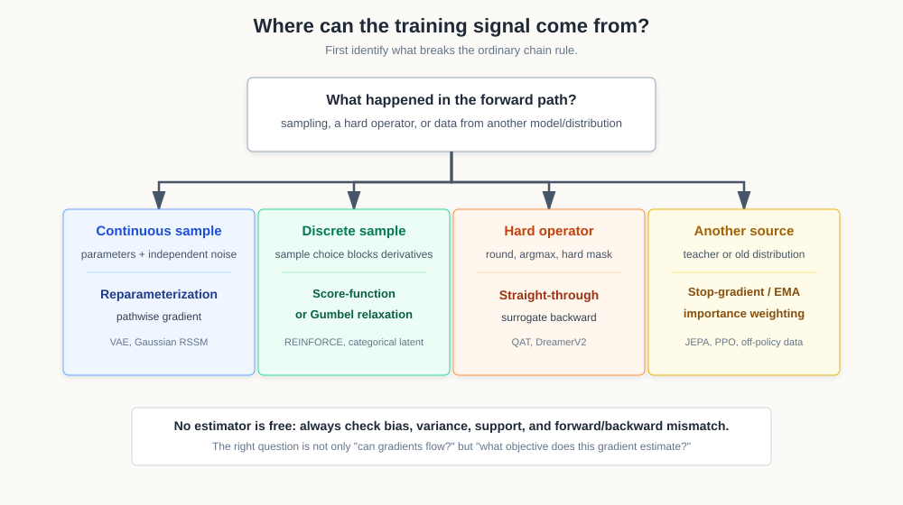

# 梯度估计、离散变量与训练信号

普通反向传播有一个隐含前提：从 loss 到参数之间存在一条可微的计算路径。但很多重要模型偏偏会在中间采样、argmax、round、生成 one-hot 状态，或者用一个不参与反向传播的 teacher 提供目标。链式法则走到这里，路会突然断掉。

真正的问题是：**训练目标的梯度还能从哪里来，这个梯度估计有多大偏差和方差？** VAE 的重参数化、REINFORCE、Straight-Through Estimator、Gumbel-Softmax、EMA teacher 和 PPO ratio，都是对这一个问题的不同回答。

!!! tip "数学先修"
    需要用到[微积分与链式法则](../prerequisite-math/calculus-and-newton-leibniz.md)、[概率分布与期望](../prerequisite-math/probability-distributions-and-expectation.md)以及[采样估计的偏差和方差](../prerequisite-math/sampling-estimation-and-calibration.md)。如果这些公式还不熟，先读对应数学页；已经熟悉可直接继续。

## 链式法则会在哪些地方断掉

先看四种常见情况：

| 前向过程 | 为什么普通梯度不够 | 下游例子 |
| --- | --- | --- |
| 从参数化分布采样 | 样本节点看起来不是参数的确定函数 | VAE、RSSM stochastic state |
| categorical / token 采样 | 离散选择对 logits 没有普通导数 | REINFORCE、DreamerV2 |
| round、argmax、hard mask | 函数几乎处处导数为 0，跳点又不可导 | QAT、稀疏路由、硬剪枝 |
| teacher 或旧策略产生数据 | 数据来自另一组参数或另一个分布 | JEPA、蒸馏、PPO、off-policy RL |

{ width="820" }

<small>图源：自绘决策图。先判断链式法则在哪里断，再选择重参数化、score-function、连续松弛、STE、stop-gradient/EMA 或 importance weighting。图里每条路线都只是估计方法，不自动保证目标正确或训练稳定。</small>

这些方法不能按“哪种更高级”排序。要比较的是四件事：

1. 前向计算是否保留了真实部署行为。
2. 反向计算估计的到底是哪一个目标。
3. 估计是否有偏，方差是否可控。
4. 数据分布和当前模型分布是否一致。

## 重参数化：把随机性搬到参数之外

设 VAE encoder 输出高斯 posterior：

\[
q_\phi(z\mid x)
=
\mathcal N
\left(
\mu_\phi(x),
\operatorname{diag}(\sigma_\phi^2(x))
\right)
\]

直接写 \(z\sim q_\phi(z\mid x)\) 时，采样节点挡在 \(z\) 和参数 \(\phi\) 之间。重参数化把它改写成：

\[
\epsilon\sim\mathcal N(0,I)
\]

\[
z
=
\mu_\phi(x)
+
\sigma_\phi(x)\odot\epsilon
\]

随机性现在来自与 \(\phi\) 无关的 \(\epsilon\)。给定一次噪声样本后，\(z\) 是 \(\mu_\phi\) 和 \(\sigma_\phi\) 的确定、可微函数，梯度可以沿这条路径回到 encoder。

假设目标是：

\[
\mathcal J(\phi)
=
\mathbb E_{z\sim q_\phi(z\mid x)}[f(z)]
\]

重参数化以后可以写成：

\[
\mathcal J(\phi)
=
\mathbb E_{\epsilon\sim\mathcal N(0,I)}
\left[
f\left(
\mu_\phi(x)+\sigma_\phi(x)\odot\epsilon
\right)
\right]
\]

对固定的 \(\epsilon\) 做普通反向传播，就得到 pathwise gradient 的 Monte Carlo 估计。它通常比 score-function estimator 方差小，因为梯度利用了 \(f\) 对样本值的局部变化。

但它有条件：分布要能写成“参数的可微变换 + 参数无关噪声”，而且后续 \(f\) 对样本值要可微。高斯很自然；一般离散 categorical sample 就没有同样直接的路径。

## Score-function estimator：不能穿过样本，就给样本概率加权

对离散随机变量，先看：

\[
\mathcal J(\theta)
=
\mathbb E_{z\sim p_\theta}[f(z)]
=
\sum_z p_\theta(z)f(z)
\]

假设 \(f\) 不直接依赖 \(\theta\)，求导得到：

\[
\nabla_\theta\mathcal J
=
\sum_z \nabla_\theta p_\theta(z)f(z)
\]

这行表示参数只通过采样概率 \(p_\theta(z)\) 影响期望；每个离散结果的收益 \(f(z)\) 在当前假设下不直接依赖参数。

再利用 log-derivative identity，把概率梯度写成概率乘 log probability 梯度：

\[
\nabla_\theta p_\theta(z)
=
p_\theta(z)\nabla_\theta\log p_\theta(z)
\]

可得：

\[
\nabla_\theta
\mathbb E_{z\sim p_\theta}[f(z)]
=
\mathbb E_{z\sim p_\theta}
\left[
f(z)\nabla_\theta\log p_\theta(z)
\right]
\]

这就是 score-function estimator，也是 REINFORCE 的数学骨架。它不需要穿过离散样本对 \(z\) 求导，只需要知道“这次采到 \(z\) 的 log probability 对参数怎样变化”。

在策略梯度里，\(z\) 可以是一条动作轨迹，\(f(z)\) 可以是 return。如果一条轨迹回报高，就增加产生这条轨迹的动作 log probability；回报低，就降低它。

它的代价是方差通常很大。可以减去一个不依赖当前采样动作的 baseline：

\[
\mathbb E
\left[
(f(z)-b)\nabla_\theta\log p_\theta(z)
\right]
\]

因为：

\[
\mathbb E[\nabla_\theta\log p_\theta(z)]=0
\]

合适的 baseline 不改变期望梯度，却能减少波动。RL 里的 value baseline 和 advantage 就在做这件事。

这里的 score 是：

\[
\nabla_\theta\log p_\theta(z)
\]

它对**模型参数**求导。扩散模型常说的 data score 是：

\[
\nabla_x\log p_t(x)
\]

它对**数据变量**求导。名字相同，但微分对象和用途不同：前者服务梯度估计，后者描述概率密度在数据空间里的方向。

## Straight-Through Estimator：前向做硬选择，反向借一条近似梯度

round、argmax 和 one-hot sampling 的真实导数无法直接支持训练。STE 的思路是：前向保持硬操作，反向假装它走过另一条可微路径。

令 \(\operatorname{sg}(x)\) 表示 stop-gradient：前向值等于 \(x\)，反向导数视为 0。一个常见写法是：

\[
y_{\mathrm{st}}
=
y_{\mathrm{soft}}
+
\operatorname{sg}
\left(
y_{\mathrm{hard}}-y_{\mathrm{soft}}
\right)
\]

前向时：

\[
y_{\mathrm{st}}=y_{\mathrm{hard}}
\]

反向时，stop-gradient 分支不传梯度，所以梯度像是来自 \(y_{\mathrm{soft}}\)。对量化 round 也可写成：

\[
x_{\mathrm{st}}
=
x
+
\operatorname{sg}
\left(
\operatorname{round}(x)-x
\right)
\]

前向得到量化值，反向近似把 round 当作恒等映射。

STE 的核心边界是：**它通常是有偏估计。** 反向使用的是 surrogate derivative，不是硬操作的真实导数。它能让模型训练，不代表梯度精确对应部署目标。论文需要用真实 hard forward、端到端任务质量和数值稳定性证明这个近似可用。

[DreamerV2](../paper-deep-dives/world-models/dreamerv2.md) 的 categorical latent 前向用 one-hot sample，反向借 softmax probability 的梯度；[Attn-QAT](../paper-deep-dives/foundations/attn-qat.md) 的 fake quantization 前向模拟 FP4，反向则用 STE 近似量化操作。

## Gumbel-Softmax：用连续分布逼近离散选择

如果 categorical 概率是 \(\pi_1,\ldots,\pi_K\)，先采样：

\[
u_i\sim\operatorname{Uniform}(0,1)
\]

\[
g_i=-\log(-\log u_i)
\]

这里各个 \(u_i\) 独立服从均匀分布；经过两次对数变换后，\(g_i\) 表示与模型参数无关的标准 Gumbel 噪声。

再构造：

\[
y_i
=
\frac{
\exp((\log\pi_i+g_i)/\tau)
}{
\sum_j\exp((\log\pi_j+g_j)/\tau)
}
\]

当 temperature \(\tau\) 高时，\(y\) 较平滑；当 \(\tau\) 下降时，\(y\) 越来越接近 one-hot。因为噪声 \(g_i\) 与参数分离，soft sample 可以走 pathwise gradient。

但 Gumbel-Softmax 没有让 argmax 本身获得普通导数。它优化的是一个连续松弛目标。温度太高时，训练和真实硬选择差距大；太低时，分布很尖，梯度可能变得不稳定。若前向再取 hard one-hot、反向仍借 soft sample，本质上又组合了 straight-through 思想。

## Stop-gradient 与 EMA teacher：有些分支不该被反向更新

JEPA、BYOL 和很多 teacher-student 方法都有两条分支：

\[
\text{student prediction}
\quad\text{vs}\quad
\operatorname{sg}(\text{teacher target})
\]

stop-gradient 的作用不是“节省一次 backward”，而是固定当前 target 的角色。如果两边都被同一个 matching loss 同时拉动，encoder 可能一起朝无信息常数表示移动，轻松把 loss 降低。

teacher 参数常通过 exponential moving average 更新：

\[
\bar\theta_t
=
\tau\bar\theta_{t-1}
+
(1-\tau)\theta_t
\]

其中 \(\theta_t\) 是当前 student 参数，\(\bar\theta_t\) 是 teacher 参数，\(\tau\) 通常接近 1。teacher 不接收这条 loss 的直接梯度，而是缓慢跟随 student，为下一批数据提供变化更慢的 target。

它解决的是目标稳定性，不是事实正确性。EMA teacher 可能稳定地保留错误偏差；stop-gradient 也不能单独保证表示有信息。表示学习还需要 masking、predictor asymmetry、variance/covariance constraint、negative samples 或其他 anti-collapse 机制。

## Importance weighting：数据来自旧分布时怎样改权重

有时目标期望来自分布 \(p(x)\)，手里的样本却来自 \(q(x)\)。只要 \(p\) 有质量的区域里 \(q\) 也能采到样本，就有：

\[
\mathbb E_{x\sim p}[f(x)]
=
\mathbb E_{x\sim q}
\left[
\frac{p(x)}{q(x)}f(x)
\right]
\]

这里 \(p\) 是想估计的目标分布，\(q\) 是实际采样的 proposal 分布；比例项负责修正两者的采样频率差异。把这个比例记成权重：

\[
w(x)=\frac{p(x)}{q(x)}
\]

其中 \(w(x)>1\) 表示样本在目标分布中比在 proposal 中更常见，\(w(x)<1\) 则表示它被 proposal 过度采样。

把来自 \(q\) 的样本重新加权成目标分布 \(p\) 下的期望。PPO 的新旧策略概率比：

\[
r_t(\theta)
=
\frac{
\pi_\theta(a_t\mid s_t)
}{
\pi_{\theta_{\mathrm{old}}}(a_t\mid s_t)
}
\]

就是这种思想的策略版本：rollout 来自旧策略，更新目标却在评估新策略。

危险也直接来自这个比值。如果 \(q(x)\) 很小而 \(p(x)\) 不小，少数样本权重会非常大，估计方差爆炸；如果 \(q(x)=0\) 而 \(p(x)>0\)，现有样本根本无法覆盖目标区域。PPO clipping、off-policy correction 截断和 replay freshness 都在控制这种分布差距，但截断也会引入偏差。

## 偏差、方差和适用边界

| 方法 | 需要什么条件 | 偏差 | 方差 | 主要风险 |
| --- | --- | --- | --- | --- |
| Pathwise / reparameterization | 可写成可微变换加独立噪声 | 通常可无偏估计目标梯度 | 较低 | 不能直接处理一般离散采样 |
| Score-function / REINFORCE | 能计算 sample log probability | 可无偏 | 常较高 | credit assignment 和长轨迹噪声 |
| Continuous relaxation | 有可用的连续近似 | 对硬目标通常有偏 | 受 temperature 影响 | 训练和部署选择不一致 |
| STE | 能定义 surrogate backward | 通常有偏 | 常较低但依赖近似 | 梯度方向可能不对应真实硬操作 |
| stop-gradient + EMA | 有可更新的 target branch | 不是随机梯度估计器 | 取决于目标和 batch | 稳定 target 不等于防止所有 collapse |
| Importance weighting | proposal 覆盖 target support | 未截断时可无偏 | 权重可极高 | support mismatch 和有效样本数坍缩 |

“有偏”不等于一定不能用，“无偏”也不等于一定好训练。一个方差极大的无偏估计可能在有限 batch 下几乎没有可用信号；一个有偏 STE 可能因为前向与部署一致、方差较低而更实用。最终要用目标对齐、训练稳定性和真实任务表现一起判断。

## 五个下游例子串起来

### 1. VAE：连续 latent 用重参数化

VAE encoder 输出 \(\mu_\phi(x)\) 和 \(\sigma_\phi(x)\)，再与参数无关噪声 \(\epsilon\) 组合成 \(z\)。reconstruction / likelihood loss 可以沿 \(z\rightarrow\mu,\sigma\rightarrow\phi\) 反向传播。数学上的 ELBO 见[潜变量、似然与生成模型目标](../prerequisite-math/latent-likelihood-and-generative-objectives.md)。

### 2. DreamerV2：离散 latent 用 STE

DreamerV2 希望 forward rollout 使用真正的 categorical one-hot state，但 one-hot sample 不可直接微分。它前向保留 hard sample，反向借 softmax probability 的梯度。这里换来的是可训练的离散状态，代价是 surrogate gradient 的偏差。

### 3. Attn-QAT：量化 forward 用 STE，敏感 backward 保高精度

QAT 需要 forward 看到量化后的 Q/K/V 或 attention probability，部署行为才一致；round / quantizer 的 backward 则用 STE。Attn-QAT 进一步指出，softmax Jacobian 的关键路径不能简单全部低精度化，所以“有梯度”之后还要问梯度的数值语义是否与真实 attention 对齐。

### 4. JEPA / BYOL：target 用 stop-gradient 和 EMA

student predictor 对齐 target encoder 的表示，但 target 分支不被当前 matching loss 直接更新。teacher 通过 EMA 缓慢跟随 student。这个非对称训练信号减少两边一起追逐常数解的风险，仍需配合表示方差、masking 或架构约束。

### 5. PPO：采样用旧策略，更新用 probability ratio

policy gradient 本身使用 score-function estimator：

\[
A_t\nabla_\theta
\log\pi_\theta(a_t\mid s_t)
\]

rollout 来自旧策略时，再乘新旧策略概率比，并用 clipping 限制分布偏移。于是 PPO 同时用了两层思想：log-probability gradient 负责离散动作 credit assignment，importance ratio 负责旧分布样本的校正。

## 常见误读

| 误读 | 更稳的理解 |
| --- | --- |
| 重参数化就是“换一种公式写采样” | 关键是把参数依赖和随机噪声分开，让 pathwise gradient 成立 |
| score-function 里的 score 就是扩散 score | 一个对参数求导，一个对数据变量求导 |
| STE 让 round / argmax 真正可导了 | forward 仍是硬操作，backward 使用的是有偏 surrogate |
| temperature 越低越接近真实离散目标，所以一定越好 | 近似更硬，但梯度可能更差、更不稳定 |
| EMA teacher 会自动防止表示坍缩 | 它提供慢目标，仍需要信息保持和 anti-collapse 证据 |
| importance weighting 能修复任意分布偏移 | proposal 没覆盖 target support 时无法补回缺失样本 |
| 所有 reparameterization 都是 VAE 技巧 | 扩散 scheduler 的参数化、权重重参数化和随机变量重参数化含义不同 |

## 读完以后怎么判断

看到一条特殊梯度路径时，按这个顺序检查：

1. 前向实际执行的是连续采样、离散采样、硬算子，还是 teacher/旧策略数据。
2. backward 使用真实导数、pathwise gradient、log-probability gradient，还是 surrogate。
3. 这个估计是否有偏，主要方差来自样本、轨迹还是 importance weight。
4. 训练时的 soft / fake / old 行为和部署时的 hard / real / current 行为差多少。
5. 论文是否用真实前向、独立评测和失败分桶证明近似没有掩盖问题。

把这五步说清楚，就能判断一个训练技巧是在正确估计目标、用可控偏差换稳定性，还是只让计算图表面上“有梯度”。

## 外部材料

- [Auto-Encoding Variational Bayes](https://arxiv.org/abs/1312.6114)。
- [Categorical Reparameterization with Gumbel-Softmax](https://arxiv.org/abs/1611.01144)。
- [Bootstrap Your Own Latent](https://arxiv.org/abs/2006.07733)。
- [Proximal Policy Optimization Algorithms](https://arxiv.org/abs/1707.06347)。
