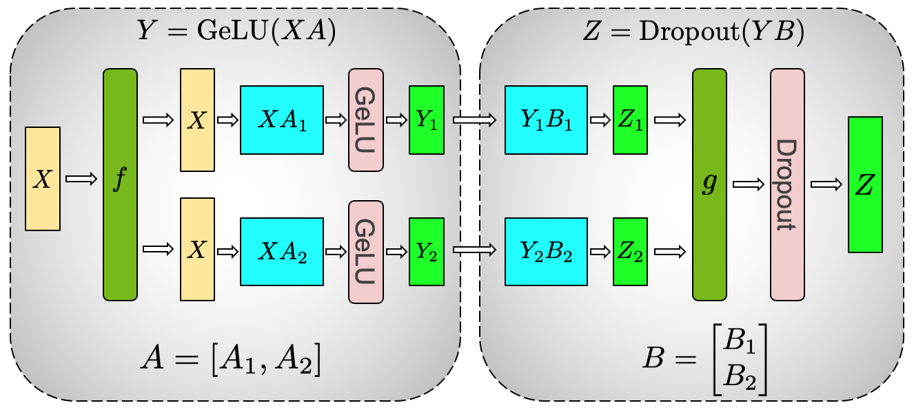
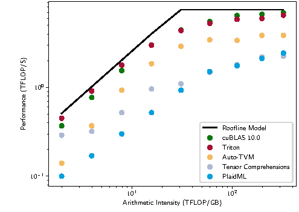

# 线性层、MLP 与矩阵乘法

先看一个会在代码里真的出错的小例子。输入是两个数 \([1,2]\)，层的参数为

\[
W=\begin{bmatrix}1&2\\3&4\end{bmatrix},\qquad
b=\begin{bmatrix}0.5&-0.5\end{bmatrix}.
\]

采用行向量写法，输出为 \(y=xW+b\)。第一个输出是 \(1\times1+2\times3+0.5=7.5\)，第二个输出是 \(1\times2+2\times4-0.5=9.5\)。每个输出都从全部输入中取值，由权重决定各输入的贡献，再加一个偏置。

输出只有两个数，计算却已经暴露了线性层最容易混淆的地方。权重的行列方向、偏置的广播范围，以及一个 token 是否会看到别的 token，都要从这个例子对上。模型变大以后，输入向量更长，输出更多，同一个权重矩阵会同时处理许多 token。需要补数学时，可以看[矩阵乘法与线性变换](../prerequisite-math/linear-algebra-and-geometry.md)；需要核对轴含义时，回到[张量与 Shape](tensors-shapes-and-computation-graphs.md)。

## 一列权重怎样得到一个输出

设输入有 \(D_{\mathrm{in}}\) 个特征，输出有 \(D_{\mathrm{out}}\) 个特征。下面统一使用

\[
x\in\mathbb R^{1\times D_{\mathrm{in}}},\qquad
W\in\mathbb R^{D_{\mathrm{in}}\times D_{\mathrm{out}}},\qquad
b\in\mathbb R^{D_{\mathrm{out}}}.
\]

第 \(j\) 个输出为

\[
y_j=\sum_{i=1}^{D_{\mathrm{in}}}x_iW_{ij}+b_j.
\]

\(W\) 的第 \(j\) 列给出了生成这个输出所用的全部权重。上面的示例中，第一列是 `[1, 3]`，第二列是 `[2, 4]`。训练过程中，优化器会改变这些权重与偏置，输入输出维度则由网络设计确定。

把同一组数交给一段不依赖框架的 Python，先核对手算结果。

```python
x = [1, 2]
weights = [[1, 2], [3, 4]]
bias = [0.5, -0.5]
y = [sum(x[i] * weights[i][j] for i in range(len(x))) + bias[j]
     for j in range(len(bias))]
print(y)
```

输出是 `[7.5, 9.5]`。[本站的数值示例](../assets/examples/foundations/mechanisms.py)提供同样的 `affine` 函数，也包含训练更新和注意力例子。

有偏置的 \(xW+b\) 严格说是仿射变换。数学中的线性变换满足 \(f(0)=0\)，偏置会改变这一点。深度学习框架通常仍把这一层叫作 Linear 或 Dense。读论文时，区分名称习惯与数学定义就足够了。

## 一批输入共享同一份参数

把多个输入按行堆起来，可以一次计算

\[
Y=XW+b,
\qquad
X\in\mathbb R^{M\times D_{\mathrm{in}}},\quad
Y\in\mathbb R^{M\times D_{\mathrm{out}}}.
\]

偏置广播到每一行。\(M\) 从 1 变成 100，只增加需要处理的数据，不增加这个层的可训练参数。带偏置的参数量始终是

\[
D_{\mathrm{in}}D_{\mathrm{out}}+D_{\mathrm{out}}.
\]

对于文本张量 `[B, L, D_in]`，线性层分别处理每个样本、每个位置的最后一维，输出 `[B, L, D_out]`。它本身不会把相邻 token 的信息混在一起。Transformer 中逐位置的前馈网络继承了这个性质，跨位置读取则由注意力完成。

具体代码中还可能看到与这里相反的权重 shape。PyTorch `nn.Linear(in_features, out_features)` 的参数 `weight` 存为 `[out_features, in_features]`，计算的是 `x @ weight.T + bias`。将它与上面的 \(W\) 对照时，需要转置一次。两种约定描述的是同一变换，不能在同一个推导中混用。

## 堆叠线性层为什么还不够

如果两个层之间没有非线性函数，那么

\[
(xW_1+b_1)W_2+b_2
=x(W_1W_2)+(b_1W_2+b_2).
\]

右侧仍然只是一次仿射变换。增加这样的层数会改变参数化方式，但整体表达的函数仍可合并为一个仿射层。

MLP 在两次变换之间加入非线性函数，常见形式为

\[
\operatorname{MLP}(x)=\sigma(xW_1+b_1)W_2+b_2.
\]

若输入、隐藏和输出维度分别为 \(D,H,O\)，那么 \(W_1\) 为 `[D, H]`，\(W_2\) 为 `[H, O]`。激活函数 \(\sigma\) 逐元素作用于隐藏向量，不改变它的 shape。ReLU 的定义是 \(\operatorname{ReLU}(z)=\max(0,z)\)。它让负值变成零，正值保持原样，整个网络因此可以在不同输入区间使用不同的线性关系。

一个很小的例子可以看出这种差别。令输入为单个数 \(x\)，第一层输出 \([x,-x]\)，经过 ReLU 后把两个分量相加，就得到

\[
f(x)=\operatorname{ReLU}(x)+\operatorname{ReLU}(-x)=|x|.
\]

当 \(x=2\) 时，隐藏值从 `[2, -2]` 变成 `[2, 0]`，输出 2；当 \(x=-2\) 时，隐藏值从 `[-2, 2]` 变成 `[0, 2]`，输出仍为 2。单个仿射函数无法在整个实数轴上表示绝对值函数。

```python
def tiny_mlp(x):
    hidden = [max(0, x), max(0, -x)]
    return sum(hidden)

print([tiny_mlp(x) for x in [-2, 0, 2]])
```

输出是 `[2, 0, 2]`。这个构造用于说明非线性的作用，参数是手工指定的，不代表训练出来的实验结果。实际模型常用 GELU、SiLU 或门控结构，它们的定义与残差、归一化之间的关系见[归一化、残差与激活](normalization-residual-and-activation.md)。

## Transformer 的前馈网络做了什么

标准的两层前馈网络常先把宽度 \(D\) 扩大到 \(H\)，经过激活，再投影回 \(D\)。输入输出都是 `[B, L, D]`，中间表示是 `[B, L, H]`。输出维度保持不变，才能方便地与输入做残差相加。

在每个 token 内部，第一层计算多种特征组合，激活改变这些组合的响应，第二层再把隐藏表示组合成输出。增大 \(H\) 会增加隐藏特征的数量，同时增加参数、运算和中间激活。没有偏置时，这两次矩阵乘的权重总量为 \(2DH\)。

门控前馈网络使用两条输入投影。例如一种常见写法为

\[
\operatorname{FFN}(x)
=\bigl(\operatorname{SiLU}(xW_g)\odot(xW_u)\bigr)W_d.
\]

其中 \(W_g,W_u\) 都为 `[D, H]`，\(W_d\) 为 `[H, D]`，\(\odot\) 表示逐元素相乘。门控分支随输入改变另一路表示的幅度。这个无偏置版本有 \(3DH\) 个权重，所以不能在隐藏宽度相同的条件下，把它与两层版本当作相同参数量来比较。

{ width="720" }

<small>图源为 [Megatron-LM](https://arxiv.org/abs/1909.08053) Figure 3a。图中把第一层矩阵按列切分，分别计算激活，再让第二层接收对应分块。理解单个 MLP 的维度以后，这种切分才有明确的数学含义。</small>

将一个大的 MLP 分到多张设备上，需要在适当的位置汇总部分结果。混合专家模型则为不同 token 选择部分前馈网络。两者都依赖这里的矩阵结构，但解决的问题不同。相关实现可继续看[分布式训练](../training/distributed-training-and-checkpointing.md)和[Transformer 结构](transformer-attention-and-tokenization.md)。

## 同一计算到了 GPU 上为什么叫 GEMM

GEMM 是通用矩阵乘法的常见名称，其一般形式为

\[
C\leftarrow\alpha AB+\beta C.
\]

在线性层里，主要运算就是其中的矩阵乘部分。把输入 `[B, L, D_in]` 看成一个二维矩阵时，对应关系为

\[
M=BL,\qquad K=D_{\mathrm{in}},\qquad N=D_{\mathrm{out}}.
\]

结果有 \(MN\) 个元素，每个元素要进行约 \(K\) 次乘加。如果把一次乘法和一次加法各计为一次浮点运算，运算量约为

\[
2MKN\ \mathrm{FLOPs}.
\]

这个估算没有计入偏置、激活和访存开销。例如 \(M=8,K=4,N=3\)，矩阵乘部分约为 \(2\times8\times4\times3=192\) FLOPs。FLOPs 表示运算总量，FLOP/s 表示每秒执行多少运算，两者单位不同。

GPU 会把大矩阵分成块，使一次载入的输入和权重参与多次计算。对于很大的 \(M\)，同一权重矩阵能够服务许多行，数据复用较充分。当 \(M=1\) 时，每个权重的复用机会少得多，读取权重的速度可能比算术能力更早成为限制。因此，同一线性层在大批训练和逐 token 生成时可能有很不一样的硬件效率。

{ width="760" }

<small>图源为 [Triton](https://doi.org/10.1145/3315508.3329973) 中的性能分析。Roofline 将计算吞吐和数据移动放在一起考察。它帮助解释矩阵乘的性能边界，不能仅凭图中某个结果推断任意设备上的实际速度。</small>

框架的融合算子还可能把矩阵乘后的偏置、激活或其他逐元素操作放进同一个执行过程，减少中间结果写回显存的次数。这通常不改变上面的数学函数，却会改变访存量和执行开销。布局、数值格式、矩阵尺寸、硬件和内核实现都会影响实际性能，具体分析见[GEMM、Attention 与融合算子](../operators/gemm-attention-and-fused-kernels.md)。

## 反向传播仍然包含矩阵乘法

对于 \(Y=XW+b\)，若损失对输出的梯度为 \(G\)，那么

\[
\nabla_W\mathcal L=X^\top G,\qquad
\nabla_X\mathcal L=GW^\top.
\]

前一个式子把所有输入行对同一权重的贡献加起来，后一个式子把输出梯度传回输入特征。加上前向的 \(XW\)，一个需要同时计算输入梯度与权重梯度的线性层，主要工作通常包含三次矩阵乘。冻结参数或不需要输入梯度时，可以省去相应部分，不能机械地对所有情形套用固定倍数。

激活函数也参与反向传播。以 ReLU 为例，正输入处的导数为 1，负输入处为 0；零点的数学导数不存在，框架会采用约定值。因此，前向中的哪些单元被激活，会影响梯度如何返回前一层。参数如何根据这些梯度改变，可接着看[优化与训练](optimization-and-training-basics.md)。

## 用开头的输入核对反向矩阵

仍取 \(x=(1,2)\)、输出 \(y=(7.5,9.5)\)，这次给目标 \(t=(1,0)\)，损失为 \(\frac12\sum_j(y_j-t_j)^2\)。上游梯度是 \(G=(6.5,9.5)\)，因此

\[
\nabla_W\mathcal L=x^\top G=
\begin{bmatrix}6.5&9.5\\13&19\end{bmatrix},\qquad
\nabla_b\mathcal L=(6.5,9.5).
\]

第一行权重的导数乘输入1，第二行乘输入2。换成 PyTorch 存储约定，`weight.grad` 应为这个矩阵的转置，而非直接相同。核对框架时，既要比较数值，也要比较每个数对应的输入输出通道。

## 用 PyTorch 把两个约定放在同一张表里

手算中的 \(W\) 是 `[D_in, D_out]`，PyTorch 中的 `weight` 是 `[D_out, D_in]`。不要只凭变量名判断方向，直接把前面的数字写进层里，再比较输出。

```python
import torch

layer = torch.nn.Linear(2, 2, bias=True)
with torch.no_grad():
    # 手算里的 W = [[1, 2], [3, 4]]
    # PyTorch 按输出通道存行，所以这里需要写成 W.T
    layer.weight.copy_(torch.tensor([[1.0, 3.0], [2.0, 4.0]]))
    layer.bias.copy_(torch.tensor([0.5, -0.5]))

x = torch.tensor([[1.0, 2.0]])
y = layer(x)
expected = torch.tensor([[7.5, 9.5]])
torch.testing.assert_close(y, expected)
print(layer.weight.shape, y)
```

如果把 `[[1, 2], [3, 4]]` 原样复制给 `layer.weight`，程序仍然会运行，但输出会变成 `[5.5, 10.5]`。这类错误很危险，因为 shape、dtype 和反向传播都可能正常，只有和独立的手算或参考实现比较时才会暴露。最小核对应该同时保存输入、权重、偏置和期望输出，不要只检查 `loss.backward()` 是否报错。

继续使用平方误差核对梯度。令目标为 `[1, 0]`，损失写成每个输出平方误差之和的一半，代码得到的梯度应与上一节相同。

```python
target = torch.tensor([[1.0, 0.0]])
loss = 0.5 * (y - target).square().sum()
loss.backward()

expected_grad = torch.tensor([[6.5, 13.0], [9.5, 19.0]])
expected_bias_grad = torch.tensor([6.5, 9.5])
torch.testing.assert_close(layer.weight.grad, expected_grad)
torch.testing.assert_close(layer.bias.grad, expected_bias_grad)
```

这里的 `expected_grad` 仍按 PyTorch 的 `[out_features, in_features]` 排列。手算得到的
\(
\begin{bmatrix}6.5&9.5\\13&19\end{bmatrix}
\)
是输入维度在前、输出维度在后的矩阵，放进 `weight.grad` 前需要转置。把两个矩阵并排写出来，比在文字里说“注意转置”更容易发现索引是否错了一位。

## 三维输入只沿最后一维做同一件事

Transformer 常把输入写成 `[B, L, D_in]`。线性层不会把 batch 或序列位置混在一起，它对每个位置独立执行 `x @ weight.T + bias`。下面的断言把三维结果展平成二维结果，检查这一点。

```python
layer.zero_grad(set_to_none=True)
x3 = torch.tensor([
    [[1.0, 2.0], [0.0, 1.0], [2.0, 0.0]],
    [[1.0, 0.0], [0.0, 2.0], [2.0, 2.0]],
])
y3 = layer(x3)
y2 = layer(x3.reshape(-1, 2)).reshape_as(y3)
torch.testing.assert_close(y3, y2)
assert y3.shape == (2, 3, 2)
```

如果误把序列轴和特征轴交换，程序仍可能得到一个形状正确的张量，但每个位置读到的两个数已经换了来源。

```python
x_bad = x3.transpose(1, 2).reshape(-1, 2)
y_bad = layer(x_bad).reshape_as(y3)
assert not torch.allclose(y_bad, y3)
```

这种错误不会总在第一行就报 shape mismatch。把一个位置的输入、正确输出和错误输出同时打印出来，通常比只看最终 loss 更快定位轴的含义。

如果把 `x3` 沿序列维度求平均后再送入层，得到的已经是另一个模型：它先丢掉了 token 之间的差异，再做一次投影。注意力、卷积或池化可以引入跨位置交互，但线性层自身没有这项功能。排查 Transformer 的 shape 时，可以先把一个位置单独取出来，与三维调用的对应位置比较。

最后把计算量估算和实际计时分开。对 `[B, L, D_in]` 到 `[B, L, D_out]` 的矩阵乘，理论乘加数约为 \(2BLD_{\mathrm{in}}D_{\mathrm{out}}\)。这个数字适合检查规模是否写错，不能直接当作 GPU 时间。实际时间还受到权重读取、layout 转换、kernel 选择、融合和 batch 形成过程影响。先用上述断言确认数学对象，再用固定 shape 的 benchmark 讨论性能，两个问题不要混在同一条结论里。

## 参考资料

- [PyTorch Linear](https://docs.pytorch.org/docs/stable/generated/torch.nn.Linear.html) 给出仿射层的计算约定、参数形状和输入输出形状。
- [cuBLAS](https://docs.nvidia.com/cuda/cublas/index.html) 定义 GEMM 等线性代数接口。
- [CUTLASS GEMM](https://docs.nvidia.com/cutlass/latest/media/docs/cpp/gemm_api.html) 展示 GPU 矩阵乘的分块和实现结构。
- [Megatron-LM](https://arxiv.org/abs/1909.08053) 将 MLP 的矩阵结构用于模型并行。

- [PyTorch 的优化循环](https://github.com/pytorch/tutorials/blob/5672cd98a7671eda4d9122b10f8eec580f74d03e/beginner_source/basics/optimization_tutorial.py)，用于把正文的数学对象对应到具体数据布局和执行顺序。
