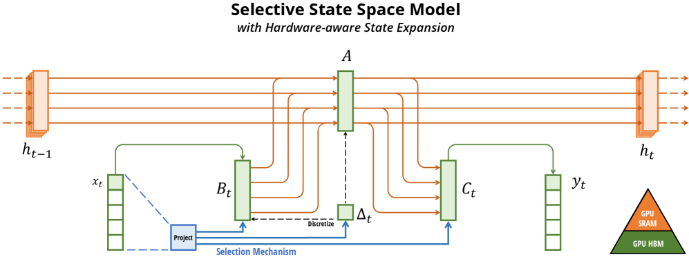
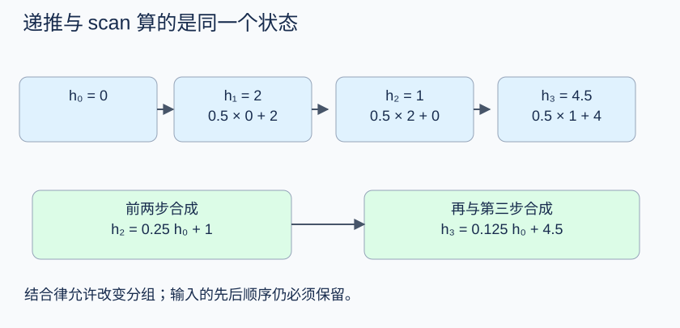

# Mamba 与混合状态空间架构

同样生成很长的序列，attention 可以回读所有历史，状态空间模型却只能带着一个固定大小的状态往前走。为什么要接受这个取舍，哪些信息会被压掉，又怎样把有用的信息留下来？Mamba 属于后一条路线，并让状态更新规则随输入变化。先把记忆如何被压缩算清楚，再去区分 Mamba、Mamba-2 和混合模型的名字。

从一个标量递推开始，比直接比较模型名单更容易看清这种选择的含义。设输入依次为 \(u_1,u_2,u_3=(2,0,4)\)，状态初值为零，更新规则是

\[
h_t=0.5h_{t-1}+u_t,\qquad y_t=h_t.
\]

三个状态分别是 2、1、4.5。到第三步，最早的 2 只剩 \(0.5^2\times2=0.5\) 的贡献。状态把历史压成了一个数，也因此无法完整恢复每个历史输入。

## 从连续状态到离散递推

状态空间模型常从连续方程出发

\[
\frac{dh(t)}{dt}=Ah(t)+Bu(t),\qquad y(t)=Ch(t)+Du(t).
\]

\(h\) 是内部记忆，\(u\) 是当前输入，\(A\) 决定状态自身怎样演化，\(B\) 决定输入如何写入，\(C\) 决定怎样读取，\(D\) 是输入到输出的直接路径。它们在高维情况下是相容尺寸的矩阵。

若每段长度为 \(\Delta\)，段内输入保持常数，精确零阶保持离散化给出

\[
\bar A=e^{\Delta A},\qquad
\bar B=\left(\int_0^\Delta e^{sA}\,ds\right)B,
\qquad h_t=\bar Ah_{t-1}+\bar Bu_t.
\]

标量且 \(A\ne0\) 时，\(\bar B=(e^{\Delta A}-1)B/A\)。不能在奇异矩阵情况下直接写逆矩阵而不处理极限或积分。

开头的 0.5 可以来自 \(A=-\log2,\Delta=1\)。负的连续状态系数让旧状态随时间衰减。真实代码可能采用不同的输入项离散近似，例如本文核对的 Mamba-1 参考路径使用 \(\Delta B u\)，不能把连续系统的精确 \(\bar B\) 公式说成它逐项执行的源码。

## 选择性意味着更新规则读到了当前输入

固定 \(\bar A,\bar B,C\) 时，每个位置使用同样的记忆规则。假设我们想记住序列中被标记的数字，忽略无关字符，固定衰减很难同时做到长期保留和及时覆盖。

Mamba 的一类更新可概括为

\[
h_t=e^{\Delta_t A}h_{t-1}+\Delta_t B_tu_t,
\qquad y_t=C_th_t+Du_t.
\]

\(\Delta_t,B_t,C_t\) 由当前输入经过投影产生。\(A\) 是学习到、跨时间共享的参数；它并非每个 token 都重新预测一份。选择性来自写入、遗忘和读取随输入变化。

回到标量例子，若第二步为无关输入，希望只保留前一状态，就可让对应的有效写入项接近零、衰减接近 1。第三步需要重写状态时，可采用更强遗忘并增加当前写入。这只是解释性的参数选择，训练会通过任务损失学习这些规则，并没有人工告诉每个通道“此刻记什么”。

## 一个 Mamba block 的计算顺序

输入先投影成两条分支。一条经过短的因果卷积和 SiLU，再产生 \(\Delta,B,C\) 并进入 selective scan；另一条产生门控信号。Scan 输出与直接输入项相加，再乘门，最后投影回模型宽度。

{ width="920" }

<small>图源：[Mamba Figure 1](https://arxiv.org/abs/2312.00752)。先看输入如何影响选择参数，再看扩大的状态维度。高效实现需要避免把所有时间点、所有通道的完整内部状态长期写入显存。</small>

**读这张图。**输入分支先产生选择参数，再进入状态更新；另一条分支提供门控。图中“选择性”发生在参数随输入变化这一处，不能把它理解成每个 token 都拥有一套独立的模型权重。

在核对的 `mamba_simple.py` 中，`x_proj` 产生 \(\Delta\) 的低秩表示以及 B/C，`dt_proj` 展开时间步，softplus 使时间步为正；`A=-exp(A_log)` 使标量状态衰减项具有规定符号。短卷积还有自己的历史缓存，推理状态因此不只有 SSM state。

## 有前后依赖，训练为什么还能并行

递推 \(h_t=a_th_{t-1}+b_t\) 可以看成一个仿射变换。两步合成满足

\[
(a_2,b_2)\circ(a_1,b_1)
=(a_2a_1,\ a_2b_1+b_2).
\]

这个合成有结合律，所以一串更新可用并行前缀 scan 组织。开头三个变换是 `(0.5,2)`、`(0.5,0)`、`(0.5,4)`；前两步合成 `(0.25,1)`，三步合成 `(0.125,4.5)`。初始状态零，最终仍是 4.5。

```python
steps = [(0.5, 2.0), (0.5, 0.0), (0.5, 4.0)]
def compose(later, earlier):
    a2,b2 = later
    a1,b1 = earlier
    return a2*a1, a2*b1+b2
h = 0.0
for a,b in steps:
    h = a*h+b
combined = compose(steps[2], compose(steps[1], steps[0]))
print(h, combined)
```

输出为 `4.5 (0.125, 4.5)`。这段串行 Python 只验证组合恒等式，不是 GPU scan 性能实现。Mamba 的输入相关系数由输入路径预先计算；一般非线性 RNN 若系数依赖尚未得到的隐藏状态，不能直接套用这套仿射 scan。



<small>图源：本站根据三步标量递推重绘。它只说明仿射更新可以按结合律合并，不代表任意递归网络都能并行 scan。</small>

**读这张图。**每个小块表示一对 ((a_t,b_t))，合并时后一步的衰减系数会乘到前一步的写入量。沿序列合并后的结果应与逐步更新相同，初始状态和组合方向都不能颠倒。

## 固定大小状态带来的收益与限制

生成时只需更新本层状态和短卷积缓存，存储不随已生成长度线性增加。这个结论针对固定模型宽度与状态维度的 SSM 层，不表示整个混合模型没有 KV，也不表示任意长度的信息都能无损保留。

Attention 可以针对当前 query 直接比较历史位置，SSM 只能读取历史被压缩后的状态。需要精确检索远处细节的任务，可能对这种压缩更敏感。混合结构因此会在一些层保留 attention，在另一些层采用 SSM；若再加 MoE，是改变前馈计算的另一条轴。

Mamba-2 通过结构化状态空间对偶关系重新组织计算，使部分训练计算能更充分使用矩阵乘法。它与 Mamba-1 的参数化和 kernel 并不完全相同。阅读新版本或厂商混合模型时，应确认具体论文与代码，再讨论层比例、状态、KV 和速度，不能把某个版本结果推广给整个系列。

## 源码中的两个入口

- [Mamba-1 的 forward、step 与缓存分配](https://github.com/state-spaces/mamba/blob/e9594ce1c732d97440f0332fdc43170a2294dbfa/mamba_ssm/modules/mamba_simple.py)，训练路径和逐 token 推理可以并排比较，特别留意输入项使用的离散化规则。

- [selective_scan_ref](https://github.com/state-spaces/mamba/blob/e9594ce1c732d97440f0332fdc43170a2294dbfa/mamba_ssm/ops/selective_scan_interface.py)提供便于核对的循环表达，`deltaA`、`deltaB_u` 与本文递推对应。
- [Mamba-2 / Transformers are SSMs](https://arxiv.org/abs/2405.21060)解释结构化状态空间对偶；继续阅读前先掌握这里的仿射递推。

## 公式和代码对照

连续状态空间模型的定义和输入相关选择机制参考 [Mamba](https://arxiv.org/abs/2312.00752)，训练计算重排参考 [Transformers are SSMs](https://arxiv.org/abs/2405.21060)，实现细节对照 [state-spaces/mamba](https://github.com/state-spaces/mamba/tree/e9594ce1c732d97440f0332fdc43170a2294dbfa)。标量递推、仿射结合律和“固定状态不等于无损记忆”是本站为读者构造的算例，不是论文 benchmark 的缩小版。

可以把三个输入换成 `[(1, 0), (0, 1), (2, 0)]`，分别计算循环递推和结合律合成的结果。再问一个具体问题：如果任务必须精确找回第一个 token，固定大小状态为什么可能比带 KV 的 attention 更困难？这个问题比单独比较吞吐数字更能说明两种记忆的取舍。

若要把这两种记忆放进同一条生成链，可以接着看[Transformer 的 attention 与 token 化](transformer-attention-and-tokenization.md)对照显式 KV 读取；服务侧的缓存代价见[上下文压缩与 KV 分层](../inference/context-compression-kv-eviction-and-memory-hierarchies.md)。
