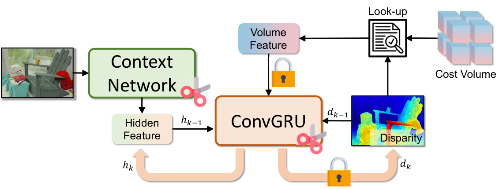
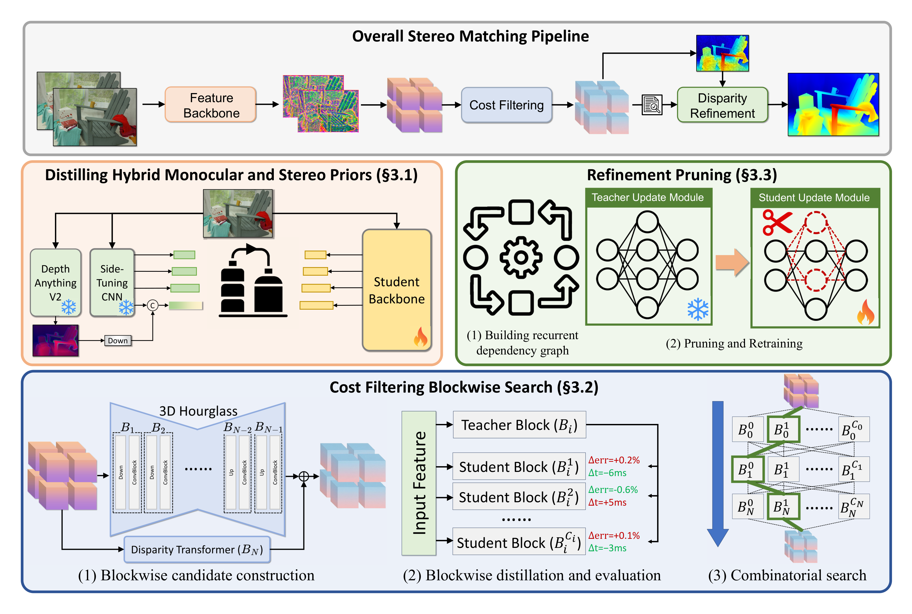
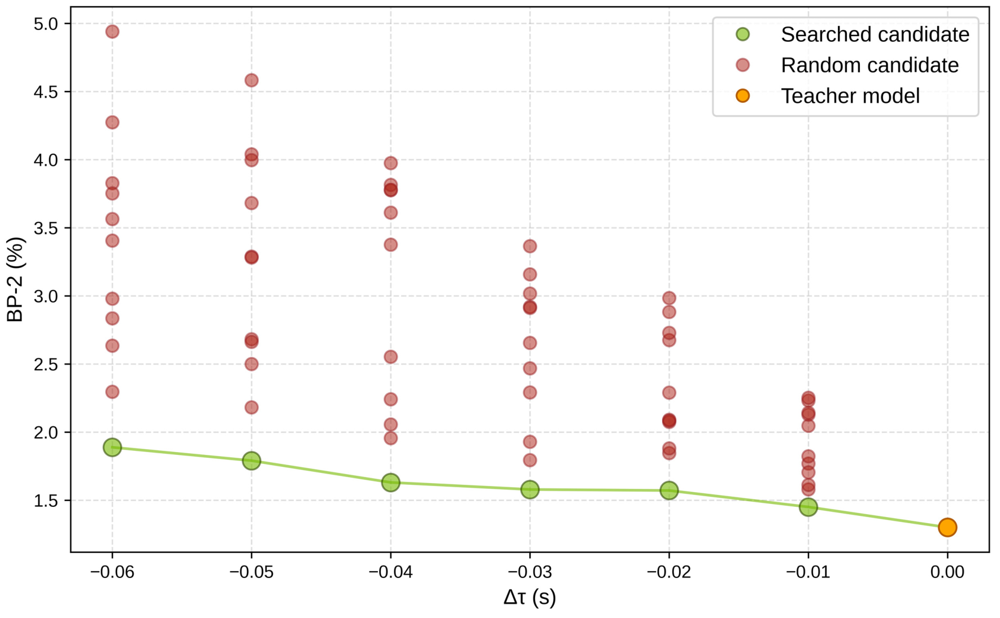

# 模型压缩、剪枝与结构搜索

把一半权重设为零，模型文件和延迟都可能几乎不变；删掉一个隐藏通道，前后两层的矩阵尺寸却会一起改变。讨论压缩前，先要看最终执行了什么计算，以及存储格式和 kernel 能否利用这种变化。

用两层网络说明。输入是二维向量，第一层产生三个隐藏通道，第二层输出一个数。采用行向量记号，\(W_1\) 为 `2×3`，\(W_2\) 为 `3×1`，忽略 bias，共有 9 个权重。对一条输入，它们也需要 9 次乘加。

## 真正删除一个通道，要同时改两层

取 \(x=(1,2)\)，并设

\[
W_1=\begin{bmatrix}1&0&1\\0&1&1\end{bmatrix},\qquad
W_2=\begin{bmatrix}1\\2\\-1\end{bmatrix}.
\]

第一层得到 \((1,2,3)\)，ReLU 不改变这些正值，最终输出为 \(1+4-3=2\)。若删除第三个隐藏通道，需要同时删除 \(W_1\) 的第三列和 \(W_2\) 的第三行，剩下 6 个权重，输出变成 5。

参数与乘加都减少了三分之一，但输出变化很大。这个例子说明结构化剪枝的两个独立问题：依赖关系必须正确修改，删除后的模型还需恢复质量。用少量校准样本观察差异，再进行微调或蒸馏，是常见的恢复方式。

若网络有残差相加，双方形状必须相容；若同一通道被多个分支使用，所有使用点都要更新。直接按每层权重范数独立删除，可能破坏整个计算图。

{ width="820" }

<small>图源：[Fast-FoundationStereo](https://arxiv.org/abs/2512.11130)，Figure 5。</small>

跟随 ConvGRU 隐状态回到下一轮的连接，可以看到同一通道跨多次迭代被使用。剪枝须同步处理这些使用点；图中固定与可剪部分的划分属于该模型，不能直接复制成所有网络的剪枝规则。

## Mask 为零与更小矩阵的区别

非结构化剪枝可给每个权重乘一个二值 mask。常规 dense GEMM 仍遍历整个矩阵，因此即使有很多零，也未必减少算量。稀疏格式还要存储索引；只有稀疏度、形状和硬件支持适合时，专用算子才可能获得收益。

PyTorch pruning 教程展示的 `weight_orig` 和 `weight_mask` 保留了原张量尺寸。`prune.remove` 将 mask 的结果固化进权重、移除重参数化，不会自动把矩阵压缩成较小维度。这是阅读 API 时非常容易误会的地方。

结构化剪枝改变维度，通常更容易交给普通 dense kernel；不过更小的形状也可能降低硬件利用率。2:4 等半结构化稀疏要求在硬件规定的分组方向内满足模式，并使用受支持的数据类型与算子路径，不能把任意四个权重留两个都称为可加速的 2:4。

## 重要性分数只是选择候选的近似

设一个可删除单元的缩放系数为 \(g\)，当前为 1，删除等于设为 0。Taylor 展开给出

\[
\Delta\mathcal L\approx-g\frac{\partial\mathcal L}{\partial g}
+\frac12g^2\frac{\partial^2\mathcal L}{\partial g^2}.
\]

第一项是带符号的损失变化近似。常见重要性取 \(|g\partial_g\mathcal L|\) 或样本平均绝对值，目的是按敏感程度排序；它不再表示有符号的损失增减。先对梯度求均值再取绝对值，与先取绝对值再平均也不同，样本间的抵消会改变结果。

在接近训练驻点时，一阶梯度可能很小，但删除是一次很大的有限扰动，二阶项和通道之间的相互作用不能忽略。先删多个各自“不重要”的单元，也可能造成明显质量下降。因此重要性分数应配合实际删除后的前向对照，而非代替它。

## 量化、蒸馏与剪枝如何配合

量化减少每个数的表示成本，剪枝改变保留哪些计算，蒸馏提供训练信号。三者可以叠加，但操作顺序会影响误差。例如删掉通道后，后续激活范围改变，原来的量化 scale 可能不再合适，需要重新校准。

模型参数数目减少一半不保证总显存减少一半。推理还有 KV、临时 workspace 和缓存；训练还有梯度、优化器状态与激活。先用[数值与显存估算](numerics-memory-and-runtime-basics.md)判断主要占用，再选择压缩对象。

{ width="820" }

<small>图源：[Fast-FoundationStereo](https://arxiv.org/abs/2512.11130)，Figure 3。</small>

上方流水线由特征提取、代价过滤与视差细化组成，下方分别展示蒸馏、结构搜索与剪枝。先确认每个阶段的输入输出及耗时，再选择方法，才能避免只优化参数最多、却不占主要时间的模块。

## NAS 把结构选择写成明确候选

Neural Architecture Search 在一个事先定义的候选空间中选择结构。假设两个 block 各有“宽”和“窄”版本，对应成本和独立估计的损失增量如下。数字是解释性假设，不是实测性能。

| Block | 候选 | 成本 | 损失增量 |
| --- | --- | ---: | ---: |
| 1 | 宽 | 6 | 0 |
| 1 | 窄 | 3 | 0.2 |
| 2 | 宽 | 5 | 0 |
| 2 | 窄 | 2 | 0.5 |

预算为 8 时，宽+宽成本 11 不可行；窄+宽成本 8、损失估计 0.2；宽+窄成本 8、损失估计 0.5；窄+窄成本 5、损失估计 0.7。按这份模型应选窄+宽。

用二元变量 \(z_{ij}\) 表示 block \(i\) 是否选择候选 \(j\)，可以写成

\[
\min_z\sum_{i,j}\Delta\ell_{ij}z_{ij},\qquad
\sum_{i,j}c_{ij}z_{ij}\le C,\quad
\sum_jz_{ij}=1,\quad z_{ij}\in\{0,1\}.
\]

每个 block 恰选一个的约束不可省略，否则“什么都不选”可能成为假解。损失可加是近似，延迟也可能受融合、缓存和通信影响而不可加，所以还要把选中的完整模型实际构建并测量。

{ width="820" }

<small>图源：[Fast-FoundationStereo](https://arxiv.org/abs/2512.11130)，Figure 8。</small>

横轴为相对耗时变化 Δt，纵轴为 BP2 误差。比较相近预算下的搜索候选与随机候选，才有意义。这里的曲线是论文实验，不是上表假设成本的实测结果；端到端验证仍不可省。

## 什么样的对照能回答压缩是否成功

保持任务、输入长度、batch 和硬件相同，分别记录质量、权重存储、峰值显存与端到端时间。不要把参数量缩减当成延迟实测，也不要只在最适合的单一 shape 上报告加速。

质量下降时，先确认结构依赖、预处理和数值路径没有错误，再判断恢复训练是否足够。正确性检查与任务评估承担不同作用：数值对照能发现错误切片，任务集才能说明被删除的信息是否重要。

## 从教程看真实张量变化

- [PyTorch Pruning Tutorial](https://github.com/pytorch/tutorials/blob/5672cd98a7671eda4d9122b10f8eec580f74d03e/intermediate_source/pruning_tutorial.py)，重点比较 named_parameters、named_buffers、前向hook和 remove 前后的张量尺寸。

[模型蒸馏](model-distillation-basics.md)解释恢复训练可用的教师信号，[量化专题](../quantization/index.md)进一步讨论数值格式与部署算子。
