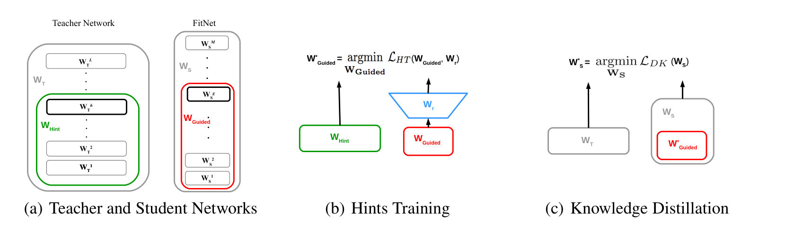
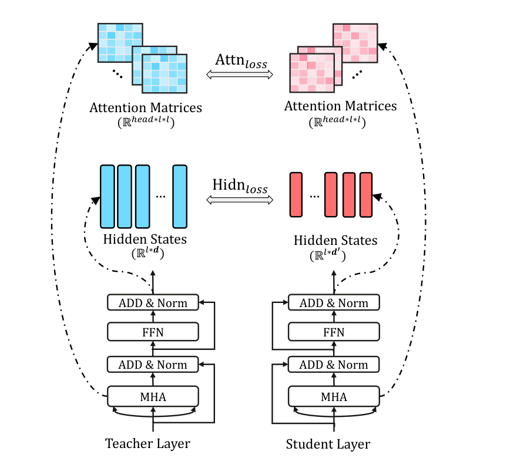
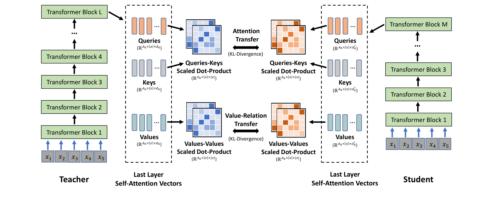
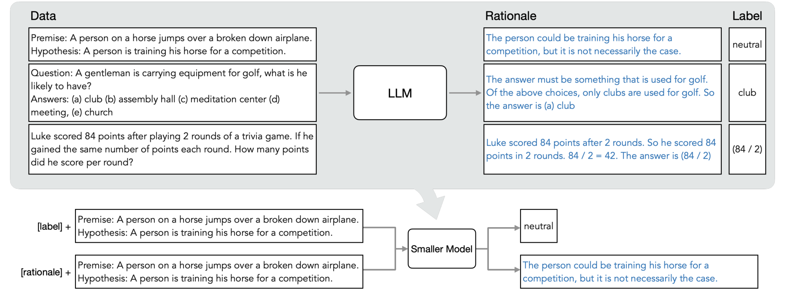

# 模型蒸馏入门

模型蒸馏（Knowledge Distillation, KD）解决的是一个很实际的问题：已经有一个强但贵的 teacher model，能不能把它的行为、分布或中间表示压到更小、更快、更便宜的 student model 里。

!!! tip "数学先修"
    本文会用到[熵、交叉熵与 KL](../prerequisite-math/information-theory-and-divergence.md)比较 teacher/student 分布，用[概率与期望](../prerequisite-math/probability-distributions-and-expectation.md)理解 soft target；teacher 分支和离散信号可继续读[梯度估计与 stop-gradient](gradient-estimators-and-training-signals.md)。

## 1. 蒸馏解决什么

蒸馏的常见目标可以分成三类：

| 目标 | 想换回什么 | 常见 student |
| --- | --- | --- |
| 模型压缩 | 更小参数、更低显存、更快推理 | TinyBERT、MiniLM、端侧分类器 |
| 行为迁移 | 让小模型学会大模型的任务格式、工具流程或推理风格 | task-specific LLM、agent 小模型 |
| 生成加速 | 把多步生成或慢采样压成少步甚至一步 | LCM、DMD、少步扩散学生 |

FitNets 很适合作为第一张图：它说明蒸馏不只发生在最后输出，也可以发生在中间层。teacher 的 hidden layer 给 student 一个“hint”，student 先学中间表示，再用 KD 训练完整网络。

{ width="860" }

<small>图源：[FitNets: Hints for Thin Deep Nets](https://arxiv.org/abs/1412.6550)，Figure 1。原论文图意：先用 teacher 的 hint layer 指导 student 的 guided layer，再用知识蒸馏目标训练完整 student network。</small>

**蒸馏可以教中间表示。**
左图里 teacher 更宽，student 更薄更深；中图先让 student 的 guided layer 通过 regressor 对齐 teacher 的 hint layer；右图再让整个 student 进入知识蒸馏训练。它支持的判断是：蒸馏可以降低深薄模型的优化难度，不只是给最后分类头加 soft label。它不能直接证明所有小模型都会比 teacher 更好，因为收益依赖 student 容量、hint/guided layer 选择和任务分布。

## 2. 经典 KD：soft target 和 temperature

经典知识蒸馏的 soft target 和 temperature 口径来自 [Distilling the Knowledge in a Neural Network](https://www.cs.toronto.edu/~hinton/absps/distillation.pdf)。这一节只抽出初学者最常用的读法：teacher 用升温 softmax 产生更软的概率分布，student 同时学习真实 hard label 和 teacher 的 soft target。

普通监督学习通常只看 hard label：

```text
输入：一张图片
标签：猫 = 1，狗 = 0，狐狸 = 0，汽车 = 0
```

teacher 给的 soft target 更细：

```text
猫 = 0.72，狐狸 = 0.18，狗 = 0.08，汽车 = 0.02
```

这种分布里有“类之间相似度”的信息。student 不只是知道正确答案是猫，还会知道 teacher 觉得狐狸比汽车更像。

经典 KD 常用带 temperature 的 softmax：

\[
p_i^{(T)}=\frac{\exp(z_i/T)}{\sum_j \exp(z_j/T)}
\]

这里 \(z_i\) 是第 \(i\) 类 logit，\(T\) 是 temperature，\(p_i^{(T)}\) 是升温后的类别概率。\(T=1\) 时就是普通 softmax；\(T>1\) 会让分布更软，让非最大类也保留更多相对信息。

常见训练目标可以写成：

\[
\mathcal{L}
=
(1-\alpha)\operatorname{CE}(y, p_s^{(1)})
+
\alpha T^2 \operatorname{CE}(p_t^{(T)}, p_s^{(T)})
\]

这个式子有两股力：第一项让 student 仍然贴近真实标签 \(y\)；第二项让 student 在 temperature \(T\) 下贴近 teacher 分布 \(p_t^{(T)}\)。\(\alpha\) 控制 teacher 信号的权重，\(T^2\) 常用于补偿高 temperature 下梯度尺度变小的问题。

**常见误解：soft target 不是 teacher 永远正确。**
soft target 传的是 teacher 的归纳偏好。如果 teacher 在某些人群、语言、视觉域或任务格式上有系统偏差，student 会一起继承。蒸馏前要先评估 teacher；蒸馏后还要用独立 gold eval 和失败分桶检查，而不是只看 student 和 teacher agreement。

## 3. 蒸馏什么：从 logits 到 attention、rationale 和生成轨迹

Transformer 蒸馏通常不满足于只学最后 logits。TinyBERT 的方法图把信号拆得很清楚：attention matrices 和 hidden states 都可以成为 student 的训练目标。

{ width="620" }

<small>图源：[TinyBERT: Distilling BERT for Natural Language Understanding](https://arxiv.org/abs/1909.10351)，Figure 2。原论文图意：Transformer-layer distillation 同时对齐 teacher 和 student 的 attention matrices 与 hidden states，分别形成 attention-based distillation loss 和 hidden-states distillation loss。</small>

**Transformer 蒸馏看的是层内行为。**
这张图把 teacher layer 和 student layer 放在左右两侧。上方对齐 attention matrices，意思是让 student 学 teacher 如何在 token 之间分配注意力；中间对齐 hidden states，意思是让 student 学 teacher 在层内形成的表示。它能支持“蒸馏目标可以落在中间层”的判断，但不能说明 attention 完全等价于可解释推理，也不能保证任务外泛化一定保住。

MiniLM 又往前走了一步：它不强制逐层对齐所有 hidden states，而是让 student 深度模仿 teacher 最后一层 self-attention 的关系结构，包括 query-key attention distribution 和 value-value relation。

{ width="920" }

<small>图源：[MiniLM: Deep Self-Attention Distillation for Task-Agnostic Compression of Pre-Trained Transformers](https://arxiv.org/abs/2002.10957)，Figure 1。原论文图意：student 通过 KL divergence 学 teacher 最后一层 self-attention 的 query-key attention distribution 和 value-relation transfer，从而深度模仿 self-attention 行为。</small>

**蒸馏关系，而不只是蒸馏向量。**
图中 teacher 和 student 的层数可以不同，但都把最后一层 self-attention vectors 拆成 queries、keys、values。上支路对齐 query-key 关系，下支路对齐 value-value 关系。它支持的判断是：蒸馏可以对齐 token-token 关系结构，因此不一定要求 teacher/student 每一层形状完全一致。它不能证明 student 继承了 teacher 的全部知识；embedding、MLP、长尾任务和训练数据覆盖仍会限制上限。

可以把常见蒸馏信号放在一张表里：

| 信号 | student 学什么 | 适合场景 | 风险 |
| --- | --- | --- | --- |
| Soft label / logits | teacher 的输出分布 | 分类、检索、轻量任务模型 | 容易只学到表面答案 |
| Hidden states | 中间表示几何 | 压缩 Transformer、视觉 backbone | 层映射和维度投影要设计好 |
| Attention / relation | token-token 关系 | 语言模型压缩、多语模型压缩 | attention 关系不等于完整因果解释 |
| Rationale / CoT | teacher 的解释或步骤 | 推理、数学、问答、任务专用小模型 | 可能蒸馏错误理由或格式模板 |
| Trajectory / distribution | 生成路径或最终分布 | 扩散少步/一步生成 | 模式覆盖、细节和条件对齐更难验 |

生成模型里的蒸馏常常不是“把大网络压成小网络”，而是“把慢生成过程压成少步过程”。DMD 的方法图说明了这一点：student generator 不只模仿 teacher 的某一步输出，还要通过 distribution matching 让最终生成分布靠近 teacher 或真实数据分布。

{ width="920" }

<small>图源：[One-step Diffusion with Distribution Matching Distillation](https://arxiv.org/abs/2311.18828)，Figure 2。原论文图意：一步生成器 \(G_\theta\) 从噪声生成 fake image；一条支路用预计算 noise-image pairs 做 regression loss，另一条支路通过 real / fake score 差异形成 distribution matching gradient。</small>

**少步蒸馏是在重写生成路径。**
DMD 图里的 student generator 目标不是机械复刻 teacher 的每一个中间去噪状态，而是让少步或一步输出落到正确样本分布附近。regression branch 稳住单样本对应关系，distribution matching branch 约束整体分布方向。它能支持“少步生成不是删采样步”的判断；它不能单独证明文本对齐、细节锐度、多样性和长尾稳定性都保住，仍需要真实 sampler 回放和分桶评测。

扩散少步蒸馏的更完整展开见 [一步生成、蒸馏与整流](../diffusion/distillation.md)。基础页只要抓住一个区别：分类 KD 多在压缩**模型行为**，扩散 KD 常在压缩**生成过程**。

## 4. 怎么训练：从离线数据到 strong-to-weak

最朴素的蒸馏流程是离线的：

```text
1. 准备 transfer set，可以有标签，也可以是未标注输入
2. 用 teacher 生成 logits、labels、rationales、hidden states 或轨迹
3. 用 teacher 信号 + 原始监督信号训练 student
4. 用独立评测集和部署成本指标验收 student
```

LLM 时代经常蒸馏的不只是答案，还有 rationale。Distilling step-by-step 的图展示了一个多任务框架：先让 LLM 为输入生成 label 和 rationale，再训练小模型根据不同 task prefix 输出 label 或 rationale。

{ width="920" }

<small>图源：[Distilling Step-by-Step! Outperforming Larger Language Models with Less Training Data and Smaller Model Sizes](https://arxiv.org/abs/2305.02301)，Figure 2。原论文图意：先用 CoT prompting 从 LLM 提取 rationales 和 labels，再用 task prefix 把小模型训练成既能预测 label、也能生成 rationale 的多任务模型。</small>

**rationale 蒸馏把答案背后的步骤也变成监督。**
上半部分是 teacher LLM 给未标注样本补 rationale 和 label，下半部分是 smaller model 用 `[label]` 和 `[rationale]` 两种前缀学习不同输出。它支持的判断是：蒸馏可以提升数据效率，因为 rationale 给了比单个标签更密的任务信号。它不能直接证明 student 会真正“理解”推理过程；如果 teacher rationale 是事后编造或包含错误规则，student 也可能学到漂亮但脆弱的解释。

更复杂的训练策略包括：

| 策略 | 什么时候用 | 核心取舍 |
| --- | --- | --- |
| 两阶段蒸馏 | 先学通用表示，再学任务行为 | 稳，但训练链更长 |
| Teacher assistant | teacher 和 student 容量差太大 | 多训一个中间模型，降低直接对齐难度 |
| Strong-to-weak distillation | 大模型后训练很贵，小模型 RL 探索弱 | 让小模型继承强模型数据、轨迹和偏好边界 |
| Self-distillation | 同一模型或同族模型互相产生软目标 | 可能提升校准，也可能只是重复自身偏差 |
| Online distillation | teacher/student 或多个模型同步训练 | 更新及时，但系统复杂、可复现更难 |

## 5. 怎么验收蒸馏是否真的成功

蒸馏实验最容易犯的错，是只看 student 与 teacher 的一致率。更完整的验收至少要同时看：

| 指标 | 说明什么 | 不能替代什么 |
| --- | --- | --- |
| Student vs teacher agreement | student 是否学像 teacher | teacher 是否正确 |
| Independent gold eval | 是否符合独立标注或规则答案 | 部署长尾和安全边界 |
| Per-bucket metrics | 哪些任务桶退化 | 平均分不能解释局部失败 |
| Calibration / confidence | 概率是否可信 | 准确率本身 |
| Latency / throughput / memory | 部署成本是否下降 | 质量是否保住 |
| Regression replay | 老任务、边界样本是否退化 | 新任务泛化 |

**蒸馏的核心失败模式。**
1. teacher 本身错，student 学得很像但也错。
2. 平均分接近 teacher，但关键桶退化，比如长上下文、少数语言、复杂 prompt、工具调用或安全拒答。
3. 离线蒸馏好看，线上分布漂移后失效。
4. student 延迟下降，但为了补质量又加 rerank、fallback 或 verifier，端到端成本没有真的降。
5. rationale 蒸馏让输出更像推理，但不代表推理过程可靠。

一个实用判断是：如果目标是部署提速，必须报告端到端延迟、显存和吞吐；如果目标是能力迁移，必须报告独立评测、失败分桶和 teacher 错误继承；如果目标是生成少步化，必须报告真实步数下的质量、多样性、条件对齐和长尾样例。

## 读完以后怎么判断

模型蒸馏是一种把 teacher 里的可用信号转成 student 训练目标的方法。它可以压缩模型、迁移行为、提高数据效率，也可以把慢生成过程压成少步生成。但蒸馏不是免费午餐：teacher 质量、蒸馏信号、student 容量、数据覆盖和评测口径共同决定结果。读论文时先问四件事：蒸馏谁、蒸馏什么、用什么 loss、用什么独立证据证明 student 真的可替代。

## 相关阅读与下一步

- 外部材料：[The Illustrated Transformer](https://jalammar.github.io/illustrated-transformer/)。
- 外部材料：[Dive into Deep Learning](https://d2l.ai/)。
- 外部材料：[Distill Circuits](https://distill.pub/2020/circuits/visualizing-weights/)。
- 站内下一步：[基础概念专题](index.md)。
- 站内下一步：[Transformer 输入与注意力](transformer-attention-and-tokenization.md)。
- 站内下一步：[数值、内存与运行时基础](numerics-memory-and-runtime-basics.md)。
