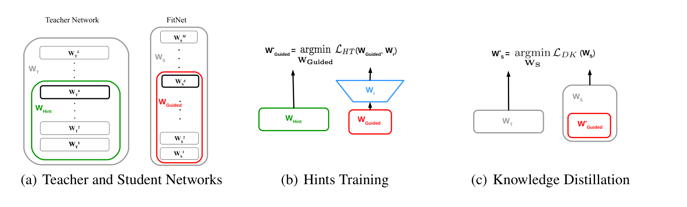
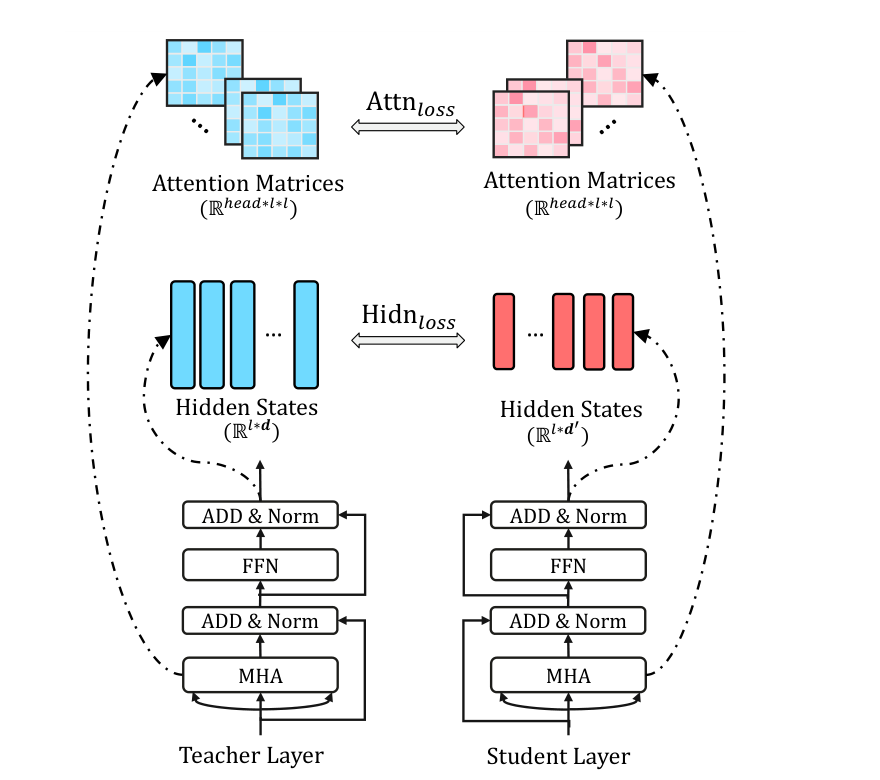
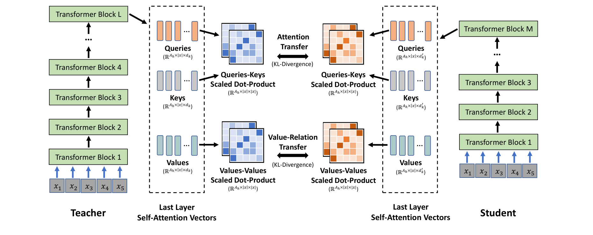
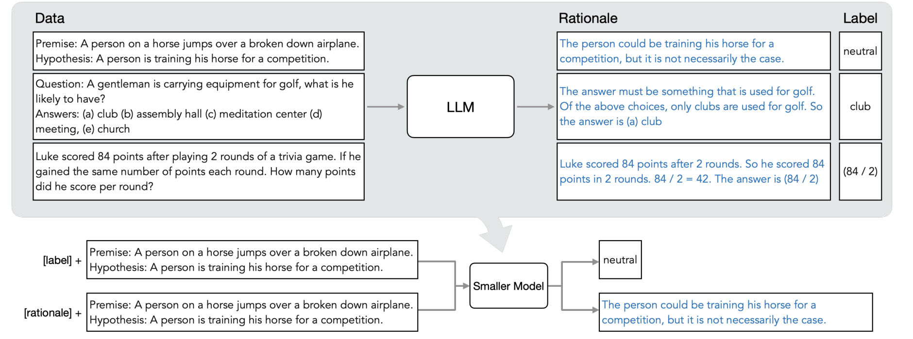
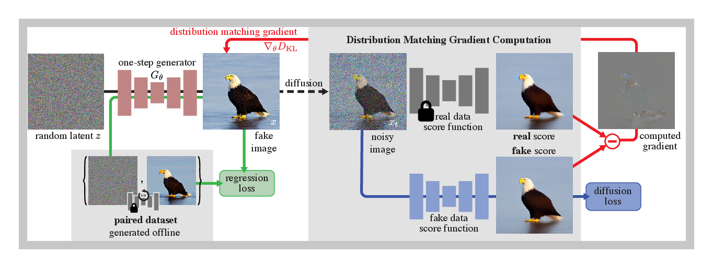

# 模型蒸馏

教师模型对同一个输入可以给出完整的类别分布，学生不必只学习一个正确标签。蒸馏使用这份额外监督，帮助学生学习教师的预测方式。它可以用于压缩模型，也可用于迁移行为，但学生的结构、训练数据和可表达能力仍然限制最终效果。

先看一个二分类输入。教师 logits 为 `(2,0)`，学生 logits 为 `(0,0)`，真实类别为第一类。硬标签只告诉学生“第一类正确”；教师分布还给出它偏向第一类的程度。下面把这个差别算成损失和梯度。

## 温度改变了教师提供的信息

温度为 \(T\) 时，教师和学生分布分别是

\[
p_i^{(T)}=\frac{e^{z_i^{\rm teacher}/T}}{\sum_j e^{z_j^{\rm teacher}/T}},\qquad
q_i^{(T)}=\frac{e^{z_i^{\rm student}/T}}{\sum_j e^{z_j^{\rm student}/T}}.
\]

教师在 \(T=1\) 时约为 `(0.880797,0.119203)`，在 \(T=2\) 时约为 `(0.731059,0.268941)`；学生在两种温度下都是 `(0.5,0.5)`。较高温度让非最大类别的相对偏好更容易参与训练，但温度过高也可能让分布接近均匀，削弱有用差异。

温度不是教师置信度的自动校准。这里人为平滑目标是训练设计；教师概率是否与真实正确率相符，需要另外评估。

## KL 和交叉熵的数值不同，学生梯度相同

固定教师分布，蒸馏可以最小化 \(\mathrm{KL}(p^{(T)}\|q^{(T)})\)。由 \(\mathrm{KL}=H(p,q)-H(p)\)，教师熵对学生参数是常数，所以使用软标签交叉熵会得到相同学生梯度。

在 \(T=2\) 的例子中，软标签交叉熵为 \(\log2=0.693147\)，KL 为 0.110944。两者损失值不能直接横比，训练日志应写清实际使用哪一个。

常见目标还乘 \(T^2\)。对学生原始 logits 求导得到

\[
\frac{\partial[T^2\mathrm{KL}(p^{(T)}\|q^{(T)})]}{\partial z_i^{\rm student}}
=T(q_i^{(T)}-p_i^{(T)}).
\]

本例是 `(-0.462117,0.462117)`。梯度下降将提高第一类 logit、降低第二类。乘 \(T^2\) 可补偿温度引起的部分梯度缩放，但有限温度下不能保证不同 \(T\) 的梯度完全相同。

## 教师意见与真实标签怎样合并

常见总损失为

\[
\mathcal L=\alpha T^2\mathrm{KL}(p^{(T)}\|q^{(T)})
+(1-\alpha)\operatorname{CE}(y,q^{(1)}).
\]

硬标签使用通常温度，蒸馏分支使用平滑温度。取 \(\alpha=0.25\)，本例硬标签梯度是 `(-0.5,0.5)`，合成第一维梯度约为 -0.490529。

如果真实标签其实是第二类，硬标签与教师就会发生冲突，第一维合成梯度约为 0.259471，仍推动学生纠正教师。若把教师权重设得过高，则可能复制教师错误。蒸馏并不会自动知道教师在哪些输入上可信，覆盖目标分布和保留独立评测非常重要。

```python
import math
T = 2.0
p0 = 1 / (1 + math.exp(-2/T))
p = [p0, 1-p0]
q = [.5, .5]
ce = -sum(a*math.log(b) for a,b in zip(p,q))
kl = sum(a*math.log(a/b) for a,b in zip(p,q))
grad = [T*(b-a) for a,b in zip(p,q)]
print(round(ce,6), round(kl,6))
print([round(g,6) for g in grad])
```

输出为 `0.693147 0.110944` 与 `[-0.462117, 0.462117]`，可以直接核对目标的方向和尺度。

## 一次训练前向实际要保留什么

同一个输入先经过教师，再经过学生。教师通常保持 `eval()` 并禁止梯度记录，学生保留反向计算图；二者接收的预处理和 token 对齐必须相容。`eval()` 本身不关闭自动微分，它只改变 dropout、BatchNorm 等模块的行为，所以与 `no_grad()` 不能互相代替。

如果提前缓存教师 logits，训练可省掉重复教师前向，但缓存绑定了输入版本、增强策略、tokenizer 和教师 checkpoint。对文本只保存 top-k 概率时，尾部质量丢失，不能不加说明地当成完整分布 KL。不同词表的教师与学生更不能逐 token 硬对齐 logits，需要序列数据、映射或其他目标。

## 中间表示和生成轨迹也能作为监督

当学生输出能力不足以解释教师的完整分布时，可以在中间层提供辅助信号。例如学生特征 \(h_s\) 通过可训练投影 \(P\) 后与教师 \(h_t\) 比较，使用 \(\|Ph_s-h_t\|^2\)。投影解决尺寸不同的问题，但逐坐标匹配还假设两种表示适合这样对齐；关系矩阵、注意力分布等方法放宽了直接匹配的方式。

{ width="860" }

<small>[FitNets Figure 1](https://arxiv.org/abs/1412.6550)。看教师 hint layer 与学生 guided layer 的连接，它为学生提供了输出标签之外的训练信号。图示训练步骤属于该方法，不是所有蒸馏都必须先做一轮特征拟合。</small>

{ width="820" }

<small>图源：[TinyBERT: Distilling BERT for Natural Language Understanding](https://arxiv.org/abs/1909.10351)，Figure 2。</small>

上下两组虚线分别连接 attention matrices 与 hidden states。它们让辅助监督进入 Transformer 中间层；教师与学生的层数、宽度不同时，还需定义对应关系及必要投影。

{ width="820" }

<small>图源：[MiniLM: Deep Self-Attention Distillation for Task-Agnostic Compression of Pre-Trained Transformers](https://arxiv.org/abs/2002.10957)，Figure 1。</small>

上支路比较 query-key attention 分布，下支路比较 value-value 关系。关系矩阵的 token 轴可以相容，即使隐藏通道宽度不同；但输入 token 仍需对齐，关系蒸馏并不免除全部接口约束。

文本序列蒸馏常让教师生成答案，再把这些 token 当作学生的监督数据。它不等于完整分布蒸馏，保留了选中的轨迹，省去了大量未选 token 的概率。教师解释步骤也可能包含错误，因此筛选答案和验证过程会直接改变学生学到的行为。

{ width="820" }

<small>图源：[Distilling Step-by-Step! Outperforming Larger Language Models with Less Training Data and Smaller Model Sizes](https://arxiv.org/abs/2305.02301)，Figure 2。</small>

上半部由教师产生 rationale 和 label，下半部用不同任务前缀训练较小模型。解释文本增加了监督内容，也可能带入教师错误；要核查解释是否支持标签，不能只看句子是否流畅。

扩散少步蒸馏又多一层变化：学生要用更少次网络调用近似教师的多步生成过程，监督对象可能是状态、速度、轨迹或分布梯度，不能直接套用上面的分类 KL。对应机制见[扩散模型](../diffusion/index.md)。

{ width="820" }

<small>图源：[One-step Diffusion with Distribution Matching Distillation](https://arxiv.org/abs/2311.18828)，Figure 2。</small>

左侧生成器从噪声产生样本，回归分支使用预计算配对，另一分支以 real 与 fake score 的差异构造分布匹配梯度。这里压缩的是采样过程；直接删除教师去噪步骤，并不会自动得到图中的学生目标。

## 怎样判断蒸馏有用

至少要比较同一学生结构的两个版本：只用原始监督训练，和加入教师信号训练。输入数据、训练预算、评估协议应尽量一致；如果蒸馏版本多用了大量数据，效果不能全部归给损失形式。

部署成本由最终学生的参数、状态和运行方式决定。训练期间多跑教师会增加成本，部署时如果还需教师验证，也不能报告成“只有学生”的延迟。教师强、学生小都只是设定，真正的结论应来自相同任务上的质量与成本测量。

## 可读的教程实现

- [PyTorch Knowledge Distillation Tutorial](https://github.com/pytorch/tutorials/blob/5672cd98a7671eda4d9122b10f8eec580f74d03e/beginner_source/knowledge_distillation_tutorial.py)，soft_targets_loss 实际计算 KL 并乘 T²，随后与真实标签交叉熵加权；可直接对照本文每个变量。
