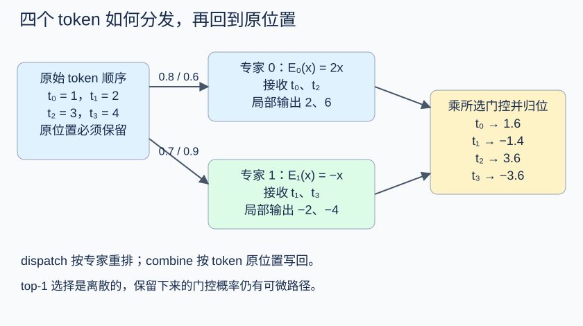
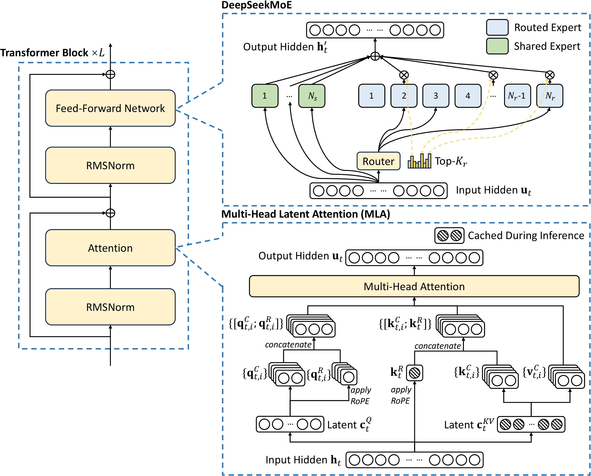
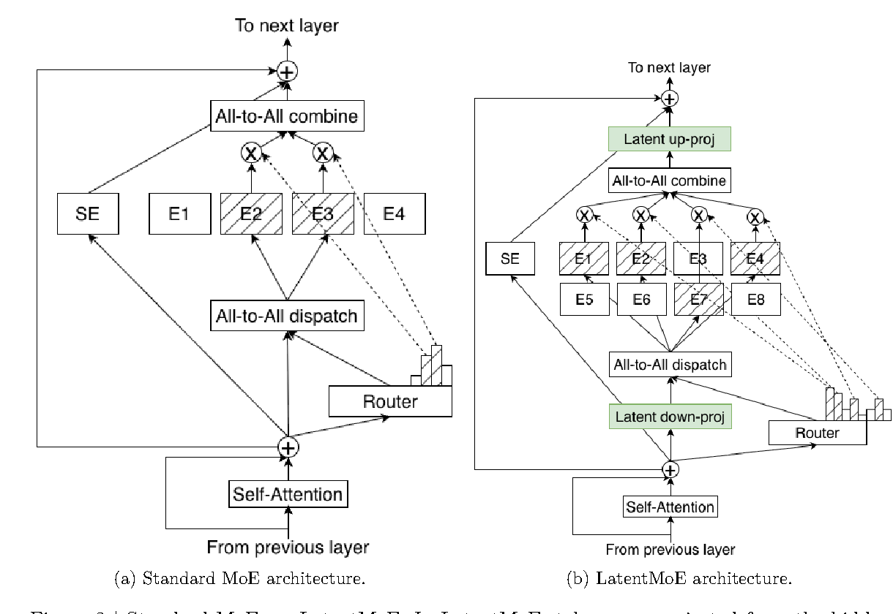

# MoE 的路由、专家计算与通信

一个 batch 里的 token 为什么不必经过同一组前馈权重？Mixture of Experts 把前馈层换成多个候选专家，再为每个 token 选择其中少数几个。这样可以存储更多参数，同时控制一次 token 真正使用的参数量。

真正需要解释的是这几步如何连起来。路由结果是离散索引，GPU 喜欢连续矩阵；专家输出还要回到原来的 token 顺序，才能与残差相加。本文先用四个标量 token 和两个专家算完整个过程，再扩展到向量、容量和多卡通信。标量专家只是演示数据流，不代表真实模型能力。

## 四个 token 怎样被分到两个专家

令输入为 \(x=(1,2,3,4)\)。Router 通常用线性投影产生每个专家的分数，再对专家维做 softmax。假设当前概率矩阵为

\[
P=\begin{bmatrix}
0.8&0.2\\0.3&0.7\\0.6&0.4\\0.1&0.9
\end{bmatrix}.
\]

每行对应一个 token，每列对应一个专家。Top-1 路由选择本行最大项，得到专家编号 `[0,1,0,1]`。这时不能按原顺序直接做一次共享矩阵乘法，因为四个 token 使用的权重已经不同。

Dispatch 把第 0、2 个 token 聚到专家 0 的小批次 `[1,3]`，第 1、3 个聚到专家 1 的 `[2,4]`。同时保存原位置索引 `[0,2]` 和 `[1,3]`，否则后面无法复原序列。

## 专家计算以后怎样返回原序列

用 \(E_0(x)=2x\)、\(E_1(x)=-x\) 演示，两组结果为 `[2,6]` 和 `[-2,-4]`。采用保留选中概率的 top-1 规则

\[
y_t=p_{t,e_t}E_{e_t}(x_t),
\]

加权后分别是 `[1.6,3.6]` 与 `[-1.4,-3.6]`。Combine 按位置写回，输出为 `[1.6,-1.4,3.6,-3.6]`。若外部还有残差，最终块输出为 `[2.6,0.6,6.6,0.4]`。

这里概率没有重新归一化为 1。若 top-1 后只保留索引、直接返回专家输出，前向值会不同，router 从主损失获得的梯度路径也会不同。阅读实现时必须看选中概率是否保留、top-k 内是否重归一化、有没有共享专家。

```python
x = [1.0, 2.0, 3.0, 4.0]
p = [[.8,.2], [.3,.7], [.6,.4], [.1,.9]]
routes = [max(range(2), key=lambda e: row[e]) for row in p]
groups = [[i for i, e in enumerate(routes) if e == expert] for expert in range(2)]
y = [0.0] * len(x)
for expert, indices in enumerate(groups):
    for i in indices:
        value = 2*x[i] if expert == 0 else -x[i]
        y[i] = p[i][expert] * value
print(groups)
print([round(v, 6) for v in y])
```

输出是 `[[0, 2], [1, 3]]` 和 `[1.6, -1.4, 3.6, -3.6]`。真实实现把循环变成 gather、grouped GEMM 和 scatter 等算子，数学上的分组与复原仍然存在。



<small>图源：本站根据上面的四个 token、两个专家和 router 概率重绘。图中展示的是分组、专家计算和按原位置归位，未包含真实实现中的容量溢出策略。</small>

**读这张图。**先看 token 被分到哪个专家，再沿每个专家的局部输出回到原 token 位置；概率权重在归位时参与缩放。若容量不足，图示路径还需要额外的丢弃、转交或 dropless 规则。

## 离散选择以后，router 还怎样学习

假设第一个 token 的专家选择暂时不变，\(y=2p_0\)，目标为 1，损失为 \((y-1)^2/2\)。在 \(p_0=0.8\) 时，\(y=1.6\)，所以 \(\partial\ell/\partial p_0=(1.6-1)2=1.2\)。

两专家 softmax 满足 \(\partial p_0/\partial l_0=p_0(1-p_0)=0.16\)，\(\partial p_0/\partial l_1=-0.16\)。于是 router 两个 logits 的梯度为 \((0.192,-0.192)\)。被选中概率保留了一条可微路径，未选中的 logit 也能通过 softmax 分母影响它。

不过 argmax 的索引跳变本身没有在这里求导。这是分段计算图上的梯度，不能理解为程序已经评价了所有未选中专家的效果。Top-1 概率若归一化成常数 1，主损失对这个 gate 的导数会消失，除非实现另设替代梯度或其他训练信号。

## 容量限制会把数学路由变成系统决策

把第二个 token 的概率改成 `[0.7,0.3]`，就有三个 token 选专家 0，只有一个选专家 1。假设每个专家仅容纳两个 token，专家 0 溢出一个。实现可以丢弃专家分支、转交其他专家、增加容量或采用 dropless 执行；每种方式改变的成本和输出都不同。

例如“溢出 token 的专家分支置零，保留外部残差”与“用输入替代专家输出后再加残差”并不相同。下面引用的 labml 教学实现有特定的 passthrough 行为，应逐行读它，不能把那份实现推广成全部 MoE 的统一规则。

辅助负载均衡损失常同时使用实际选中比例 \(f_e\) 和平均 router 概率 \(\bar p_e\)，例如 \(E\sum_e f_e\bar p_e\)。上例 \(f=(0.75,0.25)\)、\(\bar p=(0.55,0.45)\)，该项为 1.05。它给 router 一个分散分配的训练信号，不会在本次前向里自动把多出来的 token 搬走，也不保证每个 batch 精确均分。

## 从两个标量专家扩展到大模型

真实输入通常是 \(X\in\mathbb R^{T\times d}\)，每个专家是带隐藏宽度 \(m\) 的 FFN 或 SwiGLU。若使用两层 FFN，一个专家约有 \(2dm\) 个参数。\(E\) 个专家的总参数约 \(2Edm\)，每个 token 选 \(k\) 个时，专家乘加量主要随 \(k\) 增加；router、attention、共享层和通信都还要另外计算。

因此“总参数多、激活参数少”描述的是存储与单 token 路径的区别。即使本次只选择少数专家，服务系统通常仍需让所有可能被选中的权重可访问。权重分布在多卡时，dispatch 要把 token 特征发到专家所在卡，combine 再把结果送回；热门专家还可能形成负载瓶颈。

{ width="920" }

<small>[DeepSeek-V3 Technical Report Figure 2](https://arxiv.org/abs/2412.19437)。图中的注意力与专家分支承担不同工作。共享专家处理每个 token，路由专家只处理选中的 token；不能把减少 KV 的注意力设计直接归功于 MoE。</small>

**读这张图。**沿一个 token 向右追踪，先经过共享的 attention 与 shared expert，再进入它被路由到的若干 routed experts。图示表达模块连接和参数归属，无法单独给出 dispatch、combine 或 all-to-all 的实际通信时间。

小批次 decode 时，每个专家拿到的 token 可能很少，矩阵形状不利于 GPU 利用；大批次虽能提高专家计算效率，也可能增加通信和排队。比较 dense 与 MoE 应固定任务质量、请求长度、批次、硬件和并行方式。激活参数量不能单独预测延迟。

{ width="820" }

<small>图源：[Nemotron 3 Super Technical Report](../paper-deep-dives/technical-reports/nemotron-3-super.md)，Figure 3。</small>

**读这张图。**比较左右两条路径时，重点看 latent 投影插入 all-to-all 的位置，以及专家计算前后的表示宽度。它说明通信对象可以改变，不能据此推出所有 batch 和硬件都获得相同加速。

左侧为标准专家分发与合并，右侧在 all-to-all dispatch 前加 latent down-proj，在 combine 后加 latent up-proj。图要比较的是专家计算及通信所处的表示维度。它没有把本文的 top-1 标量算例变成通用路由规则，也不能单独证明特定硬件上的加速幅度。

## 对照一个能读完的实现

- [labml 的 SwitchFeedForward](https://github.com/labmlai/annotated_deep_learning_paper_implementations/blob/2be1800d141eb2716d6079405bbe47ce1040ef85/labml_nn/transformers/switch/__init__.py)，依次查看 route_prob、indexes_list、capacity、expert_output 和 final_output；注意它自己的丢弃与概率缩放规则。

深入实现可继续看[专家并行与通信](../training/distributed-training-and-checkpointing.md)和[离散选择与路由数学](../prerequisite-math/discrete-selection-topk-and-routing.md)。理解它们时，始终保留本例的两个对象：token 原位置和当前专家分组。
