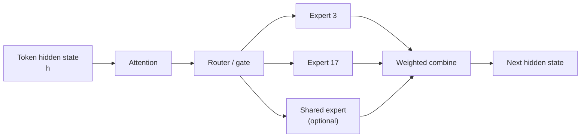
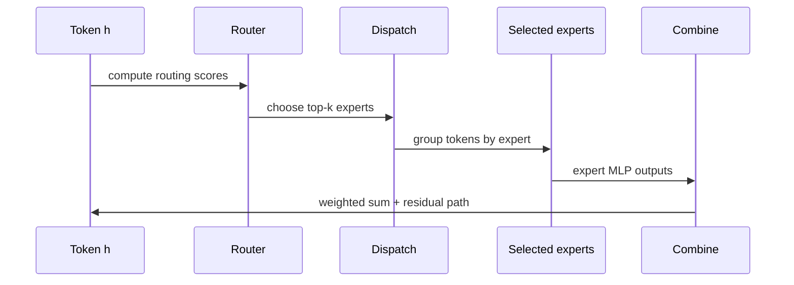
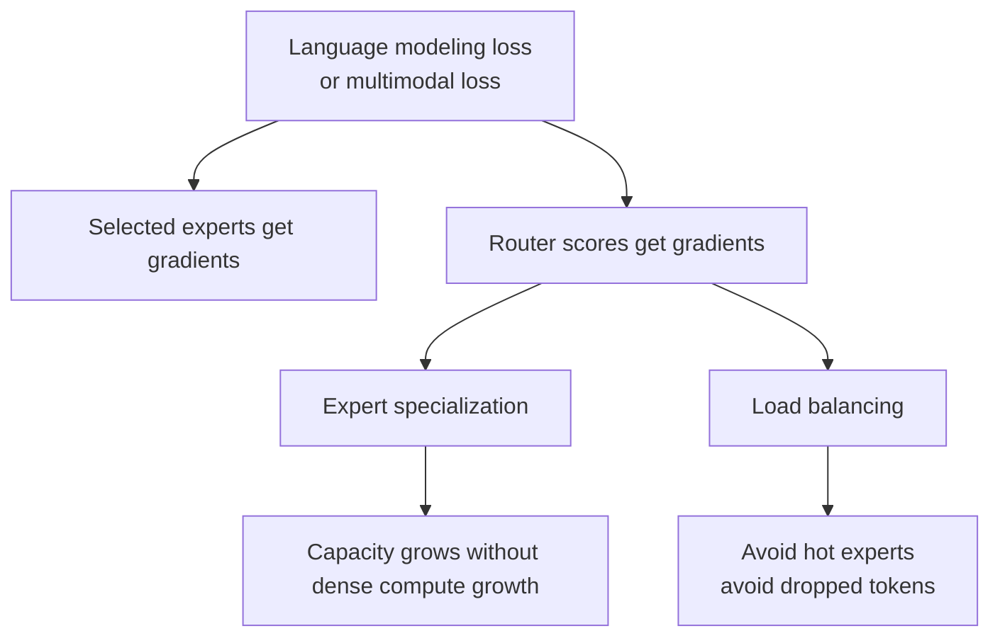
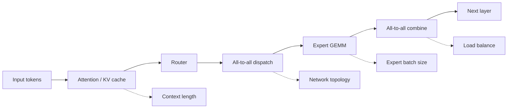
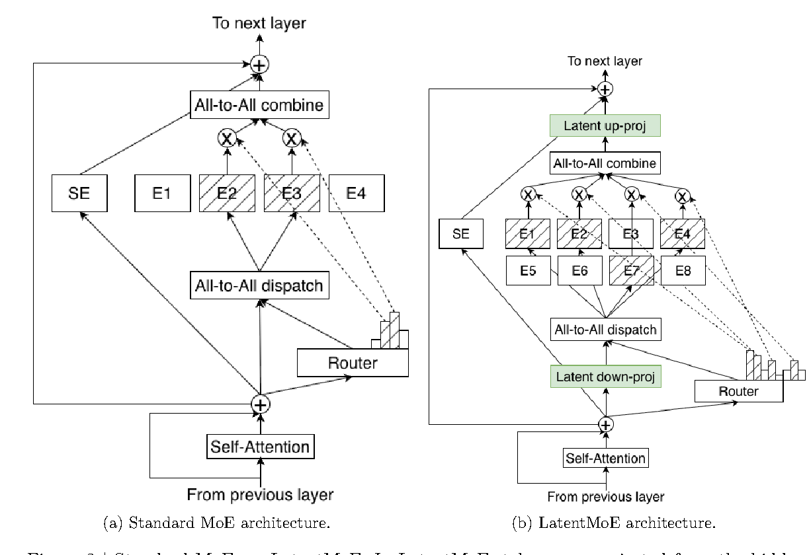
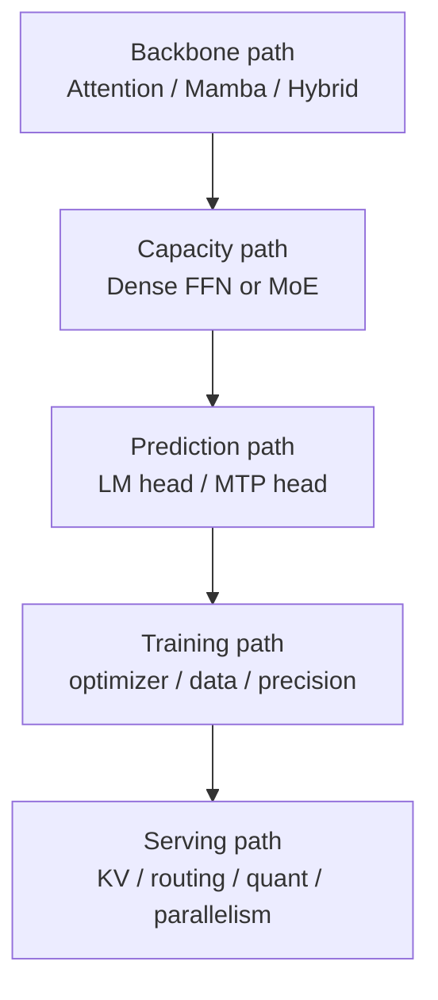
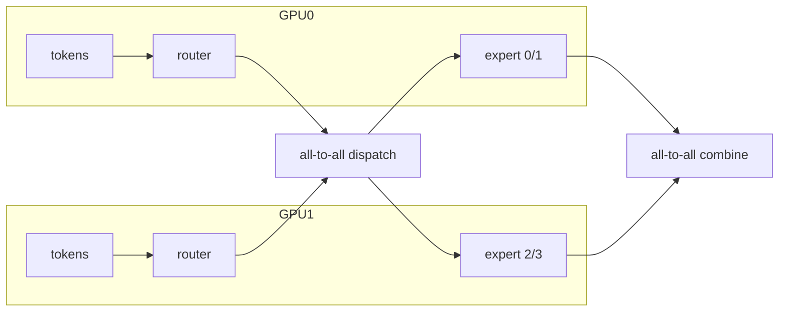

# MoE 与大模型架构：总参数、激活参数和路由成本

读 DeepSeek、Qwen、Kimi、Gemini、Nemotron 这类技术报告时，最容易被一张模型规模表带偏：`Total Params`、`Activated Params`、`Experts`、`Top-k`、`MLA/GQA`、`MTP`、`FP8/FP4` 全部挤在一起。真正要读懂它，不是背模型名字，而是先分清：**MoE 改的是容量和计算分配，MTP 改的是预测头，Mamba/SSM 改的是序列状态路径，低精度改的是数值和硬件执行。**

这一页补的是“读架构表”的前置知识。它不是部署路由教程，而是帮你在技术报告里看懂稀疏专家模型到底怎样训练、怎样算账、怎样影响推理。
可以先把这页当成一张入门地图：它把零散术语连成“输入、变化、输出”三件事。先不用背模型名，先看清哪一步在改变信息，哪一步在改变成本。

!!! tip "数学先修"
    本文会用到[Top-k、softmax gating 与负载均衡](../prerequisite-math/discrete-selection-topk-and-routing.md)、[概率分布](../prerequisite-math/probability-distributions-and-expectation.md)，以及[复杂度、FLOPs 和通信字节](../prerequisite-math/numerics-complexity-and-estimation.md)来同时读懂 router 和系统成本。

## 核心问题

MoE 最容易被误读成“参数很多，所以能力强；激活参数少，所以推理便宜”。这两个判断都不够。真正要看的是：**总参数给了多少容量，router 每个 token 激活了多少专家，训练时专家有没有被均衡使用，推理时 token dispatch 和 all-to-all 有没有把节省的计算吃掉。**

因此读 MoE 不要从模型名字开始，而要从一条 token 的路径开始：hidden state 进入 router，router 选出少数 expert，系统把 token 发到对应 expert，expert MLP 算完再合回来。这个路径既是模型结构，也是训练稳定性和硬件成本的来源。

## 先把核心问题立住

MoE（Mixture of Experts）的核心是：**把 Transformer block 里的 dense MLP 换成多个 expert MLP，再用 router 为每个 token 只选择少数几个 expert。**

这张图的重点是位置和稀疏性。MoE 通常替换 Transformer block 中的 FFN/MLP 子层，而不是 attention 本身。一个 token 不会经过所有专家，只会经过 router 选中的少数专家；这就是为什么 MoE 可以有很大的总参数量，但每个 token 的激活计算量相对小。

## MoE 公式怎么读

MoE router 可以看成每个 token 的 Top-K 选择问题。负载均衡 loss 则是在主任务 loss 之外约束 expert 使用分布，避免少数 expert 过热、其他 expert 闲置。更细的算法推导可以读 Datawhale 的 [MoE Router 入门](https://datawhalechina.github.io/llm-algo-leetcode/02_PyTorch_Algorithms/06_MoE_Router.html)。

从复杂度上看，router Top-K 通常要扫描 \(E\) 个 expert 分数，代价约为 \(O(E)\) 到 \(O(E\log K)\)，只保留 \(K\) 个 active expert 索引；expert 计算近似随 \(K\) 线性增长，但系统还要额外准备 token dispatch 和 combine buffer。也就是说，MoE 的难点不只在数学上的 top-k，还在稀疏调度、负载均衡和跨设备通信。

最小读法：router 先给 expert 打分，选 top-k 个 expert 处理当前 token，再把这些 expert 的输出按权重合回来。

## Dense 与 MoE 的差别

Dense 模型里，每个 token 都经过同一套 MLP 参数；MoE 模型里，每个 token 会被分配给少数 expert。

| 对比项 | Dense MLP | MoE MLP |
| --- | --- | --- |
| 参数使用 | 每个 token 使用同一套 FFN 参数 | 每个 token 只使用 top-k expert 和可能的 shared expert |
| 容量来源 | 增大隐藏维度、层数或 FFN 宽度 | 增加 expert 数量，让不同 token 走不同参数 |
| 单 token 计算 | 接近总 FFN 规模 | 接近被激活 expert 的规模 |
| 训练难点 | 优化稳定、显存、吞吐 | router 负载均衡、expert specialization、通信和稳定性 |
| 推理难点 | attention/KV、batch、kernel | token dispatch、all-to-all、hot expert、expert batch size |

MoE 的一个常见误读是：看到 `671B`、`1T` 之类的总参数，就把它等同于每个 token 的计算量。实际要分两层看：

- `Total Params`：模型仓库里一共存了多少参数，代表容量和存储成本。
- `Activated Params`：单个 token 前向时大约用了多少参数，更接近 per-token compute。

{ width="920" }

<small>图源：[DeepSeek-V3 Technical Report](https://arxiv.org/abs/2412.19437)，Figure 2。原论文图意：DeepSeek-V3 的 Transformer block 采用 MLA 和 DeepSeekMoE；MLA 用压缩 latent 降低 KV cache，DeepSeekMoE 由 shared experts 和 routed experts 共同组成。</small>

这张图应先看右侧 DeepSeekMoE 放大框，再回到左侧 Transformer block。shared experts 是所有 token 都能走的公共能力；routed experts 是 router 按 token 选择的专家；MLA 是 attention/KV 路径的压缩，不是 MoE 本身。对应到公式，就是 \(y=E_{\text{shared}}(h)+\sum_{i\in\operatorname{TopK}(g)}\tilde g_iE_i(h)\)。最容易误读的是把 MLA 和 MoE 混成一件事：MLA 主要省 KV cache，MoE 主要改变 FFN 容量和激活计算。

## 一个 token 怎么走过 MoE

MoE 层的计算可以写成：

\[
g = \operatorname{softmax}(W_r h)
\]

\[
\operatorname{TopK}(g) = \{i_1, i_2, \dots, i_k\}
\]

\[
y = \sum_{i \in \operatorname{TopK}(g)} \tilde g_i \cdot E_i(h)
\]

其中 \(h\) 是 token 的 hidden state，\(W_r\) 是 router，\(E_i\) 是第 \(i\) 个 expert，\(\tilde g_i\) 是 top-k 后重新归一化的权重。很多现代 MoE 还会加入 shared expert：

\[
y = E_{\text{shared}}(h) + \sum_{i \in \operatorname{TopK}(g)} \tilde g_i \cdot E_i(h)
\]

这张流程图里最容易漏掉的是 `Dispatch`：训练和推理时，token 不是在原地挨个跑 expert，而是会按 expert 分组，再发到对应设备。大规模 MoE 的系统成本，很多时候就卡在 dispatch/combine 和跨卡通信。

## 架构表先看哪几列

技术报告里的模型表不要从 benchmark 分数开始读，先把下面几列翻译成成本账。

| Field in reports | 应该怎么读 | 常见误读 |
| --- | --- | --- |
| `Total Params` | 所有 dense 权重、expert 权重、embedding 等参数总和 | 误以为每个 token 都会用到全部参数 |
| `Activated Params` | 单个 token 前向实际激活的大致参数量 | 误以为它能单独决定 latency |
| `# Experts` | 总 expert 数量，通常只在 MoE FFN 层出现 | 误以为 expert 越多一定越快 |
| `Top-k` / `Activated Experts` | 每个 token 选择几个 routed experts | 忽略 top-k 增大会增加计算和通信 |
| `Shared Experts` | 所有 token 都会经过的公共 expert | 把 shared expert 当成普通 routed expert |
| `Routed Experts` | 由 router 动态选择的 expert | 忽略 router 负载不均会造成 hot expert |
| `Expert Hidden Size` | 每个 expert MLP 的中间维度 | 只看 expert 数，不看单个 expert 的宽度 |
| `Layers` | MoE 是否每层都有，还是只在部分层替换 FFN | 误以为“MoE 模型”代表所有层都是 MoE |
| `Attention Heads` / `KV Heads` | attention 路径的计算和 KV cache 成本 | 把 MoE 的节省错误归到 attention 上 |
| `Context Length` | 长上下文会放大 attention、KV 和通信压力 | 只看参数量，不看序列长度 |
| `Precision` | BF16、FP8、FP4、NVFP4 等数值和硬件路径 | 把存储格式等同于计算格式 |
| `Parallelism` | TP、PP、DP、EP、CP 如何切分模型和序列 | 忽略 EP/all-to-all 对 MoE 吞吐的影响 |

最短读法是先问四个问题：总参数有多大，单 token 激活多少，每个 token 选几个专家，专家分布在几张卡上。这四个问题答出来后，再看 benchmark 和训练细节才不会被一个规模数字带偏。

## Router 训练到底训练什么

MoE 训练不是只把很多 MLP 拼起来。Router 决定 token 走哪些 expert，因此它同时影响模型能力、梯度分配和系统负载。

| 训练细节 | 为什么重要 | 读论文时要找什么 |
| --- | --- | --- |
| Router softmax / sigmoid | 决定 token 到 expert 的概率分配 | router logits、top-k、是否重新归一化 |
| Top-k selection | 决定单 token 计算量和 expert 覆盖 | top-1、top-2、top-8 等设置 |
| Load balancing loss | 避免所有 token 挤到少数 expert | auxiliary loss、balance coefficient、token fraction |
| Auxiliary-loss-free balancing | 用动态 bias 等方式平衡负载，减少主目标干扰 | 是否报告无辅助损失路由或 bias update |
| Capacity factor | 限制每个 expert 一步能接多少 token | overflow、dropless routing、token dropping |
| Shared expert | 承担通用模式，给 routed experts 留出专业化空间 | shared/routed expert 数量和激活方式 |
| Expert parallelism | expert 分布在不同设备上 | EP group、all-to-all、communication overlap |
| Router stability | 防止训练早期 expert collapse | router z-loss、初始化、warmup、噪声策略 |

常见的 load balancing 直觉是：如果 expert \(i\) 收到的 token 比例是 \(f_i\)，router 给它的平均概率是 \(p_i\)，那么训练会惩罚“高概率但负载不均”的分布。论文公式可能不同，但目标通常类似：

\[
\mathcal{L}_{balance} \propto N \sum_i f_i p_i
\]

这里的重点不是背公式，而是理解：**MoE 需要一套机制保证专家被充分使用，否则总参数再大也只是摆设。**

## 为什么 Active Params 仍不等于延迟

`Activated Params` 更接近单 token 计算量，但它仍然不是实际延迟。推理延迟还受下面这些因素影响：

| 成本项 | 对 MoE 的影响 |
| --- | --- |
| Attention / KV cache | MoE 通常不减少 attention 的 \(L^2\) prefill 或 decode KV 读写成本 |
| All-to-all communication | expert 放在不同卡上时，token dispatch/combine 会引入通信 |
| Expert batch size | 每个 expert 收到的 token 太少，GEMM 会变碎，GPU 利用率下降 |
| Hot experts | 少数 expert 过热会拖慢整个 batch |
| Decode batch | 自回归 decode 每步 token 少，MoE 通信和调度开销更明显 |
| Quantization support | expert 权重低比特不代表 router、activation、通信都低成本 |
| Kernel fusion | router、dispatch、expert MLP、combine 是否融合会影响真实吞吐 |

所以读技术报告时，不要只看“active params 比 dense 小”。还要看作者有没有报告 tokens/s、latency、MFU、通信重叠、batch setting、context length 和硬件拓扑。

## MoE 和其他结构不要混

大模型报告常把 MoE、MTP、Mamba、MLA/GQA、Muon、FP8/FP4 放在同一段里。它们属于不同层。

{ width="880" }

<small>图源：[Nemotron 3 Super Technical Report](../paper-deep-dives/technical-reports/nemotron-3-super.md)，Figure 3。原论文图意：LatentMoE 用 latent routing 组织专家选择，并把稀疏专家能力接入大模型主干。</small>

再看 Nemotron 图，是为了提醒读者不要把某一个模型的 MoE 画法套到所有报告上。读这类图时先找 router 或 latent routing 的位置，再看 token/hidden state 如何进入专家；不同报告里的细节会变，但核心总是 token 表示、router、专家计算和 combine。它帮助你读懂“专家怎么被选中”，而不是只看模型表里的专家数量。

| 名词 | 改的是哪一层 | 主要解决什么 | 不要误解成 |
| --- | --- | --- | --- |
| MoE | FFN/MLP 容量与稀疏激活 | 用更大总容量服务不同 token | 直接减少 attention 或 KV cache |
| MTP | 预测头和训练目标 | 训练模型预测未来多个 token，服务投机或规划信号 | 一种 MoE 路由方法 |
| Mamba / SSM | 序列建模路径 | 用 recurrent state 降低长序列状态成本 | 一种专家模型 |
| GQA / MLA | Attention 和 KV 表示 | 降低 KV cache 或 attention 表示成本 | MoE 的替代品 |
| FP8 / FP4 / NVFP4 | 数值格式与硬件执行 | 降低显存、带宽或提升 GEMM 吞吐 | 自动提升模型能力 |
| Muon / MuonClip | 优化器更新几何 | 稳定或提升大规模预训练效率 | 推理加速技术 |
| EP / all-to-all | 分布式执行 | 把 expert 分到多卡并完成 token 交换 | 模型结构本身 |

如果一篇报告说“模型是 Mamba-MoE、带 shared-weight MTP、支持 FP8/NVFP4”，可以按这条路径拆：

## 训练相关细节怎么补读

MoE 技术报告里和训练最相关的不是“用了多少专家”本身，而是下面这条链：

\[
\text{data mixture} \rightarrow \text{router distribution} \rightarrow \text{expert specialization} \rightarrow \text{load balance} \rightarrow \text{system throughput}
\]

MoE 的训练 recipe 往往比架构名更关键。一个专家数更多的模型，如果 router 负载不稳、expert batch 太碎、低精度保护不足，真实训练效率可能反而更差。读报告时要把训练数据、router 分布、expert specialization、load balance 和系统吞吐连起来看。

## 系统读法：从专家到硬件

MoE 的系统执行通常会引入 Expert Parallelism（EP）：不同 expert 放在不同 GPU 上，token 根据 router 结果被发到对应设备。

读系统表时要特别看：

- EP group size：expert 分在多少张卡上；
- all-to-all 是否和 expert GEMM overlap；
- expert batch 是否足够大；
- router 和 dispatch 是否 fused；
- prefill 和 decode 是否分别报告；
- benchmark 的 batch size、context length、hardware topology 是否公开；
- 训练吞吐和推理吞吐是否混在一个结论里。

## 技术报告应该怎样拆

读一篇大模型技术报告时，先按下面顺序把 claim 拆开。这样做不是为了机械打勾，而是避免把“模型规模、训练 recipe、系统吞吐、后训练效果”混成一个结论。

1. 结构表：是 dense、MoE、hybrid MoE，还是 Mamba-MoE？MoE 出现在多少层？
2. 参数表：`Total Params` 和 `Activated Params` 分别是多少？top-k 是多少？
3. 专家表：shared experts、routed experts、expert hidden size、capacity 或 dropless 设置是什么？
4. 训练表：数据 mixture、训练 token、optimizer、precision、router balance 策略是否讲清？
5. 系统表：TP/PP/DP/EP/CP 如何组合？有没有 all-to-all、MFU、tokens/s、latency？
6. 后训练表：SFT、reward、RL、distillation 是否改变能力结论？
7. 证据表：benchmark、ablation、safety、system profiling 分别支持哪类 claim？

| 报告类型 | 重点看什么 | 回到本站哪里读 |
| --- | --- | --- |
| DeepSeek-V3 / V4 | DeepSeekMoE、MLA、auxiliary-loss-free routing、FP8、MTP、并行训练 | [DeepSeek-V3 讲解](../paper-deep-dives/technical-reports/deepseek-v3.md)、[DeepSeek-V4 讲解](../paper-deep-dives/technical-reports/deepseek-v4-pro.md) |
| Qwen3 / Qwen3.5-Omni | dense/MoE 版本、thinking、omni 模态、后训练和部署边界 | [Qwen3 讲解](../paper-deep-dives/technical-reports/qwen3.md)、[Qwen3.5-Omni 讲解](../paper-deep-dives/technical-reports/qwen35-omni.md) |
| Kimi K2 | 大规模 MoE、MuonClip、agentic data、tool-use 后训练 | [Kimi K2 讲解](../paper-deep-dives/technical-reports/kimi-k2.md)、[优化与训练入门](optimization-and-training-basics.md) |
| Nemotron 3 Super | Mamba-heavy hybrid backbone、LatentMoE、shared-weight MTP、NVFP4/FP8 | [Nemotron 3 Super 讲解](../paper-deep-dives/technical-reports/nemotron-3-super.md)、[Mamba 与混合 SSM 架构](mamba-and-hybrid-ssm-transformers.md) |
| Gemini 2.5 / System Card | sparse MoE、long context、dynamic thinking、安全与产品证据 | [Gemini 2.5 讲解](../paper-deep-dives/technical-reports/gemini-2-5.md)、[数据划分与评测指标](data-splits-metrics-and-evaluation-basics.md) |

## 最容易犯的六个错

| 错误读法 | 更稳的读法 |
| --- | --- |
| 总参数越大，推理一定越慢 | 先看 activated params，再看 attention/KV、通信、batch 和硬件 |
| Activated params 小，所以 latency 一定低 | MoE 可能被 all-to-all、hot expert、碎 GEMM 卡住 |
| Expert 越多，能力一定越强 | 还要看数据、router、负载均衡、训练 token 和后训练 |
| MoE 省的是所有计算 | MoE 主要稀疏化 FFN，attention/KV 仍要单独处理 |
| Shared expert 是可有可无的细节 | shared expert 会影响通用知识和 routed expert 专业化 |
| MoE Serving 路由和模型内 MoE router 是一回事 | 前者是请求/模型级调度，后者是 token/expert 级模型结构 |

## 外部精读

- [The Sparsely-Gated Mixture-of-Experts Layer](https://arxiv.org/abs/1701.06538)：MoE router、top-k、capacity 和 load balancing 的早期经典来源。
- [GShard](https://arxiv.org/abs/2006.16668)：把稀疏专家、自动并行和大规模训练放到系统语境里。
- [Switch Transformer](https://arxiv.org/abs/2101.03961)：top-1 routing、capacity factor 和负载均衡的入门读物。
- [Hugging Face: Mixture of Experts Explained](https://huggingface.co/blog/moe)：适合用图和直觉理解 expert、router、capacity 和推理代价。
- [DeepSpeed MoE Tutorial](https://www.deepspeed.ai/tutorials/mixture-of-experts/)：从系统角度理解 expert parallelism、通信和训练配置。

读完这一页，再读技术报告时应该能做到：看到一张模型表，先把参数容量、激活计算、路由训练、通信成本和证据强度拆开，而不是被一个大模型规模数字带着走。
