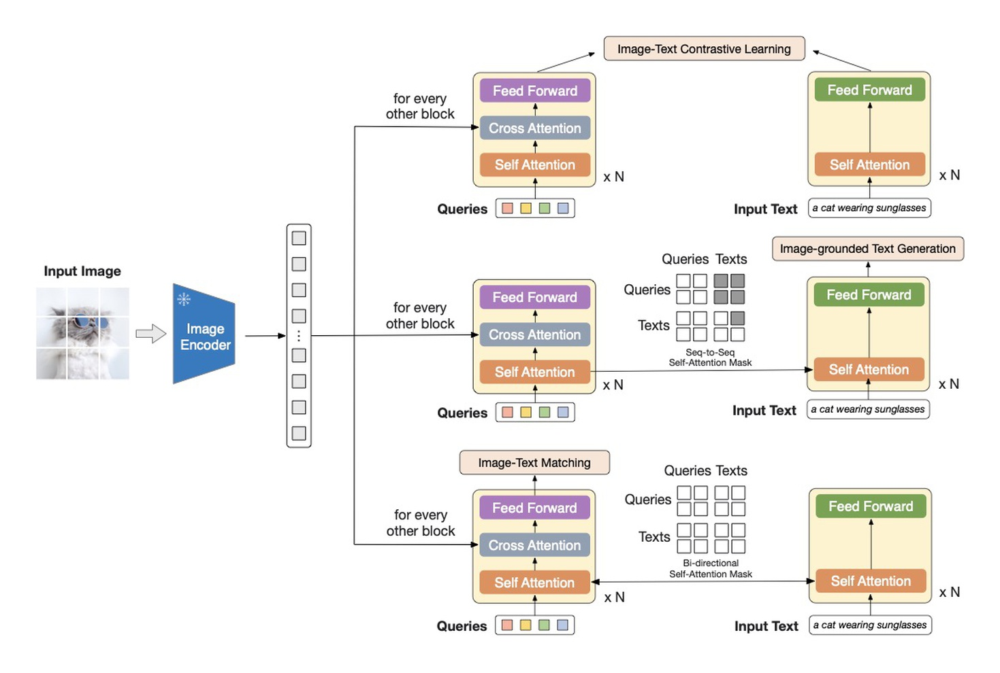
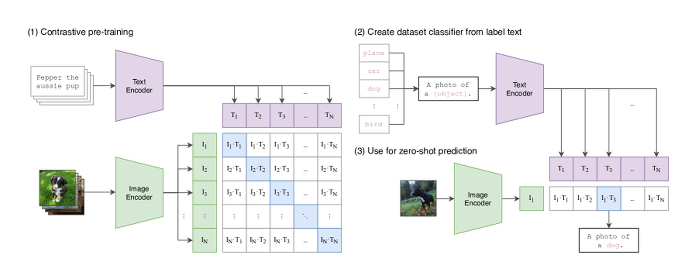

# 多模态推理怎样使用视觉证据

一张柱状图显示甲产品销量 120、乙产品销量 80，问题是“甲比乙高百分之多少”。正确计算是 \((120-80)/80=50\%\)。如果模型读成 120 和 90，再长的推理都只会围绕错误数字展开；如果数字读对却用 120 作分母，又属于另一种错误。

这个例子把多模态推理拆成能核查的过程：图像中的证据是否进入模型，数字与对象是否正确对应，最后的计算是否符合问题。视觉对齐、语言推理和工具验证分别作用于不同环节。

## 像素先被变成有限数量的表示

视觉编码器可能把图像分成 patch，再产生特征 token；连接器把特征映射到语言模型可处理的维度。一个线性 projector 主要改变通道表示，resampler 还可能改变 token 数量。这些步骤都不会自动保证小文字被保留。

假设原图为 `1024×1024`，缩成 `224×224` 后，原本宽 8 像素的数字笔画只剩不到 2 像素。即使后面增加推理 token，也不能凭空恢复可靠的原始笔画。高分辨率裁剪可以保留细节，但需要把局部图块放回全局坐标，避免把甲的标签接到乙的柱子。

{ width="820" }

<small>图源：[BLIP-2: Bootstrapping Language-Image Pre-training with Frozen Image Encoders and Large Language Models](https://arxiv.org/abs/2301.12597)，Figure 2。</small>

先找左侧图像特征，再沿 cross-attention 看 queries 怎样读取它们。右侧对比、生成与匹配任务采用不同的信息交互方式。有限 queries 是一种压缩接口，是否保留小字和精确位置仍需任务测试。

图文相似度训练能鼓励“图里有销量比较”的语义匹配，却未必对 80 与 90 的差别施加强监督。读取数值、定位文字和保持对象对应关系，要用相应数据与任务检查。

{ width="820" }

<small>图源：[Learning Transferable Visual Models From Natural Language Supervision](https://arxiv.org/abs/2103.00020)，Figure 1。</small>

左侧对角线是训练中匹配的图文对，右侧是用文本类别做预测。目标能鼓励整体语义匹配；若配套文本从未区分 80 与 90，就不能仅由配对能力断言模型能读准这两个数字。

## 把对象、数值和单位一起保留

对这张图，可把读取结果组织成三元组 `(对象, 数值, 单位)`，例如 `(甲,120,件)`、`(乙,80,件)`。还要确认纵轴是否从零开始、数字是标签还是坐标刻度、单位是否为“万件”。

这些字段可以由模型、OCR 或组合流程产生。无论哪一种，都应该能回到图中的区域核查。OCR 输出 80，却没有坐标和对象关系，仍可能在后续组合时配错产品。

如果关键数字模糊，正确处理是保留不确定性并请求更清晰证据或给出条件答案。把语言先验里常见的比例填进缺口，会让解释看起来完整，却失去证据基础。

## 问题决定分母，工具只执行给定算式

“甲比乙高多少”以乙为参照，所以分母是 80；“乙比甲低多少”以甲为参照，结果是 \((120-80)/120\approx33.33\%\)。同一组数字，对应不同问题。

计算器能保证指定表达式的数值计算，却不能自动判断表达式是否正确。模型需要先把自然语言关系映射到运算，再由工具执行，最后核对单位和参照对象。完整记录应同时保存识别到的数字、选择的表达式与结果。

```python
a, b = 120.0, 80.0
print(round((a-b)/b*100, 2))
print(round((a-b)/a*100, 2))
```

输出为 50.0 和 33.33。这个差别是语义决定的，不能通过多数投票或更长解释直接消除。

## 用对照输入区分看图与猜测

保持问题不变，把乙的数值从 80 改为 100，答案应从 50% 变为 20%。若回答几乎不变，说明系统可能没有稳定使用该视觉证据。再保持数字不变、交换甲乙标签，检查对象绑定是否随之改变。

这些是受控测试思路，不是关于某个模型已经失败的实验结论。实际测试应重新渲染清晰图像、保证只有目标因素变化，并记录预处理后的图像。直接修改 prompt 中的数字，测到的是文字推理，不是视觉读取。

遮掉数字后模型仍能猜对某一题，也不能单独证明它作弊，可能存在其他视觉线索。需要一组具有对照和随机化的样本，才能区分语言偏好、视觉线索和真正的数值读取。

## 视频多了时间顺序与采样问题

设一个 2 秒视频中，手在 0.8 到 0.9 秒短暂接触杯子。若只取 0 秒和 1 秒的帧，模型可能看到接触前后状态，却没看到接触本身。回答“手何时接触杯子”需要承认采样边界，不能把帧间推测当作已观察事件。

视频编码还要保留帧时间、相机变化与对象身份。把两个动作顺序颠倒可以检验模型是否利用时间；只用单帧的成功不能证明它理解了动作因果。更多机制见[视频表示与记忆](../vlm/video-representation-and-memory.md)。

## 推理步骤什么时候有帮助

明确写出“读到甲120、乙80，参照乙，计算差值再除以80”，能使错误位置可见。它有助于检查流程，却不是独立的正确性证据。模型也可能事后生成一段与答案相符的解释，真正可靠的依据仍是输入区域、数值对应和可复算操作。

对机器人任务，图中“杯子在左边”还需转换到相机、机械臂和世界坐标。语言空间描述正确，不代表动作坐标正确，视觉推理与控制之间还有标定和执行接口，详见[几何与三维](../prerequisite-math/geometry-vision-and-3d.md)。

## 阅读入口

- [VLM 的视觉编码与连接器](../vlm/visual-tokenizers-and-connectors.md)解释证据如何进入语言模型。
- [多模态评测与失败模式](../vlm/multimodal-evaluation-and-failure-modes.md)讨论分辨率、定位与时序的分项检查。
- [Prompt、CoT 与 RAG](prompt-engineering-cot-and-rag-basics.md)解释外部证据、工具和验证如何接到生成过程。
