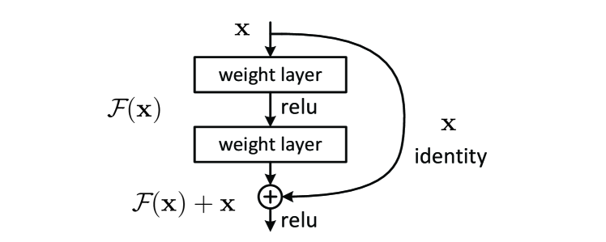
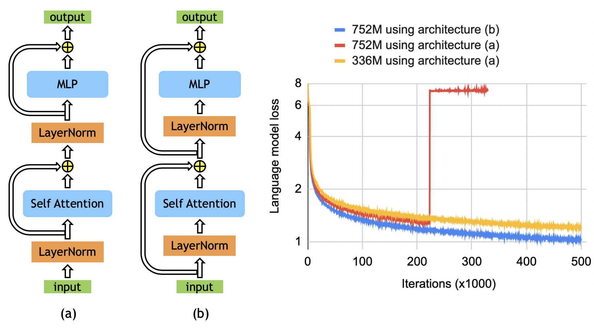
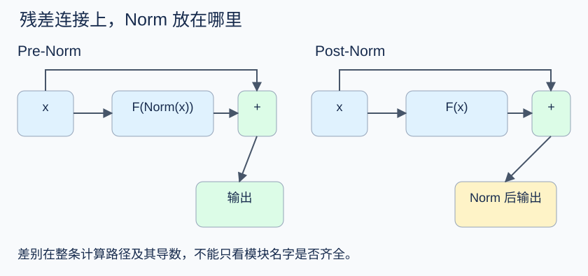
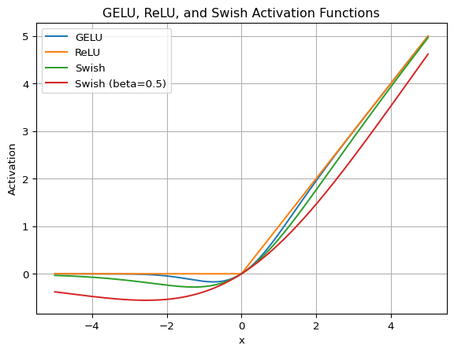

# 归一化、残差与激活

一个 Transformer 层收到向量以后，通常先调整它的数值尺度，再通过注意力或前馈网络产生改变量，最后加回原向量。这几个步骤常挤在一行代码中，却各自改变了不同的数学性质。实际排查数值问题时，先把这几个动作拆开，往往比直接换激活函数更快找到原因。

沿着一个输入 \(h=(1,3)\) 看一次残差块。我们先计算它进入分支前的归一化结果，再看残差怎样影响梯度，最后展开分支内部的非线性。例子省略 dropout，方便逐项复算。

## LayerNorm 与 RMSNorm 处理的是同一条向量的特征

LayerNorm 沿特征轴计算均值和方差。若特征数为 \(d\)，

\[
\mu=\frac1d\sum_i h_i,\quad
v=\frac1d\sum_i(h_i-\mu)^2,\quad
\operatorname{LN}(h)_i=\gamma_i\frac{h_i-\mu}{\sqrt{v+\epsilon}}+\beta_i.
\]

对 \((1,3)\)，均值为 2、方差为 1。先取 \(\gamma=(1,1),\beta=(0,0)\)，忽略很小的 \(\epsilon\)，得到 \((-1,1)\)。这里除以的是特征数 2，不是无偏样本方差使用的 1。它在标准化当前特征，不是在估计未知总体方差。

RMSNorm 不减均值，分母为均方根

\[
\operatorname{RMSNorm}(h)_i
=\gamma_i\frac{h_i}{\sqrt{d^{-1}\sum_j h_j^2+\epsilon}}.
\]

本例均方根为 \(\sqrt5\)，输出约 \((0.447214,1.341641)\)。LN 把整体偏移移除，RMSNorm 保留这种差别，只调整尺度。因此二者不能描述为“相同算法省掉一个步骤”。学习到的 \(\gamma,\beta\) 还会重新改变每个通道的范围，归一化不保证最终输出永远均值零、方差一。

在 `[batch, length, hidden]` 张量中，常见 Transformer Norm 对最后一轴独立操作。一个 token 不会因此读到别的 token。BatchNorm 常按 batch 和空间位置计算通道统计量，还区分训练统计和推理运行统计；小 batch、分布变化或重计算的副作用，需要按具体模块处理。

## 残差给原表示留下一条直接路径

设分支函数是 \(F\)，残差块计算 \(y=h+F(h)\)。如果当前分支输出 \((0.2,-0.1)\)，块输出就为 \((1.2,2.9)\)。训练可以从小改动开始，逐渐调整已有表示。

{ width="560" .atlas-figure-compact }

<small>[ResNet Figure 2](https://arxiv.org/abs/1512.03385)。看相加节点的两路输入。直接路径没有绕过整个模型的训练，它让输入对输出存在一个恒等贡献。</small>

用列向量梯度记号，反向传播满足

\[
\nabla_h\mathcal L=(I+J_F(h))^\top\nabla_y\mathcal L.
\]

如果连续有两层，梯度是 \((I+J_{F_0})^\top(I+J_{F_1})^\top\nabla_{h_2}\mathcal L\)。先经过后层的转置 Jacobian，再经过前层，矩阵次序不能随意交换。

恒等项能改善某些深层优化条件，但不是梯度保证。标量反例很直接：\(F(h)=-h\) 时导数为零，梯度完全抵消；\(F(h)=h\) 时每层导数为 2，堆叠后指数放大。残差尺度、初始化、归一化位置和深度仍然重要。

## Norm 放在哪，直接路径就不同

Pre-Norm 块可写为 \(y=h+F(N(h))\)。它的 Jacobian 是 \(I+J_FJ_N\)，恒等项没有再经过 Norm。Post-Norm 则是 \(y=N(h+F(h))\)，Jacobian 为 \(J_N(I+J_F)\)，两路都要经过最后的 Norm。

这个差别说明为什么调换两行代码会改变梯度传播，并不意味着某一种在所有深度、初始化和训练配方下都更好。Pre-Norm 的残差流自身还可能随深度增长；实践还会采用残差缩放、额外归一化和不同初始化。

顺着一个常见 Pre-Norm Transformer 看，先做 `h + attention(norm(h))`，再对更新后的表示做 `h + mlp(norm(h))`。两个分支分别混合位置和通道，不能把第二个 Norm 仍然喂给旧输入。

{ width="820" }

<small>图源：[Megatron-LM](https://arxiv.org/abs/1909.08053)，Figure 7。</small>

先沿左侧两条残差支路追踪相加和归一化的先后，再看右侧在论文设置下的训练损失。红线发散说明该配置存在训练问题，不能由一张图推导出所有模型都必须采用同一种 Norm 位置。



## 前馈网络为什么必须有非线性

若两层都是线性，\((hW_1)W_2=h(W_1W_2)\)，仍等价于一层线性变换。激活函数让不同输入激活不同区域，模型才能表达复杂关系。

ReLU 取 \(\max(0,x)\)，正区间导数为 1、负区间为 0。GELU 常写为 \(x\Phi(x)\)，SiLU 为 \(x\sigma(x)\)，它们平滑地改变输入而不把所有负值硬置零。实际 GELU 还可能用 tanh 近似，数值验证需匹配实现。

{ width="440" }

<small>图源为 [Naoki Shibuya 的 SwiGLU 说明](https://naokishibuya.github.io/blog/2023-04-30-swiglu-2020/index.html)。关注零点附近的曲线和负区间，斜率决定这些输入如何传回梯度。</small>

SwiGLU 用两条投影构造一个乘法门

\[
g=hW_g,\quad v=hW_v,\quad
u=\operatorname{SiLU}(g)\odot v,\quad y=uW_o.
\]

对一个隐藏通道，若 \(g=2,v=3\)，门值为 \(2\sigma(2)=1.761594\)，乘积是 5.284782。门并非限制在 0 到 1 内，它既可改变符号，也可放大数值。

这个通道对 value 的导数是 1.761594，对 gate 的导数是

\[
v[\sigma(g)+g\sigma(g)(1-\sigma(g))]\approx3.272353.
\]

两条投影都可被训练。三个矩阵在忽略 bias 时共约 \(3dm\) 个参数；普通两层 FFN 为 \(2dm\)。如果比较参数成本，应调整隐藏宽度 \(m\)，不能保持同样宽度后说两者代价相同。

## 数值实现需要保留哪些细节

归一化包含平方、归约和倒数平方根，输入范围与累加精度都会影响结果。\(\epsilon\) 避免方差或均方根太小时除零，也会改变小输入的缩放。在低精度环境中，框架可能用更高精度累加，再转换输出；应检查真实算子，而非只看输入 dtype。

残差加法也可能丢失很小的改变量。如果 \(h\) 很大，\(F(h)\) 小于当前格式在这个尺度上的间隔，二者相加可能舍入回原值。归一化、残差和低精度训练因此相互关联，详见[数值、显存与运行时](numerics-memory-and-runtime-basics.md)。

```python
import math
h = [1.0, 3.0]
mean = sum(h) / len(h)
var = sum((x - mean)**2 for x in h) / len(h)
rms = math.sqrt(sum(x*x for x in h) / len(h))
print([(x - mean) / math.sqrt(var) for x in h])
print([round(x/rms, 6) for x in h])
g, v = 2.0, 3.0
s = 1 / (1 + math.exp(-g))
print(round(g*s*v, 6), round(v*(s+g*s*(1-s)), 6))
```

这里为复现手算省略了 \(\epsilon\)；真实模块需要保留它。输出为 `[-1, 1]`、`[0.447214, 1.341641]` 和 `5.284782 3.272353`。

## 源码阅读

- [LLMs from scratch 的 LayerNorm 与 TransformerBlock](https://github.com/rasbt/LLMs-from-scratch/blob/cdbd33e6d57a71e20ea31434841095fac50cecd8/ch04/01_main-chapter-code/gpt.py)，可逐行对应特征轴方差、两次残差和前馈网络；这份实现采用 GELU，不是 SwiGLU。

## 来源和复算入口

LayerNorm 的定义参考原论文 [Layer Normalization](https://arxiv.org/abs/1607.06450)，RMSNorm 的取舍参考 [Root Mean Square Layer Normalization](https://arxiv.org/abs/1910.07467)，代码排列对照 [LLMs from scratch 的 LayerNorm 与 TransformerBlock](https://github.com/rasbt/LLMs-from-scratch/blob/cdbd33e6d57a71e20ea31434841095fac50cecd8/ch04/01_main-chapter-code/gpt.py)。向量 `(1,3)`、门控激活数值和残差舍入是本站的手算例子；真实模型还要核对 epsilon、归一化轴、参数 dtype 和 kernel 累加精度。

复算时把同一向量分别送入 LayerNorm、RMSNorm 和一个残差分支，记录均值、均方根、输出范数与梯度。再把输入尺度放大 100 倍，观察两种归一化如何改变结果。这个对照能把“归一化让训练稳定”拆成具体可测的量。

读完后可以接着看[数值、显存与运行时](numerics-memory-and-runtime-basics.md)，理解低精度下的累加与舍入，再回到[Transformer 与注意力](transformer-attention-and-tokenization.md)对照归一化、注意力和前馈网络在一个 block 里的先后关系。
