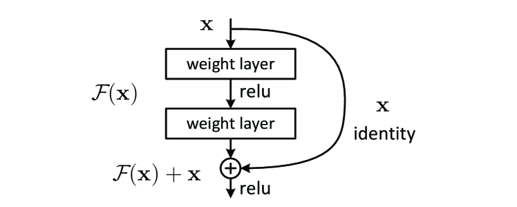
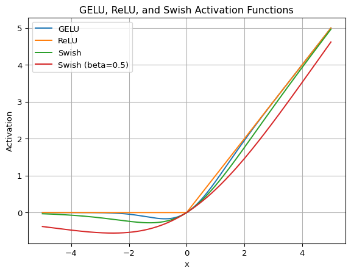
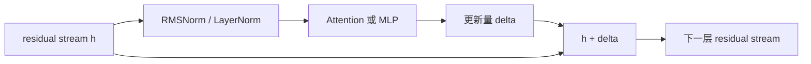

# 归一化、残差与激活：深层网络为什么能稳住

这篇文章只回答一个问题：一个网络堆到几十层、几百层甚至上千层时，为什么还能把信号传下去、把梯度传回来，并且不被中间张量的尺度拖垮。

答案不是某一个模块单独立功。归一化控制每层看到的数值尺度，残差连接保留一条可传播的信息路径，激活函数让线性投影之间产生非线性选择。三者一起决定深层模型是否“可优化”：如果尺度漂移，后面的线性层和 softmax 会被极值支配；如果没有直通路径，反向梯度要穿过太多不稳定变换；如果没有非线性，多层矩阵乘法最终仍等价于一个矩阵。

## 先看坏掉的机制

把一层写成

\[
h_{l+1}=f_l(h_l)
\]

连续堆叠后，输出是 \(f_L(f_{L-1}(\cdots f_1(h_0)))\)。反向传播要乘上一串雅可比矩阵：

\[
\frac{\partial L}{\partial h_0}
=
\frac{\partial L}{\partial h_L}
\prod_{l=0}^{L-1}
\frac{\partial h_{l+1}}{\partial h_l}
\]

这条式子的重点不是让读者去手算雅可比，而是提醒：深层网络的训练失败经常来自“连续相乘”。如果每层导数尺度平均略大于 1，梯度可能爆；略小于 1，梯度可能消失；某几层激活出现极值，低精度训练或量化会先在这些层出问题。

归一化、残差和激活分别对应三个修补位置：

| 组件 | 它直接改变什么 | 它不能单独保证什么 |
| --- | --- | --- |
| Normalization | 让子模块输入的均值、方差或 RMS 更可控 | 不能消除所有 per-channel outlier，也不能替代好初始化 |
| Residual | 让表示和梯度有一条接近 identity 的路径 | 不会自动修复主分支输出过大或低精度溢出 |
| Activation | 让 MLP 不只是线性变换，并对通道进行选择 | 激活形状和门控乘法也可能制造长尾分布 |

## Normalization：不是把数值洗白，而是稳定子模块入口

一个 Transformer token 的 hidden vector 可以写成 \(h\in\mathbb{R}^d\)。LayerNorm 对这个 token 的 hidden 维做统计：

\[
\mu=\frac{1}{d}\sum_{i=1}^{d}h_i,\qquad
\sigma=\sqrt{\frac{1}{d}\sum_{i=1}^{d}(h_i-\mu)^2+\epsilon}
\]

\[
\operatorname{LayerNorm}(h)_i
=
\gamma_i \frac{h_i-\mu}{\sigma}+\beta_i
\]

这里有三层意思。

第一，LayerNorm 的统计是在单个样本、单个 token 的 hidden 维里算出来的，不依赖同一个 batch 里的其他样本。Transformer 的 batch size、序列长度、padding、在线推理 batch 都会变化，用 batch 统计会很尴尬；LayerNorm 在训练和推理时执行同样的计算，所以更适合序列模型。

第二，\(\gamma_i,\beta_i\) 不是装饰项。归一化先把输入拉回一个统一尺度，再让模型学习每个通道应该恢复到什么尺度和偏置。没有这组可学习参数，Norm 会过度限制表示；有了它，Norm 更像“给子模块一个稳定入口”，不是强迫所有层输出同一种分布。

第三，LayerNorm 稳的是整体尺度，不代表每个通道都没有异常值。某个通道偶尔很大，LayerNorm 可以把整条向量的方差拉住，但低比特量化、FP8 scale、SwiGLU gate 仍可能被少数极值影响。

BatchNorm 的统计轴不同。CNN 中常见做法是对每个 channel，跨 batch 和空间位置估计均值方差；训练时用当前 mini-batch，推理时用 running statistics。它很适合卷积特征图，但当 batch 很小、序列长度变化大或推理请求动态拼 batch 时，统计会变成系统变量。2018 年的 BatchNorm 优化分析也提醒：它的作用不能只归因于“减少内部协变量偏移”，更重要的是让优化地形更平滑、梯度更可预测。

RMSNorm 则去掉了 mean-centering，只保留 RMS 缩放：

\[
\operatorname{RMS}(h)=\sqrt{\frac{1}{d}\sum_{i=1}^{d}h_i^2+\epsilon}
\]

\[
\operatorname{RMSNorm}(h)_i
=
\gamma_i\frac{h_i}{\operatorname{RMS}(h)}
\]

它问的是一个很工程化的问题：如果现代 decoder-only LLM 主要需要控制向量长度，而不一定每层都需要减均值，那能不能省掉一部分计算。RMSNorm 论文把这个叫 re-scaling invariance，很多 LLaMA-style 架构采用它，是因为它在 Pre-Norm Transformer 里通常足够稳定、计算更简单，也更方便和 bias-free linear、SwiGLU、RoPE 等现代组件打包。

| 方法 | 统计轴 | 常见位置 | 关键直觉 |
| --- | --- | --- | --- |
| BatchNorm | 每个 channel 跨 batch / spatial | CNN | 用群体统计稳定卷积特征，推理时依赖 running stats |
| LayerNorm | 单个样本或 token 的 hidden 维 | Transformer、RNN | 不依赖 batch，训练和推理一致 |
| RMSNorm | 单个样本或 token 的 hidden RMS | 现代 LLM decoder | 保留尺度归一化，去掉减均值，换取更简洁的块 |

## Residual：让层学习“改动量”

ResNet 的关键不是“多画一根线”，而是把层的任务改写成：

\[
y=x+F(x)
\]

普通深层网络要直接学习一个目标映射 \(H(x)\)。残差块把它改成学习 \(F(x)=H(x)-x\)，也就是“在已有表示上补一个改动量”。如果某一层暂时学不到有用变化，接近 \(F(x)\approx 0\) 也能让输入穿过去；这比每层都从零重写表示容易优化得多。

{ width="560" .atlas-figure-compact }

<small>图源：[Deep Residual Learning for Image Recognition](https://arxiv.org/abs/1512.03385)，Figure 2。原图表达：主分支学习 \(F(x)\)，identity shortcut 把 \(x\) 直接送到相加节点。本站使用这张图说明 residual 的核心不是“跳过计算”，而是让每个块默认站在已有表示上做编辑。</small>

反向传播时，残差块也改变了梯度路径：

\[
\frac{\partial L}{\partial x}
=
\frac{\partial L}{\partial y}
\left(I+\frac{\partial F(x)}{\partial x}\right)
\]

\(I\) 是 identity shortcut 带来的项。它不保证梯度永远健康，但它让梯度不必完全依赖主分支 \(F\) 的导数。主分支如果因为激活饱和、初始化不当、低精度噪声或暂时训练不好而变得不稳定，identity 项仍能保留一部分直接传回去的信号。

维度不一致时，残差连接不能直接相加。CNN 里常用 \(1\times1\) 卷积或 stride projection：

\[
y=F(x)+W_sx
\]

Transformer block 通常保持 hidden size 不变，所以 residual add 更直接。以 Pre-Norm 写法为例：

```text
x = x + Attention(Norm(x))
x = x + MLP(Norm(x))
```

这行伪代码里，`x` 是 residual stream。Attention 和 MLP 不是每次重造整条表示，而是读取一个归一化后的版本，生成一个更新量，再加回 residual stream。

## Pre-Norm 与 Post-Norm：Norm 放在哪里会改变梯度

Transformer 里最常见的分歧是 Norm 在残差加法之前还是之后。

Post-Norm 写成：

\[
h_{l+1}=\operatorname{Norm}(h_l+F_l(h_l))
\]

Pre-Norm 写成：

\[
h_{l+1}=h_l+F_l(\operatorname{Norm}(h_l))
\]

两者的差异不只是代码顺序。Post-Norm 会在每个 block 输出处归一化，早期 Transformer 和 BERT 使用过这种结构，但深层训练时更依赖 warmup、初始化和学习率细节。Pre-Norm 把 Norm 放进主分支，residual stream 本身保留更直接的 identity 路径，因此深层 decoder-only 模型更常使用它。

{ width="820" }

<small>图源：[Megatron-LM](https://arxiv.org/abs/1909.08053)，Figure 7。原图对比 original BERT architecture 与 rearranged architecture 的 loss 曲线。本站使用这张图说明：LayerNorm / residual placement 是可观测的训练稳定性问题，不是架构图里的小排版。</small>

2020 年的 Pre-LN/Post-LN 分析给了一个很实用的解释：Post-LN Transformer 初始化时，靠近输出层的梯度期望可能很大，大学习率会让训练不稳，所以 warmup 很关键；Pre-LN 把 LayerNorm 放进 residual block 后，初始化梯度更容易保持良性。这也是为什么很多大模型训练配方宁愿在 block 末尾再补一个 final norm，也要让每层的 residual path 尽量干净。

Pre-Norm 也不是无条件更好。它可能让每层更新量相对 residual stream 变小，极深模型还需要 residual scaling、DeepNorm、初始化缩放或更细的 optimizer 配方。真正的判断标准不是“Pre 一定赢 Post”，而是：这套架构在目标深度、学习率、精度格式、序列长度和并行策略下，梯度与激活统计是否能稳定闭合。

## Activation：非线性不是装饰，它决定 MLP 怎么筛通道

如果没有激活函数，多层线性层会塌缩成一个线性层：

\[
W_3W_2W_1x = W'x
\]

所以激活函数的第一作用是给网络加入非线性。但在 Transformer MLP 里，它还有第二个作用：决定中间通道如何被打开、压低或门控。可以把 FFN 写成：

\[
\operatorname{FFN}(h)=W_2\,\phi(W_1h)
\]

\(\phi\) 的形状会影响梯度、稀疏性、负值区域、通道长尾和低精度友好程度。

{ width="440" }

<small>图源：[Naoki Shibuya: SwiGLU: GLU Variants Improve Transformer](https://naokishibuya.github.io/blog/2023-04-30-swiglu-2020/index.html)，Activation Functions 图。原图对比 ReLU、GELU、Swish/SiLU 的曲线。本站使用它说明：ReLU 是硬门，GELU/SiLU 是软门，SwiGLU 则把软门扩展成两条投影分支的乘法门控。</small>

ReLU 是最简单的硬门：

\[
\operatorname{ReLU}(x)=\max(0,x)
\]

负值直接变成 0，正值近似原样通过。它计算便宜，能制造稀疏激活，但负区间梯度为 0，学习率或初始化不合适时会出现“死亡神经元”。

GELU 是软门：

\[
\operatorname{GELU}(x)=x\Phi(x)
\]

\(\Phi(x)\) 是标准高斯分布的 CDF。这个公式的机制是：输入不是按正负号硬切，而是按值大小乘上一个平滑权重。小负值不会立刻归零，大正值接近原样通过。工程里常用 tanh 近似：

\[
\operatorname{GELU}(x)
\approx
0.5x\left(1+\tanh\left[\sqrt{2/\pi}(x+0.044715x^3)\right]\right)
\]

SiLU/Swish 也是自门控：

\[
\operatorname{SiLU}(x)=x\sigma(x),\qquad
\operatorname{Swish}_\beta(x)=x\sigma(\beta x)
\]

这里 \(\sigma(x)\) 是 sigmoid。它和 GELU 一样平滑，但门控来自输入自己的 sigmoid，而不是高斯 CDF。曲线里负值区域有一个小谷，这意味着它不是简单“负值全丢掉”，而是允许一部分负向信号以较小幅度参与后续计算。

SwiGLU 经常被误写成一条普通激活曲线。更准确地说，它是 MLP 子层结构：

\[
\operatorname{SwiGLU}(h)
=
W_2\left(\operatorname{SiLU}(W_gh)\odot W_vh\right)
\]

\(W_g h\) 是 gate 分支，\(W_v h\) 是 value 分支，\(\odot\) 是逐元素乘法。GLU 变体论文在 Transformer FFN 中比较了 ReGLU、GEGLU、SwiGLU 等结构；LLaMA 等模型采用 SwiGLU 时，通常还会调整中间维度，让三矩阵门控结构的参数量和原始两矩阵 FFN 接近。

这解释了两个工程现象。第一，SwiGLU 往往比“单投影 + GELU”表达力更强，因为它让一个分支决定另一个分支的信息流。第二，门控乘法也可能放大少数通道的 activation outlier；在 FP8、INT8 或长上下文训练中，这些 outlier 会变成 scale、overflow 和 loss spike 问题。

## 三者在一个 Transformer block 里怎么配合

现代 Pre-Norm decoder block 可以粗略写成：

```text
h = h + Attention(RMSNorm(h))
h = h + MLP(RMSNorm(h))
```

从数据流看，Norm 不是最终输出的美化器，而是每个子模块入口的稳定器；Attention 和 MLP 负责生成更新量；Residual add 把更新量写回同一条 residual stream。这个 residual stream 越深，越像一条持续被编辑的状态向量。



调试时也应该按这条路径看，而不是只看模块名字。若 loss spike 出现在长上下文 batch，可能是 Attention 输出尺度随长度变化；若 MLP activation amax 在少数层突然抬高，可能是 SwiGLU gate/value 乘法制造了长尾；若 Norm 后均值方差正常但 per-channel 极值异常，说明整体归一化没有消除低比特路径最怕的 outlier。

## 低精度会把这些基础组件重新放大

FP16/BF16/FP8/INT8 不只是把 dtype 换小。低精度格式的动态范围、scale granularity、rounding 和 accumulation 都会放大基础组件的问题。

一个典型案例是 activation outlier。假设某层大多数 activation 在 \([-2,2]\)，但某个通道偶尔到 30。LayerNorm 或 RMSNorm 可能让整条向量的 RMS 看起来正常，但量化 scale 如果为了装下 30，主体区域会被压到很少的格子里；如果 scale 只照顾主体区域，30 又会被截断。LLM.int8() 和 SmoothQuant 的重要性就在这里：它们不是只说“用 8-bit”，而是把大模型少数离群通道如何破坏矩阵乘法精度讲清楚。

所以排查训练和部署问题时，可以按下面顺序定位：

| 现象 | 先问什么 | 常见处理方向 |
| --- | --- | --- |
| 深层训练不稳 | residual path 是否被 Norm、scale 或 dtype 打断 | Pre-Norm、final norm、residual scaling、warmup |
| NaN 或 loss spike | 哪些层 activation / grad amax 先异常 | clipping、保 BF16、调整初始化和学习率 |
| W8A8 掉点 | activation scale 是否被少数通道支配 | per-channel/per-token scale、SmoothQuant、混合精度保留 |
| SwiGLU 后长尾增多 | gate/value 乘法是否放大少数通道 | 分层 histogram、敏感层保高精、重新校准 FP8 scale |

这也是为什么“基础组件”不是初学者专属内容。大模型训练、低比特推理、长上下文和多模态 connector 出问题时，最后经常又回到 Norm 轴、residual path、activation distribution 这三件事。

## 常见误解

Norm 不是越多越好。它能稳定子模块入口，但额外 Norm 会改变表示分布和计算图，可能影响吞吐、kernel fusion 和模型质量。

残差不是免费保险。它让信息和梯度更容易穿过深层网络，但也会把异常尺度一路带下去。主分支输出、残差缩放、optimizer、精度格式必须一起看。

SwiGLU 不是“更高级的 GELU 曲线”。它是带两条投影分支的门控 FFN。理解它时要看 gate、value 和输出投影，而不是只看 Swish/SiLU 的单变量曲线。

Pre-Norm 不是永远优于 Post-Norm。它通常更适合深层稳定训练，但具体模型还受深度、初始化、学习率、final norm、residual scaling 和任务指标影响。

## 阅读结论

归一化解决的是“子模块入口尺度是否可控”，残差解决的是“信息和梯度是否有直通路径”，激活函数解决的是“线性投影之间能否做非线性选择”。深层网络能训练起来，不是因为这些模块各自有一个漂亮名字，而是因为它们共同把连续相乘的优化问题改造成更接近“稳定读取、局部更新、持续写回”的过程。

## 外部精读

- [Deep Residual Learning for Image Recognition](https://arxiv.org/abs/1512.03385)：读 ResNet 时重点看 degradation problem 和 residual function 的改写。
- [Layer Normalization](https://arxiv.org/abs/1607.06450)：理解为什么 LayerNorm 不依赖 batch statistics，适合序列模型。
- [Root Mean Square Layer Normalization](https://arxiv.org/abs/1910.07467)：理解 RMSNorm 为什么只保留 re-scaling。
- [On Layer Normalization in the Transformer Architecture](https://arxiv.org/abs/2002.04745)：理解 Pre-LN/Post-LN 与 warmup、初始化梯度的关系。
- [Gaussian Error Linear Units](https://arxiv.org/abs/1606.08415) 与 [GLU Variants Improve Transformer](https://arxiv.org/abs/2002.05202)：理解 GELU、GEGLU、SwiGLU 的公式和 Transformer FFN 位置。
- [Sebastian Raschka: Why do many modern LLMs use RMSNorm instead of LayerNorm?](https://sebastianraschka.com/faq/docs/rmsnorm-vs-layernorm.html)：适合看 RMSNorm 的工程化解释。
- [Naoki Shibuya: SwiGLU](https://naokishibuya.github.io/blog/2023-04-30-swiglu-2020/index.html)：适合看 GLU 变体如何从 FFN 公式展开。
- [Datawhale LLM-Algo-LeetCode: RMSNorm](https://datawhalechina.github.io/llm-algo-leetcode/02_PyTorch_Algorithms/01_RMSNorm_Tutorial.html) 与 [SwiGLU](https://datawhalechina.github.io/llm-algo-leetcode/02_PyTorch_Algorithms/02_SwiGLU_Activation.html)：适合看中文工程讲法、PyTorch 实现和混合精度陷阱。
- [LLM.int8()](https://arxiv.org/abs/2208.07339) 与 [SmoothQuant](https://arxiv.org/abs/2211.10438)：理解 activation outlier 为什么会影响低比特部署。
