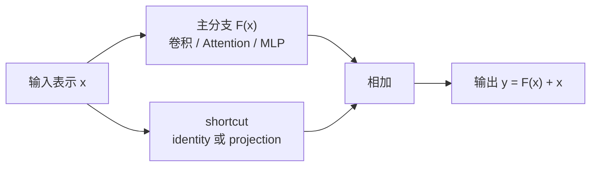
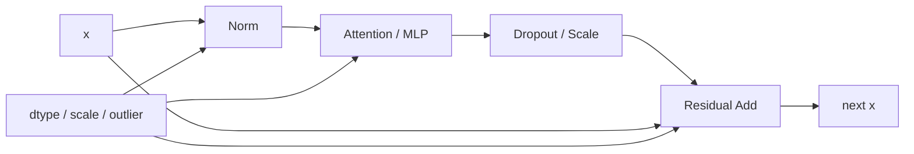

# Norm、残差与激活函数

深层网络能稳定训练，不只靠模型结构，还靠一组看似基础但非常关键的组件：归一化、残差连接和激活函数。

{ width="700" }

<small>图源：[Deep Residual Learning for Image Recognition](https://arxiv.org/abs/1512.03385)，Figure 2。原论文图意：残差块让网络学习 \(F(x)\)，再与 identity shortcut 的 \(x\) 相加，输出 \(F(x)+x\)。</small>

!!! note "图解：ResNet 残差块在保留一条直通路"
    图中的主分支学习 \(F(x)\)，shortcut 分支直接把输入 \(x\) 送到输出端，两者相加得到 \(F(x)+x\)。这意味着一层网络不必每次重写全部表示，而是可以只学习“在原输入上补一个修正量”。当模型变深、序列变长、精度变低时，数值稳定性会变成核心问题：Residual 提供信息与梯度直通路径，Norm 控制尺度，activation 提供非线性，三者一起构成深层网络的稳定训练基础。

!!! note "初学者先抓住"
    Norm 控制数值尺度，Residual 保留原始信息通路，Activation 提供非线性。三者合在一起，才让深层网络既能表达复杂关系，又不容易在训练中数值崩掉。看到训练发散、低精度不稳或模型层数加深后变差时，先把问题放到尺度、梯度通路和非线性表达里检查。

!!! tip "遇到这些症状，回看本页"
    FP8/FP16 训练短跑正常但长跑爆、某些层 activation amax 长期贴上限、加深模型后梯度开始异常，或者换 SwiGLU/MLP 配置后 loss spike 变多时，回看本页。本页能帮你判断问题来自尺度漂移、残差通路、activation outlier，还是低精度下敏感层缺少高精保护。

## 1. 归一化在解决什么

神经网络每层输出的数值尺度可能不断漂移。尺度过大，梯度可能爆炸；尺度过小，梯度可能消失。

归一化的作用是把中间表示拉回更稳定的范围。

常见归一化：

| 方法 | 常见位置 | 直觉 |
| --- | --- | --- |
| BatchNorm | CNN | 按 batch 统计均值和方差 |
| LayerNorm | Transformer | 按 token 内部 hidden 维统计 |
| RMSNorm | LLM | 只用均方根尺度，更简单高效 |

## 2. 残差连接：让深层网络学“改动量”

残差连接是 ResNet 论文里最值得牢牢记住的基础结构。它不是简单多画一根线，而是把一个深层模块拆成两条路径：一条主分支学习变换 \(F(x)\)，另一条 shortcut 分支尽量原样保留输入 \(x\)。最后把两条路径相加：

\[
y = x + F(x)
\]

它让模型学习“在原输入上补一个变化”，而不是每层都从零重写表示。ResNet 原论文关注的核心现象是：plain network 加深以后不一定更好训，甚至训练误差也可能变差；残差连接把问题改成“学一个相对输入的修正量”，优化会轻很多。

### 2.1 原论文图怎么读

| 图中元素 | 对应公式 | 作用 |
| --- | --- | --- |
| 上方输入 \(x\) | \(x\) | 当前层已经有的表示，直接进入 shortcut |
| 两个 `weight layer` | \(F(x)\) | 主分支学习需要补上的特征变换 |
| 右侧 `identity` 弧线 | \(x\) | 不额外改动输入，保留一条信息直通路 |
| 加号节点 | \(F(x)+x\) | 把“新学到的修正量”和“原表示”相加 |
| 输出处 `relu` | \(\sigma(F(x)+x)\) | 相加后再过非线性，形成下一层输入 |

读这张图时，可以把主分支看成“编辑器”，shortcut 看成“保留原稿”。如果主分支暂时学不到有用变化，最好的策略接近 \(F(x)\approx 0\)，整块网络仍能近似传递 \(x\)。这就是残差块比直接堆很多层更容易优化的关键。



### 2.2 为什么它能帮梯度穿过深层网络

从反向传播看，残差连接给梯度保留了一条不经过复杂非线性模块的通路。若 \(y=x+F(x)\)，那么有：

\[
\frac{\partial L}{\partial x}
=
\frac{\partial L}{\partial y}
\left(I + \frac{\partial F(x)}{\partial x}\right)
\]

这里的 \(I\) 来自 identity shortcut。即使主分支 \(F(x)\) 的梯度因为初始化、激活饱和或低精度误差变得不稳定，identity 项仍能把一部分梯度直接传回去。它不能保证训练一定成功，但会显著降低“越深越难把信号传回前面层”的压力。

直觉例子：修改文章时，如果每次都从空白页重写，很难保持一致；如果在原文上改动，工作会稳定得多。残差连接就是让深层网络在表示上“持续修改”，而不是不断重建。

### 2.3 维度不一致时怎么办

最简单的残差连接要求主分支输出和输入 \(x\) 形状一致，这样才能直接相加。CNN 里如果通道数或空间分辨率变化，常见做法是给 shortcut 加一个投影：

\[
y = F(x) + W_s x
\]

这里的 \(W_s\) 可以是 \(1\times1\) 卷积、带 stride 的下采样投影，或者线性层。Transformer block 通常保持 hidden size 不变，所以更常见的是直接做：

```text
x = x + Attention(Norm(x))
x = x + MLP(Norm(x))
```

也就是说，ResNet 里的 residual block 和 Transformer 里的 residual add 属于同一类思想：每个子模块只负责更新表示的一部分，残差流负责把已有信息稳定地传到更深层。

!!! warning "残差不是万能保险"
    残差连接保留了信息和梯度通路，但它也会把尺度问题继续传下去。如果主分支输出过大、Norm 位置不合适，或者低精度加法累积误差明显，残差流会把这些异常带到后续层。因此实际训练里常和 LayerNorm/RMSNorm、合适初始化、residual scaling、gradient clipping 一起使用。

## 3. 激活函数为什么不能省

如果网络只有线性层，那么多层线性叠加仍然等价于一个线性变换。激活函数提供非线性，让模型能表达复杂关系。

常见激活：

- `ReLU`：把负值截断为 0，简单高效，但可能产生死亡神经元。
- `GELU`：用平滑门控保留一部分小负值，BERT、GPT 等 Transformer 中很常见。
- `SiLU`：也叫 Swish，形式平滑，常用于视觉模型和一些现代网络块。
- `SwiGLU`：把门控机制放进 MLP，中间维度表达力更强，许多 LLM 采用类似变体。

现代 Transformer 常用 GELU 或 SwiGLU 变体，因为它们在表达能力和训练稳定性之间表现较好。

## 4. Pre-Norm 和 Post-Norm

Transformer 里常见两种写法：

```text
# Pre-Norm
x = x + Attention(Norm(x))
x = x + MLP(Norm(x))

# Post-Norm
x = Norm(x + Attention(x))
x = Norm(x + MLP(x))
```

很多大模型更偏好 Pre-Norm，因为深层训练更稳。Post-Norm 在某些设置下也有价值，但更容易遇到梯度稳定性问题。

## 5. 数据流图：一个 Transformer Block 里的稳定性路径



读这个图时，不要只看模块名字。`Norm` 决定输入尺度，`Attention / MLP` 决定大部分计算和激活分布，`Residual Add` 决定信息与梯度是否能穿过深层网络。低精度训练或量化时，任何一处尺度偏移都会通过残差路径累积到后续层。

## 6. 一个故障案例：SwiGLU 后 activation outlier 增多

假设把某个 Transformer 的 MLP 从 GELU 换成 SwiGLU 后，短跑 loss 正常，但 20k step 后开始出现 loss spike。排查时不要只调学习率，可以按下面看：

| 观察 | 可能解释 | 应做检查 |
| --- | --- | --- |
| MLP 中间激活 amax 变大 | 门控乘法放大少数通道 | 逐层 activation histogram |
| Norm 输出均值正常但方差长尾 | RMSNorm 控住整体尺度，但 outlier 仍在 | per-channel / per-token 极值 |
| FP8 scale 频繁上调 | 低精度路径被极值牵着走 | amax history、overflow count |
| 只有长上下文桶 spike | 长序列累积误差放大 | 按长度桶看 loss 和 grad norm |

修复不一定是回退激活函数。可以先让敏感层保 BF16、调整 FP8 scale granularity、给 MLP 输出加 clipping 或重新校准初始化。关键是把问题定位到尺度、激活分布和低精度路径，而不是笼统说“模型不稳定”。

## 7. 低精度训练为什么更依赖这些组件

当使用 FP16、BF16、FP8 或更激进低精度时，数值范围和舍入误差会更敏感。Norm 和 residual 能减少尺度漂移，激活函数和 MLP 结构则会影响异常值分布。

这也是为什么量化和低比特训练不能只看“把 dtype 改小”，还要看：

1. 哪些层保留高精度；
2. norm 是否稳定；
3. activation outlier 是否明显；
4. optimizer state 如何保存；
5. 梯度缩放和 clipping 是否合理。

## 8. 和后续专题的关系

- [训练稳定性](../training/stability-numerics-and-failure-triage.md)：排查 loss spike、NaN 和梯度异常。
- [量化激活离群值](../quantization/activation-outliers-and-calibration-strategies.md)：理解 SmoothQuant 和 activation outlier。
- [Transformer 基础](transformer-attention-and-tokenization.md)：理解 block 内 norm、residual 和 MLP 的位置。

## 小结

Norm 控制尺度，residual 保留路径，activation 提供非线性。深层模型的很多“高级能力”都建立在这些基础组件稳定工作的前提上。
