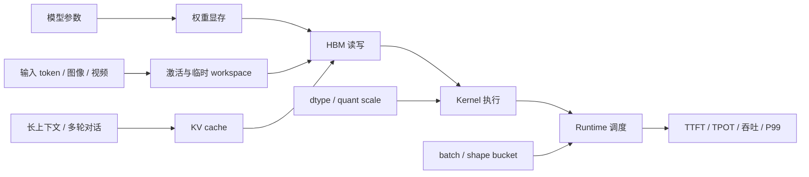

# 数值、显存与运行时

模型能不能真正部署，不只取决于算法，还取决于数值格式、显存、带宽、kernel 和 runtime 是否匹配。

{ width="630" }

<small>图源：[FP8 Formats for Deep Learning](https://arxiv.org/abs/2209.05433)，Figure 1。原论文图意：比较不同规模 GPT 模型在 BF16 与 FP8 训练下的 loss/perplexity 曲线，展示 FP8 在合适 scaling 与训练配置下可以接近 BF16 收敛行为。</small>

!!! note "图解：低精度不是只看能不能表示"
    这张图的重点不是“FP8 一定安全”，而是说明低精度能否用于训练，要看 loss 曲线是否稳定跟随高精度基线。FP8 节省显存和带宽，但必须配合合适的 scaling、累加精度、kernel 和异常值处理。低精度格式能保存不等于能高效执行；模型文件变小也不等于线上更快。必须同时看数据在哪里、怎么搬、用什么 kernel 算。

!!! note "初学者先抓住"
    大模型系统里，“算得动”和“跑得快”不是一回事。真正速度常由 dtype、显存、带宽、kernel、runtime 和请求形态共同决定。看到“模型更小但没有更快”“FLOPs 低但延迟高”“量化后 P99 变差”时，不要只看参数量。

!!! tip "遇到这些症状，回看本页"
    KV INT8 省了显存但 token/s 没升，FP8 loss 曲线短期对齐但长跑漂移，或者某个 runtime 宣称支持低比特却在 trace 里频繁 dequant 回 FP16 时，回看本页。本页能帮你判断收益是否被带宽、workspace、kernel fallback、scale 读取或数值保护抵消。

## 1. 数值格式：精度和范围的取舍

常见格式：

| 格式 | 常见用途 | 直观理解 |
| --- | --- | --- |
| FP32 | 高精度训练、参考路径 | 准但贵 |
| FP16 | 混合精度训练和推理 | 省显存但范围较窄 |
| BF16 | 大模型训练常用 | 范围接近 FP32，精度更低 |
| FP8 | 新硬件上的训练/推理加速 | 更省，但更依赖 scaling |
| INT8 / INT4 | 量化推理 | 压缩强，kernel 支持很关键 |

低精度的本质是牺牲部分表示能力，换取更低显存、更低带宽和更高吞吐。

## 2. 显存主要被谁占用

不同阶段显存构成不同：

| 阶段 | 主要显存 |
| --- | --- |
| 训练 | 权重、梯度、optimizer state、activation |
| 推理 | 权重、KV cache、临时 workspace |
| 长上下文 | KV cache 可能成为主瓶颈 |
| 多模态 | 图像/视频 token 和中间特征会显著增加内存 |

这解释了为什么同一个模型“能推理”不代表“能训练”，也不代表“能高并发服务”。

## 3. FLOPs、带宽和延迟

常见指标：

- `FLOPs`：算了多少浮点操作。
- `memory bandwidth`：数据搬运速度。
- `latency`：单次请求耗时。
- `throughput`：单位时间处理多少请求或 token。

一个算子可能不是算不动，而是数据搬不动。比如低算术强度算子经常受带宽限制，而不是算力限制。

## 4. Kernel 和 Runtime

Kernel 是实际在 GPU 或加速器上执行的底层计算程序。Runtime 负责把模型图、请求、batch、缓存和 kernel 组织起来。

例如：

- GEMM kernel 负责高性能 dense 矩阵-矩阵乘路径。
- Attention kernel 负责注意力计算。
- Fused kernel 把多个操作合并，减少中间读写。
- vLLM、SGLang、ONNX Runtime、TensorRT-LLM 负责更高层的执行调度。

## 5. 为什么“格式支持”不等于“性能收益”

一个 INT4 模型文件很小，但如果 runtime 没有 INT4 高效 kernel，可能会发生：

1. 先反量化成 FP16。
2. 再用普通 FP16 GEMM 计算。
3. 文件变小了，但计算没变快，甚至因为反量化更慢。

因此量化上线前必须确认：

- 目标 runtime 支持该格式；
- 目标硬件支持该低精度指令；
- 热点算子有对应 kernel；
- 端到端 TTFT、TPOT、吞吐和质量都改善。

## 6. 一张部署成本流图

这张图提醒你：低精度格式只是进入系统成本的一条边。真正上线时，权重、activation、KV cache、workspace、kernel、runtime 和 shape bucket 都会共同决定延迟。一个方案若只减少权重显存，却没有减少 decode 时的 KV 读取或没有命中低比特 kernel，端到端收益就会很小。

## 7. 一个可复算的显存小账

假设一个 7B 模型使用 BF16 权重，权重显存约为：

\[
7\times10^9\times2 \approx 14GB
\]

但如果服务长上下文，KV cache 可能同样大。以 32 层、hidden size 4096、batch 8、上下文 16k、BF16 KV 为例：

\[
2\times32\times8\times16384\times4096\times2 \approx 64GiB
\]

这里前面的 2 表示 K 和 V。这个例子说明：小模型不一定轻，长上下文下 KV cache 会成为主角。量化权重能让模型放得下，但 KV 量化、prefix cache、paged attention 和上下文裁剪才可能让高并发跑得稳。

| 优化动作 | 主要省什么 | 可能不省什么 |
| --- | --- | --- |
| 权重量化 | 参数显存、部分权重带宽 | KV cache、视觉 token、runtime overhead |
| KV 量化 | 长上下文并发显存、decode 读写 | prefill FLOPs、scale/dequant 开销 |
| Activation checkpointing | 训练激活显存 | 反向重算时间 |
| FlashAttention | attention 中间写回 | decode KV 生命周期 |
| Shape bucketing | kernel 命中率、padding 浪费 | 长尾请求和工具延迟 |

## 8. 和后续专题的关系

- [量化路线图](../quantization/index.md)：理解低精度格式和部署收益。
- [推理系统](../inference/index.md)：理解延迟、吞吐、KV cache 和服务调度。
- [算子与编译器](../operators/index.md)：理解 kernel、GEMM、attention 和 profiling。
- [训练稳定性](../training/stability-numerics-and-failure-triage.md)：理解混合精度和数值异常。
- [线性层、MLP 与 GEMM](linear-layers-mlp-and-gemm.md)：理解为什么矩阵乘是低精度和算子优化的主战场。

## 小结

数值格式决定误差和存储，显存与带宽决定瓶颈，kernel 和 runtime 决定收益能否兑现。理解这一层，才能把“模型方法”真正落到“能跑、跑快、跑稳”。
