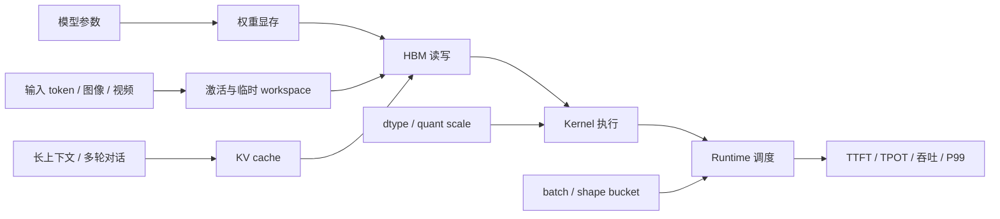

# 数值、显存与运行时

模型能不能真正部署，不只取决于算法，还取决于数值格式、显存、带宽、kernel 和 runtime 是否匹配。

{ width="630" }

<small>图源：[FP8 Formats for Deep Learning](https://arxiv.org/abs/2209.05433)，Figure 1。原论文图意：比较不同规模 GPT 模型在 BF16 与 FP8 训练下的 loss/perplexity 曲线，展示 FP8 在合适 scaling 与训练配置下可以接近 BF16 收敛行为。</small>

## 最小字节账：先把数字换成显存

数值格式首先决定每个数字占多少 bytes。

| 格式 | 粗略 bytes / value | 直觉 |
| --- | ---: | --- |
| FP32 | 4 | 准但贵 |
| FP16 / BF16 | 2 | 大模型训练和推理常用 |
| FP8 / INT8 | 1 | 更省，但依赖 scale 和 kernel |
| INT4 / FP4 | 0.5 | 压缩强，硬件和 runtime 支持更关键 |

一个 hidden tensor 的最小显存可以先估：

\[
B\times L\times D\times bytes
\]

这不是完整显存，只是把 shape 换成 bytes 的第一步。训练还要加激活、梯度和 optimizer state；推理还要加 KV cache 和 workspace。

符号含义：

## 数值格式：精度和范围的取舍

<!-- [融合：算法基础] 来源：llm-algo-leetcode《20. Quantization W8A16 | 模型量化基础: INT8 绝对最大值量化与反量化 (Quantization)》-->
> **算法视角**：量化可以看成在权重或激活旁边维护 scale / zero-point，把高精度矩阵乘改写成“低比特存储 + 反量化或融合计算”的数据布局问题。
>
> 延伸阅读：[20. Quantization W8A16 | 模型量化基础: INT8 绝对最大值量化与反量化 (Quantization)](https://datawhalechina.github.io/llm-algo-leetcode/02_PyTorch_Algorithms/20_Quantization_W8A16.html)

<!-- [融合：复杂度分析] 来源：llm-algo-leetcode《20. Quantization W8A16 | 模型量化基础: INT8 绝对最大值量化与反量化 (Quantization)》-->
| 操作 | 时间复杂度 | 空间复杂度 | 说明 |
|------|-----------|-----------|------|
| 逐元素量化 / 反量化 | $O(N)$ | $O(N)$ 或按 block 存 scale | 关键收益通常来自带宽和存储减少，而不是渐进复杂度下降；参考：[对应章节](https://datawhalechina.github.io/llm-algo-leetcode/02_PyTorch_Algorithms/20_Quantization_W8A16.html) |
| 量化 GEMM | $O(MNK)$ | 权重侧约按 bit-width 缩放 | 反量化若能融合进 matmul epilogue，才更容易转成端到端收益。 |

常见格式：

| 格式 | 常见用途 | 直观理解 |
| --- | --- | --- |
| FP32 | 高精度训练、参考路径 | 准但贵 |
| FP16 | 混合精度训练和推理 | 省显存但范围较窄 |
| BF16 | 大模型训练常用 | 范围接近 FP32，精度更低 |
| FP8 | 新硬件上的训练/推理加速 | 更省，但更依赖 scaling |
| INT8 / INT4 | 量化推理 | 压缩强，kernel 支持很关键 |

低精度的本质是牺牲部分表示能力，换取更低显存、更低带宽和更高吞吐。

## 显存主要被谁占用

不同阶段显存构成不同：

| 阶段 | 主要显存 |
| --- | --- |
| 训练 | 权重、梯度、optimizer state、activation |
| 推理 | 权重、KV cache、临时 workspace |
| 长上下文 | KV cache 可能成为主瓶颈 |
| 多模态 | 图像/视频 token 和中间特征会显著增加内存 |

这解释了为什么同一个模型“能推理”不代表“能训练”，也不代表“能高并发服务”。

## FLOPs、MACs、带宽和延迟

常见指标：

- `FLOPs`：算了多少浮点操作。
- `MACs`：multiply-accumulate 次数，也就是一次乘法加一次累加。
- `memory bandwidth`：数据搬运速度。
- `latency`：单次请求耗时。
- `throughput`：单位时间处理多少请求或 token。

`MACs` 和 `FLOPs` 经常被混用，但最好先立一个约定：一个 MAC 包含一次 multiply 和一次 add，所以在很多硬件/论文的 FLOPs 口径里，`1 MAC ≈ 2 FLOPs`。但有些模型统计工具会把 fused multiply-add 当成 1 次操作。读报告或 profile 时，先确认工具到底在数 `MACs`、`FLOPs`，还是只数矩阵乘里的乘加主项。

一个 Linear 层 \(y=xW\) 最适合建立直觉：

\[
W\in\mathbb{R}^{d_{\text{in}}\times d_{\text{out}}}
\]

\[
\text{Params}=d_{\text{in}}d_{\text{out}}\quad(\text{不含 bias})
\]

\[
\text{MACs per token}=d_{\text{in}}d_{\text{out}}
\]

这三行式子在说：权重矩阵 \(W\) 把输入维度 \(d_{\text{in}}\) 映射到输出维度 \(d_{\text{out}}\)。不算 bias 时，参数量就是矩阵格子数；单个 token 通过这层时，每个权重通常参与一次乘加，所以主项 MACs 也是 \(d_{\text{in}}d_{\text{out}}\)。

如果一次处理 \(B\) 个 batch、每个 batch 有 \(T\) 个 token，那么 Linear 主体 MACs 约为：

\[
B T d_{\text{in}}d_{\text{out}}
\]

这里 \(B\) 是 batch size，\(T\) 是每条样本的 token 数；乘上 \(BT\) 后，就从“单 token 账”变成“整批输入账”。

这也是为什么 `Params` 和 `MACs` 有时看起来很接近：对单个 token 来说，一个被用到的权重通常贡献一次乘加。但它们不是同一个概念。`Params` 是模型静态存了多少权重；`MACs` 是某个输入 shape、某个推理/训练阶段实际做了多少乘加。MoE、长上下文 attention、batch、prefill/decode 都会让两者分开。

一个算子可能不是算不动，而是数据搬不动。比如低算术强度算子经常受带宽限制，而不是算力限制。

## Kernel 和 Runtime

Kernel 是实际在 GPU 或加速器上执行的底层计算程序。Runtime 负责把模型图、请求、batch、缓存和 kernel 组织起来。

例如：

- GEMM kernel 负责高性能 dense 矩阵-矩阵乘路径。
- Attention kernel 负责注意力计算。
- Fused kernel 把多个操作合并，减少中间读写。
- vLLM、SGLang、ONNX Runtime、TensorRT-LLM 负责更高层的执行调度。

## 为什么“格式支持”不等于“性能收益”

一个 INT4 模型文件很小，但如果 runtime 没有 INT4 高效 kernel，可能会发生：

1. 先反量化成 FP16。
2. 再用普通 FP16 GEMM 计算。
3. 文件变小了，但计算没变快，甚至因为反量化更慢。

因此量化上线前必须确认：

- 目标 runtime 支持该格式；
- 目标硬件支持该低精度指令；
- 热点算子有对应 kernel；
- 端到端 TTFT、TPOT、吞吐和质量都改善。

## 一张部署成本流图

这张图提醒你：低精度格式只是进入系统成本的一条边。真正上线时，权重、activation、KV cache、workspace、kernel、runtime 和 shape bucket 都会共同决定延迟。一个方案若只减少权重显存，却没有减少 decode 时的 KV 读取或没有命中低比特 kernel，端到端收益就会很小。

## 一个可复算的显存小账

假设一个 7B 模型使用 BF16 权重，权重显存约为：

\[
7\times10^9\times2 \approx 14GB
\]

但如果服务长上下文，KV cache 可能同样大。以 32 层、hidden size 4096、batch 8、上下文 16k、BF16 KV 为例：

\[
2\times32\times8\times16384\times4096\times2 \approx 64GiB
\]

这里前面的 2 表示 K 和 V。把这行拆开看会更直观：在单层里，单独一个 K cache 的大小是 \(B\times T\times d\times bytes = 8\times16,384\times4,096\times2\)，约 `1GiB`；再乘 V 就是 `2GiB / layer`；32 层合起来就是约 `64GiB`。这还只是 KV 本体，没有算 page metadata、碎片、runtime workspace、临时 buffer 和其它并发请求。

这类小账要注意公式里的 \(d\) 更准确地说是 KV 宽度。标准 MHA 里它通常接近 hidden size；如果用了 GQA/MQA，KV head 数少于 query head 数，KV 宽度会按比例下降；如果用了 MLA，则缓存的可能是压缩 latent，而不是完整 K/V。因此判断一个模型“长上下文贵不贵”时，不能只看参数量，还要看 `layers`、`context`、`batch`、`KV heads`、`head dim` 和 `dtype`。

| 变量变化 | KV 显存怎么变 | 直觉 |
| --- | --- | --- |
| context 从 `16k` 到 `32k` | 约 `2x` | 历史 token 多一倍，每层都要多存一倍 K/V |
| batch 从 `8` 到 `16` | 约 `2x` | 并发上下文一起常驻显存 |
| BF16 KV 改 INT8 KV | 约 `1/2` | bytes 从 2 降到 1，但要考虑 scale/dequant 和质量回归 |
| MHA 改 GQA，KV heads 降到 `1/4` | KV 宽度约 `1/4` | 主要省 KV cache 和 decode 读带宽，不等于 prefill 计算免费 |

这个例子说明：小模型不一定轻，长上下文下 KV cache 会成为主角。量化权重能让模型放得下，但 KV 量化、prefix cache、paged attention 和上下文裁剪才可能让高并发跑得稳。

| 优化动作 | 主要省什么 | 可能不省什么 |
| --- | --- | --- |
| 权重量化 | 参数显存、部分权重带宽 | KV cache、视觉 token、runtime overhead |
| KV 量化 | 长上下文并发显存、decode 读写 | prefill FLOPs、scale/dequant 开销 |
| Activation checkpointing | 训练激活显存 | 反向重算时间 |
| FlashAttention | attention 中间写回 | decode KV 生命周期 |
| Shape bucketing | kernel 命中率、padding 浪费 | 长尾请求和工具延迟 |

## 进阶案例：DeepSeek-V3 的 Params 和 MACs 怎么手算

下面用 DeepSeek-V3 做一个可复算例子。它适合这个主题，因为它是 MoE：`Total Params` 很大，但每个 token 只激活一小部分 routed experts。

{ width="920" }

<small>图源：[DeepSeek-V3 Technical Report](https://arxiv.org/abs/2412.19437)，Figure 2。原论文图意：DeepSeek-V3 的 Transformer block 采用 MLA 和 DeepSeekMoE；MLA 缓存压缩 latent 与 RoPE key，MoE 由 shared experts 和 routed experts 共同组成。</small>

!!! note "先说明口径"
    下面按 DeepSeek-V3 官方 671B 主模型配置手算，不把额外的 MTP module 算进主模型参数。为了让初学者能复算，计算只抓主要权重矩阵，RMSNorm、router bias 等小项会说明但不作为直觉重点。MACs 也只先数矩阵乘主项；softmax、SiLU、RMSNorm、top-k、dispatch/combine、通信和 kernel padding 都会影响真实延迟。

关键数字来自 DeepSeek-V3 技术报告和官方 [`config_671B.json`](https://github.com/deepseek-ai/DeepSeek-V3/blob/main/inference/configs/config_671B.json)：

### 9.1 先算 embedding 和输出头

输入 embedding 和输出 LM head 都是 \(V\times d\)：

\[
Vd = 129{,}280\times7{,}168 = 926{,}679{,}040 \approx 0.927B
\]

这行式子在说：一个词表项对应一个 \(d\) 维向量，词表里共有 \(V\) 个项，所以 embedding 表或输出头各自有 \(Vd\) 个权重。

如果输入 embedding 和输出头不共享权重，仅这两块合计约：

\[
2Vd \approx 1.853B
\]

注意：embedding lookup 本身主要是查表读权重，不是大矩阵乘；输出 head 计算 logits 时才是 \(d\times V\) 的 MACs。

### 9.2 再算每层 MLA 参数

DeepSeek-V3 的 attention 不是普通 Q/K/V/O 四个 \(d\times d\) 投影，而是 MLA。按官方实现，可以把主要权重拆成：

\[
P_{\text{MLA}} =
d r_q
+ r_q H(d_{\text{nope}}+d_{\text{rope}})
+ d(r_{kv}+d_{\text{rope}})
+ r_{kv}H(d_{\text{nope}}+d_v)
+ Hd_vd
\]

符号含义：\(P_{\text{MLA}}\) 是单层 MLA 的主要参数量；\(d\) 是 hidden dimension；\(r_q\) 和 \(r_{kv}\) 是 query/KV 压缩 rank；\(H\) 是 head 数；\(d_{\text{nope}}\)、\(d_{\text{rope}}\)、\(d_v\) 分别是 non-RoPE Q/K 维度、RoPE Q/K 维度和 value head 维度。每一项对应 MLA 里的一个主要投影矩阵。

代入数字：

\[
\begin{aligned}
P_{\text{MLA}}
&=7168\times1536\\
&+1536\times128\times(128+64)\\
&+7168\times(512+64)\\
&+512\times128\times(128+128)\\
&+128\times128\times7168\\
&\approx 187.1M
\end{aligned}
\]

61 层 MLA 合计约：

\[
61\times187.1M\approx11.4B
\]

### 9.3 Dense MLP 和单个 expert

DeepSeek-V3 的 MLP/Expert 都是 SwiGLU 形态，核心有三块矩阵：`w1`、`w3` 升维，`w2` 降维。因此 dense MLP 每层参数是：

\[
P_{\text{dense-MLP}}=3dd_{\text{ff}}
=3\times7168\times18432
\approx396.4M
\]

前 3 层是 dense FFN，所以：

\[
3\times396.4M\approx1.19B
\]

单个 expert 的宽度是 \(d_e=2048\)，所以单个 expert 参数是：

\[
P_{\text{expert}}=3dd_e
=3\times7168\times2048
\approx44.0M
\]

### 9.4 MoE 层的 total params

每个 MoE 层有 256 个 routed experts 和 1 个 shared expert。router gate 还要给每个 expert 打分，主要权重约为 \(Ed\)：

\[
P_{\text{MoE-total}}
= E P_{\text{expert}} + S P_{\text{expert}} + Ed
\]

这行式子在说：一层 MoE 的总参数包括 \(E\) 个 routed experts、\(S\) 个 shared experts，以及 router gate 的 \(Ed\) 权重。这里算的是“仓库里一共有多少专家参数”，不是单个 token 实际会激活多少。

\[
=256\times44.0M+1\times44.0M+256\times7168
\approx11.32B
\]

58 个 MoE 层合计：

\[
58\times11.32B\approx656.6B
\]

这行式子只是把“单个 MoE 层的总参数仓库”乘以 58 个 MoE 层，得到所有 MoE 层合计参数。

把 embedding、输出头、MLA、前 3 层 dense MLP、58 层 MoE 加起来：

\[
\begin{aligned}
P_{\text{total}}
&\approx 2Vd + 61P_{\text{MLA}} + 3P_{\text{dense-MLP}} + 58P_{\text{MoE-total}}\\
&\approx 1.85B + 11.4B + 1.19B + 656.6B\\
&\approx 671.0B
\end{aligned}
\]

这就对上了 DeepSeek-V3 报告里的 `671B total params`。关键点是：大头来自所有 routed experts 的总仓库，而不是每个 token 都会跑完这 671B。

### 9.5 MoE 层的 activated params

每个 token 在 MoE 层不会用 256 个 routed experts，只会用 Top-8 routed experts，再加 shared expert：

\[
P_{\text{MoE-active}}
= K P_{\text{expert}} + S P_{\text{expert}} + Ed
\]

这行式子把 total params 换成 activated params：\(K\) 是每个 token 选中的 routed experts 数，\(S\) 是总会参与的 shared experts 数。router gate 仍然需要为专家打分，所以保留 \(Ed\) 这一项。

\[
=8\times44.0M+1\times44.0M+256\times7168
\approx398.2M
\]

这个数表示单 token 真正激活的 MoE 参数量：\(8+1=9\)，而 \(9\times2048=18432\)，正好接近 dense MLP 的 \(d_{\text{ff}}\)。所以单 token 的 FFN 乘加量接近一个 \(18,432\) 宽度的 dense SwiGLU MLP，但模型总容量因为 256 个 routed experts 被放大很多。

把单 token 会用到的矩阵权重加起来：

\[
\begin{aligned}
P_{\text{active, MAC-producing}}
&\approx P_{\text{head}} + 61P_{\text{MLA}} + 3P_{\text{dense-MLP}} + 58P_{\text{MoE-active}}\\
&\approx 0.927B + 11.4B + 1.19B + 23.1B\\
&\approx 36.6B
\end{aligned}
\]

如果把输入 embedding 查表也放进“activated params”口径里，则约为：

\[
36.6B + 0.927B \approx 37.6B
\]

这就是报告里 `37B activated params per token` 的来源直觉。它不是精确 latency，也不是每步只有 37B 次所有操作，而是说明稀疏 MoE 下每个 token 实际触达的权重规模远小于 `671B total params`。

### 9.6 从 activated params 到 MACs

对单个 decode token，如果只看被用到的矩阵乘主项，MACs 约等于 MAC-producing active weights：

\[
\text{weight MACs/token}\approx36.6B\ \text{MACs}
\]

如果换成常见 FLOPs 口径：

\[
36.6B\ \text{MACs}\times2\approx73.2B\ \text{FLOPs}
\]

但真实 LLM 推理还有 attention score/value 聚合。这个部分不随参数量固定，而随上下文长度变。用 MLA 的 absorb 实现做一个粗略估计，decode 一个新 token、历史长度为 \(T\) 时，每层 score/value 聚合主项可写成：

\[
H T \left((r_{kv}+d_{\text{rope}})+r_{kv}\right)
\]

这行式子在粗算 decode 阶段单层 attention 的主项：\(H\) 个 head 都要看长度为 \(T\) 的历史；括号里前半部分对应 score 计算要读的压缩 KV 与 RoPE key，后半部分对应 value 聚合要读的压缩 value 信息。

当 \(T=4096\)：

\[
128\times4096\times((512+64)+512)\approx0.57B\ \text{MACs/layer}
\]

61 层约：

\[
61\times0.57B\approx34.8B\ \text{MACs}
\]

所以在 4K 历史长度下，一个 decode token 的粗略矩阵乘账可以写成：

\[
36.6B\ \text{weight MACs}+34.8B\ \text{attention MACs}\approx71.4B\ \text{MACs}
\]

如果是 prefill 一个 4K prompt，weight MACs 会乘上 4096：

\[
4096\times36.6B\approx150.0\ \text{TMACs}
\]

attention pairwise 部分按 causal triangle 粗算约：

\[
\frac{1}{2}\times61\times128\times4096^2\times((512+64)+512)
\approx71.3\ \text{TMACs}
\]

所以 4K prefill 的主项大约是：

\[
150.0\ \text{TMACs}+71.3\ \text{TMACs}\approx221.3\ \text{TMACs}
\]

!!! warning "不要把这当成线上延迟"
    这只是手算主项。真实服务还会受 FP8/BF16 kernel、MoE dispatch/combine、expert batch size、all-to-all、KV cache layout、logits 是否全量计算、batching、prefix cache、padding、采样和 runtime 调度影响。`Params` 帮你看存储和容量，`MACs` 帮你看乘加规模，最终线上速度仍要用 profiler 和端到端压测确认。

## 和后续专题的关系

- [量化路线图](../quantization/index.md)：理解低精度格式和部署收益。
- [推理系统](../inference/index.md)：理解延迟、吞吐、KV cache 和服务调度。
- [算子与编译器](../operators/index.md)：理解 kernel、GEMM、attention 和 profiling。
- [训练稳定性](../training/stability-numerics-and-failure-triage.md)：理解混合精度和数值异常。
- [线性层、MLP 与 GEMM](linear-layers-mlp-and-gemm.md)：理解为什么矩阵乘是低精度和算子优化的主战场。

## 本页结论

数值格式决定误差和存储，显存与带宽决定瓶颈，kernel 和 runtime 决定收益能否兑现。理解这一层，才能把“模型方法”真正落到“能跑、跑快、跑稳”。
