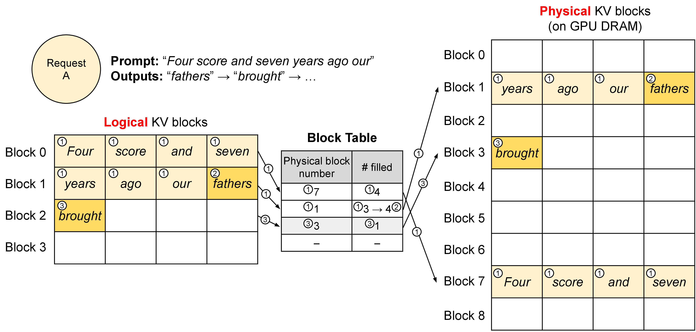
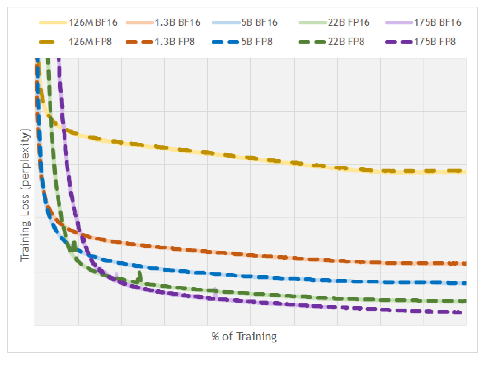

# 数值精度、显存与运行时间

为什么一个模型装得进显存，长上下文却 OOM；显存下降以后，生成速度又可能几乎不变？排查时先把参数、KV、workspace、计算和数据搬运分开列出来，确认瓶颈属于哪一栏，再决定优化方向。

用一个假设模型做估算。设它有 70 亿个参数、32 层，每层 8 个 KV 头，每头维度 128。参数与 KV 都先按 BF16 存储，每个数 2 字节。以下只做容量和下界演算，不是硬件 benchmark。

## 参数存储只是一部分显存

BF16 权重的原始数据量为 \(7\times10^9\times2=14\) GB，约 13.04 GiB。GB 按十进制，GiB 按 \(2^{30}\) 字节。不能把二者数字混写。

若权重改为理想的 4-bit 打包，纯权重下界变为 3.5 GB。但实际格式还可能有 scale、zero point、padding、未量化层和运行缓冲区。框架如果把权重解包成高精度副本常驻，最终占用还会进一步增加。

训练另需梯度、优化器状态和激活。以一种常见混合精度 Adam 配置为例，BF16 权重和梯度各 2 字节、FP32 主权重 4 字节、两个 FP32 矩状态共 8 字节，合计可达每参数 16 字节，且还没算激活。具体框架可能省去主权重、改变梯度精度或分片，不能把 16 当成所有配置的固定常数。

## 长前缀怎样吃掉 KV 显存

自回归 Transformer 为每个历史 token 保存 key 和 value。上述模型中，一条长度 S 的序列原始 KV 数据量为

\[
M_{KV}=2L S H_{kv}d_h b.
\]

前面的 2 来自 K 和 V，b 是每个元素字节数。S=32768 时，结果为 4 GiB；4 条同长度请求就是 16 GiB，还没算分页空隙、元数据或其他张量。

将权重从 BF16 压到 4 bit，节省约 10.5 GB 原始参数数据，却不会自动减少这 16 GiB KV。请求变多、上下文变长时，优化对象可能需要转向 KV、分块调度或有效上下文长度。

GQA 让多个 query 头共享较少的 KV 头，公式中应填 KV 头数，不是 query 头数。混合 SSM 架构、滑动窗口和压缩注意力会改变历史状态形式，需按实际层结构分别计算。

{ width="820" }

<small>图源：[vLLM PagedAttention blog](https://vllm.ai/blog/2023-06-20-vllm)。</small>

左侧请求按 token 顺序组织逻辑块，中间块表指向右侧可不连续的物理块。分页减少连续分配的要求并管理碎片，没有改变每个实际 KV 元素占多少字节；因此前面的 KV 容量估算仍然成立。

## 浮点格式同时决定范围和间隔

FP16、BF16 都占 16 bit，但指数位和有效精度不同。BF16 的指数范围接近 FP32，正常数区间相对精度较低；较大范围有助于避免部分溢出，却不保证任何训练都稳定。

例如 BF16 在 256 附近相邻可表示值间距为 2，把 1 加到 256 上可能按舍入规则回到 256。小更新相对大参数可能被吞掉，因此训练常保留更高精度的累加或主状态。低精度输入与低精度累加是两项不同选择。

FP8/FP4 通常还依赖缩放。缩放不合适会导致大值溢出或饱和，小值下溢或舍入误差扩大。浮点格点并非等间距，不能直接照搬整数均匀量化的直觉。格式、分组方式和硬件转换语义都需要明确。

{ width="820" }

<small>图源：[FP8 Formats for Deep Learning](https://arxiv.org/abs/2209.05433)，Figure 1。</small>

按图例将同一规模的两种精度曲线配对，横轴是训练进度，纵轴是训练损失。这些曲线支持论文配置下的比较，不能替代新模型上对 scale、溢出、累加精度和最终任务质量的检查。

## 同一层在 prefill 和 decode 为什么速度不同

线性层的输入可展平为 `[M,K]`，权重为 `[K,N]`，计算量约 \(2MKN\) FLOPs。Prefill 一次处理很多输入 token，M 较大，权重可被多个 token 复用；小 batch decode 每步只处理少量新 token，M 较小，同一份大权重仍需读取。

粗略性能下界为

\[
t\ge\max\left(\frac{\mathrm{FLOPs}}{\text{有效计算速率}},
\frac{\mathrm{bytes}}{\text{有效带宽}}\right).
\]

这只是计算与搬运的下界，未包括调度、通信、同步和无法重叠的开销。若假设读权重 14 GB、有效带宽 1 TB/s，仅完整读一遍的时间尺度就是 14 ms；缓存、批处理、分片和实际kernel会改变有效搬运量，不能把这个算式当成真实每token延迟。

## 为什么 FlashAttention 与量化能互补

标准 attention 的数学表达包含 S×S 分数矩阵。FlashAttention 通过分块与在线 softmax，避免将完整矩阵长期写入显存；它在实数算术下计算同一注意力，浮点运算顺序不同仍可能产生数值误差。

权重量化减少权重相关搬运，FlashAttention 主要处理注意力中间数据，两者针对的对象不同。解码时还要读历史 KV，序列越长，这部分越重要。单个 GEMM 变快，也可能被 KV 访问、排队或通信掩盖。

## 如何把估算变成可判断的测量

先固定模型、dtype、输入/输出长度、batch和硬件，再记录峰值显存、首token时间、后续token间隔与吞吐。GPU 异步执行意味着只量 Python 函数返回时间可能低估计算，测量需要正确同步或设备事件。冷启动编译和稳定运行也应分开。

显存分配器的 reserved 往往高于 active allocated，前者包含预留空间；看到 reserved 高不能立刻断言张量泄漏。OOM出现在加载、前向、反向还是第一次 optimizer step，也会指向不同对象。

```python
params, layers, length, kv_heads, head_dim, byte = 7_000_000_000,32,32768,8,128,2
weights = params*byte
kv = 2*layers*length*kv_heads*head_dim*byte
print(round(weights/1e9,2), round(weights/2**30,2))
print(kv/2**30, 4*kv/2**30)
```

输出 `14.0 13.04` 和 `4.0 16.0`。先做这种带单位的估算，再用 profiler 找到实际热点，能避免把优化精力放在占比很小的部分。

## 接着查哪一层

- [自动微分与训练显存](autograd-activation-checkpointing-and-memory.md)解释为什么反向需要保存中间值。
- [量化](../quantization/index.md)解释低比特格式怎样落到真实算子。
- [算子与性能](../operators/index.md)解释shape、带宽与测量。

- [PyTorch 优化循环教程](https://github.com/pytorch/tutorials/blob/5672cd98a7671eda4d9122b10f8eec580f74d03e/beginner_source/basics/optimization_tutorial.py)，可对照前向、反向和参数更新分别在哪一步发生，再观察各阶段状态分配。

## 公式和代码对照

FlashAttention 的分块和在线 softmax 参考 [FlashAttention](https://arxiv.org/abs/2205.14135)，显存与异步测量的框架边界对照 [PyTorch CUDA Semantics](https://docs.pytorch.org/docs/stable/notes/cuda.html)，参数、KV 和运行缓冲区的算例是本站按明确假设计算的。数字用于建立量级，不代表某个 GPU 的实际峰值或服务 SLO。

把一个小模型的参数、梯度、optimizer state、KV 和临时张量分别打印出来，再用设备事件测一次同步前后的时间。若只记录 `torch.cuda.memory_allocated()` 或 Python 函数返回时间，无法知道预留显存和异步 kernel 对结果造成了什么影响。
