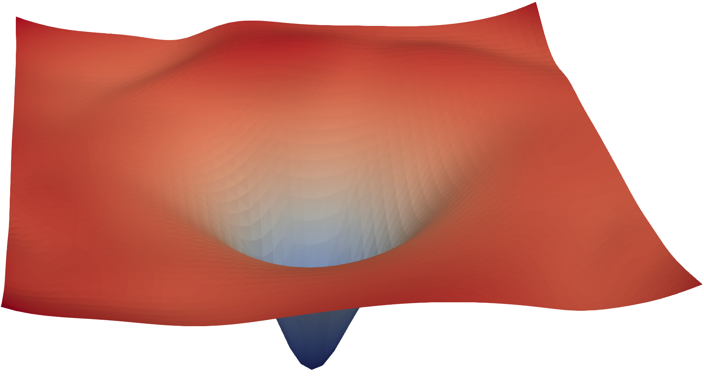
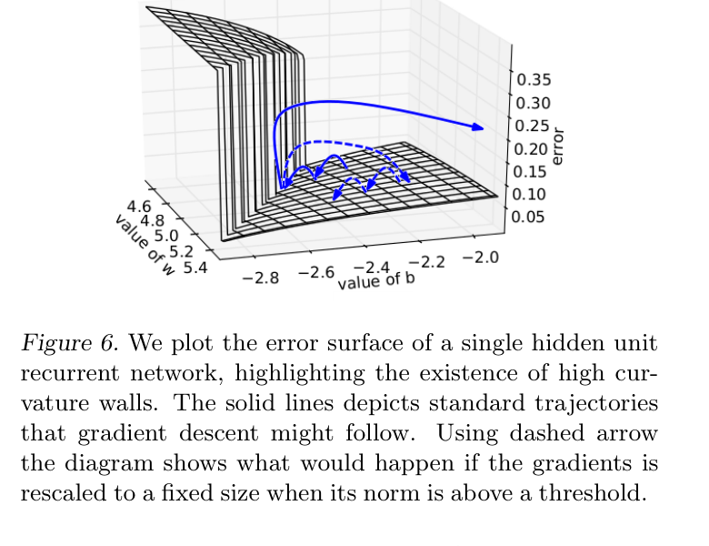

# 优化与训练

一个模型能够计算输出，并不意味着它已经知道该用哪些参数。训练要解决的是这个选择问题。我们先约定怎样衡量预测错误，再计算参数对错误的影响，最后沿着能降低错误的方向调整参数。

用一个可以手算的例子开始。数据有两个样本 \((x,y)=(1,2),(2,4)\)，模型是直线 \(\hat y=wx+b\)。初始参数为 \(w=1,b=0\)，所以预测是 1 和 2，误差分别是 \(-1\) 和 \(-2\)。接下来发生的梯度计算与参数更新，和大型神经网络的基本训练过程相同。

本文中的小数据全部用于演算，不是模型性能实验。需要补充求导规则时，可以查看[微分与梯度](../prerequisite-math/differential-jacobian-and-gradient-flow.md)；梯度如何由程序自动计算，在[自动微分与激活显存](autograd-activation-checkpointing-and-memory.md)中展开。

## 损失函数把预测变成一个可优化的数

对上面的回归问题，采用带 \(1/2\) 系数的均方损失

\[
\mathcal L(w,b)=\frac{1}{2n}\sum_{i=1}^{n}(wx_i+b-y_i)^2.
\]

平方让正负误差都产生非负损失，较大的偏差受到更强惩罚。除以 \(n\) 是在样本间取平均，额外的 \(1/2\) 用来抵消求导时出现的 2。不同库对均方误差的定义可能没有这个 \(1/2\)，因此比较 loss 和学习率时，需要先核对归约方式与常数系数。

这里 \(n=2\)，初始损失为

\[
\mathcal L(1,0)=\frac{(-1)^2+(-2)^2}{4}=1.25.
\]

分类任务通常换用交叉熵。模型为所有类别输出 logits，softmax 把它们变成概率 \(p_k\)。如果正确类别是 \(c\)，单个样本的损失为

\[
\ell=-\log p_c.
\]

正确类别得到 0.8 概率时，损失约为 0.223；只有 0.2 概率时，损失约为 1.609。交叉熵直接惩罚正确类别概率过低。对 logits \(z_k\) 求导得到 \(\partial\ell/\partial z_k=p_k-\mathbf 1[k=c]\)，因此梯度会推动正确类别的分数上升，并调整其余类别的分数。

损失表达了训练要改善什么，却未必完整表达应用要求。预测下一个 token 的交叉熵下降，不能单独证明答案更可靠；图像像素误差降低，也不能单独证明物体结构或运动更合理。目标函数和最终评价指标之间的关系，需要结合具体任务检查。

## 完整算出一次参数更新

令每个样本的误差为 \(e_i=wx_i+b-y_i\)。对回归损失求导，得到

\[
\frac{\partial\mathcal L}{\partial w}
=\frac1n\sum_i e_ix_i,
\qquad
\frac{\partial\mathcal L}{\partial b}
=\frac1n\sum_i e_i.
\]

代入两条数据后，权重梯度为 \((-1\times1-2\times2)/2=-2.5\)，偏置梯度为 \((-1-2)/2=-1.5\)。梯度描述损失对参数的局部变化率。权重梯度为负，意味着在当前点附近小幅增加 \(w\) 会降低损失。

最基本的梯度下降更新为

\[
w_{\mathrm{new}}=w-\eta\frac{\partial\mathcal L}{\partial w},\qquad
b_{\mathrm{new}}=b-\eta\frac{\partial\mathcal L}{\partial b},
\]

其中 \(\eta\) 是学习率。取 \(\eta=0.1\)，更新后 \(w=1.25,b=0.15\)。两个预测变成 1.4 和 2.65，误差为 \(-0.6\) 和 \(-1.35\)，新损失为

\[
\frac{(-0.6)^2+(-1.35)^2}{4}=0.545625.
\]

下面的代码与手算使用相同定义，只依赖 Python。

```python
x, y = [1, 2], [2, 4]
w, b, lr = 1.0, 0.0, 0.1
errors = [w * xi + b - yi for xi, yi in zip(x, y)]
loss = sum(e * e for e in errors) / (2 * len(x))
dw = sum(e * xi for e, xi in zip(errors, x)) / len(x)
db = sum(errors) / len(x)
w, b = w - lr * dw, b - lr * db
new_errors = [w * xi + b - yi for xi, yi in zip(x, y)]
new_loss = sum(e * e for e in new_errors) / (2 * len(x))
print(loss, dw, db)
print(w, b, new_loss)
```

输出两行分别为 `1.25 -2.5 -1.5` 和 `1.25 0.15000000000000002 0.545625`。偏置显示出的末尾误差来自浮点表示，可以按 0.15 理解。[可运行示例](../assets/examples/foundations/mechanisms.py)也提供同一计算。

对于网络中的矩阵参数，更新规则按元素作用。复杂之处主要来自损失如何依赖数百万个参数，以及怎样高效地计算它们的梯度，更新的基本含义没有变化。

## 把手算接到训练循环

框架中的一次更新仍包含同样的依赖顺序。先清除上一次更新留下的参数梯度，再前向得到预测、计算损失、调用 backward，最后调用 optimizer.step。若有梯度累积，只在一组 micro-batch 开始时清空，收集完这一组后才更新一次参数。

`backward()` 计算并累加梯度，不会自己修改参数；`step()` 使用已有梯度及优化器状态更新参数，不会重新前向。若忘记清空，本例第二次 backward 的梯度会与第一次相加；若每个 micro-batch 都清空，预期累积的早期贡献又会消失。这两个错误都可能产生平滑的训练曲线，不能只凭曲线判断循环正确。

## 为什么训练只看一小批数据

理想情况下，我们希望模型在实际使用时遇到的数据上表现好。若这些数据服从分布 \(P\)，可以把目标写成总体风险

\[
R(\theta)=\mathbb E_{(x,y)\sim P}\left[\ell(f_\theta(x),y)\right].
\]

实际只能拿到有限训练集，于是优化它的经验平均

\[
\hat R(\theta)=\frac1N\sum_{i=1}^{N}\ell(f_\theta(x_i),y_i).
\]

训练集只是总体的样本。即使把训练损失降到很低，也可能只适应了这组数据中的偶然关系。验证集用来检查未参与参数拟合的数据表现；测试集应留到方案确定后再做最终评价，反复根据测试结果改模型会削弱它的独立性。

当 \(N\) 很大，每次更新遍历全量数据代价太高，所以通常从训练集中抽一个 mini-batch 估计梯度。在均匀采样、损失按相同方式平均等条件下，mini-batch 梯度是完整训练集梯度的无偏估计，但每一次抽到的值会有波动。类别重采样、不同样本权重或不同 token 归约方式，都可能改变估计对应的目标。

一个 epoch 表示训练数据被遍历一轮，一个 step 通常表示一次优化器更新。两者不能混用。若每次更新只处理一部分数据，同一个 epoch 会包含多个 step；使用梯度累积时，还会先处理多个 micro-batch，再合成一次更新。

梯度累积需要让各部分损失的权重与大 batch 的平均一致。等大小 micro-batch 可以按累积次数缩放；大小不相同或有效 token 数不同时，要按实际样本或 token 数加权。累积也未必与一次大 batch 完全相同，例如依赖当前 batch 统计量的层会受到分批方式影响。

## 学习率控制局部近似能用多远

梯度只描述当前位置附近的变化。对一个小更新 \(\Delta\theta\)，有一阶近似

\[
\mathcal L(\theta+\Delta\theta)
\approx\mathcal L(\theta)+\nabla\mathcal L(\theta)^\top\Delta\theta.
\]

取 \(\Delta\theta=-\eta\nabla\mathcal L\)，近似中的变化量为 \(-\eta\|\nabla\mathcal L\|^2\)，因此足够小的下降步有降低损失的倾向。步子很大时，高阶项不能忽略，损失可能反而上升。随机 batch 的波动又会让单步曲线更加不规则。

{ width="820" }

<small>图源为 [Visualizing the Loss Landscape of Neural Nets](https://arxiv.org/abs/1712.09913)。图中的二维曲面是在选定方向上观察高维损失，形状受到方向选择与归一化方法影响。它可以说明局部曲率的差异，不能完整表示网络全部参数空间。</small>

学习率过小可能进展缓慢，过大可能震荡或数值发散。warmup 从较小学习率逐步增加，衰减调度则在后期减小学习率；这些都是改变更新过程的方法，效果依赖模型、优化器、数据和训练长度。仅凭一个固定的学习率值，无法跨任务判断它是否合适。

## SGD、动量与 AdamW 分别改变了什么

普通 SGD 直接用当前梯度 \(g_t\) 更新。动量方法会保存一个历史方向，例如

\[
v_t=\mu v_{t-1}+g_t,\qquad
\theta_{t+1}=\theta_t-\eta v_t.
\]

连续多步方向一致时，它们会在历史量中累积；频繁改变符号的分量则可能部分抵消。不同实现可能采用缩放或 Nesterov 等变体，阅读配置时需要确认实际公式。

Adam 同时维护梯度的一阶和二阶指数滑动平均

\[
m_t=\beta_1m_{t-1}+(1-\beta_1)g_t,\qquad
v_t=\beta_2v_{t-1}+(1-\beta_2)g_t^2.
\]

平方为逐元素运算。若初始状态为零，在第 \(t\) 步使用偏差修正 \(\hat m_t=m_t/(1-\beta_1^t)\)、\(\hat v_t=v_t/(1-\beta_2^t)\)，再更新

\[
\theta_{t+1}=\theta_t-\eta\frac{\hat m_t}{\sqrt{\hat v_t}+\epsilon}.
\]

这个分母让不同参数分量使用不同的有效缩放，因此 Adam 的参数变化不能直接由原始梯度范数推断。它还要保存额外的状态，显存成本通常高于没有动量的 SGD。

给损失加 \(\lambda\|\theta\|^2/2\)，会给梯度增加 \(\lambda\theta\)。在普通 SGD 中，这与每步对参数施加相应的乘法衰减可以对应起来；放进 Adam 后，这一项也会进入自适应缩放，效果就发生变化。AdamW 将权重衰减与梯度的自适应更新分开，常见表达为

\[
\theta_{t+1}=(1-\eta\lambda)\theta_t
-\eta\frac{\hat m_t}{\sqrt{\hat v_t}+\epsilon}.
\]

哪些参数参与衰减、\(\epsilon\) 怎样放置以及调度怎样执行，应以具体实现为准。正则项是在目标或更新中施加偏好，并不等同于要求参数必须满足某个硬约束。

## 梯度裁剪能限制什么

按全局范数裁剪时，给定阈值 \(c\)，把梯度替换成

\[
\tilde g=g\min\left(1,\frac{c}{\|g\|_2}\right).
\]

零梯度无需缩放。若梯度是 `[3, 4]`，其范数为 5，取 \(c=1\) 后变成 `[0.6, 0.8]`。方向保持不变，范数降为 1。普通 SGD 在没有动量及其他更新项时，参数步长范数便不超过 \(\eta c\)；对于 Adam、带历史状态的动量或额外衰减，这个结论不能直接套用。

{ width="640" }

<small>图源为 [On the difficulty of training recurrent neural networks](https://proceedings.mlr.press/v28/pascanu13.html) Figure 6。作者用小型循环网络展示损失中的陡峭区域，为梯度爆炸与裁剪提供直观解释。裁剪限制传给优化器的梯度大小，无法自动修复错误标签、非法数值或不合适的目标函数。</small>

混合精度训练若使用 loss scaling，需要先将梯度还原到真实尺度，再按预定阈值裁剪。否则阈值对应的是被放大的数值，含义会改变。具体数值格式与溢出问题见[数值、显存与运行时](numerics-memory-and-runtime-basics.md)。

## 训练曲线要与数据一起看

一次更新让当前 batch 的损失下降，只说明这一步对这组数据有作用。要判断模型是否改善，需要同时看训练和验证表现，并确认输入、标签、mask、归约方式与评估代码一致。

训练损失持续下降、验证损失开始升高，可能是过拟合，也可能包含分布差异；两者都不下降，则要检查目标、梯度和输入输出关系。可以先让模型拟合很小的一组数据，这能帮助暴露更新链条或表示能力的问题，但拟合成功仍不代表泛化良好。

比较两次训练时，数据划分、采样顺序、训练预算和评价规则会影响结论。随机种子能减少一部分变化，不能消除所有硬件和算子差异。对幅度很小的提升，需要重复运行或给出误差范围；单条较漂亮的曲线不够支撑稳定改进的判断。

更完整的数据组织和训练流程见[模型训练入门](../training/beginner-model-training-primer.md)，不同预训练目标见[预训练目标与表征学习](pretraining-objectives-and-representation-learning.md)。

## 参考资料

- [Adam](https://arxiv.org/abs/1412.6980) 给出自适应矩估计和偏差修正。
- [Decoupled Weight Decay Regularization](https://arxiv.org/abs/1711.05101) 说明 AdamW 与耦合 L2 惩罚的区别。
- [PyTorch AdamW](https://pytorch.org/docs/stable/generated/torch.optim.AdamW.html) 用于核对具体优化器语义。
- [A Recipe for Training Neural Networks](https://karpathy.github.io/2019/04/25/recipe/) 讨论数据检查、小样本拟合与逐步排查训练问题。
- [Deep Learning Tuning Playbook](https://developers.google.com/machine-learning/guides/deep-learning-tuning-playbook) 讨论训练预算、实验设计和调参证据。

- [PyTorch optimization_tutorial.py](https://github.com/pytorch/tutorials/blob/5672cd98a7671eda4d9122b10f8eec580f74d03e/beginner_source/basics/optimization_tutorial.py)，用于把正文的数学对象对应到具体数据布局和执行顺序。
