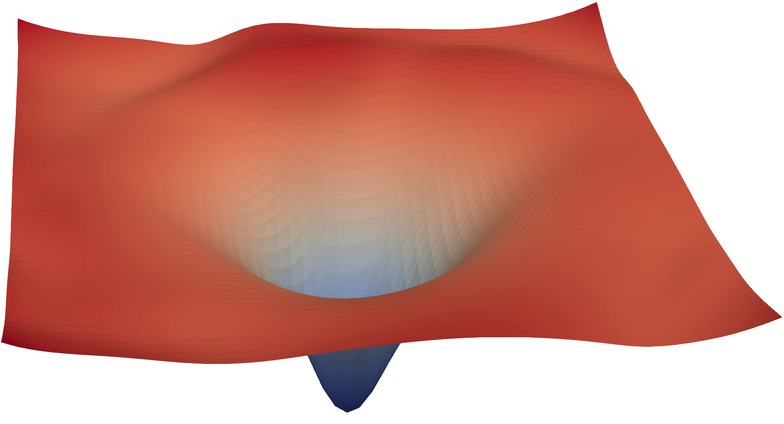
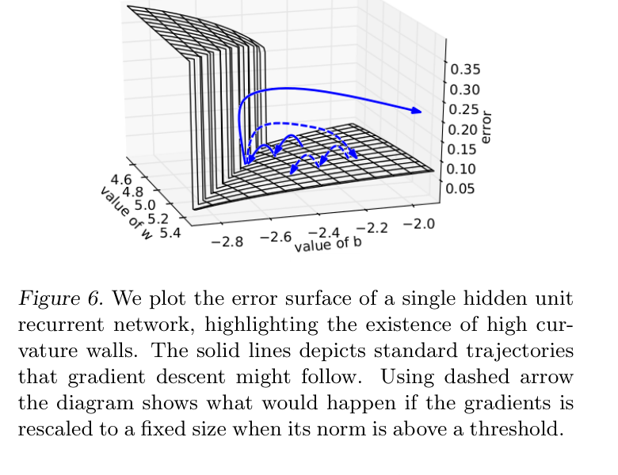
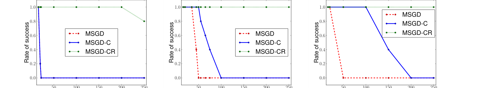

# 优化与训练：loss 怎样变成一次可靠更新

这篇文章只回答一个问题：模型训练时，loss 是怎样通过梯度、学习率和优化器变成参数更新的，以及为什么“loss 下降”仍然可能不代表模型真的更好。

训练不是把模型多跑几轮。一次训练 step 至少包含四个动作：从数据分布采样一个 batch，计算当前参数下的 loss，用反向传播估计梯度，再让 optimizer 把梯度变成参数更新。任何一环错位，曲线都可能看起来正常，但真实任务变差。

!!! tip "数学先修"
    本文会用到[优化、梯度与约束](../prerequisite-math/optimization-and-gradient-methods.md)解释参数更新，用[微积分与链式法则](../prerequisite-math/calculus-and-newton-leibniz.md)连接 backward，并用[采样估计](../prerequisite-math/sampling-estimation-and-calibration.md)理解 mini-batch 梯度为什么会抖。

## 目标函数定义训练压力

大多数监督训练可以写成：

\[
\min_\theta
\mathcal{J}(\theta)
=
\mathbb{E}_{(x,y)\sim p_{\text{data}}}
\left[
\ell(f_\theta(x),y)
\right]
+\lambda\Omega(\theta)
\]

这里的变量槽位要先读清：\(\theta\) 是被更新的模型参数，\((x,y)\) 来自训练数据分布，\(f_\theta(x)\) 是模型预测，\(\ell\) 定义预测和目标之间怎样算错，\(\Omega\) 是正则或约束项，\(\lambda\) 控制约束强度。

这行式子在说一件很朴素但很容易被忘掉的事：模型会优化你写进去的代理目标，而不是自动优化你脑子里的真实目标。next-token loss 让模型更会预测下一个 token；行为克隆 loss 让模型更像数据里的动作；扩散 loss 让模型更会去噪；偏好/RL loss 让模型把某类回答概率推高。它们都可能有用，也都可能和真实验收错位。

所以训练的第一问不是“optimizer 用什么”，而是：

| 问题 | 为什么重要 |
| --- | --- |
| loss 在哪些样本上取期望 | 数据分布会决定平均梯度方向 |
| loss 惩罚的是 token、像素、动作还是整条轨迹 | 不同目标给出的学习信号粒度不同 |
| 样本或任务是否有权重 | 大桶会淹没小但关键的失败桶 |
| 正则项和约束项是否实际影响梯度 | 写在配置里不等于真的主导训练 |

## Loss landscape 只是局部地形

把参数 \(\theta\) 想成一个很高维的位置，每个位置都有一个 loss 值。训练就是在这个地形里移动。二维可视化不是完整真实地形，但它能帮助读者理解：结构、归一化、初始化、batch、学习率都会改变路是否好走。

{ width="820" }

<small>图源：[Visualizing the Loss Landscape of Neural Nets](https://arxiv.org/abs/1712.09913)。原图用 filter normalization 等方法可视化 ResNet 附近的 loss surface。本站用这张图说明：optimizer 不是瞬间找到全局最优点，而是在局部地形上按梯度、历史统计和学习率一步步移动。</small>

地形直觉可以解释几个常见现象：

| 现象 | 地形直觉 | 日志表现 |
| --- | --- | --- |
| 学习率太大 | 一步跨过低谷或撞上高曲率区域 | loss spike、震荡、NaN/overflow |
| 学习率太小 | 每步太短，平台区走很久 | loss 缓慢下降，训练成本高 |
| batch 噪声大 | 每个 batch 指向不同局部方向 | 曲线抖动，seed 方差大 |
| 代理目标错位 | 地形低处不对应真实任务成功 | train loss 降，关键评测不升 |

这也是 Karpathy 那篇训练 recipe 反复强调“神经网络训练是会漏水的抽象”的原因。代码能跑、loss 能降，不等于数据、目标、梯度和评测真的对齐。

## 梯度是一个 noisy estimate

理论目标是数据分布上的期望，但训练时只能用 mini-batch 估计梯度：

\[
g_t
=
\nabla_\theta
\frac{1}{B}
\sum_{i=1}^{B}
\ell(f_\theta(x_i),y_i)
\]

这里 \(B\) 是 batch size，\(g_t\) 是第 \(t\) 步用当前 batch 估计出来的梯度。它不是“真实方向”，而是带噪声的方向。batch 越小，噪声通常越大；batch 越大，估计更稳，但学习率、warmup、泛化和系统吞吐都要重新匹配。

对 LLM、多模态和 VLA，最好把 batch 换算成有效 token 或有效轨迹片段，而不是只看样本数。两个 run 都写着 global batch 256，如果一个平均 512 token，另一个平均 4096 token，它们的梯度压力和显存压力完全不是一回事。

梯度还会被数据桶影响。若 easy bucket 占 80%，hard bucket 占 5%，平均梯度可能主要服务 easy bucket。模型不是偏心，它只是忠实地沿平均目标走。

## 学习率决定这一步有多大

最基础的一阶更新是：

\[
\theta_{t+1}
=
\theta_t-\eta_t g_t
\]

这行式子在说：第 \(t\) 步从当前参数 \(\theta_t\) 出发，沿估计梯度 \(g_t\) 的反方向走，步长由学习率 \(\eta_t\) 控制。真正危险的是，\(g_t\) 和 \(\eta_t\) 都在变：数据 batch 会变，loss 权重可能会变，混合精度 scale 会变，学习率日程也会变。

大模型常见日程是 warmup + decay：

\[
\eta_t=
\begin{cases}
\eta_{\max}\frac{t}{T_w}, & t\le T_w\\
\eta_{\max} f(t), & t>T_w
\end{cases}
\]

这里 \(T_w\) 是 warmup 步数，\(\eta_{\max}\) 是峰值学习率，\(f(t)\) 是 decay 函数。公式读法是：训练早期先小步，让参数、激活、optimizer state、分布式梯度统计和混合精度路径进入稳定区；后期再逐渐收小步长，减少在好解附近震荡。

Warmup 太短时，前期常见 loss spike、overflow、grad norm 暴涨；decay 太快时，模型还没学够就进入低学习率；peak LR 太低时，训练稳定但浪费算力。学习率不是单独调的，它必须和 effective batch、数据阶段、loss 权重、gradient clipping、precision recipe 一起看。

## Optimizer 改变的是更新方向

SGD 直接使用当前梯度。Momentum 会把历史方向滚动平均，减少来回摆动。Adam/AdamW 会维护一阶矩和二阶矩，让不同参数有不同尺度的更新。

可以把优化器抽象写成：

\[
\theta_{t+1}
=
\theta_t-\eta_t u_t
\]

这里 \(u_t\) 不一定等于当前梯度 \(g_t\)。SGD 里 \(u_t\approx g_t\)；Momentum 里 \(u_t\) 是历史梯度平滑；AdamW 里 \(u_t\) 会被二阶矩缩放。优化器的本质不是“更聪明地找全局最优”，而是给 noisy gradient 加上不同的预条件和历史统计。

| Optimizer | 更新方向怎么来 | 常见用途 | 主要风险 |
| --- | --- | --- | --- |
| SGD | 当前梯度 | 简单 baseline、视觉模型、可控实验 | 学习率敏感，收敛慢 |
| Momentum SGD | 当前梯度 + 历史方向 | 视觉训练、强正则场景 | 动量过大可能冲过低谷 |
| Adam | 一阶/二阶矩自适应缩放 | Transformer、稀疏或 noisy gradient | weight decay 和泛化要小心 |
| AdamW | Adam 更新 + 解耦 weight decay | 现代 LLM / VLM 训练默认起点 | 仍需调 LR、warmup、decay 和 decay mask |
| Adafactor | 压缩二阶统计以省状态 | 超大模型或显存受限 | 配方更敏感，API 细节多 |

AdamW 的关键是 decoupled weight decay。Adam 这类自适应方法里，把 L2 penalty 直接混进 loss 梯度，并不等价于经典 weight decay。AdamW 把衰减项从自适应梯度更新里拆出来，让“沿梯度学习”和“让权重别无限长大”变成两件更清楚的事。PyTorch 的 AdamW 文档也明确把它写成 weight decay 不进入 momentum/variance 的算法。

## Gradient clipping 只限制异常步长

深层网络、RNN、长上下文、多模态训练和低精度训练都可能遇到梯度爆炸。链式法则会把很多局部导数连乘；如果某些段的导数或 loss scale 过大，global grad norm 会突然冲高。

{ width="640" }

<small>图源：[On the difficulty of training recurrent neural networks](https://proceedings.mlr.press/v28/pascanu13.html)，Figure 6。原图用单隐藏单元 RNN 的 error surface 展示高曲率墙。本站使用这张图说明：gradient clipping 不是修正目标函数，而是在异常大梯度出现时限制单步更新幅度，避免一步把参数推离稳定区域。</small>

常见 clipping 做法是按 global norm 缩放：

\[
g
\leftarrow
g\cdot
\min\left(1,\frac{\tau}{\lVert g\rVert_2}\right)
\]

这里 \(\tau\) 是阈值，\(\lVert g\rVert_2\) 是梯度范数。公式读法是：若梯度范数不超过阈值，就不动；若超过阈值，就把整组梯度按比例缩小。它保护的是“这一步不要太离谱”，不是“目标一定正确”。如果 clipping 频繁触发，应该继续查学习率、异常数据桶、loss scale、混合精度 overflow、初始化和模型结构，而不是只庆幸没有 NaN。

{ width="760" }

<small>图源：[On the difficulty of training recurrent neural networks](https://proceedings.mlr.press/v28/pascanu13.html)，Figure 7。原图比较 temporal order 任务中不同序列长度、初始化和训练策略的成功率。本站使用它说明：长序列训练是否成功，通常由梯度路径、初始化、学习率、裁剪和任务长度共同决定。</small>

## Loss 下降为什么仍会骗你

假设一个世界模型新 recipe 的平均训练 loss 从 `0.214` 降到 `0.198`，分桶后却是：

| Bucket | Token Share | Baseline Loss | New Loss | Closed-loop |
| --- | ---: | ---: | ---: | ---: |
| easy static scene | `72%` | `0.180` | `0.158` | `+0.3%` |
| moving object | `18%` | `0.246` | `0.241` | `+0.1%` |
| contact / occlusion | `10%` | `0.310` | `0.337` | `-6.8%` |

平均 loss 下降，是因为 easy bucket 占比大；真正影响机器人任务的 contact/occlusion 变差。优化器没有犯错，目标函数也没有撒谎，它们只是按你给的权重优化了平均目标。

这类问题要看梯度贡献和任务价值是否对齐：

| 只看平均值会漏掉什么 | 应该补什么证据 |
| --- | --- |
| 大桶改善掩盖小桶退化 | per-bucket loss、failure replay、risk recall |
| 训练 loss 改善但泛化变差 | validation bucket、OOD split、数据泄漏检查 |
| 静态评测好但闭环失败 | closed-loop success、恢复能力、动作敏感性 |
| 吞吐更高但质量下降 | quality regression 与 tokens/s / MFU 同表报告 |

所以可信训练报告不应该只说“loss 更低”。它至少要把质量、稳定性和成本放在同一张证据表里。

## 一次训练改动怎样才可信

改 loss、optimizer、LR schedule 或 clipping 后，先问这些问题：

| 检查项 | 说明什么 |
| --- | --- |
| init loss 是否符合预期 | 标签、logits、mask、loss scale 是否基本正确 |
| 一个小 batch 能否过拟合 | 反向、参数更新、数据对齐是否能闭环 |
| train/eval 是否同时改善 | 是否只是记住训练分布 |
| per-bucket 是否有退化 | 平均指标是否掩盖关键失败 |
| grad norm / activation / overflow 是否稳定 | 是否有数值或异常数据问题 |
| optimizer/scheduler state 能否恢复 | checkpoint resume 后训练轨迹是否可信 |

Karpathy 的训练 recipe 很值得学习的不是某个固定超参，而是过程：先理解数据，搭一个可信的端到端骨架，用简单 baseline 和单 batch overfit 验证训练闭环，再逐步增加复杂度。这个顺序能避免最糟糕的情况：所有高级技巧都打开了，但你不知道哪一项让模型变好或变坏。

## 读完以后怎么判断

训练的核心不是让 loss 机械下降，而是让一个代理目标通过 noisy gradient、合适步长和可靠 optimizer 稳定改善真实任务。Loss 定义压力，batch 决定梯度估计，学习率决定每步幅度，optimizer 改变更新方向，clipping 和 warmup 保护训练早期与异常步长，评测和分桶证据防止平均 loss 欺骗你。读任何训练曲线时，都要问：这个下降服务的是哪个目标、哪个数据桶、哪种任务价值，以及它有没有用足够强的证据被验证。

## 外部精读

- [A Recipe for Training Neural Networks](https://karpathy.github.io/2019/04/25/recipe/)：学习如何从数据、baseline、过拟合小 batch 和逐步复杂化来排查训练。
- [Visualizing the Loss Landscape of Neural Nets](https://arxiv.org/abs/1712.09913)：理解 loss landscape 可视化和结构/归一化对优化地形的影响。
- [On the difficulty of training recurrent neural networks](https://proceedings.mlr.press/v28/pascanu13.html)：理解梯度爆炸、梯度裁剪和长序列训练的经典来源。
- [Adam](https://arxiv.org/abs/1412.6980) 与 [Decoupled Weight Decay Regularization](https://arxiv.org/abs/1711.05101)：理解 Adam 到 AdamW 的动机。
- [PyTorch AdamW](https://pytorch.org/docs/stable/generated/torch.optim.AdamW.html) 与 [Hugging Face optimization schedules](https://huggingface.co/docs/transformers/main_classes/optimizer_schedules)：核对 optimizer 与 warmup/cosine/linear schedule 的工程语义。
- [Google Deep Learning Tuning Playbook](https://developers.google.com/machine-learning/guides/deep-learning-tuning-playbook)：系统学习如何把调参问题拆成目标、搜索空间、训练长度和证据链。

## 相关阅读与下一步

- 外部材料：[The Illustrated Transformer](https://jalammar.github.io/illustrated-transformer/)。
- 外部材料：[Dive into Deep Learning](https://d2l.ai/)。
- 外部材料：[Distill Circuits](https://distill.pub/2020/circuits/visualizing-weights/)。
- 站内下一步：[基础概念专题](index.md)。
- 站内下一步：[Transformer 输入与注意力](transformer-attention-and-tokenization.md)。
- 站内下一步：[数值、内存与运行时基础](numerics-memory-and-runtime-basics.md)。
