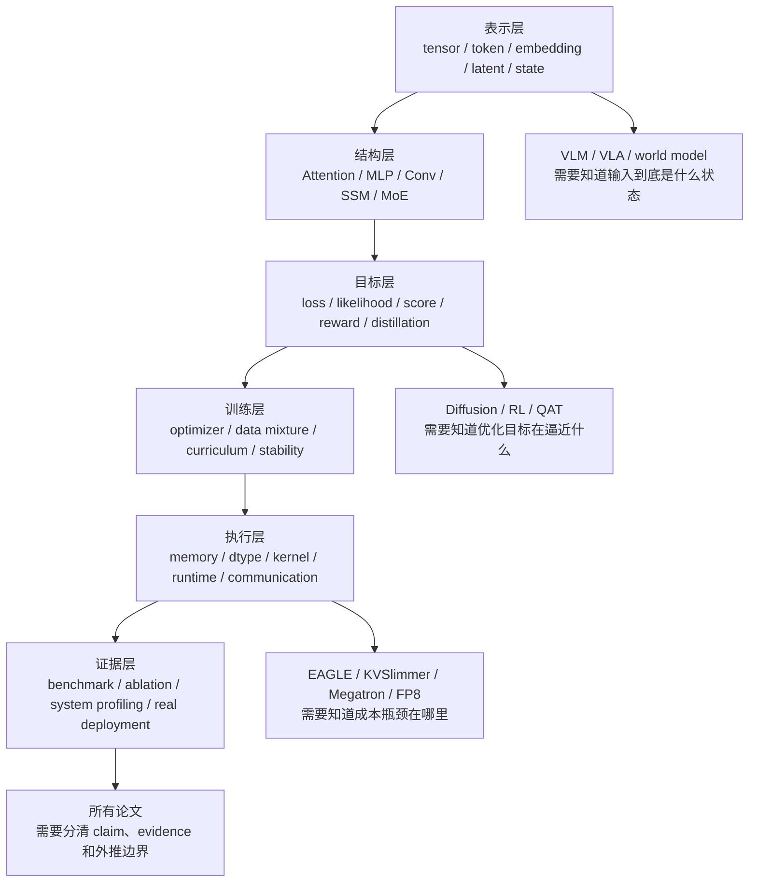
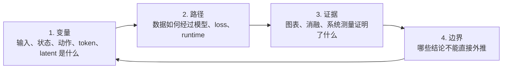
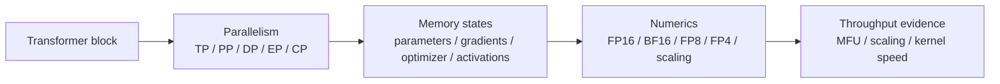
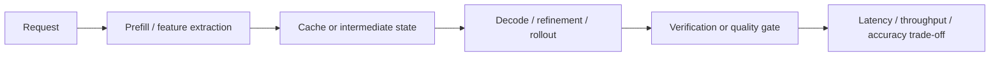
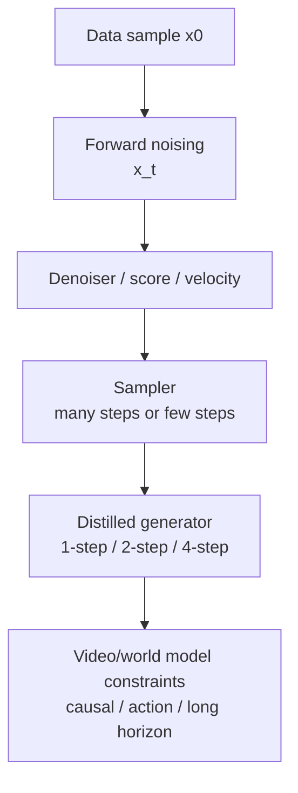
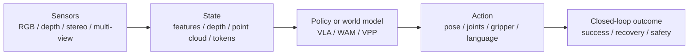
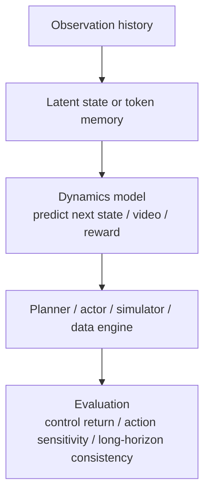
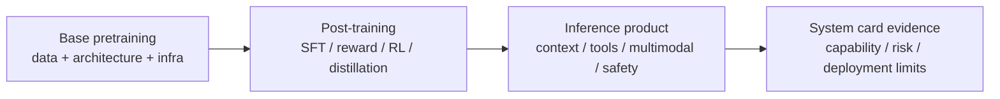

# 论文专题前置知识地图

论文专题讲解覆盖的论文很多：高效训练、推理、扩散、VLA、世界模型、几何视觉和大模型技术报告都有。真正难的不是“论文太多”，而是它们默认读者已经掌握几套公共语言：**张量和注意力怎么流动，训练目标在约束什么，推理成本从哪里来，实验表到底证明了什么。**

这一页专门补这张前置地图。它不是让你在读论文前先学完全部基础，而是帮你判断：读到某个概念卡住时，应该回前面哪一页补。

## 总图：论文专题需要的六层前置知识

!!! note "这张图怎么用"
    读论文时先不要急着记方法名。遇到一个新术语，先问它属于哪一层：是在改输入表示，改模型结构，改训练目标，改执行系统，还是改评测证据？能放到这张图里，论文就会从“名词堆”变成一条数据流。

## 先补一个通用读法：变量、路径、证据

所有专题页都可以用同一套三步读法。

| 读论文时先问 | 具体问题 | 回看页面 |
| --- | --- | --- |
| 变量是什么 | token、patch、latent、state、action、KV cache、expert、depth/disparity 分别是什么形状和语义 | [张量、Shape 与计算图](tensors-shapes-and-computation-graphs.md)、[Transformer 输入与注意力](transformer-attention-and-tokenization.md)、[多模态推理入门](multimodal-cot-and-reasoning-basics.md) |
| 路径怎么走 | 数据如何进入模型，训练时哪些模块更新，推理时哪些模块缓存或复用 | [自动微分与激活显存](autograd-activation-checkpointing-and-memory.md)、[数值、显存与运行时](numerics-memory-and-runtime-basics.md) |
| 目标约束什么 | 这是 next-token、denoising、score matching、reward maximization、distillation 还是 reconstruction | [概率与潜变量模型](probability-latent-variables-and-generative-models.md)、[优化与训练入门](optimization-and-training-basics.md) |
| 证据强不强 | benchmark、ablation、human eval、runtime profiling、真实机器人闭环分别支持什么 | [数据划分与评测指标](data-splits-metrics-and-evaluation-basics.md)、[训练评测与消融方法](../training/evaluation-and-ablation-methodology.md) |

## 你可能缺的前置知识

从现有论文专题反推，前面最值得补强的是下面这些“跨专题接口”。很多内容前面已经分散讲过，这里把它们组织成读论文时的入口。

| 缺口 | 为什么会卡论文 | 已有补课入口 |
| --- | --- | --- |
| 证据等级与外推边界 | 技术报告和系统论文常把 benchmark、demo、ablation、吞吐表混在一起，不分清会误判结论强度 | [数据划分与评测指标](data-splits-metrics-and-evaluation-basics.md)、[训练评测与消融方法](../training/evaluation-and-ablation-methodology.md) |
| Attention 与 KV 的执行成本 | EAGLE、KVSlimmer、MLA、RingAttention、长上下文报告都默认你懂 prefill/decode/KV cache | [Transformer 输入与注意力](transformer-attention-and-tokenization.md)、[位置编码与 Mask](positional-encoding-masks-and-context.md)、[推理系统路线图](../inference/index.md) |
| MoE、MTP、SSM、稀疏结构的分工 | DeepSeek、Qwen、Kimi、Nemotron 报告会同时出现 MoE、MTP、Mamba、GQA/MLA、routing | [MoE 与大模型架构表](moe-and-large-model-architecture-basics.md)、[Mamba 与混合 SSM 架构](mamba-and-hybrid-ssm-transformers.md)、[MTP 与投机解码](../training/mtp-and-speculative-decoding.md)、[MoE Serving](../inference/moe-routing-and-multi-model-serving.md) |
| 扩散目标、采样器和少步蒸馏 | DPM-Solver++、DMD、DMD2、Phased DMD、CausVid、Self Forcing 都在改采样路径或训练-推理分布 | [Score Matching 到 SDE](../diffusion/score-matching-sde-and-probability-flow.md)、[采样与推理加速](../diffusion/inference.md)、[一步生成、蒸馏与整流](../diffusion/distillation.md) |
| 世界模型里的状态、动作和 rollout | PlaNet/Dreamer、JEPA/V-JEPA、Genie、LingBot-World、DreamZero 都在争论“预测什么状态、给谁用” | [概率与潜变量模型](probability-latent-variables-and-generative-models.md)、[RSSM、Dreamer 与规划](../world-models/rssm-dreamer-and-planning.md)、[VLA、WAM 与世界模型地图](../embodied-ai/vla-wam-world-model-system-map.md) |
| 机器人几何与动作接口 | Depth Anything、VGGT、SpatialVLA、Fast-FoundationStereo、RT/GR/π0.5 都需要相机、深度、坐标和动作表示 | [卷积与视觉特征](convolution-and-feature-extraction.md)、[相机、深度与机器人视觉](../embodied-ai/cameras-depth-and-robot-vision.md)、[动作表示与控制接口](../vla/action-representation-and-interfaces.md) |
| 低比特、kernel 与 runtime 的真实收益 | Low-bit LLM Survey、Attn-QAT、DeepSeek FP8/FP4、KVSlimmer 都要求你区分保存格式、计算格式和硬件路径 | [数值、显存与运行时](numerics-memory-and-runtime-basics.md)、[量化路线图](../quantization/index.md)、[算子专题路线图](../operators/index.md) |

## 按论文专题分组补前置

下面不是重复论文目录，而是每组论文的“最小前置知识”。读某一组时，先会这些就够进入正文；细节可以边读边补。

### 高效训练论文

对应论文：Megatron-LM、ZeRO、Muon、MagiAttention、SLA/SLA2、Attn-QAT。

| 读这组前先会 | 会帮你读懂什么 | 补课入口 |
| --- | --- | --- |
| 线性层、attention 和 Transformer block 的 shape | Megatron 的 column/row parallel、attention head parallel、SLA 的 sparse/linear attention | [线性层、MLP 与 GEMM](linear-layers-mlp-and-gemm.md)、[Transformer 输入与注意力](transformer-attention-and-tokenization.md) |
| 参数、梯度、优化器状态和 activation 分别占多少显存 | ZeRO 为什么分 stage，checkpointing 为什么省显存但耗算力 | [自动微分与激活显存](autograd-activation-checkpointing-and-memory.md)、[分布式训练与 Checkpointing](../training/distributed-training-and-checkpointing.md) |
| dtype、scale、outlier 和累加精度 | Attn-QAT、FP8/FP4、NVFP4 为什么不能只看 bitwidth | [数值、显存与运行时](numerics-memory-and-runtime-basics.md)、[FP8 与混合精度服务](../quantization/fp8-and-mixed-precision-serving.md) |
| 优化器更新方向与训练稳定性 | Muon、MuonClip 为什么关心矩阵更新、谱范数和大规模预训练稳定性 | [优化与训练入门](optimization-and-training-basics.md) |

### 高效推理论文

对应论文：EAGLE、EAGLE-2、EAGLE-3、Low-bit LLM Survey、KVSlimmer、Fast-FoundationStereo。

| 读这组前先会 | 会帮你读懂什么 | 补课入口 |
| --- | --- | --- |
| prefill、decode、KV cache、batch 和 P95/P99 | EAGLE 系列为什么受 acceptance、batch、verify overhead 影响 | [推理系统路线图](../inference/index.md)、[缓存、路由与投机解码](../inference/caching-routing-and-speculative.md) |
| draft/target 分布一致性和多步误差 | EAGLE 的 feature uncertainty、EAGLE-3 的 training-time test | [概率与潜变量模型](probability-latent-variables-and-generative-models.md)、[MTP 与投机解码](../training/mtp-and-speculative-decoding.md) |
| 量化到底省权重、激活还是 KV | Low-bit LLM Survey 的 W-only、W&A、KV quant、QAT/PTQ | [量化路线图](../quantization/index.md)、[数值、显存与运行时](numerics-memory-and-runtime-basics.md) |
| Key/Value 的语义差异和 attention 输出路径 | KVSlimmer 为什么只合并 Key 更稳 | [Transformer 输入与注意力](transformer-attention-and-tokenization.md)、[位置编码与 Mask](positional-encoding-masks-and-context.md) |
| 视觉感知 pipeline 的 stage latency | Fast-FoundationStereo 为什么把 feature backbone、cost filtering、refinement 分开压缩 | [卷积与视觉特征](convolution-and-feature-extraction.md)、[相机、深度与机器人视觉](../embodied-ai/cameras-depth-and-robot-vision.md) |

### 扩散与视频生成论文

对应论文：DPM-Solver++、DMD、DMD2、Diffusion Forcing、CausVid、Wan、Phased DMD。

| 读这组前先会 | 会帮你读懂什么 | 补课入口 |
| --- | --- | --- |
| score、噪声日程、\(\epsilon/x_0/v\) 参数化 | DPM-Solver++、DMD 系列所有公式的变量含义 | [Score Matching 到 SDE](../diffusion/score-matching-sde-and-probability-flow.md)、[噪声日程与参数化](../diffusion/noise-schedules-and-parameterization.md) |
| ODE/SDE 采样和步数-质量权衡 | DPM-Solver++ 为什么能高阶求解，少步生成为什么难 | [采样与推理加速](../diffusion/inference.md) |
| distribution matching、teacher/student、fake score | DMD、DMD2、Phased DMD 为什么不是普通监督蒸馏 | [一步生成、蒸馏与整流](../diffusion/distillation.md) |
| 视频 token、因果 rollout、训练-推理分布偏移 | CausVid、Diffusion Forcing、Self Forcing、LingBot-World 的连接 | [视频与多模态扩散](../diffusion/video-and-multimodal-diffusion.md)、[视频表征与长时记忆](../vlm/video-representation-and-memory.md) |

### 具身智能与几何视觉论文

对应论文：RT-2、GR-2、GR-3、π0.5、DreamZero、VPP、SpatialVLA、Depth Anything 系列、VGGT、Fast-FoundationStereo。

| 读这组前先会 | 会帮你读懂什么 | 补课入口 |
| --- | --- | --- |
| 相机内外参、深度、disparity、点云、多视角几何 | Depth Anything 3、VGGT、Fast-FoundationStereo 的几何主张 | [相机、深度与机器人视觉](../embodied-ai/cameras-depth-and-robot-vision.md)、[卷积与视觉特征](convolution-and-feature-extraction.md) |
| 行为克隆、covariate shift、动作 chunk 和控制接口 | RT-2、GR、π0.5、SpatialVLA 的训练和部署边界 | [VLA 数据与策略学习](../vla/data-and-policy-learning.md)、[动作分块、层级策略与潜在技能](../vla/action-chunking-hierarchical-policies-and-latent-skills.md) |
| VLM 视觉 token 和语言-动作对齐 | 为什么 web-scale video / VLM prior 能迁移到机器人，但不能自动保证控制可靠 | [VLM 架构：视觉表征、连接器与记忆](../vlm/architecture-and-training.md)、[多模态推理入门](multimodal-cot-and-reasoning-basics.md) |
| 闭环评测、失败恢复和安全约束 | 为什么真实机器人实验不能只看离线 loss 或单次成功率 | [VLA 闭环恢复与失败分析](../vla/closed-loop-recovery-and-failure-analysis.md)、[具身部署模式与安全案例](../embodied-ai/deployment-patterns-and-safety-cases.md) |

### 世界模型论文

对应论文：PlaNet、Dreamer、DreamerV2/V3、JEPA/H-JEPA/V-JEPA、Genie、LWM、RingAttention、Towards Video World Models、LingBot-World、World Model Survey。

| 读这组前先会 | 会帮你读懂什么 | 补课入口 |
| --- | --- | --- |
| latent variable、posterior/prior、reconstruction 和 reward prediction | PlaNet/Dreamer 的 RSSM、imagined rollout 和 actor-critic | [概率与潜变量模型](probability-latent-variables-and-generative-models.md)、[RSSM、Dreamer 与规划](../world-models/rssm-dreamer-and-planning.md) |
| 表征预测 vs 像素生成 | JEPA/V-JEPA/H-JEPA 为什么不直接重建所有像素 | [VLM 架构：视觉表征、连接器与记忆](../vlm/architecture-and-training.md)、[视频表征与长时记忆](../vlm/video-representation-and-memory.md) |
| 动作条件、反事实分叉和 rollout 漂移 | DreamZero、LingBot-World、Genie 是否真的能支持决策 | [VLA、WAM 与世界模型地图](../embodied-ai/vla-wam-world-model-system-map.md)、[世界模型评测与失效模式](../world-models/evaluation-and-failure-modes.md) |
| 长上下文系统成本 | LWM、RingAttention 为什么把 context length 和训练基础设施放到能力核心 | [位置编码与 Mask](positional-encoding-masks-and-context.md)、[长上下文与 FlashAttention 演进](../operators/long-context-and-flashattention-evolution.md) |

### 技术报告

对应报告：DeepSeek-V3/V4、DeepSeek-R1、Qwen3、Qwen3.5-Omni、Kimi K2、Nemotron 3 Super、Gemini 2.5、GPT-4o System Card。

| 读这组前先会 | 会帮你读懂什么 | 补课入口 |
| --- | --- | --- |
| MoE、routing、activated params 和 total params | DeepSeek、Qwen、Kimi、Nemotron 的模型规模表 | [MoE 与大模型架构表](moe-and-large-model-architecture-basics.md)、[MoE 路由与多模型服务](../inference/moe-routing-and-multi-model-serving.md)、[Mamba 与混合 SSM 架构](mamba-and-hybrid-ssm-transformers.md) |
| 预训练、SFT、偏好训练、RLHF/GRPO 的阶段差异 | DeepSeek-R1、Qwen3、Kimi K2 的后训练 pipeline | [预训练、微调与对齐](../training/pretraining-finetuning-alignment.md)、[Policy Gradient、PPO 与 GRPO](../reinforcement-learning/policy-gradient-actor-critic-ppo-grpo.md) |
| agentic data、tool use、judge model 和回流数据 | Kimi K2、Gemini 2.5、Qwen3.5-Omni 的数据系统 | [后训练数据引擎与 Judge Model](../training/post-training-data-engines-and-judge-models.md)、[Prompt、CoT 与 RAG 入门](prompt-engineering-cot-and-rag-basics.md) |
| 系统卡和安全评估怎么读 | GPT-4o System Card、Gemini 2.5 的风险和能力证据边界 | [数据划分与评测指标](data-splits-metrics-and-evaluation-basics.md)、[多模态评测与失败模式](../vlm/multimodal-evaluation-and-failure-modes.md) |

## 读论文时最容易混的十组概念

| 容易混的词 | 区分方法 |
| --- | --- |
| `model size` vs `activated params` | MoE 总参数是容量，activated params 更接近单 token 计算量；细节见 [MoE 与大模型架构表](moe-and-large-model-architecture-basics.md) |
| `FLOPs` vs `latency` | FLOPs 是计算量，latency 还受 memory、kernel、batch、调度和通信影响 |
| `compression ratio` vs `quality retained` | 压缩率高不等于可用，必须看任务桶、长尾和回归集 |
| `feature` vs `latent state` | feature 常是表征，latent state 通常还承担动态预测或不确定性 |
| `video prediction` vs `world model` | 会预测视频不等于动作条件下的未来可用于规划 |
| `distillation` vs `fine-tuning` | distillation 学 teacher 分布或中间信号，fine-tuning 用任务数据更新能力 |
| `QAT` vs `PTQ` | QAT 训练时模拟低精度误差，PTQ 部署前校准/重建已有模型 |
| `benchmark score` vs `deployment readiness` | benchmark 是公开任务证据，部署还要看延迟、稳定性、安全、回滚和监控 |
| `CoT length` vs `reasoning quality` | 推理 token 是资源，不是越长越好；要看可控预算和正确率 |
| `zero-shot generalization` vs `closed-loop robustness` | 未见数据上预测好，不等于机器人闭环遇到扰动能恢复 |

## 最短学习路线

如果目标是尽快读懂论文专题，而不是系统学习全部课程，可以按下面顺序补：

1. [Transformer 输入与注意力](transformer-attention-and-tokenization.md)：解决 token、attention、KV、上下文成本。
2. [概率与潜变量模型](probability-latent-variables-and-generative-models.md)：解决 generative model、latent、uncertainty。
3. [优化与训练入门](optimization-and-training-basics.md)：解决 loss、gradient、optimizer、训练稳定。
4. [数值、显存与运行时](numerics-memory-and-runtime-basics.md)：解决 dtype、memory、bandwidth、runtime。
5. [数据划分与评测指标](data-splits-metrics-and-evaluation-basics.md)：解决 benchmark、ablation、证据强度。
6. 按论文方向补专题页：技术报告先读 [MoE 与大模型架构表](moe-and-large-model-architecture-basics.md)，扩散读 [采样与推理加速](../diffusion/inference.md)，VLA 读 [动作表示与控制接口](../vla/action-representation-and-interfaces.md)，世界模型读 [RSSM、Dreamer 与规划](../world-models/rssm-dreamer-and-planning.md)，推理系统读 [推理系统路线图](../inference/index.md)。

## 读完这页应该能做什么

你不需要马上掌握每个公式，但应该能做到三件事：

1. 看到一篇论文，先判断它主要在改表示、结构、目标、训练、执行还是证据；
2. 读到图表时，能区分它证明的是机制、消融、系统吞吐、benchmark 还是 demo；
3. 卡住时知道回前面哪一页补，而不是在模型名字之间来回跳。

这就是论文专题前置知识的真正作用：让每篇论文变成可比较、可复用、可质疑的工程材料。
