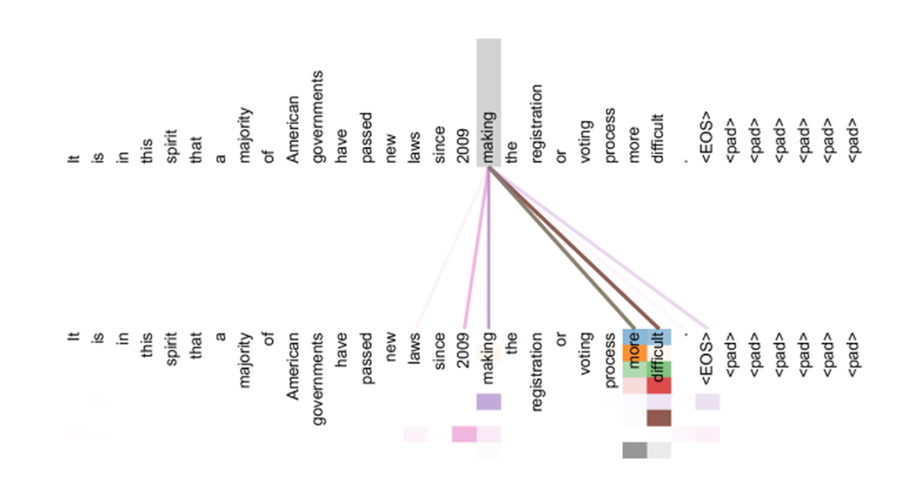

# 位置编码与 Mask：顺序、可见性和长上下文边界

这篇文章只回答一个问题：Transformer 里的 token 为什么需要知道“我在哪里”和“我能看谁”。

Attention 本身只会比较 token 向量之间的匹配分数。它不会天然知道第一个 token 在前、第二个 token 在后，也不会自动知道 padding、未来 token、另一个 packed sample 或未来动作标签不该被看见。位置机制负责把顺序、距离、时间或空间放进模型；mask 负责在 attention 里划出可见性边界。

## Attention 不天然知道顺序

标准 attention score 可以写成：

\[
S=\frac{QK^\top}{\sqrt{d}}
\]

这里 \(Q\) 是 query，\(K\) 是 key，\(d\) 是 head dimension。这个式子只在比较向量相似度。如果没有位置机制，两个 token 的内容向量被打乱后，attention 不会天然知道“谁先谁后”。句子“猫追狗”和“狗追猫”包含相同词，但顺序改变了语义。

最早的 Transformer 使用 sinusoidal positional encoding，把第 \(i\) 个 token embedding 加上位置向量：

\[
h_i = E(x_i)+p_i
\]

这里 \(E(x_i)\) 是 token embedding，\(p_i\) 是位置 \(i\) 的向量。它的工程含义很简单：同一个词出现在不同位置，会带上不同的位置标记。Attention Is All You Need 选择正弦/余弦形式，是希望模型能从不同频率的周期信号里推断相对位移，并可能外推到比训练更长的序列。

{ width="760" }

<small>图源：[Attention Is All You Need](https://arxiv.org/abs/1706.03762)，Figure 3。原图展示 encoder self-attention head 关注长距离依赖。本站用这张图说明：attention 可以跨远距离读信息，但“能读远处”不等于“知道顺序”，顺序仍要由位置机制注入。</small>

位置机制大致有四类：

| 方法 | 信息放在哪里 | 直觉 |
| --- | --- | --- |
| 绝对位置 embedding / sinusoidal | token 表示里 | 每个位置有自己的标记 |
| 相对位置 bias | attention score 里 | 更关心 \(i\) 和 \(j\) 相隔多远 |
| RoPE | Q/K 的旋转里 | 点积时自然带出相对距离 |
| ALiBi | score 的距离惩罚里 | 越远越扣分，偏向可外推距离偏置 |

选择哪种机制不是审美问题。文本生成更关心一维顺序和长距离外推；图像 patch 还要表达二维行列；视频要叠加时间；机器人轨迹还要表达相机、状态、动作时间戳和 episode 边界。

## RoPE 把位置写进 Q/K 的相对旋转

RoPE 不把位置向量加到 token embedding 上，而是在生成 query/key 后按位置旋转。简化写法是：

\[
q_i' = R_i q_i,\qquad k_j'=R_j k_j
\]

这里 \(R_i\) 和 \(R_j\) 是由位置决定的旋转矩阵。Attention 点积变成：

\[
(q_i')^\top k_j'
=
q_i^\top R_i^\top R_j k_j
\]

这行式子是 RoPE 的核心：\(R_i^\top R_j\) 只和相对位置 \(j-i\) 有关，所以模型比较 token \(i\) 和 token \(j\) 时，点积里已经带有它们的相对距离。换句话说，RoPE 不是简单告诉模型“我是第 17 个 token”，而是让模型在每次比较两个 token 时知道“我们相隔多远”。

第一次读 RoPE，不要先背矩阵块。更好的路线是：先问“score 能不能只依赖相对距离”，再看二维旋转怎样保持向量长度，最后把每两维一组推广到高维。科学空间的 [旋转式位置编码](https://kexue.fm/archives/8265/comment-page-5) 和 Hugging Face 的 [设计位置编码](https://huggingface.co/blog/zh/designing-positional-encoding) 都很适合沿着这条路补读；前者把复数旋转、矩阵形式和相对位置推导连起来，后者用“从简单编码一路设计到 RoPE”的方式降低入门阻力。

长上下文扩展会动到 RoPE scaling、position interpolation、NTK-style scaling、YaRN 等技巧，本质都是在调整“位置索引如何映射到旋转角度”。这不是把 config 里的最大长度数字改大。模型还要在训练或微调中见过足够长的依赖结构，否则只改位置公式，远距离检索、跨段推理和长文档鲁棒性仍可能不稳。

## ALiBi 把距离偏置加到 attention score

ALiBi 的思路更直接：不学习新的位置 embedding，而是在 attention score 里加一个随距离变化的线性偏置。可以粗略写成：

\[
S_{ij}
=
\frac{q_i^\top k_j}{\sqrt{d}}
-m_h\cdot (i-j)
\quad (j\le i)
\]

这里 \(m_h\) 是第 \(h\) 个 attention head 的斜率，\(i-j\) 是 query 和 key 的距离。对于自回归模型，越远的历史 token 会被不同 head 以不同强度惩罚。ALiBi 的价值在于把距离偏置做成不依赖固定最大长度的形式，因此论文主打“train short, test long”。

但这也不是万能长上下文。距离 bias 可以帮助 score 外推，不能替代长上下文数据、任务评测、KV cache 管理和真实远距离信息使用。

## Mask 在 softmax 前改变可见性

位置机制回答“在哪里”，mask 回答“能看谁”。Mask 通常加在 softmax 前：

\[
A
=
\operatorname{softmax}
\left(
\frac{QK^\top}{\sqrt{d}}+M
\right)
\]

这里 \(M_{ij}=0\) 表示 query 位置 \(i\) 可以看 key 位置 \(j\)，\(M_{ij}=-\infty\) 表示不可见。softmax 后，被设为 \(-\infty\) 的位置权重接近 0。

常见 mask 不止 causal 三角矩阵：

| Mask 类型 | 它阻止什么 |
| --- | --- |
| causal mask | 自回归模型偷看未来 token |
| padding mask | 真实 token attend 到 padding |
| segment/document mask | packed samples 之间互相泄漏 |
| sliding-window mask | 只看局部历史，控制 KV 和计算 |
| block / prefix mask | 不同块、工具结果、系统前缀按规则可见 |
| tree mask | speculative decoding 或搜索树里，分支 token 只能看祖先 |

最小伪代码是：

```text
scores = Q @ K.T / sqrt(d)
scores[future_positions] = -inf
scores[padding_positions] = -inf
scores[cross_sample_positions] = -inf
weights = softmax(scores)
output = weights @ V
```

注意这不是只在第一层做一次。每一层 attention 都要遵守同一组可见性规则，否则后续层仍可能通过 hidden state 间接泄漏信息。

## Packed sequence 里的 mask 是数据契约

为了提高吞吐，训练时常把多个短样本 pack 到同一条长序列里：

```text
[sample A tokens][sample B tokens][sample C tokens]
```

从张量形状看，它是一条长序列；从任务语义看，它是三个独立样本。正确的 document / segment mask 应该让 A、B、C 互相不可见，除非任务明确允许跨样本上下文。

如果 mask 写错，模型可能看到另一个样本的答案，validation loss 会异常好，上线却失败。这类 bug 很隐蔽，因为 shape 没错、loss 下降也很漂亮。最有效的排查方式是构造 toy sequence：把未来答案或另一个 sample 放成明显标记，再检查 attention mask、loss 和生成输出是否能偷看。

Hugging Face 的 attention backend 文档也提醒：不同 backend 需要不同 mask 格式，causal、padding、packing、sliding-window 约束如果没有被正确传给 backend，可能被静默丢掉。也就是说，mask 不只是数学概念，还是 runtime 接口。

## 多模态位置不是一维编号

多模态模型的问题更复杂，因为 token 不只来自一条文本。

| 输入 | 位置要表达什么 | Mask 要表达什么 |
| --- | --- | --- |
| 图像 patch | 行、列、分辨率、局部邻域 | 哪些 patch 可互看，是否和文本 cross-attend |
| 视频 token | 帧内空间位置 + 时间位置 | 是否能看未来帧，是否局部窗口 |
| 文档图像 | OCR 顺序 + 页面二维布局 | 表格、页眉、正文、脚注边界 |
| 机器人轨迹 | 时间步、相机、状态、动作延迟 | 预测动作时不能看未来动作标签 |
| packed episode | episode id、segment id | 不同 episode 不能互相泄漏 |

一个 VLA 样本可能长这样：

```text
[instruction]
[cam1_t0 patches][cam2_t0 patches][proprio_t0][action_t0]
[cam1_t1 patches][cam2_t1 patches][proprio_t1][action_t1]
```

这里至少有四种位置：文本顺序、图像二维 patch、时间步、相机视角。Mask 还要表达因果：预测 `action_t1` 时不能看未来动作标签，训练不同 episode 时也不能跨 episode 读信息。如果视觉帧和动作时间戳错位，策略会像慢半拍；如果未来动作可见，模型会学到伪能力。

{ width="920" }

<small>图源：[MagiAttention](https://arxiv.org/abs/2502.13138)，Figure 4。原图展示 long-context、packed、block-causal 等不同 attention mask pattern。本站用这张图说明：现代训练里的 mask 不是只有 causal 三角形，视频、packed sequence、多段 memory 和长上下文会把可见性变成复杂图。</small>

## 长上下文不是只改位置长度

长上下文至少同时牵涉四件事：

| 问题 | 为什么重要 |
| --- | --- |
| 位置外推 | RoPE/ALiBi/PI/YaRN 决定远距离 token 如何编码 |
| 可见性策略 | full、causal、sliding window、block sparse、retrieval memory 决定能看哪些历史 |
| 训练数据 | 模型是否见过真正需要长距离依赖的样本 |
| 系统成本 | \(L^2\) attention、KV cache、prefill/decode、batch 和 P99 是否可承受 |

KV cache 粗略随上下文长度增长：

\[
\text{KV cache}
\propto
Layers\times L\times d_{\text{kv}}\times bytes
\]

这里 \(L\) 是历史长度，\(d_{\text{kv}}\) 是 KV 宽度。位置编码让模型知道远处 token 在哪里，mask 决定远处 token 是否可见，runtime 决定远处 token 的 KV 是否存得下、读得快。sliding window、prefix cache、context compression、retrieval memory 和 KV eviction，都是在回答同一个问题：哪些历史必须留在 attention 里，哪些可以压缩或外部化。

所以读长上下文论文时，不要只看 “context length = 128K/1M”。要问：位置机制怎么扩展，训练是否包含长样本，mask 是否允许目标信息泄漏，评测是否按距离分桶，KV cache 和 P99 是否一起报告。

## 常见事故

| 事故 | 表现 | 排查 |
| --- | --- | --- |
| 未来 token 泄漏 | validation loss 异常好，上线退化 | 构造 toy sequence 检查 future visibility |
| padding 未 mask | 长短样本混 batch 后输出漂移 | 看 padding token 是否被 attend |
| packed sample 泄漏 | 一个样本影响另一个样本答案 | 按 segment id 可视化 mask |
| RoPE scaling 误用 | 长上下文远距离能力不稳 | 按距离桶评测 retrieval 和 QA |
| backend mask 格式不匹配 | 换 attention backend 后结果变 | 检查 backend 需要 2D、4D 还是 BlockMask |
| 图像/动作时间错位 | VLA 策略慢半拍或抖动 | 核对 frame index、action timestamp、position id |

## 阅读结论

位置编码回答“这个 token 在哪里”，mask 回答“这个 token 能看谁”。二者一起定义 attention 的语义边界。文本里，它们决定顺序和未来可见性；packed training 里，它们决定不同样本是否泄漏；长上下文里，它们和 KV cache、sliding window、prefix cache 共同决定历史如何被使用；多模态和机器人里，它们还要表达空间、时间、相机、动作和 episode 边界。

读任何 Transformer、长上下文、VLM、VLA 或 packed training 方案时，先画 token 排列，再画可见性矩阵。很多看似神秘的训练捷径、长上下文失败和多模态错位，都会还原成位置或 mask 的问题。

## 外部精读

- [Attention Is All You Need](https://arxiv.org/abs/1706.03762)：位置编码和 attention 的原始入口。
- [RoFormer / RoPE](https://arxiv.org/abs/2104.09864)：理解旋转位置编码如何把相对距离放进 Q/K 点积。
- [EleutherAI: Rotary Embeddings](https://blog.eleuther.ai/rotary-embeddings/)：高质量 RoPE 直觉博客。
- [科学空间：旋转式位置编码](https://kexue.fm/archives/8265/comment-page-5)：中文 RoPE 推导入口，适合把复数旋转、矩阵形式和相对位置性质连起来。
- [Hugging Face：设计位置编码](https://huggingface.co/blog/zh/designing-positional-encoding)：从整数、二进制、正弦编码一路推到 RoPE 的中文教学型文章。
- [Train Short, Test Long: ALiBi](https://arxiv.org/abs/2108.12409)：理解 attention bias 路线的长上下文外推。
- [YaRN](https://arxiv.org/abs/2309.00071)：理解 RoPE context extension 为什么需要频率/位置缩放和少量继续训练。
- [Hugging Face Attention Interface](https://huggingface.co/docs/transformers/attention_interface)：理解不同 attention backend 对 causal、padding、packing、sliding-window mask 的接口要求。
- [MagiAttention](https://arxiv.org/abs/2502.13138)：看复杂 mask、长上下文和分布式 attention 如何绑在一起。
