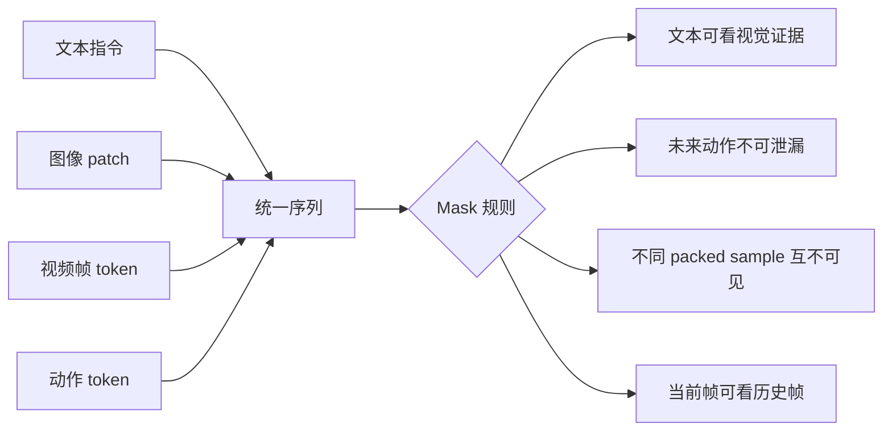

# 位置编码与 Mask：顺序和可见性

Attention 本身只计算 token 之间的相关性。它并不知道第一个 token 在前、第二个 token 在后，也不知道哪些 token 不应该被看见。位置编码和 mask 就是为了解决这两个问题。

!!! note "读法定位"
    这页先回答“位置编码与 Mask：顺序和可见性”在「基础知识」里的位置：它解决什么局部问题，依赖哪些前置，最后会影响哪类工程或研究判断。
    **前置**：先看本页要补哪一个最小概念；公式或术语卡住时回到术语表，不需要一次吃完整个数学体系。 必要时先回 [基础知识入口](index.md) 或 [术语表](../glossary/index.md)。
    **主线关系**：把符号、张量、优化、评测和运行时这些前置打稳，后面的扩散、VLM/VLA、训练与系统页才不会断层。

{ width="590" }

<small>图源：[Attention Is All You Need](https://arxiv.org/abs/1706.03762)，Figure 3。原论文图意：Transformer encoder 的某些 self-attention heads 会关注长距离依赖，例如围绕 `making ... more difficult` 的依赖关系。</small>

!!! note "初学者先抓住"
    Transformer 本身像一袋 token。位置编码解决“谁在前谁在后”，mask 解决“谁能看谁”。看到长上下文、packing、VLM 多图输入或 agent 历史记忆时，先问三个问题：位置机制能不能表达顺序，mask 有没有限定正确可见性，padding 或未来 token 有没有泄漏。

!!! tip "遇到这些症状，回看本页"
    packed sequence 训练后验证集异常变好、长视频模型偷看未来帧、图像/动作 token 的时间顺序错乱，或者 attention mask 让某些 rank 负载极不均时，回看本页。本页能帮你判断问题是位置编码外推、causal/padding mask 泄漏、block mask 设计，还是长上下文可见性规则和系统调度不匹配。

## 符号卡：位置和可见性

| 符号或词 | 含义 |
| --- | --- |
| \(i,j\) | token 位置编号 |
| \(L\) | 序列长度 |
| `position id` | 每个 token 的位置编号 |
| `causal mask` | 当前 token 只能看过去和自己 |
| `padding mask` | 补齐用的 padding token 不参与 attention |
| `block mask` | 只允许某些区块互相可见 |
| \(-\infty\) | mask 里常用的不可见分数，softmax 后权重接近 0 |

一句话记法：position 告诉模型“我在哪里”，mask 告诉模型“我能看谁”。

## 为什么需要位置编码

如果没有位置编码，Transformer 对输入顺序不敏感。句子：

```text
猫追狗
狗追猫
```

包含的字相同，但意思完全不同。模型必须知道 token 的顺序。

常见位置机制可以先按用途区分：

| 方法 | 直观理解 | 常见场景 |
| --- | --- | --- |
| 绝对位置编码 | 给每个位置一个固定或可学习编号 | 早期 Transformer |
| 相对位置编码 | 关注 token 之间相对距离 | 长序列建模 |
| RoPE | 用旋转方式把位置信息注入 Q/K | 现代 LLM 常见 |
| ALiBi | attention 分数按距离加入偏置 | 长上下文扩展 |

## Mask 决定可见性

Mask 是 attention 里的可见性规则。

### Causal Mask

自回归语言模型只能看过去，不能看未来：

```text
token 1 -> 看 token 1
token 2 -> 看 token 1,2
token 3 -> 看 token 1,2,3
```

这样模型才能做 next-token prediction，不会偷看答案。

### Padding Mask

不同样本长度不一样，batch 时会补 padding。Padding token 不是有效内容，需要被 mask 掉。

### Block / Sliding Window Mask

长上下文模型有时只允许 token 看局部窗口，减少 \(L^2\) attention 成本。

## Attention Mask 的伪代码

```text
scores = Q @ K.T / sqrt(d)

if causal:
    scores[future_positions] = -inf

if padding:
    scores[padding_positions] = -inf

weights = softmax(scores)
output = weights @ V
```

把某些位置设成 \(-\infty\)，softmax 后这些位置权重接近 0，也就相当于不可见。

## 为什么长上下文很贵

标准 attention 需要计算 \(L \times L\) 的分数矩阵。序列长度 \(L\) 翻倍，attention 分数矩阵大约变成 4 倍。

推理时还会产生 KV cache：

\[
\text{KV cache size} \propto \text{layers} \times L \times D
\]

所以长上下文系统往往不会只扩大窗口，而是同时引入上下文压缩、KV cache 量化、prefix cache、sliding window attention 和检索式外部记忆。它们解决的是同一个系统问题：哪些信息必须留在注意力里，哪些可以压缩、缓存或外部检索。

## 多模态里的位置更复杂

图像和视频不只有一维顺序，还有二维空间和时间结构。

| 输入 | 位置问题 |
| --- | --- |
| 图像 patch | 行列位置、局部邻域 |
| 视频 token | 帧内位置 + 时间位置 |
| 文档图像 | OCR 文本位置 + 页面布局 |
| 机器人轨迹 | 时间步 + 空间状态 |

所以 VLM、视频模型和 VLA 不只是“把所有 token 拼起来”，还要设计位置编码和 mask，让模型知道哪些关系重要。

## 一个多模态拼接例子



例如一个 VLA 训练样本可能拼成：

```text
[BOS] instruction tokens
[IMG_CAM1_T0 ... IMG_CAM4_T0]
[IMG_CAM1_T1 ... IMG_CAM4_T1]
[PROPRIO_T0] [ACTION_T0]
[PROPRIO_T1] [ACTION_T1]
```

这里至少有三类可见性规则：语言目标可以看全部历史观测；预测 `ACTION_T1` 时不能偷看未来动作；如果多个短轨迹被 packing 到同一序列，不同轨迹之间必须互相 mask 掉。许多多模态训练 bug 不是模型结构错，而是这个 mask 矩阵有一个区域漏了。

## 常见 mask 事故

| 事故 | 表现 | 排查方式 |
| --- | --- | --- |
| 未来 token 泄漏 | validation loss 异常好，上线退化 | 构造 toy sequence，看未来 label 是否可见 |
| padding 未 mask | 长短样本混 batch 后输出漂移 | 检查 padding token attention 权重 |
| packed segment 泄漏 | 一个样本影响另一个样本答案 | 按 segment id 可视化 mask |
| 图像/动作时间错位 | 模型预测像慢半拍 | 检查 frame index、action timestamp 和 position id |
| sliding window 太短 | 长任务遗忘早期约束 | 按 horizon 分桶评测 |

## 和后续专题的关系

- [Transformer 输入与注意力](transformer-attention-and-tokenization.md)：理解 Q/K/V 和 attention 主体。
- [推理系统](../inference/index.md)：理解 KV cache、长上下文和上下文压缩。
- [VLM/VLA](../vlm/index.md)：理解视觉 token、视频状态和动作序列为什么依赖 mask 与位置。
- [动作表示与控制接口](../vla/action-representation-and-interfaces.md)：理解动作 token、动作块和时序控制的接口。

位置编码告诉模型“在哪里”，mask 告诉模型“能看谁”，上下文管理告诉系统“保留哪些信息”。三者共同决定 Transformer 是否能稳定处理长序列和多模态输入。

!!! tip "下一站"
    - 回到本专题入口：[基础知识](index.md)，确认这页在整条路线中的位置。
    - 按导航顺序继续：[Norm、残差与激活函数](normalization-residual-and-activation.md)。
    - 概念或符号卡住时，先查 [术语表](../glossary/index.md)，再回到当前页。
