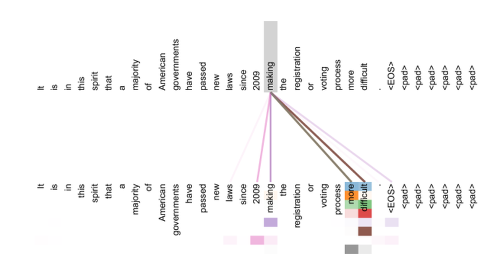
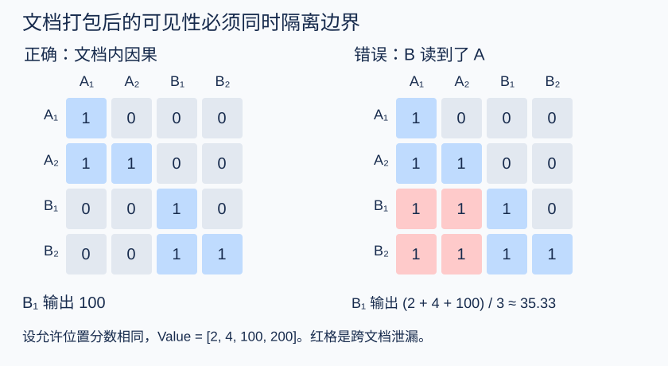
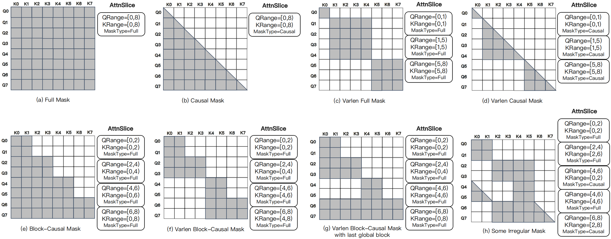

# 位置编码、Mask 与上下文

Attention 根据内容分数混合 Value。把两个 token 的位置交换以后，模型为什么会跟着改变输出？如果没有位置或可见性规则，输出通常只会相应交换，因为内容相关性本身没有告诉模型“谁先谁后”。

位置编码告诉模型位置关系，mask 决定哪些关系可以被读取。给未来 token 编号，并不能阻止当前 token 读取未来答案。

## 从一行注意力看可见性

某个 query 对三个 key 的原始分数都为零，Value 为 `(2,4,9)`。不加 mask 时权重各为三分之一，输出为 5。如果当前 query 只能看前两个位置，第三个分数在 softmax 前设为负无穷，权重变为 `(0.5,0.5,0)`，输出为 3。

因此 mask 应进入 softmax 的归一化之前。softmax 后仅把未来权重置零而不重新归一化，会改变权重总和和输出尺度。不同 API 的布尔 mask 可能分别表示“允许”或“禁止”，不能只根据变量名套用。

若一行所有位置都被禁止，直接对全负无穷做 softmax 可能产生 NaN，因为稳定 softmax 中的减最大值会遇到负无穷减负无穷。后面再乘零也不能保证修复，浮点运算中 NaN 乘零仍是 NaN。处理 padding query 时，需要在进入这一步之前决定如何跳过或安全计算这些行。

## 绝对位置与相对位置如何进入分数

一种方式给 embedding 加位置向量 \(x_t+p_t\)，让内容与位置共同进入 Q/K/V 投影。学习到的位置表只定义了训练过的索引范围，扩展表长需要额外方法，不能简单假定新位置同样可靠。

RoPE 将 query/key 的每两个通道按位置旋转。对一对通道，

\[
R(\theta)=\begin{bmatrix}\cos\theta&-\sin\theta\\\sin\theta&\cos\theta\end{bmatrix},\qquad
q_m'=R(m\omega)q_m,\quad k_n'=R(n\omega)k_n.
\]

内积满足 \((q_m')^\top k_n'=q_m^\top R((n-m)\omega)k_n\)。位置以相对位移形式进入分数，但分数仍取决于内容向量，不能说 attention 只看距离。

取 \(q=k=(1,0)\)，旋转差为零时内积 1，差为 \(\pi/2\) 时为 0，差为 \(\pi\) 时为 -1。真实模型使用多个频率和学习到的内容向量，远距离表现由训练分布与这些频率共同决定。

把一个非对称的数值例算完，能看出“相对位移”从哪里来。取 \(q=(1,2)\)、\(k=(3,4)\)、\(\omega=\pi/4\)，令 query 在位置 \(m=1\)，key 在位置 \(n=3\)。两者的旋转差是 \((n-m)\omega=\pi/2\)，所以

\[
q^\top R(\pi/2)k=(1,2)\begin{bmatrix}-4\\3\end{bmatrix}=2.
\]

如果把两个向量都在位置 1 旋转，旋转差变成 0，内积则回到 \(q^\top k=11\)。这两个结果的变化来自位置差和内容向量的共同作用。只把它记成“距离越远分数越小”会丢掉旋转方向与通道内容。

ALiBi 则为分数加入与距离相关的偏置，例如对过去位置加入 \(-m_h(i-j)\)。它不旋转向量，而是给各头不同的距离偏好。偏好近处仍不等于禁止远处，可见性由 mask 另外决定。

{ width="820" }

<small>图源：[Attention Is All You Need](https://arxiv.org/abs/1706.03762)，Figure 3。</small>

连线展示特定输入上一个注意力头的权重关系，可以跨过中间词读取远处内容。这是一次模型行为的可视化；它本身不能证明模型在任意长度上都能可靠使用位置信息。

## 两篇文档打包以后怎样隔离

把文档 A 的两个 token 和文档 B 的两个 token 拼成一条长度 4 的序列。若两篇文档应独立，允许矩阵为

\[
M=\begin{bmatrix}
1&0&0&0\\1&1&0&0\\0&0&1&0\\0&0&1&1
\end{bmatrix}.
\]

这里 1 表示允许。若 Value 为 `(2,4,100,200)` 且允许位置分数相等，四个输出为 `(2,3,100,150)`。如果误用普通全局因果 mask，文档 B 的第一个 token 会读到 A，输出变成 \((2+4+100)/3=35.333333\)。张量 shape 完全正常，训练目标却已经被污染。



Position id 是否在文档边界重置，是另一项设计。先看上面的 RoPE 内积公式。如果文档 B 的位置由 `[0,1]` 改成 `[2,3]`，query 与 key 都增加了 2，差值 \(n-m\) 没变。在 Q/K 内容向量、频率和可见关系相同的纯 RoPE 计算中，块内分数也不变。因此，单凭“相位变了”不能断言打包结果变了。

这个结论有明确前提。额外的绝对位置 embedding、随长度变化的频率规则，或只偏移新 query 却没有正确处理缓存 key，都需要另外检查。无论采用哪种位置编号，跨文档隔离仍由 mask 决定。

### 把允许矩阵真正算一遍

下面只用 Python 标准库，把每行分数设成零，重现前面的四个输出。`allowed[i][j]` 表示第 i 个 query 能否读取第 j 个 key。先定义矩阵，再检查因果性、当前位置和文档隔离，三个断言各管一件事。

```python
from math import exp, isfinite

document_ids = [0, 0, 1, 1]
values = [2.0, 4.0, 100.0, 200.0]
allowed = [
    [int(j <= i and document_ids[i] == document_ids[j]) for j in range(4)]
    for i in range(4)
]
assert allowed[2][3] == 0       # 文档 B 不能读取自身的未来
assert allowed[2][2] == 1       # 文档 B 的当前位置可见
assert allowed[2][0] == allowed[2][1] == 0  # 文档 B 不能读取文档 A

def masked_average(scores, values, row):
    visible = [j for j, permit in enumerate(row) if permit]
    if not visible:
        return 0.0            # 本教学实现约定空行输出零，跳过 softmax
    peak = max(scores[j] for j in visible)
    weights = [exp(scores[j] - peak) for j in visible]
    return sum(w * values[j] for w, j in zip(weights, visible)) / sum(weights)

output = [masked_average([0.0] * 4, values, row) for row in allowed]
padding_output = masked_average([0.0] * 4, values, [0, 0, 0, 0])
assert output == [2.0, 3.0, 100.0, 150.0]
assert padding_output == 0.0 and all(isfinite(x) for x in output)
print(output)
```

第三个断言要检查 B 到 A 的连接。只检查 `allowed[2][3] == 0`，只能证明未来位置不可见，普通全局因果 mask 也能通过，无法发现跨文档泄漏。可以把 A 的 Value 改成很大的数，确认 B 的两个输出仍保持 100 和 150，再有意去掉文档条件，观察第三个断言失败。

这里的空行分支是教学约定，输入分数和 Value 均假设为有限值。接入张量框架时，可以移除 padding query，或在 softmax 前给无效 query 安排一个有限的临时计算路径，再显式把输出置零。有效 query 仍不能读取 padding key，padding 对应的目标也要从 loss 中排除。仅把负无穷改成同一个有限负数，会让空行变成均匀权重，不能据此认为屏蔽已经正确。

{ width="820" }

<small>图源：[MagiAttention](https://arxiv.org/abs/2502.13138)，Figure 4。</small>

把每个小方格读作一对 query 与 key 的可见关系。本文的两篇文档对应块内因果、块间隔离；视频或混合任务还可能需要其他模式。先确定任务允许哪些边，再选择支持该模式的实现。

## 标签右移还要单独检查

一段 `[BOS,A,B,EOS]` 通常形成输入 `[BOS,A,B]` 与目标 `[A,B,EOS]`。若直接连接多篇文档再整体右移，文档末尾可能被要求预测下一篇的起始 token。是否允许这种跨文档目标，应按预训练定义决定；独立样本的 SFT 通常需要屏蔽相应边界。

Loss mask 只决定哪些目标计入损失，attention mask 决定表示能读哪些输入。即使边界 label 不计算 loss，错误 attention 仍可能让后续位置读取不应可见的信息。

## 长上下文和缓存增加哪些要求

生成新 token 时，缓存中的 key 往往已经带有对应位置变换，新 query 必须使用正确的绝对位置或位置偏移。复用一个前缀不仅要求文本相同，还要求模型、适配器、位置处理和其他影响 KV 的条件相同。

改变 RoPE 频率或扩展位置范围，只处理了长上下文的一部分问题。更长前缀还增加 KV 存储与读取，训练数据是否覆盖远距离检索、mask是否正确、短上下文能力是否退化，都需要评估。文本长度能通过 shape 检查，不代表模型有效利用了全部内容。

图片和视频还有二维/三维位置。空间坐标、帧时间、帧率和裁剪顺序都影响 token 的含义。把视频 flatten 成一条序列以后，这些关系仍需通过位置设计或结构保存，不能只看总 token 数。

## 源码对照

- [LLMs from scratch 的 MultiHeadAttention](https://github.com/rasbt/LLMs-from-scratch/blob/cdbd33e6d57a71e20ea31434841095fac50cecd8/ch04/01_main-chapter-code/gpt.py)，它构造上三角禁止mask，在softmax前填入负无穷；这份教学模型的位置embedding与RoPE是不同实现。

- [RoFormer](https://arxiv.org/abs/2104.09864)给出旋转位置编码的推导。
- [序列与掩码数学](../prerequisite-math/sequence-position-and-masking.md)可对照索引、张量轴与概率分解。

**来源与改编说明**：RoFormer、Attention Is All You Need 和 MagiAttention 用于核对位置表示与 mask 的定义；4×4 文档隔离矩阵、均匀 Value 例子和 Python 断言由本站重写。页面中的 mask 约定以“1 表示允许”为例，接入具体框架时仍需按 API 文档核对布尔含义。

读完这里的 mask 后，可以回到[一次 attention 的完整计算](transformer-attention-and-tokenization.md)复算 Q、K、V 的轴；长上下文的缓存、淘汰和位置边界见[上下文压缩与 KV 分层](../inference/context-compression-kv-eviction-and-memory-hierarchies.md)。
