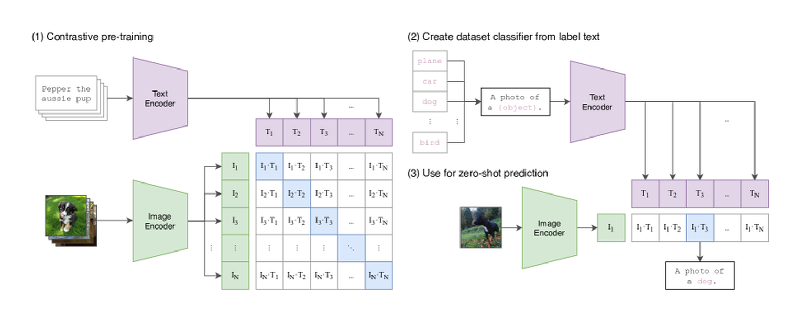
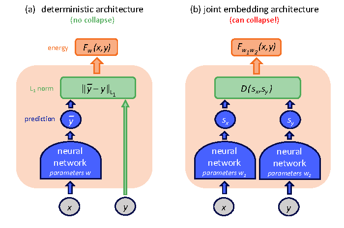
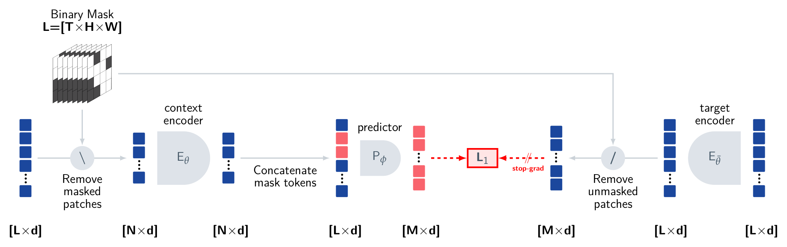
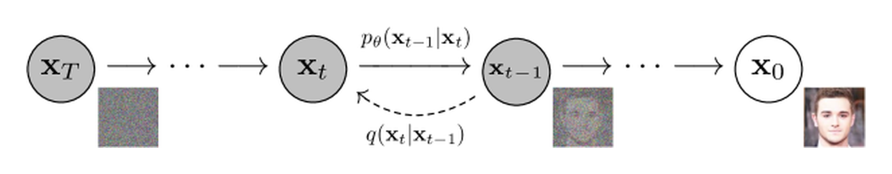

# 预训练目标与表示学习

同一批图片可以用来训练分类器、重建器、图文检索器或生成器。数据相同，目标不同，模型必须保留的信息也不同。理解表示学习，需要看模型从什么输入预测什么目标，以及哪些错误会被损失惩罚。

先用两张图片说明对比学习。一张是杯子，一张是鞋；每张图片各做两种增强，形成两对应该匹配的视图。编码器把视图映射为向量，再比较相似度。它没有被直接告知“杯子”这个类别名，监督来自“这两个视图出自同一张图”。

## 一张相似度矩阵怎样产生学习信号

设第一组视图作为 query、第二组作为 key，温度缩放后的相似度矩阵为

\[
S=\begin{bmatrix}2&0\\0&2\end{bmatrix}.
\]

每行正确匹配在对角线上。对第一行 softmax 得 `(0.880797,0.119203)`，交叉熵为 \(-\log0.880797=0.126928\)，第二行相同。对第一行 logits 的梯度为 `(-0.119203,0.119203)`，因此更新会提高正确配对分数、降低错误配对分数。

相似度如果来自归一化向量点积，梯度还会继续传进向量与编码器。温度越低，相同点积差异会被放大，但实际梯度和训练难度同时改变，不能只把温度理解成“增强区分能力”的开关。

```python
import math
scores = [[2.,0.], [0.,2.]]
for i,row in enumerate(scores):
    weights = [math.exp(v-max(row)) for v in row]
    probs = [v/sum(weights) for v in weights]
    print(round(-math.log(probs[i]),6),
          [round(p-(j==i),6) for j,p in enumerate(probs)])
```

两行损失都是 0.126928，梯度符号指向各自的正确匹配。真实 batch 通常包含更多候选，负样本构成和重复语义会影响训练。

## 正样本定义了希望保留什么

如果杯子的颜色变化仍被当作正对，目标鼓励表示忽略颜色；但下游任务恰好需要“找红杯子”时，过强颜色不变性就可能有害。若裁剪只留下背景，而另一视图主要是物体，模型可能学到背景相关性。

同类图片还可能在 batch 中被当成负对，产生 false negative。对比学习并不天然知道语义类别，只优化已构造的配对关系。图文 CLIP 把正对换成图像与配套文本，仍需要考虑文本是否遗漏数量、位置或细节。

{ width="820" }

<small>图源：[Learning Transferable Visual Models From Natural Language Supervision](https://arxiv.org/abs/2103.00020)，Figure 1。</small>

左侧相似度矩阵把匹配图文放在对角线上，与上面的两样本计算对应。右侧把类别名写成文本再比较相似度，用的是同一表示空间，但任务已从配对训练变成分类。

## 为什么“让两个表示接近”可能坍缩

假如损失只有 \(\|f(x_1)-f(x_2)\|^2\)，所有输入都映射成常量向量就能使损失为零，却没有保留任何区分信息。对比学习中的负样本提供排斥作用；其他方法可能使用预测器、停止梯度、教师平滑、方差或协方差约束。

这些组件要一起看。把一个 `detach()` 单独复制进任意网络，不保证表示不会坍缩。更抽象的 latent 目标也不自动更适合任务，目标表示若丢掉接触、方向或时间信息，学生最多学会同样的遗漏。

{ width="820" }

<small>图源：[H-JEPA 精读](../paper-deep-dives/world-models/h-jepa.md)，Figure 5。</small>

左侧预测直接对照给定目标 y，右侧连目标表示也由可学习编码器产生。右侧如果两个编码器都输出常量，距离同样很小；这正是需要额外训练设计约束的退化解。图比较的是目标结构，不是对某个训练结果的测量。

## 预测下一个 token 学到哪些关系

语言模型的输入是前缀，目标是下一个 token，损失为负 log 概率。整个序列可分解为 \(p(x_{1:T})=\prod_t p(x_t\mid x_{<t})\)。文本中的语法、事实关联、程序结构和推理模式都可能帮助预测，因此训练能产生广泛能力。

但是目标仍然奖励训练数据中出现的续写。它不直接验证句子为真，也不天然区分可靠知识与错误陈述。将网页噪声、代码、数学推导按不同权重混合，会改变模型收到的预测信号，参见[数据怎样成为样本](data-and-dataset-basics.md)。

## Masked modeling 为什么要控制可见内容

遮掉输入的一部分，再要求预测被遮内容，可以让模型使用周围上下文。关键在于目标是否通过其他路径泄漏。例如预测图像 patch，却在全局预处理或教师特征中直接混入该 patch 的信息，任务可能比设计者以为的简单。

预测离散 token、原始像素和教师 embedding 也不是同一目标。像素重建会强烈关注纹理和精确颜色，教师表示可能压缩这些细节，但它保留的内容由教师训练决定。选择目标空间，实质是在选择误差在哪些方向上有代价。

{ width="820" }

<small>图源：[V-JEPA: Latent Video Prediction for Visual Representation Learning](https://arxiv.org/abs/2404.08471)，Figure 3。</small>

左侧 context encoder 只接收可见 patches，predictor 结合 mask tokens 预测缺失位置的表示；右侧 target encoder 产生监督目标。沿两条输入路径读图，才能区分学生可见内容与训练时构造的教师目标。

## 重建、去噪与行为模仿

自编码器把输入压缩后重建，瓶颈限制模型能保存多少信息。没有合理限制时，网络可能学习接近恒等映射；限制过强又会丢失下游所需细节。

去噪先按已知规则扰动输入，再预测噪声、干净数据或速度等目标。不同参数化可通过代数变换关联，但损失权重和不同噪声水平的梯度尺度可能不同，因此“目标可换算”不等于“训练过程完全等价”。生成时还需指定采样器，把学到的局部预测组合成样本。

{ width="820" }

<small>图源：[Denoising Diffusion Probabilistic Models](https://arxiv.org/abs/2006.11239)，Figure 2。</small>

图上方 pθ 路径逐步生成，下方 q 路径按设定加噪。训练时可由数据构造某一噪声水平的监督，生成时却没有干净目标可读，必须逐步使用模型预测。

行为克隆用观测和指令预测示范动作。均方误差对应一类条件均值估计，面对左绕和右绕两种合理动作时，平均动作可能撞向中间障碍。即便离线预测很好，执行后到达示范中少见的状态，也可能连续犯错。这时问题涉及动作分布与闭环反馈，详见[VLA](../vla/index.md)。

## 用目标解释能力边界

看到一种预训练方法，可以沿三项具体检查继续读：哪些输入在预测时可见，目标由谁产生，损失对哪些差别敏感。三项足以解释很多表面矛盾。例如检索表示能识别“杯子”，却未必知道杯柄坐标；视频重建逼真，未必学会动作改变未来；next-token loss下降，也未必提升带验证器的任务成功率。

下游评价需要与使用目标接上。冻结表示做线性分类、允许端到端微调、执行闭环控制，测到的是不同能力，不能把一个设置中的优势直接推广到全部使用方式。

## 参考材料

- [CLIP](https://arxiv.org/abs/2103.00020)展示图文对比目标与开放词汇迁移。
- [Masked Autoencoders](https://arxiv.org/abs/2111.06377)展示高比例遮挡下的图像重建。

- [LLMs from scratch 的数据集与GPT实现](https://github.com/rasbt/LLMs-from-scratch/blob/cdbd33e6d57a71e20ea31434841095fac50cecd8/ch04/01_main-chapter-code/gpt.py)，可对照移位标签的构造、因果mask和模型前向；该文件不包含交叉熵训练循环。
