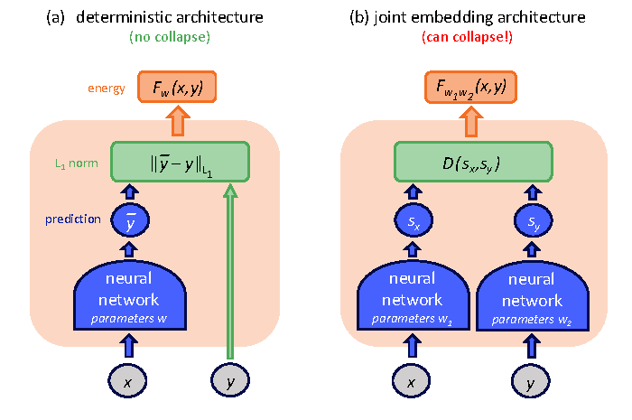

# 预训练目标与表示学习：模型到底被要求学什么

预训练目标不是训练脚本里的一行 loss。它在规定模型看见什么、预测什么、哪些差异要保留、哪些差异可以忽略。LLM 的 next-token、BERT/MAE 的 masked modeling、CLIP 的对比学习、扩散的 denoising、V-JEPA 的 latent prediction、VLA 的 behavior cloning，表面都是“让模型学表示”，实际学到的接口很不一样。

这页只回答一个核心问题：**读到一个预训练目标时，怎样判断它让模型学到了什么表示，又没有学到什么能力？**

!!! tip "数学先修"
    本文会用到[熵、KL 与互信息](../prerequisite-math/information-theory-and-divergence.md)比较训练目标，用[潜变量、ELBO、score 与 flow](../prerequisite-math/latent-likelihood-and-generative-objectives.md)理解生成式目标，并用[表示空间与内积](../prerequisite-math/linear-algebra-and-geometry.md)解释对比学习。

## 目标函数是在写信息接口

一个预训练样本可以抽象成：

\[
x \rightarrow h_\theta(x) \rightarrow \hat{y}
\]

\(x\) 是模型看到的输入，\(h_\theta(x)\) 是中间表示，\(\hat y\) 是模型被要求预测的目标。loss 会把某些信息压进 \(h_\theta(x)\)，也会允许模型丢掉另一些信息。表示学习的核心不是“向量越强越好”，而是这个向量对目标 \(y\) 是否足够，对无关扰动是否稳定。

所以读目标函数时先问三件事。第一，目标 \(y\) 是什么：下一个 token、mask 区域、匹配关系、原始像素、噪声、未来 latent，还是专家动作？第二，模型能偷懒吗：是否可以靠局部纹理、数据偏差、语言先验或静态背景拿低 loss？第三，下游任务需要的变量是否在目标里出现：动作、reward、风险、时间一致性、工具执行、事实证据有没有进入训练信号？

## Next-token：预测续写，不等于验证事实

自回归语言模型的基础目标是最大化序列似然：

\[
\mathcal{L}_{\text{NTP}}=-\sum_t \log p_\theta(x_t\mid x_{<t})
\]

它要求模型根据历史前缀预测下一个 token。这个目标极其可扩展，因为文本、代码、图像 token、视频 token、动作 token 都可以排成序列。模型为了降低 loss，会学语法、知识、风格、代码模式、推理痕迹和很多隐含结构。

但 next-token 的训练信号只告诉模型“数据里下一个 token 常是什么”。它不直接验证事实是否真实、代码是否运行、工具调用是否成功、动作是否安全。后训练、RAG、verifier、RL、结构化解码和评测系统，本质上是在补 next-token 没有显式定义的外部约束。

一个常见误解是：next-token 太简单，所以只能学表面统计。更准确的说法是：简单目标可以在巨大数据和模型容量下诱导丰富能力，但这些能力的边界取决于数据分布和评测接口。模型会学会“像训练语料里的正确答案”，不自动拥有“对现实世界负责”的机制。

## Masked modeling：补空缺时学上下文结构

Masked modeling 把输入的一部分遮住，让模型预测被遮住的内容：

\[
\mathcal{L}_{\text{mask}}=\sum_{i\in M}\ell(\hat{x}_i,x_i)
\]

BERT 预测被 mask 的文本 token；MAE 把图像切成 patch，只编码少量可见 patch，再重建被遮住的像素；V-JEPA 则预测 target encoder 产生的 latent，而不是复原像素。

这三者差别很关键。预测 token 会学语义和语言上下文；预测像素会保留低层视觉细节；预测 latent 会鼓励模型忽略一些纹理噪声，保留更抽象的时空结构。目标看起来都叫 mask，表示学到的东西却不同。

{ width="760" }

<small>图源：[V-JEPA: Latent Video Prediction for Visual Representation Learning](https://arxiv.org/abs/2404.08471)，Figure 3。原图表达 context encoder 只处理未遮挡视频 token，predictor 结合 context output 和 mask tokens 去预测 target encoder 的 masked token representations。本站读法是看预测目标：V-JEPA 不是让模型画回像素，而是让模型在 latent 空间补全缺失时空结构，因此它更像表征预训练，不是完整动作世界模型。</small>

Masked 目标的边界也在这里。它能学上下文和结构，但不保证自回归生成能力；能学视频表征，但如果没有 action、reward、done 或 closed-loop 反馈，就不能直接说明模型会规划。

## Contrastive learning：正负样本定义了不变性

对比学习的核心是：把正样本拉近，把负样本推远。InfoNCE 常见写法是：

\[
\mathcal{L}_{\text{InfoNCE}}
=-\log
\frac{\exp(\operatorname{sim}(q,k^+)/\tau)}
{\exp(\operatorname{sim}(q,k^+)/\tau)+\sum_j\exp(\operatorname{sim}(q,k_j^-)/\tau)}
\]

这里 \(q\) 是 query 表示，\(k^+\) 是正样本，\(k_j^-\) 是负样本，\(\tau\) 是 temperature。这个公式真正重要的不是分母长什么样，而是正负样本怎么定义。

在 SimCLR 里，同一张图的两种增强视图是正样本，所以表示会对 crop、color jitter、blur 等增强保持稳定。在 CLIP 里，图像和配套文本是正样本，所以模型学的是图文语义对齐，而不是像素重建或动作后果。

{ width="830" }

<small>图源：[Learning Transferable Visual Models From Natural Language Supervision](https://arxiv.org/abs/2103.00020)，Figure 1。原图表达 CLIP 用大量 image-text pairs 做对比预训练，再把类别写成文本 prompts，通过图文 embedding 相似度完成 zero-shot prediction。本站读法是：CLIP 的表示适合语义检索和开放类别识别，但图文相似度高不等于会预测物体被推动后的状态。</small>

对比学习的能力来自“哪些变化被视作同一个对象”。如果增强策略把小物体、文字、空间位置或接触点当成可忽略扰动，表示就可能在机器人、OCR、图表理解里丢掉关键细节。正样本和负样本不是采样小事，而是在写模型的不变性。

## 表示坍缩：prediction loss 很低，表示却什么都没留下

joint embedding 方法常比较两个表示：

\[
\mathcal L_{\mathrm{pred}}
=
\left\|
p_\theta(h_c(x))
-
\operatorname{sg}(h_t(y))
\right\|_2^2
\]

\(h_c\) 是 context / student encoder，\(h_t\) 是 target / teacher encoder，\(p_\theta\) 是 predictor，\(\operatorname{sg}\) 表示 stop-gradient。这个目标希望 context 表示能预测 target 表示。

但如果两边都对任意输入输出同一个常数向量 \(c\)：

\[
h_c(x)=h_t(y)=c
\]

那么 prediction loss 也能接近 0。模型看起来“预测得完美”，实际没有保留输入差异，这就是 representation collapse。

{ width="680" }

<small>图源：[H-JEPA 精读](../paper-deep-dives/world-models/h-jepa.md)，Figure 5。原图比较普通确定性预测和 joint embedding 的坏解：如果两个 encoder 都输出常数，表示距离可以很小。本站用它说明 loss 低只证明目标被满足，不证明表示仍携带信息。</small>

防 collapse 的方法在解决不同问题：

| 机制 | 它阻止什么捷径 | 它不能单独证明什么 |
| --- | --- | --- |
| Negative samples | 把不匹配样本也映到同一点 | 高维空间的负样本已覆盖所有错误区域 |
| stop-gradient | 两条分支被同一 loss 同时拖向常数 | target 表示本身有信息 |
| EMA teacher | target 每步变化过快、两边互相追逐 | teacher 学到的 invariance 对下游正确 |
| variance regularization | 某个表示维度在 batch 内变成常数 | 不同维度没有重复编码 |
| covariance regularization | 多个表示维度高度冗余 | 表示保留了动作、风险或几何 |
| bottleneck / capacity constraint | latent 直接偷带完整答案 | 瓶颈后的信息足以支持所有任务 |

VICReg 风格的 variance penalty 可以写成：

\[
\mathcal L_{\mathrm{var}}
=
\frac{1}{d}
\sum_{j=1}^{d}
\max
\left(
0,
\gamma-
\sqrt{\operatorname{Var}(z_j)+\epsilon}
\right)
\]

如果第 \(j\) 个表示维度在整个 batch 几乎不变，标准差会低于阈值 \(\gamma\)，从而受到惩罚。covariance penalty 则压低不同维度间的冗余：

\[
\mathcal L_{\mathrm{cov}}
=
\frac{1}{d}
\sum_{i\ne j}
\operatorname{Cov}(z)_{ij}^2
\]

这两项一边要求每个维度保持变化，一边减少维度之间重复表达。协方差的数学含义见[概率论、分布与期望](../prerequisite-math/probability-distributions-and-expectation.md)。

V-JEPA 采用 EMA target encoder 和 stop-gradient，让 predictor 追一个变化更慢的目标；H-JEPA 的讨论还强调 latent capacity 和 regularized energy landscape。它们都在提醒同一件事：**prediction error 只是第一张账，表示是否有信息要靠 anti-collapse 约束和独立下游评测证明。** stop-gradient、EMA 和不同梯度路径的关系见[梯度估计、离散变量与训练信号](gradient-estimators-and-training-signals.md)。

## Reconstruction：重建细节，不等于保留任务状态

Reconstruction 目标让模型从压缩表示还原输入：

\[
\mathcal{L}_{\text{rec}}=d(g_\theta(h_\phi(x)),x)
\]

Autoencoder、VAE、视觉 tokenizer、视频 VAE 都会用这类目标。它的优势是直观：如果表示能还原输入，说明它保留了大量信息。它的风险也直观：输入里有很多下游不需要的细节，模型可能把容量花在纹理、背景、压缩伪影和静态外观上。

对于生成模型，重建目标常常服务于“把高维像素压到可建模 latent”。Latent diffusion 的 VAE 就是先把图像压到 latent，再在 latent 上训练扩散模型。对于世界模型和 VLA，问题更尖锐：一个 latent 能重建画面，不代表它保留了接触力、可抓取性、风险、动作后果或可规划状态。

因此读 reconstruction 论文时要分清：它是在训练压缩器、视觉 tokenizer、生成 decoder，还是在训练 planner 可用的状态表示。重建好只是第一层证据。

## Denoising：学分布方向，而不是一次性输出答案

扩散模型把干净样本逐步加噪，再训练模型从带噪状态恢复：

{ width="620" }

<small>图源：[Denoising Diffusion Probabilistic Models](https://arxiv.org/abs/2006.11239)，Figure 2。原图表达前向过程 \(q(x_t\mid x_{t-1})\) 逐步加噪，反向过程 \(p_\theta(x_{t-1}\mid x_t)\) 逐步去噪。本站读法是：denoising 目标不是让模型一步输出最终样本，而是在不同噪声水平学习回到数据分布的方向。</small>

常见训练目标是预测噪声、干净样本、velocity 或 score 的等价形式。它和 next-token 不同：next-token 每步选择离散 token，denoising 则在噪声层级上反复更新样本。这个目标很适合图像、视频、动作轨迹等多峰输出，因为它不必把多个合理结果平均成一个均值。

边界也清楚。训练好 denoising 不等于少步采样一定稳定；图像质量高不等于条件控制强；视频生成连贯不等于能闭环规划。采样器、guidance、distillation、条件编码和评测都会改变最终系统行为。

## Behavior cloning：模仿专家，不等于会恢复

行为克隆把策略学习写成监督学习：

\[
\mathcal{L}_{\text{BC}}=-\log \pi_\theta(a_t\mid o_{\le t},l)
\]

\(o_{\le t}\) 是历史观测，\(l\) 是语言或任务条件，\(a_t\) 是专家动作。连续动作也可以用 L1/MSE 或 action diffusion 目标；离散动作可以像 token 一样做 cross entropy。

BC 的优点是稳定、可扩展、能直接吃示范数据。RT-1、RT-2、Open X-Embodiment 和很多 VLA 都依赖这种思想：把机器人行为变成大规模监督学习问题。

但 BC 学的是“专家分布上的动作”。一旦部署时进入专家数据少见的状态，模型可能不知道怎么回来，这就是 covariate shift。它也不直接学习探索、长期 credit assignment、失败恢复或安全约束。要让 VLA 真正可用，通常还需要数据回流、闭环评测、risk head、世界模型、MPC、offline RL 或在线微调。

## 目标函数要和最终接口对齐

不同目标对应不同接口：

| 目标 | 最擅长提供什么 | 最容易漏掉什么 |
| --- | --- | --- |
| next-token | 续写、代码、语言知识、序列统一接口 | 事实验证、工具执行、动作安全 |
| masked modeling | 上下文补全、局部到全局结构 | 自回归生成、因果动作后果 |
| contrastive | 检索、语义对齐、开放类别识别 | 细粒度几何、生成细节、动力学 |
| joint embedding prediction | 可迁移的抽象表示、时空预测特征 | collapse、动作后果和任务充分性 |
| reconstruction | 压缩、tokenizer、decoder、保真细节 | 抽象任务状态、风险和可规划性 |
| denoising | 多峰生成、图像/视频/动作分布 | 少步稳定、条件忠实、闭环控制 |
| behavior cloning | 模仿专家动作、快速策略学习 | 分布外恢复、探索、长期规划 |

这张表不是让人选一个“最好目标”，而是提醒：目标函数是在定义模型最先学会的接口。现代系统常常把多个阶段串起来：next-token 打底，SFT 对齐指令，RAG 补外部事实，RL 或 verifier 改善任务收益；VLM 用 contrastive 或 captioning 对齐图文，再接 LLM；VLA 用 web-scale VLM 先学语义，再用机器人数据把语义接到动作。

## 读完以后怎么判断

预训练目标决定模型被奖励去保留什么信息。Next-token 奖励可续写性，masked modeling 奖励上下文补全，contrastive 奖励正样本不变性，reconstruction 奖励可还原性，denoising 奖励分布方向，behavior cloning 奖励专家动作匹配。

读论文时不要只问“loss 降了吗”，要问目标是否包含下游需要的变量。CLIP 学到图文语义，不等于学到动作后果；V-JEPA 学到视频 latent，不等于直接能闭环控制；BC 学到专家动作，不等于能从偏离状态恢复；扩散学到生成分布，不等于少步实时控制。把目标和接口对齐，才知道一个预训练方法该期待什么、不该期待什么。

## 外部精读

- [BERT](https://arxiv.org/abs/1810.04805)
- [MAE](https://arxiv.org/abs/2111.06377)
- [SimCLR](https://arxiv.org/abs/2002.05709)
- [CLIP](https://arxiv.org/abs/2103.00020)
- [BYOL](https://arxiv.org/abs/2006.07733)
- [VICReg](https://arxiv.org/abs/2105.04906)
- [The Illustrated CLIP](https://jalammar.github.io/illustrated-clip/)
- [V-JEPA](https://arxiv.org/abs/2404.08471)
- [DDPM](https://arxiv.org/abs/2006.11239)
- [RT-1](https://robotics-transformer1.github.io/)
- [Decision Transformer](https://arxiv.org/abs/2106.01345)

## 相关阅读与下一步

- 外部材料：[The Illustrated Transformer](https://jalammar.github.io/illustrated-transformer/)。
- 外部材料：[Dive into Deep Learning](https://d2l.ai/)。
- 外部材料：[Distill Circuits](https://distill.pub/2020/circuits/visualizing-weights/)。
- 站内下一步：[基础概念专题](index.md)。
- 站内下一步：[Transformer 输入与注意力](transformer-attention-and-tokenization.md)。
- 站内下一步：[数值、内存与运行时基础](numerics-memory-and-runtime-basics.md)。
