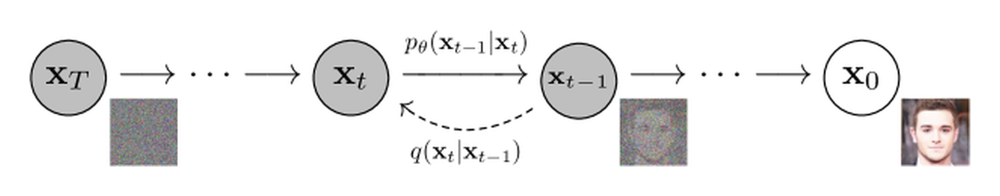

# 概率与潜变量模型

生成模型的目标不是记住训练样本，而是学习数据背后的分布，并从这个分布中采样出新样本。


{ width="620" }

<small>图源：[Denoising Diffusion Probabilistic Models](https://arxiv.org/abs/2006.11239)，Figure 2。原论文图意：前向过程 \(q(x_t\mid x_{t-1})\) 逐步加噪，反向生成过程 \(p_\theta(x_{t-1}\mid x_t)\) 逐步去噪，从噪声链条恢复数据样本。</small>

## 符号卡：概率页先认这些

看到 \(p\) 和 \(q\) 时先不要慌。一个很常见的约定是：\(p_\theta\) 负责“生成或预测”，\(q_\phi\) 负责“看到真实数据后反推 latent”。不同论文会有差异，但先按这个方向读通常不容易迷路。

## 分布是什么

可以把数据看成来自某个未知分布：

\[
x \sim p_{\text{data}}(x)
\]


生成模型希望学一个模型分布 \(p_\theta(x)\)，让它接近真实数据分布。

如果是条件生成，例如文生图，则写成：

\[
p_\theta(x \mid c)
\]


其中 \(c\) 可以是文本、类别、图像、动作或其他条件。

## 潜变量为什么有用

很多数据背后有隐藏因素。例如一张人脸图片背后可能有姿态、光照、表情、身份、背景等因素。潜变量 \(z\) 用来表示这些隐藏结构：

\[
p_\theta(x) = \int p_\theta(x \mid z)p(z)\,dz
\]


直觉上，潜变量像草稿或内部状态。模型先在潜空间里组织结构，再把它解码成可见样本。

### 2.1 潜变量不是一个东西，而是一类“内部草稿”

读后面的论文专题时，最容易卡住的一点是：大家都在说 latent，但含义并不完全一样。可以把 latent 想成厨师做菜前的“备菜台”：有的 latent 是一张图片的压缩草图，有的是一段视频的时空压缩，有的是智能体脑中的当前局势，有的是扩散模型从噪声走向样本的中间状态。

| 场景 | latent 在表示什么 | 它服务谁 |
| --- | --- | --- |
| VAE / 视频 VAE | 把像素压成更短、更容易建模的连续表示 | 让 DiT / U-Net 不必直接处理高分辨率像素 |
| 扩散模型 | \(x_t\) 是从干净样本到噪声之间的中间状态 | 让模型学会一步步把噪声推回数据分布 |
| RSSM / Dreamer | belief state 同时记住历史和当前不确定性 | 让 agent 在脑内 rollout，训练 actor / critic |
| JEPA / V-JEPA | 被预测的不是像素，而是抽象表示 | 让模型学“世界结构”，不被纹理细节拖住 |

{ width="860" }

<small>图源：[Learning Latent Dynamics for Planning from Pixels](https://arxiv.org/abs/1811.04551)，Figure 2。原论文图意：比较 RNN、SSM 和 RSSM 三种 latent dynamics 设计；RSSM 同时保留 deterministic hidden state 和 stochastic state，用于从像素学习可规划的潜空间动力学。</small>

!!! note "怎么读这张图"
    这张图可以把 latent 的作用讲得很直观：模型并不想在像素上直接规划，而是先把过去看到的画面和动作压进内部状态。RNN 路线像一本连续日记，擅长记历史；SSM 路线像每一步都抽一次签，擅长表达不确定性；RSSM 把二者合起来，既有长期记忆，也有随机潜状态。Dreamer 系列后来能在 latent space 里“想象未来”，靠的就是这种内部草稿足够稳定。

所以，看到论文里写 latent，不要马上把它翻译成“隐藏向量”就结束。更应该追问三件事：这个 latent 保留了哪些信息，丢掉了哪些细节；它能不能被稳定 rollout；它最后是服务生成画面、压缩计算，还是服务决策。

### 2.2 算一遍：小概率漏报会怎样放大

世界模型常见失败不是每一步都错，而是每一步都有一点点没校准的风险。假设 risk head 对“接触即将失败”的漏报率是 `5%`。单步看似不大，但 `20` 步 rollout 中至少漏一次的概率是：

\[
1 - (1-0.05)^{20} \approx 64.2\%
\]


这就是为什么世界模型不能只报一个最可能未来。若未来分布是多峰的，均值预测可能看起来 loss 低，却会把“会滑落”和“能抓稳”平均成一个模糊中间态。对 planner 来说，中间态不是保守，而是危险：它既不对应真实可执行动作，也低估了长尾风险。

一个更可用的判断链是：

```text
症状：open-loop 画面平均还行，长 horizon 决策越来越漂
指标：NLL / calibration、risk recall、ensemble disagreement、action sensitivity、rollout horizon 曲线
机制：单峰 likelihood 或 MSE 会压平多模态未来，不确定性没进决策
取舍：随机 latent、ensemble、分位数 risk、explicit done/risk head、短 horizon 重规划
反例：如果任务低噪声、单峰、短 horizon，复杂不确定性头可能只增加训练和部署成本
边界：likelihood 高不等于可规划；latent 省 token 也不等于保留了行动相关状态
```

## Likelihood、KL 和 ELBO

很多生成模型想最大化 likelihood：

\[
\max_\theta \log p_\theta(x)
\]


但带潜变量时，真实 likelihood 往往难算，所以会用 ELBO 这类可优化下界。

ELBO 常见形式可以粗略理解为：

\[
\text{ELBO} = \text{重建质量} - \text{潜变量分布偏离先验的代价}
\]


这解释了为什么 VAE 既要重建样本，又要约束 latent 不要乱跑。

!!! note "公式拆读：ELBO 不用一开始就会推导"
    初学者先把 ELBO 读成两股力：一股力让模型从 latent 还原出像真实数据的样本，另一股力让 latent 分布别跑得太散、太怪。前者保证有用，后者保证可采样、可泛化。扩散、VAE、RSSM 和世界模型虽然公式不同，但常常都在平衡“解释观测”和“约束内部状态”。

## Score 和扩散模型

Score 指的是：

\[
\nabla_x \log p(x)
\]


它表示在当前位置，往哪个方向走会更接近高概率数据区域。扩散模型可以理解为学习一个随噪声时间变化的 score field 或等价的噪声预测器。

这也是为什么扩散采样可以被看成“从噪声往数据分布走回去”。

## 采样：从分布到具体样本

训练得到分布还不够，最终要采样出具体样本：

```text
z = sample_prior()
for step in sampling_steps:
    z = denoise_or_update(z, condition)
x = decode(z)
```

不同生成模型的差异，很多时候就体现在 `denoise_or_update` 怎么定义。

## 和后续专题的关系

- [扩散模型路线图](../diffusion/index.md)：理解加噪、去噪和 score。
- [Score Matching 到 SDE](../diffusion/score-matching-sde-and-probability-flow.md)：理解连续时间生成轨迹。
- [世界模型路线图](../world-models/index.md)：理解潜状态、未来预测和动作条件分布。
- [量化](../quantization/index.md)：低精度误差最终也会改变模型分布。

## 本页结论

生成模型的核心问题是：如何表示分布、如何训练分布、如何从分布采样。只要这三件事清楚，扩散、VAE、世界模型和视频生成之间的关系会更容易理解。
