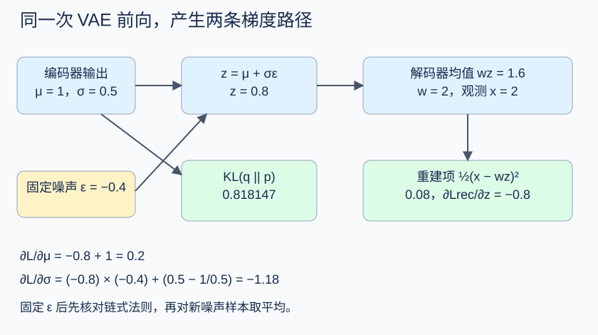
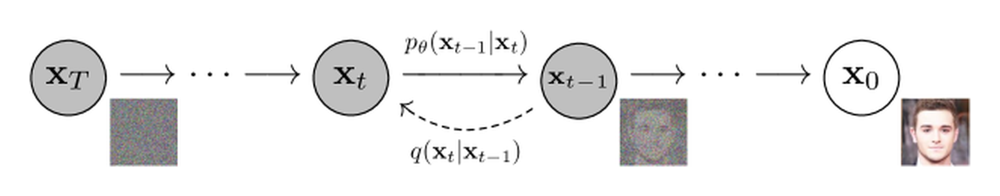
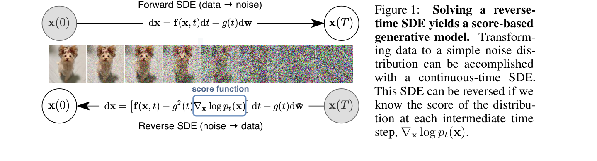
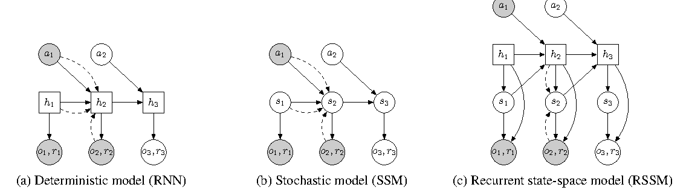

# 概率与潜变量模型

给定同一张模糊图片，可能有几种合理的清晰结果。只输出一个均值，会把不同可能性叠在一起。生成模型尝试描述这些结果出现的概率；潜变量模型进一步用一个未被直接观测的变量 \(z\)，表示造成结果差异的因素。

本文用一个标量 VAE 连续算完生成、推断、损失和梯度。它只有一个观测值，当然不能生成真实图片，但能看清大模型中编码器和解码器各自在优化什么。高维版本只是把这些标量换成向量与神经网络。

## 先写出生成方向

假定潜变量的先验是 \(p(z)=\mathcal N(0,1)\)，观测模型是 \(p_\theta(x\mid z)=\mathcal N(wz,1)\)。先抽 \(z\)，再围绕 \(wz\) 抽 \(x\)，便得到一个生成过程。这里 \(w\) 是解码器参数，单位方差是为便于计算而固定的设定。

联合密度可以分解为

\[
p_\theta(x,z)=p(z)p_\theta(x\mid z),\qquad
p_\theta(x)=\int p(z)p_\theta(x\mid z)\,dz.
\]

后一项把所有可能的隐藏解释加起来。这个线性高斯例子能解析积分；换成复杂神经网络后，积分通常难算。因此训练的困难并非“不能生成样本”，而是难以评价并优化每个真实观测的边缘似然。

概率密度也不等于取到某个精确实数的概率。密度需在区间积分才得到概率，单位随变量尺度变化；不同预处理下的密度数值不能直接横比。

## 观察到数据以后，需要反向推断

现在观测到 \(x=2\)。我们想知道哪些 \(z\) 更可能产生它，贝叶斯公式给出

\[
p_\theta(z\mid x)=\frac{p(z)p_\theta(x\mid z)}{p_\theta(x)}.
\]

这个后验依赖解码器及观测。VAE 用编码器输出一个可计算的近似后验 \(q_\phi(z\mid x)=\mathcal N(\mu,\sigma^2)\)，参数 \(\mu,\sigma\) 随输入变化。它不是先验，也不是说每个观测只对应唯一隐状态。

取当前编码器输出 \(\mu=1,\sigma=0.5\)，解码器参数 \(w=2\)。这只是一次训练中的参数状态，还没证明近似后验接近真实后验。

## 为什么同时出现重建项和 KL

把 \(q_\phi\) 乘除进边缘似然，再应用 Jensen 不等式，可以得到

\[
\log p_\theta(x)\ge
\mathbb E_{q_\phi(z\mid x)}[\log p_\theta(x\mid z)]
-\mathrm{KL}(q_\phi(z\mid x)\|p(z))
=\operatorname{ELBO}.
\]

第一项希望抽到的隐变量能解释观测；第二项惩罚编码器分布偏离生成时使用的先验。若训练时每个样本占据一个孤立的潜空间区域，而生成时却从标准正态采样，就可能落到解码器没学过的地方。KL 提供连接这两个过程的约束，但不能单独保证潜空间的每个点都产生好结果。

下界与真实 log 似然的差有精确含义

\[
\log p_\theta(x)-\operatorname{ELBO}
=\mathrm{KL}(q_\phi(z\mid x)\|p_\theta(z\mid x)).
\]

固定生成模型时，让近似后验更接近真实后验可收紧下界。联合更新 \(\theta,\phi\) 时，似然和后验都在变，ELBO 上升不意味着这个间隙每一步必然缩小。

## 一次采样怎样形成损失

重参数化把采样写为 \(z=\mu+\sigma\epsilon\)，其中 \(\epsilon\sim\mathcal N(0,1)\)。取这次噪声 \(\epsilon=-0.4\)，有

\[
z=1+0.5(-0.4)=0.8,\qquad \hat x=wz=1.6.
\]

单位方差高斯的负 log 似然，去掉不依赖参数的常数后，是 \((x-\hat x)^2/2\)。这次重建损失等于 \(0.4^2/2=0.08\)。对角高斯相对标准正态的 KL 在标量情况下是

\[
\mathrm{KL}(q\|p)=\frac12(\mu^2+\sigma^2-1-\log\sigma^2)=0.818147.
\]

于是这次负 ELBO 估计为 0.898147。只有重建期望使用了单次 Monte Carlo 样本，KL 在这里是解析值。多次重算噪声会改变重建项，不能把这一个损失数当成精确数据似然。

若 \(\mu=0,\sigma=1\)，KL 恰好为零；如果编码器对所有输入都输出这同一个分布，它不再携带输入特有的信息。这可能是 posterior collapse 的表现，但是否发生还需看解码器利用潜变量的程度。



## 梯度真的能经过采样吗

令 \(e=wz-x=-0.4\)。从重建项反传，先得到 \(\partial\ell/\partial z=ew=-0.8\)，再经过 \(z=\mu+\sigma\epsilon\)。加上 KL 后

\[
\begin{aligned}
\partial_\mu\ell&=ew+\mu=0.2,\\
\partial_\sigma\ell&=ew\epsilon+\sigma-1/\sigma=-1.18,\\
\partial_w\ell&=ez=-0.32.
\end{aligned}
\]

本次重建希望提高潜变量均值，使预测接近 2；KL 把均值拉回 0。合并后均值梯度是正数，梯度下降会让 \(\mu\) 略减。这说明两项会竞争，不能把训练叙述成“重建越来越好且潜空间自动越来越规整”。

实现通常输出 \(\log\sigma^2\)，再用指数得到正标准差。此时优化器接收的是对 log 方差的梯度，需再乘 \(\partial\sigma/\partial\log\sigma^2=\sigma/2\)。直接把对 \(\sigma\) 的 -1.18 填给 log 方差参数会更新错误。

```python
import math
mu, sigma, noise, w, x = 1.0, 0.5, -0.4, 2.0, 2.0
z = mu + sigma * noise
error = w * z - x
recon = error**2 / 2
kl = (mu**2 + sigma**2 - 1 - math.log(sigma**2)) / 2
print(round(z, 6), round(recon, 6), round(kl, 6), round(recon + kl, 6))
print(round(error*w + mu, 6),
      round(error*w*noise + sigma - 1/sigma, 6), round(error*z, 6))
```

输出依次是 `0.8 0.08 0.818147 0.898147` 和 `0.2 -1.18 -0.32`。这些数字核对的是损失定义与链式法则，没有训练图片模型。

## 换成图片、视频和时间状态以后

图像 VAE 的编码器输出一张潜特征网格，解码器把它恢复为图像。网格尺寸、通道数、压缩倍率决定保存多少空间细节；KL、像素损失、感知损失或对抗损失共同决定训练偏好。使用额外损失后，应按实际目标说明训练方法，不能把全部目标都叫严格负 ELBO。[视频 VAE](../diffusion/video-vae-1029-1246.md)进一步解释时间压缩和因果边界。

扩散模型也能用一串隐藏的噪声状态构造生成过程。正向逐渐扰动数据，反向学习在不同噪声水平恢复信息。

{ width="620" }

<small>[DDPM Figure 2](https://arxiv.org/abs/2006.11239)。顺着正向箭头看噪声如何进入，再反着看需要学习的条件分布。图中的每个节点是不同噪声水平的状态，不是视频的相邻帧。</small>

{ width="820" }

<small>图源：[Score-Based Generative Modeling through Stochastic Differential Equations](https://arxiv.org/abs/2011.13456)，Figure 1。</small>

上方箭头把数据扰动成噪声，下方反向过程使用各噪声水平的 score。反向 SDE 同时包含漂移和随机项，不能简化成只沿密度梯度走。这里的时间是噪声时间，与视频帧时间不同。

世界模型则给潜状态增加时间与动作依赖。下一状态要保留对未来奖励、接触或风险有影响的信息；重建背景纹理很好，仍可能漏掉一个会决定抓取成败的接触点。因此判断潜表示是否够用，要结合下游预测和闭环控制，参见[RSSM、Dreamer 与规划](../world-models/rssm-dreamer-and-planning.md)。

{ width="820" }

<small>图源：[Learning Latent Dynamics for Planning from Pixels](https://arxiv.org/abs/1811.04551)，Figure 2。</small>

从左到右比较确定性 RNN、随机状态模型和二者结合的 RSSM。RSSM 的历史记忆 h 与随机状态 s 分工不同；有观测时可推断状态，想象未来时只能依赖已有状态、动作和先验。此结构是否适合规划，还取决于学到的动力学与任务评价。

## 推导与实现入口

[潜变量似然与生成目标](../prerequisite-math/latent-likelihood-and-generative-objectives.md)用两个离散状态把后验和 ELBO 间隙全部枚举出来，适合核对这里的积分推导。

- [Auto-Encoding Variational Bayes](https://arxiv.org/abs/1312.6114)给出变分下界与重参数化训练。
- [PyTorch VAE example](https://github.com/pytorch/examples/tree/main/vae)可对照编码器、重参数化、解码器与损失归约；下载运行前应按该仓库环境要求配置。
