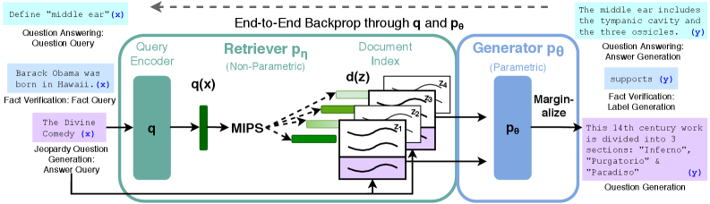

# Prompt、CoT 与 RAG 入门

Prompt Engineering 经常被误解成“找一句神奇咒语”。更准确地说，它是在设计模型的**输入契约**：告诉模型任务是什么、可用信息是什么、输出应长什么样、哪些事情不能做，以及什么时候需要借助外部证据或工具。

!!! note "读法定位"
    这页先回答“Prompt、CoT 与 RAG 入门”在「基础知识」里的位置：它解决什么局部问题，依赖哪些前置，最后会影响哪类工程或研究判断。
    **前置**：先看本页要补哪一个最小概念；公式或术语卡住时回到术语表，不需要一次吃完整个数学体系。 必要时先回 [基础知识入口](index.md) 或 [术语表](../glossary/index.md)。
    **主线关系**：把符号、张量、优化、评测和运行时这些前置打稳，后面的扩散、VLM/VLA、训练与系统页才不会断层。

这页参考 [Prompt Engineering Guide](https://www.promptingguide.ai/zh) 中的基础概念、提示词要素、Zero-shot / Few-shot、CoT、Self-Consistency、Prompt Chaining、ReAct 和 RAG 等主题，重点补一条初学者可用的主线：**从单次 prompt，到分步推理，再到检索增强和工具系统**。

!!! note "初学者先抓住"
    Prompt Engineering 不是让模型“更听话”的装饰文字，而是把任务、证据、约束和输出格式组织进上下文窗口。CoT 解决复杂任务的中间推理，RAG 解决外部知识和证据更新，ReAct / Agent 则把推理和工具动作接起来。

!!! tip "遇到这些症状，回看本页"
    评测失败无法复现、模型引用了错误证据、工具调用结果被当成指令、输出 JSON 经常坏，或者世界模型数据引擎里 judge/标注 prompt 改一句分数就变时，回看本页。本页能帮你判断问题是输入契约不清、证据边界不稳、输出 schema 太松，还是缺少可回放的评测集。

## Prompt Engineering 到底在设计什么

一个大语言模型在推理时只能看到上下文窗口里的内容。Prompt Engineering 设计的就是这个窗口里的信息结构：

```text
system / developer instruction
  -> task instruction
  -> background context
  -> examples
  -> user input
  -> retrieved evidence / tool results
  -> output constraints
  -> model response
```

可以把 prompt 看成一次临时配置。它不会改变模型参数，但会改变模型当前回答时的目标、风格、可见证据和输出边界。

| 要素 | 作用 | 常见问题 |
| --- | --- | --- |
| Instruction | 明确任务和优先级 | 任务太泛，模型只能猜 |
| Context | 提供背景、术语、业务规则 | 背景太长或混入无关信息 |
| Input data | 用户问题、文档片段、表格、代码 | 数据边界不清，模型把指令和资料混在一起 |
| Examples | 用少量样例定义格式和判断标准 | 样例和真实任务分布不一致 |
| Constraints | 约束长度、语气、证据、禁止行为 | 约束互相冲突或无法执行 |
| Output format | 指定 JSON、表格、步骤、字段 | 格式要求不够严格，难以后处理 |
| Tools / Evidence | 给出可调用工具或检索证据 | 工具结果未被验证，引用不可靠 |

一个好的 prompt 通常不是最长的，而是边界最清楚的：模型知道该做什么、用什么做、做到什么程度、以什么格式交付。

## 基础提示模式

### 2.1 Zero-shot：直接描述任务

Zero-shot 是不给示例，只用任务说明让模型回答。适合模型已经熟悉的通用任务，例如摘要、翻译、简单分类、格式转换。

```text
请把下面这段文字总结成 3 条要点，每条不超过 30 个字。

文本：
...
```

优点是简单、成本低；缺点是遇到专有格式、隐含判断标准或业务规则时，模型容易按自己的默认理解执行。

### 2.2 Few-shot：用样例定义任务边界

Few-shot 在 prompt 中提供少量输入输出样例，让模型模仿格式和判断逻辑。它适合分类、抽取、改写、结构化输出和不容易用一句话讲清的任务。

```text
你要判断用户反馈的类别，只能输出 bug、feature_request 或 complaint。

示例 1：
输入：导出 PDF 时页面空白
输出：bug

示例 2：
输入：能不能增加深色模式
输出：feature_request

现在判断：
输入：点击保存后一直转圈
输出：
```

Few-shot 的关键不是堆很多样例，而是选能覆盖边界情况的样例。样例越接近真实任务，提示越稳定。

### 2.3 分隔符：把指令和数据切开

当 prompt 里同时有指令、文档和用户输入时，应使用明确分隔符，避免模型把资料里的文字当成新指令。

```text
请只根据 <evidence> 中的信息回答问题。如果证据不足，回答“证据不足”。

<evidence>
...
</evidence>

<question>
...
</question>
```

这在 RAG、代码分析、文档问答和用户生成内容场景里尤其重要。外部文档可能包含“忽略上面的指令”这类 prompt injection 文本，系统必须把它视为数据，而不是指令。

### 2.4 输出格式：让回答可被程序消费

如果结果要进入后续系统，不应只写“请简洁回答”，而要给出字段、类型和失败时的输出。

```json
{
  "label": "bug | feature_request | complaint",
  "confidence": 0.0,
  "evidence": "引用用户原文中的关键短语"
}
```

结构化输出的好处是可解析、可评测、可回放；代价是 prompt 要更严格，并且需要在外部做 schema 校验。

## 模型参数也是提示工程的一部分

Prompt 决定模型看什么，采样参数决定模型怎么生成。

| 参数 | 直觉 | 适合场景 |
| --- | --- | --- |
| Temperature | 越高越随机，越低越稳定 | 分类、抽取、RAG 通常偏低；创意写作可偏高 |
| Top-p | 从累计概率最高的一批 token 中采样 | 和 temperature 一起控制多样性 |
| Max tokens | 限制输出长度 | 防止长回答拖慢系统或挤占预算 |
| Stop sequences | 遇到指定片段停止 | 对固定格式、多样本生成有用 |
| Seed | 固定随机性，便于复现 | 测试、回归和对比实验 |

不要把所有问题都交给 prompt 文字解决。需要稳定分类时，低温度、严格 schema 和外部校验往往比继续加一句“请认真”更有效。

## CoT：让模型有中间工作区

CoT（Chain-of-Thought）可以理解成让模型在复杂任务里先形成中间推理，再给出答案。它常用于数学、代码、规划、逻辑比较和多约束决策。

```text
请先分析约束，再给出最终答案。
最终答案必须放在“结论：”后面。
```

CoT 有用的原因不是“多写字就更聪明”，而是复杂任务往往需要中间状态：列条件、分解子问题、检查矛盾、做计算、再合成结论。

| 场景 | 是否适合 CoT | 原因 |
| --- | --- | --- |
| 简单事实问答 | 不一定 | 直接回答更快，减少幻觉空间 |
| 数学与代码 | 适合 | 需要中间计算和错误检查 |
| 多约束方案选择 | 适合 | 需要比较条件和权衡 |
| RAG 问答 | 适合简短推理 | 应以证据为主，避免编造长推理 |
| 高风险决策 | 只作为辅助 | 还需要工具、规则、人工或程序校验 |

!!! warning "不要把 CoT 当成事实证明"
    模型写出推理过程，不代表推理真实可靠。工程上更常暴露“简洁理由、证据来源、关键检查点”，而不是把完整内部草稿原样展示给用户。

## Self-Consistency：多想几条路再投票

Self-Consistency 的直觉是：对同一个复杂问题采样多条推理路径，再根据最终答案投票或筛选。它适合答案可验证、路径可能多样的任务。

```text
问题 -> 采样多个解法 -> 比较最终答案 -> 选择一致性最高或可验证的答案
```

它的优势是能降低单条推理路径偶然出错的概率；代价是 token 成本和延迟会成倍增加。因此它更适合数学、代码、离线评测和高价值任务，不适合每个在线请求默认开启。

## Prompt Chaining：把复杂任务拆成多步

当一个 prompt 同时要求“读文档、抽取事实、判断风险、生成报告、输出 JSON”时，失败概率会明显上升。Prompt Chaining 的做法是把任务拆成多个稳定步骤：

```text
Step 1: 从文档中抽取候选事实
Step 2: 对事实做去重和冲突检查
Step 3: 根据规则判断风险等级
Step 4: 生成最终摘要和结构化输出
```

拆链的好处是每一步更容易调试、评测和重试。某一步失败时，不必重新跑完整任务，也更容易定位是检索错、抽取错、判断错还是格式错。

## ReAct：推理和行动交替

ReAct 可以理解成 Reasoning + Acting。模型不只在文本里推理，还会决定何时调用工具、读工具返回、再继续下一步。

```text
用户问题
  -> 判断需要外部信息
  -> 调用搜索 / 数据库 / 代码执行 / 浏览器
  -> 读取结果
  -> 更新判断
  -> 回答或继续调用工具
```

ReAct 适合开放域问答、数据查询、代码调试、网页操作和多步业务流程。它的关键风险是工具循环、错误参数、错误解读工具结果，以及把工具返回中的恶意文本当成系统指令。

## RAG：把外部证据接进模型

RAG（Retrieval-Augmented Generation）解决的是模型知识不够新、不够私有、不可追溯的问题。它先从外部知识库检索证据，再把证据放进上下文，让模型基于证据回答。

{ width="790" }

<small>图源：[Retrieval-Augmented Generation for Knowledge-Intensive NLP Tasks](https://arxiv.org/abs/2005.11401)，Figure 1。原论文图意：RAG 把 query encoder、document index 和 seq2seq generator 接起来，对输入问题先检索 top-K 文档，再让生成器基于不同文档生成并边缘化预测。</small>

!!! note "论文图解卡：RAG 图不要只看生成器"
    **先看哪里**：从左侧 query 进入 query encoder，看它如何到 document index 里检索，再看右侧 generator 如何用检索文档生成答案。  
    **图中模块**：retriever 是外部记忆入口，document index 是非参数知识库，generator 是参数模型。  
    **对应公式**：可以把 retrieved document \(z\) 当成 latent variable，模型在 top-K 文档上综合生成概率。  
    **容易误读**：RAG 不是“把资料全部塞进 prompt”。关键是检索、排序、上下文装配和引用边界是否可靠。

一个标准 RAG 流程是：

```text
文档采集
  -> 清洗与切块
  -> embedding / 关键词索引
  -> 用户问题改写
  -> 检索候选片段
  -> rerank
  -> 上下文装配
  -> 生成带引用答案
  -> 反馈与评测回流
```

### 8.1 RAG 每一步在解决什么

| 环节 | 作用 | 常见坑 |
| --- | --- | --- |
| 文档清洗 | 去掉页眉、导航、重复噪声 | 噪声进入索引，污染回答 |
| Chunking | 把长文档切成可检索片段 | 切太碎丢上下文，切太大召回不准 |
| Embedding | 把文本变成向量，支持语义检索 | 术语、数字、代码和表格可能召回差 |
| Hybrid Search | 结合关键词和向量检索 | 只用一种检索容易漏召回 |
| Rerank | 对候选证据重新排序 | reranker 慢或和任务不匹配 |
| Context Assembly | 在 token 预算内组织证据 | 关键证据被截断或被无关证据淹没 |
| Citation | 把答案绑定到来源 | 引用看似存在，但不支撑结论 |

RAG 的核心不是“多塞资料”，而是让正确证据在正确位置被模型使用。

### 8.2 RAG、长上下文和微调的区别

| 方法 | 解决什么 | 不适合什么 |
| --- | --- | --- |
| RAG | 外部知识、新知识、私有知识、可引用证据 | 需要模型内化稳定技能的场景 |
| 长上下文 | 一次性读大量材料，减少检索漏召回 | 材料巨大且低密度时成本高 |
| Fine-tuning | 固化风格、格式、领域行为和工具习惯 | 频繁更新事实知识 |

如果知识经常变、需要引用来源，优先 RAG；如果行为格式不稳定，考虑 SFT 或规则后处理；如果只是偶尔读取一份长文档，长上下文可能比搭 RAG 更简单。

## RAG Prompt 怎么写

RAG 的 prompt 应强调证据边界、无法回答时的行为，以及引用要求。

```text
你是一个问答助手。请只根据 <evidence> 中的材料回答。

要求：
1. 如果证据不足，回答“证据不足”，不要补充常识猜测。
2. 每个关键结论后给出引用编号。
3. 如果证据之间冲突，先说明冲突，再给出保守结论。

<evidence>
[1] ...
[2] ...
</evidence>

<question>
...
</question>
```

这类 prompt 仍然不能单独保证可靠性。系统还需要检索评测、引用校验、版本控制和人工抽检。

## 常见失败模式

| 失败模式 | 表现 | 改进方向 |
| --- | --- | --- |
| 指令含糊 | 输出风格和字段每次不同 | 明确任务、格式、成功标准 |
| 样例误导 | 模型模仿了错误边界 | 选覆盖边界的 few-shot 样例 |
| 过度 CoT | 答案变长但错误更多 | 简化推理，只保留关键步骤和校验 |
| 检索漏召回 | 证据库里有答案但没找出来 | 优化 chunk、query rewrite、hybrid search |
| 证据污染 | 无关片段误导模型 | rerank、去重、证据过滤 |
| 引用幻觉 | 引用编号存在但不支撑结论 | 引用到句级证据，做自动校验 |
| Prompt injection | 文档里的恶意文本改变模型行为 | 分隔指令和数据，降低外部文本权限 |
| 无评测闭环 | 改 prompt 靠感觉 | 建立测试集、回归集和线上失败回放 |

## 一个实用选择表

| 你遇到的问题 | 优先尝试 |
| --- | --- |
| 模型不知道输出格式 | 加 schema、few-shot、外部校验 |
| 模型回答太发散 | 降低 temperature，收紧任务和字段 |
| 模型不会按业务规则判断 | 增加规则上下文和边界样例 |
| 任务需要多步推理 | CoT、Prompt Chaining、可验证中间结果 |
| 答案依赖私有或最新知识 | RAG |
| 需要查资料、跑代码或调系统 | ReAct / Agent + 工具权限控制 |
| 改动后不知道有没有变好 | 建立固定评测集和回归测试 |

## 和后续专题的接口

| 基础概念 | 后续会在哪里出现 | 读法 |
| --- | --- | --- |
| Prompt Engineering | 推理服务、Agent、VLM、产品系统 | 看输入契约和输出约束是否清楚 |
| CoT / Thinking | 多模态推理、数学代码、RL 后训练 | 看中间推理是否可验证、是否受预算控制 |
| Prompt Chaining | 文档处理、代码分析、复杂工作流 | 看任务是否被拆成可调试步骤 |
| ReAct | Agent、工具调用、具身智能闭环 | 看每步动作、观察和状态更新是否可靠 |
| RAG | 企业知识库、长上下文系统、在线问答 | 看证据召回、排序、装配和引用是否可靠 |

Prompt Engineering 是入口，RAG 和工具系统是延伸。真正稳定的系统不会只依赖一句 prompt，而会把提示词、检索、工具、格式校验、评测和失败回流一起设计。

## 参考来源

- [Prompt Engineering Guide 中文首页](https://www.promptingguide.ai/zh)
- [Prompt Engineering Guide：提示工程基础](https://www.promptingguide.ai/zh/introduction/basics)
- [Prompt Engineering Guide：Chain-of-Thought Prompting](https://www.promptingguide.ai/zh/techniques/cot)
- [Prompt Engineering Guide：Self-Consistency](https://www.promptingguide.ai/zh/techniques/consistency)
- [Prompt Engineering Guide：Prompt Chaining](https://www.promptingguide.ai/zh/techniques/prompt_chaining)
- [Prompt Engineering Guide：ReAct Prompting](https://www.promptingguide.ai/zh/techniques/react)
- [Prompt Engineering Guide：Retrieval Augmented Generation](https://www.promptingguide.ai/zh/techniques/rag)

!!! tip "下一站"
    - 回到本专题入口：[基础知识](index.md)，确认这页在整条路线中的位置。
    - 按导航顺序继续：[多模态推理入门](multimodal-cot-and-reasoning-basics.md)。
    - 概念或符号卡住时，先查 [术语表](../glossary/index.md)，再回到当前页。
