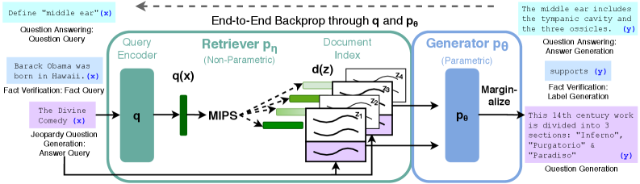
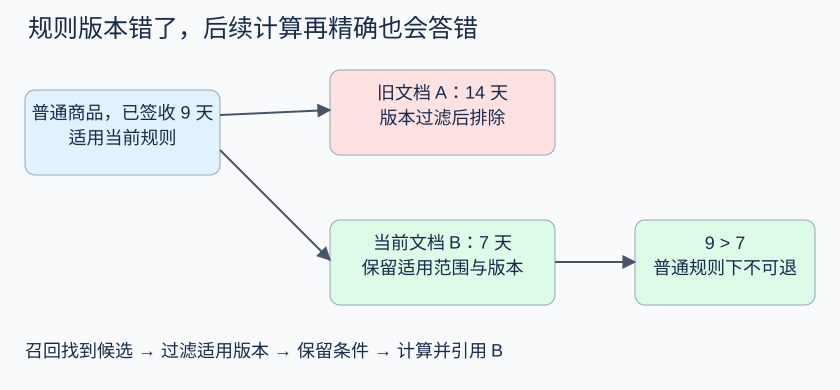

# Prompt、推理步骤与检索增强

用户问“我上周买的商品还能退吗”，模型需要知道购买日期、商品类型和适用规则。把提示词写得更有气势，不会补出这些缺失信息。一个可检查的问答流程要先确定问题，再找到规则，最后根据条件得出答案。

用三份虚构文档演示这个过程。文档 A 是旧版规则，普通商品签收后 14 天可申请；文档 B 是当前规则，普通商品签收后 7 天可申请；文档 C 规定定制商品不能按普通规则处理。它们分别包含版本、生效日期和商品范围。假设用户的订单在当前规则下，签收已 9 天，商品为普通商品。

## Prompt 把任务与已有信息组织起来

一次模型调用可以包含任务说明、用户问题、订单字段、检索证据和输出要求。这些内容各有角色，混在一个长段落里会增加歧义。最小有效输入应明确“按给定规则判断”，并提供签收天数与商品类型。

例如要求输出 `eligible`、`reason`、`source_id` 三个字段，能使后续程序稳定解析。但 schema 只限制形式，模型仍可能填 `eligible=true` 并引用旧规则。格式正确和结论正确必须分别判断。

Few-shot 示例可展示字段和判定边界。若示例全部是可退案例，模型可能形成不适合拒绝案例的偏好；示例长度、类别和边界覆盖都会影响行为。它们是上下文中的条件，通常不改变模型权重。

## 检索先决定能看见哪些证据

用户的原话可能没有“签收日期”和“退款规则”这些精确词。Query rewrite 可以将问题与订单字段组合成更明确的检索请求，但应保留原意，不能把未知商品类别擅自补成“普通商品”。

召回阶段可以使用关键词、向量或混合检索。关键词擅长精确编号和版本，向量有助于找同义表达。它们返回的是相关候选，不是已证明适用的证据。A、B 两份规则文字非常相似，语义相似度甚至可能无法区分。

因此版本和范围过滤不能只依赖 embedding。先依据订单时间选择适用版本，再保留商品范围匹配的条款。若召回只找到 A，生成模型即使完全忠于上下文，也会得出错误结论。这个错误应归到证据缺失或过滤阶段。

{ width="820" }

<small>图源：[Retrieval-Augmented Generation for Knowledge-Intensive NLP Tasks](https://arxiv.org/abs/2005.11401)，Figure 1。</small>

沿左侧 query encoder 走到中间 document index，再看候选文档如何进入右侧 generator。本文的 A、B、C 就是需要筛选的候选。原论文还联合建模检索概率与生成概率；图中的端到端训练路径，不应直接套到所有工程 RAG 系统。

## 切块不能丢掉限定条件

假设 B 的一段写“签收后 7 天内可申请”，下一句写“仅适用于普通商品”。如果切成两个互不关联的 chunk，只召回第一句，定制商品就可能被错误放行。

一个证据片段应保留必要的标题、版本、范围和例外。片段太短会断开条件，太长又增加噪声与上下文占用。不存在适合全部文档的固定 chunk 大小，应在具体问题上检查召回与答案。

Rerank 可以对问题和候选片段联合打分，改善排序，但它不能找回召回阶段完全遗漏的 B。因此诊断时先看候选池有没有正确证据，再看排序和截断是否把它留下。

## 生成时把结论绑定到证据

在本例中，适用 B，普通商品且签收 9 天，超过 7 天，所以不能按这条普通规则申请。答案应说明依据和条件；若订单类型未知，就还不能完成判断。

引文需要支持具体结论。只在段末附一个真实链接，不表示该链接里的条款支持本次判断。可以把回答拆成“适用版本”“商品范围”“天数比较”三个可核查陈述，再检查各自来源。

```python
order = {'days_since_receipt': 9, 'kind': 'ordinary', 'policy_version': 'current'}
policies = [
    {'id':'A', 'version':'old', 'kind':'ordinary', 'days':14},
    {'id':'B', 'version':'current', 'kind':'ordinary', 'days':7},
]
matches = [p for p in policies if p['version']==order['policy_version']
           and p['kind']==order['kind']]
assert len(matches) == 1
rule = matches[0]
print({'eligible':order['days_since_receipt'] <= rule['days'], 'source_id':rule['id']})
```

输出 `{'eligible': False, 'source_id': 'B'}`。这段离线规则代码只演示判定条件，不是完整 RAG 实现。它也说明有些最终步骤适合交给确定性计算，语言模型可负责解析和解释，但不要重复凭自然语言猜一次大小比较。



## CoT、投票与验证各自增加什么

中间推理步骤可以把版本选择、日期计算和规则应用显式分开，便于检查错误。然而一串流畅步骤仍可能基于错误文档，不能把长解释当作事实证据。公开的解释也不保证忠实反映模型内部计算。

Self-consistency 常对多次生成的最终答案进行汇总投票；验证器则按外部规则给候选打分。这是两种不同选择机制。五次都使用旧规则，投票只会稳定地重复错误；具有正确订单日期和规则版本的验证器才有机会纠正它。

将大任务拆成多步调用，可以定位错误，但也增加成本和错误传播。前一步若输出错误版本，后一步再精确推理也无法补救。保存每一步的输入、证据与结果，比只保存最终回答更利于诊断。

## Agent 把工具结果加入下一次决策

当系统需要查询订单时，模型可以生成工具调用，程序校验参数并执行，工具结果再进入上下文。运行状态至少要区分“请求已发出”“工具成功返回”“结果缺失或失败”。模型写了一句“已查询”，不等于工具实际执行成功。

外部文档可能包含与任务无关的指令，结构化分隔和明确角色有帮助，但不能保证消除 prompt injection。工具权限和参数校验应由程序控制，不能仅依靠文档中的自然语言约束。这里的目标是让事实证据影响答案，而非让证据文档获得系统控制权。

## 怎样定位一个有引用的错误答案

先保存原始问题和实际输入，检查正确文档是否在候选池中。若没有，处理召回、版本索引和权限；若有但未进入上下文，处理 rerank、去重和截断；若证据已完整进入，再检查条件理解、计算和引用绑定。这样才能区分“缺知识”和“没用好已有知识”。

评估集应包含版本变化、例外条款、无答案和工具失败，而非只放可以直接摘抄的一句话问题。检索 recall、答案正确、引文支持率、拒答行为和成本分别反映不同阶段，单一总分很难指导修复。

## 资料与后续实现

- [Retrieval-Augmented Generation](https://arxiv.org/abs/2005.11401)讨论检索文档与生成概率的组合；现代工程 RAG 不都实现论文中的同一个概率边缘化目标。
- [Self-Consistency](https://arxiv.org/abs/2203.11171)讨论多条推理样本的答案汇总。
- [ReAct](https://arxiv.org/abs/2210.03629)展示推理与环境动作交替的任务流程。
- [RAG、Agent 与长上下文系统](../inference/rag-agents-and-long-context-systems.md)进一步展开运行状态、缓存和评测。
