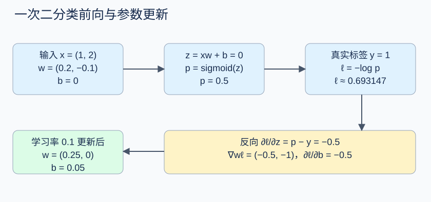
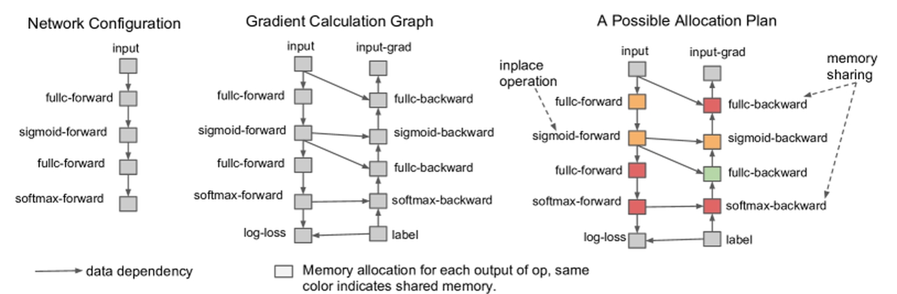

# 用一个分类器读懂公式

读公式时最容易卡在字母太多。这里要解决的问题是，先判断每个符号在这次计算里代表输入、参数、中间结果还是目标，再把它们放进同一条数据流，免得孤立地背符号。

设我们根据两个特征判断一条请求是否需要人工介入。输入为行向量 \(x=(1,2)\)，权重为列向量 \(w=(0.2,-0.1)^\top\)，偏置 \(b=0\)。这组数只用于演算，不代表实际特征或可部署模型。

## 从样本到一个分数

模型先算 \(z=xw+b=0\)。这里 \(x\) 是已知输入，\(w,b\) 是训练要调整的参数，\(z\) 是由两者算出的中间值。把全部参数统称为 \(\theta\)，就可简写为 \(z=f_\theta(x)\)。下标 \(\theta\) 提醒我们，函数的具体形状由参数决定。

若有 \(B\) 条样本，每条 \(d\) 个特征，把输入排成 \(X\in\mathbb R^{B\times d}\)，权重排成 \(W\in\mathbb R^{d\times C}\)，就能一次输出 \(C\) 类分数。符号 \(\in\) 表示“属于”，\(\mathbb R\) 表示实数，右上角是矩阵尺寸，不是幂。

矩阵乘法 \(Z=XW\) 的元素含义是 \(Z_{ic}=\sum_{j=1}^dX_{ij}W_{jc}\)。\(i\) 遍历样本，\(j\) 遍历输入特征，\(c\) 遍历输出类别。求和消去的是中间特征轴，输出剩下样本和类别两轴。

## 分数还需要变成概率

二分类可用 sigmoid，\(p=\sigma(z)=1/(1+e^{-z})\)。当前 \(z=0\)，所以 \(p=0.5\)。它描述模型对正类的预测概率，是否可靠需要评估；参数化成概率不等于已经校准。

多分类使用 softmax，\(p_c=e^{z_c}/\sum_j e^{z_j}\)。分母对同一条样本的所有类别求和，使概率总和为 1。每个 logit 都影响分母，因此提高一个类别分数时，其他概率通常也会变化。

实现会先从各 logit 减去同一个最大值再指数化，避免过大指数溢出。这个平移不改变概率，因为分子分母同时乘上相同因子。

把这一步写成 `logsumexp` 会更容易读懂数值稳定性。令 (m=max_j z_j)，则

\[
\log\sum_j e^{z_j}=m+\log\sum_j e^{z_j-m}.
\]

指数里的 (z_j-m) 不大于零，至少避免了正向溢出。softmax 的实现还可能在内部保留更高精度，尤其是输入来自低精度矩阵乘时。只检查输出概率是否加和为 1，不足以证明没有发生截断或下溢。

多分类交叉熵可以直接写成

\[
\ell(z,y)=\log\sum_j e^{z_j}-z_y.
\]

它和 `softmax` 后再取 `-log` 在数学上等价，但实现通常使用 fused `log_softmax` 与 `nll_loss`，避免先显式保存概率。这里的 `y` 是目标类别索引，不是一个需要与 logits 逐元素相乘的浮点向量；若使用 one-hot 标签，归约式会改写，但最终梯度仍与选中类别的误差对应。

## 一个标签怎样变成 loss

设真实标签 \(y=1\)，二元交叉熵是

\[
\ell=-y\log p-(1-y)\log(1-p).
\]

当前损失为 \(-\log0.5=0.693147\)。若 \(y=0\)，则惩罚正类概率过高。这里 log 通常取自然对数；更换底数会改变损失尺度。

多个样本的平均损失写作 \(\mathcal L=\frac1B\sum_i\ell_i\)。求和和平均只差常数，但会影响梯度尺度。带 mask 时，分母应与目标的归约方式一致，可能是有效 token 数，也可能先按序列平均。

例如两个样本的有效 token 数为 2 和 8，token 级损失总和分别为 1 和 2。按所有 token 等权，平均损失是 \((1+2)/(2+8)=0.3\)；先对每条序列取平均再对序列平均，则是 \((1/2+2/8)/2=0.625\)。两种结果都可以是有意设计，但它们给长短样本的权重不同。训练日志应同时记录 loss、有效 token 数和归约方式，不能只保存一个没有分母的标量。



## 梯度告诉参数该怎样改

交叉熵与 sigmoid 合起来，对分数的导数为 \(p-y=-0.5\)。链式法则继续给出

\[
\nabla_w\ell=x^\top(p-y)=(-0.5,-1)^\top,
\qquad \partial_b\ell=-0.5.
\]

\(\partial\) 表示其他变量固定时的偏导，\(\nabla\) 把对多个参数的偏导排列成向量。梯度的 shape 与对应参数相同。

取学习率 \(\eta=0.1\)，用 \(w\leftarrow w-\eta\nabla_w\ell\) 更新，得到 \(w=(0.25,0)^\top,b=0.05\)。同一输入的新分数为 0.3，新概率约 0.574443，损失降到约 0.554355。一次局部改进不保证在所有样本上都更好。

```python
import math
x, w, b, y, lr = [1.,2.], [.2,-.1], 0., 1., .1
z = sum(a*c for a,c in zip(x,w))+b
p = 1/(1+math.exp(-z))
w = [wi-lr*(p-y)*xi for wi,xi in zip(w,x)]
b -= lr*(p-y)
z_new = sum(a*c for a,c in zip(x,w))+b
p_new = 1/(1+math.exp(-z_new))
print(w, round(b,6), round(p_new,6), round(-math.log(p_new),6))
```

{ width="820" }

<small>图源：[Training Deep Nets with Sublinear Memory Cost](https://arxiv.org/abs/1604.06174)，Figure 1。</small>

左图给出计算步骤，中图增加反向需要的依赖，右图展示一种内存分配方案。梯度计算要读取某些前向值，因此“参数存得下”并不保证训练存得下；保存与重算的取舍会在自动微分一章展开。

## 期望、条件与时间下标改变了平均对象

\(\mathbb E_{(x,y)\sim P}[\ell]\) 表示从分布 P 抽取样本后平均损失，\(\sim\) 表示“服从或从中采样”。训练集平均只是这个未知总体平均的一个估计。若改变采样比例，所优化的平均也可能改变。

\(p(y\mid x)\) 中的竖线表示给定 x 的条件分布；它既不是除法，也不自动表示 x 导致 y。序列中的 \(p(x_t\mid x_{<t})\) 则明确第 t 个 token 只能依赖此前前缀。\(x_{<t}\) 是一组历史值，不是一个额外可训练参数。

KL、正则化和约束会在这个基本目标上增加条件。比如 \(\mathcal L+\lambda\|w\|^2/2\) 给梯度增加 \(\lambda w\)，而“\(\|w\|\le c\)”是可行范围要求，两者不能直接当成相同规则。进一步推导见[数学工具](../prerequisite-math/index.md)。

## 对照更大的网络

- [D2L 线性回归](https://github.com/d2l-ai/d2l-zh/blob/e6b18ccea71451a55fcd861d7b96fddf2587b09a/chapter_linear-networks/linear-regression.md)，保持同一预测任务逐步引入样本、权重、损失和小批量梯度。

[张量与计算图](tensors-shapes-and-computation-graphs.md)把这些标量换成有明确轴的数组，[自动微分](autograd-activation-checkpointing-and-memory.md)解释程序怎样自动完成这里的链式法则。

{ width="820" }

<small>图源：[Attention Is All You Need](https://arxiv.org/abs/1706.03762)，Figure 1。</small>

从底部 embedding 向上读，每个箭头都携带张量。注意左侧 encoder 输出还进入右侧 cross-attention，而右侧 masked self-attention 使用目标前缀。这是 encoder-decoder 架构，不能把它直接当成所有 decoder-only 模型的结构。

## 练习与自测

1. 对 logits `[2, 0, -1]`，计算稳定 softmax 以及标签为 1 时的交叉熵。
2. 证明给所有 logits 加同一个常数不会改变 softmax。
3. 两条序列的有效 token 数为 2 和 8，分别给出 token 平均与序列平均的损失分母。
4. 解释为什么把类别编号 `[0, 1, 2]` 直接当作连续特征，会给模型引入一个并不存在的距离关系。

每题都应能回到一个元素级公式。公式写不清时，先回到[张量、Shape 与计算图](tensors-shapes-and-computation-graphs.md)确认轴和归约，再进入 Transformer 或量化页面。
